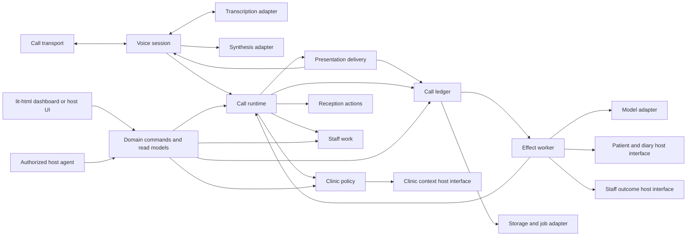
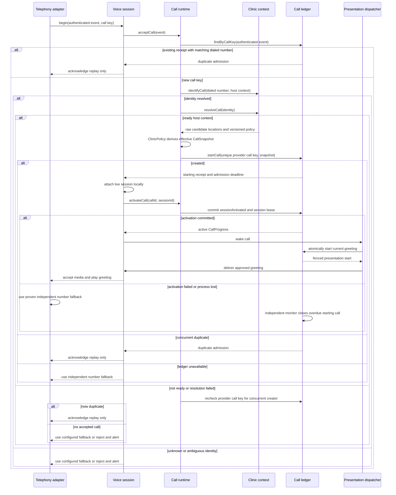

# Abby technical design

The [booking revision](docs/adr/0002-provider-acknowledged-booking.md) requires the full individual request/acknowledgement interval and finishes patient, policy, catalogue, review and quota preparation before final online/roster availability. `resolveForSend` preserves ordinary protected proposal/reschedule read checks while avoiding awaited preparation after the final observation. Native class creation completes pass/history, permission, metadata and proof preparation before `inspectForSend` performs the complete double occurrence/attendance observation; ordinary protected reads and moves retain their existing bracketing. Only local expiry/proof/lifetime/request checks precede POST. This includes the exact session-lease deadline observed during preparation; it must still be live after the final read and at dispatch. A renewal observed before final availability supplies its current deadline; an unobserved renewal cannot extend this captured send window. No additional lease/policy read or new timer follows availability. A validated individual or class creation acknowledgement is published synchronously through the host to the worker, preserving its result through later wrapper cancellation without changing action/lease validation or other operations. Creation has no post-write GET/conflict/case-use success gate. An absent optional case property in an ordinary attendee response does not prove unlinked staging; moves keep the separate native null-filter inspection. Older E2E entries below describe their dated evidence, not a requirement to restore creation post-write vetoes.

**Status:** Proposed design for implementation review. The [phone-index and patient-data boundary](phase-0/PHONE_INDEX_AND_PRIVACY_GATE.md) is a binding amendment; existing rich ledger payloads remain an implementation blocker.

**Product contract:** [PRD.md](PRD.md), version dated 2026-09-28

**Scope:** Inbound receptionist, Abby-owned real-time voice session, standalone Cliniko and Splose adapters, and an in-process reference host. This document specifies the interfaces and consequential call paths for version 1. TypeScript shapes are illustrative contracts; the PRD's caller-facing and safety requirements take precedence if a shape here proves inadequate.

**Composition scope for call durability:** D-06/D-11 make standalone Cliniko call ownership and SAM state transient. PostgreSQL session advisory locks coordinate only *active* calls across servers and contain no durable call key; after process loss a signed replay may be admitted and prior call state cannot be reconstructed. The provider route must deliver a proven clinic-approved fallback on such loss before patient traffic. Sections below describing durable call receipts, T1–T4, presentation recovery, persistent leases, outbox, and independent expiry monitoring specify the authorized embedded host contract and its reference fixture. Standalone Cliniko applies the same domain and voice semantics within one live process, with no call, effect, presentation, or patient-linked outcome rows. Its patient-specific durable work may exist only in an approved Cliniko workflow. Tests and readiness must state which composition and guarantee they prove.

**Clinic-admin identity (D-14):** Standalone sign-in and embedded host sessions terminate at the same identity adapter. The adapter verifies the authenticated subject and resolves authoritative clinic membership and role before constructing a `HostActor`; browser-submitted scope, role or actor headers are never that authority. Standalone Abby implements email magic links: PostgreSQL stores only token/session digests, opaque administrator references, membership digests and bounded throttle metadata. Explicit confirmation precedes atomic single-use redemption, and current trusted directory membership is rechecked on every request. The standalone Cliniko composition also clamps account lookup to its configured location before delivery or authority. No hosted identity provider is required. In an acquired in-process composition, the buyer supplies its existing session and role system, without separate Abby accounts or changes to core commands; Abby login state is excluded from portability archives. Revoked sessions and memberships must cease to authorize subsequent requests. API keys for Cliniko or Splose remain PMS integration credentials. A publicly documented Cliniko OIDC/OAuth external sign-in flow was not found in the 2026-10-02 documentation check; this design does not depend on one. Email delivery remains an injected port with no selected service, and final local release plus production deployment evidence remain open. See [the sign-in contract](phase-2/STANDALONE_MAGIC_LINK_IDENTITY.md).

**Caller email verification (D-17):** The selected standalone verifier is email OTP, separate from administrator sign-in. Its trusted call owner supplies exactly one fresh phone candidate, reads the registered Cliniko address and current phone by ID, and handles the answer outside model context. One challenge allows three answers within five minutes; a successful answer yields a single-use scope/call/session/patient/operation/policy-bound token for the existing proof host. Candidate, contact and policy rechecks precede attestation; a separate trusted permission port rechecks current patient/action authority (including self/proxy/minor restrictions) at issue, answer and attestation, and code possession never supplies that permission; disconnect/process loss revokes the volatile state. PostgreSQL persists only clinic-wide issue/answer counters in fixed five-minute windows (30/90), shared across locations and processes, without patient/address/phone/call keys or their hashes. Boundary bursts and denial of service affect this coarse limit; it is not a per-patient guarantee. Actual clinic approval, mail delivery/retention policy and runner/text command integration remain required. E2E-269 is local synthetic-mail text/provider/PostgreSQL evidence; no caller capability is activated.

## 1. Design rules

1. Abby's core is a headless set of deep modules. The standalone application and an acquiring monolith compose those modules in-process. Neither calls an Abby-hosted server to make a reception decision.
2. The host owns patient identity, intake, appointments, offers, opening hours, staff destinations, notification policy, and authorization. Abby owns conversation decisions, action evidence, call state, and the receptionist-specific audit trail.
3. An external model proposes typed actions. A deterministic acceptor checks policy, host evidence, caller confirmation, and capability before any consequential effect is dispatched. Prompts and vendor assistant configuration never become the source of appointment truth.
4. A call's policy, approved knowledge, and capability snapshot is versioned at call start. Later administrative edits affect later calls. An active-call override requires its own audited action.
5. A host write is confirmed to a caller only from a committed action receipt for that exact action. A timeout after dispatch is uncertain, even if the provider response is lost. An uncertain write is reconciled or sent to staff; it is never retried blindly.
6. In an authorized embedded host, every durable transition, consequential effect intent, receipt, and staff outcome is tenant-scoped and replay-safe. The browser, an authorized host agent, and jobs use the same domain commands.
7. New behavior and settings ship with a mapped E2E scenario. The deterministic corpus runs against the standalone adapters and reference host, with provider differences represented as capabilities rather than provider branches in the core.
8. Abby owns turn timing, interruption, playback completion, and transfer control in one transient voice session per call. The session may use hosted telephony, transcription, and synthesis, but only the SAM runtime decides what an utterance means or what Abby may say or do. Raw media frames are not replayed into the durable call aggregate.

### Deliberate implementation choices

| Concern | Standalone choice | Embedded host choice |
| --- | --- | --- |
| Language | TypeScript for core and standalone shell | Reuse TypeScript modules or port the versioned contracts if the host uses another language |
| Persistence | PostgreSQL, Kysely migrations and queries, Kanel-generated row types for policy, phone index, and transient active-call lock coordination; no standalone call ledger | Host database and migration system behind Abby's storage interface |
| Staff UI | Direct `lit-html` templates rendered by a small TypeScript controller | Host-native screens consuming the same commands and read models |
| Jobs | Only non-patient operational jobs in the standalone process family; Cliniko owns approved patient-specific durable work | Host worker system running the same effect and reconciliation jobs |
| Voice timing and playback | Abby-owned per-call voice session | Mount the same session in process with host-chosen media adapters |
| Telephony, transcription, synthesis, model | Replaceable provider adapters | Retain or replace adapters without changing voice-session or core decisions |

The Kysely and `lit-html` choices live in the standalone shell. Generated database types, HTTP request objects, UI templates, and provider payloads do not cross into core modules.

## 2. Module map and dependency direction

| Module | Interface for callers | Implementation it hides |
| --- | --- | --- |
| **Voice session** | Accept media/transcription events and approved presentations; return final turns and delivery outcomes | Per-call transient audio state, endpointing, interruption, playback marks, transfer control, disconnect cleanup |
| **Presentation delivery** | Start the call's current committed pending presentation through its attached live voice session; accept one fenced terminal result | Atomic start mark, lost-wake-up scan, no replay after possible output, terminal-result handoff to runtime |
| **Call runtime** | Accept a call event, caller turn, or authorized staff command; return durable progress and read models | Sole owner of the call aggregate, action and staff-item statuses, per-call SAM loop, sequencing, effect planning, duplicate detection, prompt/model version binding |
| **Reception actions** | Return plans, confirmation checks, and receipt/reconciliation interpretations to the call runtime | Pure evidence validation, offer expiry, caller confirmation, and safe-write decisions; no second action-state store |
| **Clinic policy** | Resolve a versioned call snapshot; change validated settings and approved knowledge | Setting registry, defaults, scope inheritance, readiness, policy versioning |
| **Staff work** | Return pure task-transition decisions to the call runtime | Staff task policy and valid lifecycle transitions; no direct host call or second staff-item state store |
| **Call ledger** | In the embedded host, atomically persist authorized transitions, effect references, delivery states, and terminal status; read a call and pending work | Event order, projections, outbox, replay, tenant keys, and export; no patient-specific content or independent action decisions |
| **Command gateway** | Describe permitted capabilities and submit typed staff/agent commands | Actor authorization, schema checks, approval binding, command audit, dispatch to owning modules |
| **Evaluation** | Run versioned scenarios against a composition | Fixture catalogue, conformance assertions, requirement/setting coverage manifest |

The core modules depend on small host and infrastructure interfaces. They do not import each other's tables or reach through one another to a provider SDK.



**Seam ownership:** the host interfaces express Abby's needed behavior, not a copy of a PMS SDK. Cliniko, Splose, and the reference host each implement them. A new method is justified by a real caller need or provider difference, rather than a speculative integration. The voice session owns ephemeral media timing, presentation delivery owns durable-to-live dispatch, and the call runtime is the sole business orchestrator and state owner for one call. Reception actions return pure decisions, the ledger persists accepted transitions, and staff work owns only its linked task lifecycle.

## 3. Canonical contracts

These types describe wire-safe, versionable values. All IDs are opaque, nonempty, and validated at ingress. A `PatientRef` is never inferred from a caller phone number. Timestamps are instants; location timezones are IANA identifiers. Versioned exports document their encoding separately from TypeScript.

```ts
type Result<Value, Failure> =
  | { readonly ok: true; readonly value: Value }
  | { readonly ok: false; readonly error: Failure };

type ClinicScope = Readonly<{
  tenantId: string;
  clinicId: string;
}>;
type LocationScope = ClinicScope & Readonly<{
  locationId: string;
}>;

type CallKey = Readonly<{ provider: string; providerAccountId: string; providerCallId: string }>;
type CallIdentity = Readonly<{ scope: ClinicScope; dialedNumber: string }>;
type ActionKey = string; // Stable for one intended write and payload digest.
type PolicyRef = Readonly<{ version: string; capturedAt: string }>;
type CapabilityDecision =
  | Readonly<{ mode: "execute" }>
  | Readonly<{ mode: "requestOnly"; reason: "hostUnsafe" | "hostUnavailable" | "policyRestricted" }>
  | Readonly<{ mode: "unavailable"; reason: "settingDisabled" | "hostUnsupported" | "readinessFailed" }>;

type CallSnapshot = Readonly<{
  clinic: ClinicScope;
  candidateLocations: readonly Readonly<{
    locationId: string;
    timezone: string;
    openingHoursVersion: string;
    approvedKnowledgeVersion: string;
    capabilityVersion: string;
    effectivePolicy: Readonly<{
      staffedCoverage: Readonly<{ startsAt: string; endsAt: string }>;
      staffedIntervals: readonly Readonly<{ startsAt: string; endsAt: string }>[];
      staffSchedule?: Readonly<{ scope: LocationScope; version: string; ownerRef: string; approved: true;
        effectiveFrom: string; effectiveUntil: string;
        timeZone: string; weekly: readonly Readonly<{ weekday: number; startMinute: number; endMinute: number }>[];
        closedDates: readonly string[] }>;
      capabilities: Readonly<Record<string, CapabilityDecision>>;
      afterHoursMode: "staffRequest" | "approvedInfoAndRequest";
      urgentResponse?: Readonly<{ scope: LocationScope; version: string; ownerRef: string;
        approvedText: string; approved: true; effectiveFrom: string; effectiveUntil: string }>;
      staffedDestinationRef?: string;
      staffTaskDestination?: StaffDestination;
    }>;
  }>[];
  policy: PolicyRef;
  effectiveClinicSettingsVersion: string;
  effectiveClinicSettings: Readonly<{
    automationEnabled: boolean;
    voiceLocale: string;
    voiceId: string;
    notificationOwnerByKind: Readonly<Record<string, "host" | "abby">>;
    operatorReviewQueueRef: string;
  }>;
  promptVersion: string;
  modelVersion: string;
}>;

type HostWriteReceipt =
  | { readonly kind: "committed"; readonly actionKey: ActionKey; readonly hostRef: string; readonly committedAt: string }
  | { readonly kind: "rejected"; readonly actionKey: ActionKey; readonly reason: "conflict" | "invalid" | "forbidden" | "expiredOffer" }
  | { readonly kind: "unsupported"; readonly actionKey: ActionKey; readonly capability: string }
  | { readonly kind: "uncertain"; readonly actionKey: ActionKey; readonly reconcileAfter: string; readonly deadline: string };

type HostWritePreDispatchFailure = Readonly<{ kind: "notSent"; stage: "beforeTransport"; reason: "unavailable" | "rateLimited" | "deadlineExceeded" }>;
type HostWriteOutcome = Result<HostWriteReceipt, HostWritePreDispatchFailure>;

type HostReadFailure =
  | { readonly kind: "notFound" }
  | { readonly kind: "ambiguousIdentity" }
  | { readonly kind: "forbidden" }
  | { readonly kind: "unavailable" }
  | { readonly kind: "rateLimited"; readonly retryAfter?: string }
  | { readonly kind: "deadlineExceeded" };

type DispatchFailure =
  | { readonly kind: "callUnknown" }
  | { readonly kind: "effectUnknown" }
  | { readonly kind: "tenantMismatch" }
  | { readonly kind: "callClosed" }
  | { readonly kind: "invalidEvent" }
  | { readonly kind: "leaseLost" }
  | { readonly kind: "actionSuperseded" }
  | { readonly kind: "emergencyStopped" }
  | { readonly kind: "ledgerUnavailable" };
type RetentionFailure =
  | { readonly kind: "notPermitted" }
  | { readonly kind: "staleVersion" }
  | { readonly kind: "ledgerUnavailable" };

type ClinicFailure =
  | { readonly kind: "unknownNumber" }
  | { readonly kind: "ambiguousClinic" }
  | { readonly kind: "automationDisabled" }
  | { readonly kind: "unavailable" };
type IntakeFailure =
  | { readonly kind: "invalidEvent" }
  | { readonly kind: "clinicResolution"; readonly cause: ClinicFailure }
  | { readonly kind: "ledgerUnavailable" };
type PlanFailure =
  | { readonly kind: "verificationRequired" }
  | { readonly kind: "evidenceMissing" }
  | { readonly kind: "unsupportedOperation" }
  | { readonly kind: "readUnavailable"; readonly cause: HostReadFailure };
type ConfirmationFailure =
  | { readonly kind: "confirmationMissing" }
  | { readonly kind: "confirmationExpired" }
  | { readonly kind: "digestChanged" }
  | { readonly kind: "forbidden" };
type PolicyFailure =
  | { readonly kind: "invalidValue" }
  | { readonly kind: "forbidden" }
  | { readonly kind: "versionConflict" }
  | { readonly kind: "unavailable" };
type StaffFailure =
  | { readonly kind: "forbiddenTransition" }
  | { readonly kind: "versionConflict" }
  | { readonly kind: "unavailable" };
type ReadFailure =
  | { readonly kind: "notFound" }
  | { readonly kind: "forbidden" }
  | { readonly kind: "unavailable" };
type ReconcileFailure =
  | { readonly kind: "hostUnavailable" }
  | { readonly kind: "evidenceInsufficient" };
type CapabilityFailure =
  | { readonly kind: "forbidden" }
  | { readonly kind: "invalidPayload" }
  | { readonly kind: "versionConflict" }
  | { readonly kind: "unavailable" }
  | { readonly kind: "pendingApproval" };

type CallReceipt = Readonly<{ callId: string; acceptedAt: string; admissionDeadline: string; stateVersion: number }>;
type CallLookup =
  | { readonly kind: "found"; readonly receipt: CallReceipt }
  | { readonly kind: "absent" };
type CallAdmission =
  | { readonly kind: "created"; readonly receipt: CallReceipt }
  | { readonly kind: "duplicate"; readonly receipt: CallReceipt };
type VoiceBeginResult =
  | { readonly kind: "attached"; readonly progress: VoiceProgress }
  | { readonly kind: "duplicate"; readonly callId: string };
type SessionLease = Readonly<{ sessionId: string; version: number; expiresAt: string; validForMs: number }>;
type CallProgress =
  | Readonly<{ callId: string; stateVersion: number; lifecycle: "active"; pendingEffects: number; sessionLease: SessionLease }>
  | Readonly<{ callId: string; stateVersion: number; lifecycle: "ended"; pendingEffects: number }>;
type ExpiredSessionRef =
  | Readonly<{ kind: "admission"; callId: string; stateVersion: number; admissionDeadline: string }>
  | Readonly<{ kind: "active"; callId: string; stateVersion: number; sessionId: string; leaseVersion: number; leaseExpiresAt: string }>;
type SendPermit = Readonly<{ effectId: string; leaseVersion: number; possiblySentAt: string }>;
type VoiceFailure =
  | { readonly kind: "sessionUnknown" }
  | { readonly kind: "intakeRejected"; readonly cause: IntakeFailure }
  | { readonly kind: "runtimeRejected"; readonly cause: DispatchFailure }
  | { readonly kind: "transportUnavailable" }
  | { readonly kind: "transcriptionUnavailable" }
  | { readonly kind: "synthesisUnavailable" }
  | { readonly kind: "deadlineExceeded" }
  | { readonly kind: "disconnected" }
  | { readonly kind: "deliveryBlocked" };
type VoiceDeliveryGate = Readonly<{ sessionId: string; generation: number }>;
type VoiceProgress = Readonly<{ sessionId: string; lifecycle: "listening" | "speaking" | "interrupting" | "transferring" | "ended" }>;
type MediaFrame = Readonly<{
  sessionId: string;
  sequence: number;
  capturedAt: string;
  bytes: Uint8Array;
}>;
type FinalCallerTurn = Readonly<{
  callId: string;
  sessionId: string;
  turnId: string;
  text: string;
  at: string;
  quality: "clear" | "needsClarification";
}>;
type TranscriptEvent =
  | { readonly kind: "partial"; readonly sessionId: string; readonly generation: number; readonly utteranceId: string; readonly text: string }
  | { readonly kind: "segmentFinal"; readonly sessionId: string; readonly generation: number; readonly utteranceId: string; readonly text: string; readonly quality: FinalCallerTurn["quality"] };
type StaffReason = "callerRequested" | "verificationFailed" | "unsupported" | "uncertainAction" | "partialIntake" | "clinicalUrgency" | "systemFailure" | "afterHours";
type StaffDestination =
  | Readonly<{ kind: "owner"; ownerRef: string }>
  | Readonly<{ kind: "queue"; queueRef: string }>;
type ModelProposal =
  | { readonly kind: "answer"; readonly sourceRefs: readonly string[]; readonly proposedText: string }
  | { readonly kind: "lookup"; readonly target: "patient" | "appointment" | "offer"; readonly statedName?: string; readonly statedDate?: string; readonly requestedService?: string; readonly requestedLocationId?: string }
  | { readonly kind: "action"; readonly operation: "intake" | "book" | "cancel" | "reschedule"; readonly targetRef?: string; readonly requestedService?: string; readonly requestedTime?: string }
  | { readonly kind: "handoff"; readonly reason: StaffReason };
type ModelFailure =
  | { readonly kind: "malformed" }
  | { readonly kind: "unavailable" }
  | { readonly kind: "deadlineExceeded" };

type PatientCandidate = Readonly<{ scope: ClinicScope; candidateRef: string; verificationChallengeRef: string }>;
type VerifiedPatient = Readonly<{ scope: ClinicScope; patientRef: string; verificationRef: string; expiresAt: string }>;
type PatientClues = Readonly<{ statedName?: string; statedPhone?: string; statedEmail?: string; statedDateOfBirth?: string }>;
type VerificationProof = Readonly<{ challengeRef: string; responseRef: string }>;
type AppointmentSummary = Readonly<{ appointmentRef: string; scope: LocationScope; serviceRef: string; startsAt: string }>;
type OfferPreferences = Readonly<{ serviceRef?: string; practitionerRef?: string; earliestAt?: string; latestAt?: string }>;
type BookableOffer = Readonly<{
  offerRef: string;
  scope: LocationScope;
  serviceRef: string;
  practitionerRef?: string;
  startsAt: string;
  expiresAt: string;
  price?: Readonly<{ minorUnits: number; currency: string }>;
}>;

type MutationBase = Readonly<{
  scope: LocationScope;
  actionKey: ActionKey;
  payloadDigest: string;
  policyVersion: string;
}>;
type HostMutation = MutationBase & (
  | { readonly kind: "book"; readonly patientRef: string; readonly offerRef: string; readonly confirmationRef: string }
  | { readonly kind: "cancel"; readonly patientRef: string; readonly appointmentRef: string; readonly confirmationRef: string }
  | { readonly kind: "reschedule"; readonly patientRef: string; readonly appointmentRef: string; readonly offerRef: string; readonly confirmationRef: string }
  | { readonly kind: "intake"; readonly approvedDraftRef: string; readonly consentRef: string; readonly duplicateCheckRef: string }
);

type ReconcileObservation =
  | { readonly kind: "exactCommit"; readonly receipt: Extract<HostWriteReceipt, { kind: "committed" }> }
  | { readonly kind: "definitiveNonCommit"; readonly actionKey: ActionKey }
  | { readonly kind: "stillUnknown"; readonly actionKey: ActionKey; readonly checkedAt: string };

type StaffTaskCommand = Readonly<{
  taskKey: string;
  scope: LocationScope;
  destination: StaffDestination;
  reason: StaffReason;
  dueAt: string;
  verifiedContextRefs: readonly string[];
}>;
type StaffTaskReceipt =
  | { readonly kind: "opened"; readonly taskKey: string; readonly hostTaskRef: string; readonly destination: StaffDestination }
  | { readonly kind: "rejected"; readonly taskKey: string; readonly reason: "forbidden" | "destinationUnavailable" | "invalid" }
  | { readonly kind: "uncertain"; readonly taskKey: string; readonly reconcileAfter: string };
type StaffTaskObservation =
  | { readonly kind: "found"; readonly taskKey: string; readonly hostTaskRef: string }
  | { readonly kind: "definitiveAbsent"; readonly taskKey: string }
  | { readonly kind: "unknown"; readonly taskKey: string };
type StaffTransitionCommand = Readonly<{
  scope: LocationScope;
  taskKey: string;
  commandKey: string;
  actorRef: string;
  expectedStaffVersion: number;
  transition: "acknowledge" | "reassign" | "resolve";
  assigneeRef?: string;
}>;
type StaffTransitionReceipt =
  | { readonly kind: "applied"; readonly taskKey: string; readonly commandKey: string; readonly hostVersion: string }
  | { readonly kind: "rejected"; readonly taskKey: string; readonly commandKey: string; readonly reason: "forbidden" | "conflict" | "invalid" }
  | { readonly kind: "uncertain"; readonly taskKey: string; readonly commandKey: string; readonly reconcileAfter: string };
type StaffTransitionObservation =
  | { readonly kind: "exactApplied"; readonly taskKey: string; readonly commandKey: string; readonly hostVersion: string }
  | { readonly kind: "definitiveNotApplied"; readonly taskKey: string; readonly commandKey: string }
  | { readonly kind: "unknown"; readonly taskKey: string; readonly commandKey: string };
type NotificationObservation =
  | { readonly kind: "sent"; readonly notificationKey: string }
  | { readonly kind: "definitiveUnsent"; readonly notificationKey: string }
  | { readonly kind: "unknown"; readonly notificationKey: string };
```

`HostReadQuery` chooses a typed host operation before an effect is persisted. The offer branch requires a bound `LocationScope`; the worker cannot cast a clinic-only query into an offer read. Patient-specific query evidence remains transient or host-owned. An Abby `queryRef` is a random, scope-checked reference only and cannot encode, hash, or encrypt prohibited patient data. The adapter validates the query kind and scope before its host call.

`MediaFrame.bytes` is mono PCM16LE at 16 kHz. The transport adapter decodes and resamples each provider's input before constructing this transient value; it never passes a provider codec choice into the voice session. Transcription adapters consume the same normalized format and may encode it again for their provider. Media frames use the live binary channel and are excluded from durable event and export schemas.

`HostWriteOutcome` separates a proven `notSent` pre-dispatch failure from `HostWriteReceipt`, which includes uncertainty. Provider exceptions are caught by adapters: an error proven to precede send becomes `HostWritePreDispatchFailure`; an exception after the send barrier might have reached the host and therefore becomes `HostWriteReceipt.uncertain`. No provider error string enters the SAM model. Each module owns its more specific failure union, and its caller exhaustively maps every variant to retry, clarification, staff follow-up, or a caller statement. Sensitive diagnostics may remain in an authorized embedded host’s restricted logs; standalone Cliniko logs contain no patient-specific trace, request or outcome detail. A call starts with a clinic scope and candidate location snapshots; an appointment action requires a bound `LocationScope`. The snapshot carries one effective `CapabilityDecision` per registered actionable capability and candidate location, including booking, cancellation, rescheduling, first-time intake, and live transfer. `ClinicPolicy.resolveCall` derives these decisions from host declarations, versioned raw settings, and readiness; `execute` authorizes the action, `requestOnly` permits a staff request, and `unavailable` permits neither through that capability. A missing or unknown ID is never executable. Call decisions consult this map, not raw setting flags or a second enabled-capability list. Staffed intervals and notification ownership remain separate policy values; version references identify the immutable approved knowledge and full policy documents. The standalone telephony fallback is configured by dialed number outside this snapshot so it remains available when snapshot resolution fails.

### Evidence bound to a write

An appointment write needs `LocationScope`, an authorized `PatientRef`, the exact appointment or host-issued offer, the current policy/capability versions, a caller-confirmation token, an action key, and a deadline. The confirmation token is minted only after the exact action-detail presentation reports complete playback and a later final, affirmative caller turn is observed. It binds the presentation ID and a digest of the action, patient, location, time, and policy version. A model proposal, provisional transcript, or queued/partially played prompt cannot mint it. A correction to any bound field invalidates the token and requires a fresh confirmation. A host-issued offer is revalidated at commit and is not treated as a reservation unless the host says it is.

The effect dispatcher captures the trusted host's optional `effectDeadlineMs`, validates 1–120,000 milliseconds, and defaults to 15,000 when undeclared. Explicit worker configuration takes precedence. Cliniko workflow hosts declare 30,000 milliseconds to cover their existing reviewed write and inspection protocol; the aggregate call host carries that declaration into voice dispatch. This budget does not renew patient proof, offer or call lifetimes. Cancellation or expiry still aborts the provider signal, and a possible send that times out remains uncertain rather than being replayed or confirmed by a late response. E2E-306 verifies the declaration, default, override and failure behavior.

An intake write additionally needs the host's approved duplicate-check and consent evidence. Intake and booking are distinct receipts. If intake commits and booking fails or becomes uncertain, the patient reference is retained as host-owned data, the booking is not confirmed, and staff work opens. Abby does not delete the patient record as a speculative rollback.

The [Cliniko write activation contract](phase-2/CLINIKO_WRITE_ACTIVATION.md) defines two accepted engineering contracts (D-16): standalone Cliniko best-effort and authorized owning-diary atomic writes. Best-effort requires exact validation, one possible send, operation-specific completion evidence and a proven Cliniko-owned review workflow. ADR 0002 makes the exact native acknowledgement authoritative for individual and native class creation; existing post-write inspection remains for other operation contracts; it explicitly accepts external-writer target races, overlaps and duplicate creates. A fresh read or clear conflict result never proves atomicity. Existing-patient review is acknowledged in Cliniko before mutation; restart discovery needs no lost patient/marker and never dispatches the original action. First-time intake uses the separately accepted D-18 caller-mediated contract. The [first-time intake design](phase-2/STANDALONE_CLINIKO_FIRST_TIME_INTAKE.md) records rejected patient-less memo research, separate pre-collection loss acknowledgment, one possible create, no automatic replay/merge/delete and caller contact after uncertainty. Unknown creation need not leave a saved staff request. Proven creation grants no appointment authority; subsequent appointment writes still require acknowledged Cliniko review. Current standalone modes stay unavailable pending actual workflow, authority and operation proofs. E2E-264/266 remain counterexample/detection evidence. The [owning-host write design](phase-2/OWNING_HOST_WRITE_DESIGN.md) and E2E-265 retain atomic interval exclusion, conditional targets and exact receipts for a buyer owning every diary writer; actual adapter integration remains required.

`OwnerFileIntakePolicy` provides public eligibility checks under either pending D-18 contract: exact current clinic-admin approval, captured intake setting/provider/location versions, both recorded terms versions, self-only clinic-local age and admitted phone. Its bounded owner-file revalidation supplies no caller proof, selected recovery, observed consent or patient-create authority. Normal SET-005 edits affect subsequent calls; approval revocation remains current. See [the public policy boundary](phase-2/STANDALONE_CLINIKO_FIRST_TIME_INTAKE.md#public-policy-boundary--e2e-293) and E2E-293 actual PostgreSQL/backup proof.

### Capability and setting descriptors

Each host capability declares a stable ID, version, scope, input/result schemas, required authority, side effects, idempotency/reconciliation guarantee, and whether caller confirmation or staff approval is required. Each setting declares a stable ID, type, default, scope, validation rule, and E2E scenario IDs. A clinic setting cannot expand a capability the host does not support. At call start, `ClinicPolicy` derives a complete per-location `CapabilityDecision` map from host declarations, raw setting values, and readiness, then captures it with the effective setting and capability versions in `CallSnapshot`. The raw setting registry remains the edit and UI source; no action path independently recomputes capability eligibility from booleans. `ClinicContext` supplies versioned notification ownership; `ClinicPolicy` captures it in `CallSnapshot`, and the SAM decision copies that owner to each durable notification intent. The effect worker and `NotificationDispatch` use only the persisted owner, not a live setting lookup. An ordinary settings edit affects later calls; an active-call owner change requires an audited intervention that fences any unsent notification intent before replacing its owner. SET-009 does not expose active-call owner reassignment: captured intents retain their owner, and emergency stop is a separate fence.

The initial setting registry is proposed below. A default of `unset` blocks readiness for the dependent feature. Phase 0 confirms these defaults with product owners before implementation. Each `SET` ID is a distinct browser-plus-call E2E scenario, not just a unit test of the setting parser.

| Setting ID | Type and scope | Proposed default | Constraint | E2E ID |
| --- | --- | --- | --- | --- |
| `automation.enabled` | Boolean, clinic | `false` | Off stops new automated calls; active calls retain captured policy | `SET-001` |
| `appointments.booking.enabled` | Boolean, location | `false` | Effective only with a safe host booking capability | `SET-002` |
| `appointments.cancellation.enabled` | Boolean, location | `false` | Effective only with a safe host cancellation capability | `SET-003` |
| `appointments.rescheduling.enabled` | Boolean, location | `false` | Effective only with an implemented in-place reschedule contract and proven review/recovery | `SET-004` |
| `patients.firstTimeIntake.enabled` | Boolean, clinic | `false` | Effective only with approved intake, consent, duplicate check, and safe writes | `SET-005` |
| `routing.afterHoursMode` | `staffRequest` or `approvedInfoAndRequest`, location | `staffRequest` | Approved after-hours response; no false live transfer | `SET-006` |
| `routing.staffedDestination` | Opaque host reference, location | `unset` | Must pass readiness before live transfer is enabled | `SET-007` |
| `routing.fallbackDestination` | Opaque telephony reference, dialed number | `unset` | Configured in telephony routing so it works before Abby resolves a location or persists a call | `SET-008` |
| `notifications.owner` | Enum per notification kind, clinic | `unset` | Exactly one owner per kind before that notification is enabled | `SET-009` |
| `voice.locale` | Locale ID, clinic | `unset` | Must be supported by voice and speech adapters | `SET-011` |
| `voice.voiceId` | Opaque provider ID, clinic | `unset` | Must be supported by the configured voice adapter | `SET-012` |

Approved knowledge is a separate versioned asset with owner, tenant/location scope, effective period, and approval status. It is referenced by settings and `CallSnapshot`; raw retrieved text cannot grant capabilities or override policy.

| Host capability ID | Automated only when | Safe fallback | Conformance journey |
| --- | --- | --- | --- |
| `patients.phoneCandidates` | A complete clinic-scoped phone-to-ID index yields candidates and each candidate's current phone is rechecked by Cliniko ID | Bounded clarification or staff verification | `E2E-003` |
| `patients.verify` | Host-approved verification can bind one candidate patient ref; caller ID alone is insufficient | Staff verification | `E2E-003` |
| `offers.search` | Host supplies eligible, time-bound offers | Staff request | `E2E-005` |
| `appointments.book` | Commit and lost-response safety are proven | Booking request | `E2E-006` |
| `appointments.cancel` | Exact appointment and commit safety are proven | Cancellation request | `E2E-007` |
| `appointments.reschedule` | Declared in-place operation, outcome inspection and owned loss/review contract are proven | Reschedule request | `E2E-007` |
| `patients.intake` | Consent, duplicate check, and write safety are proven | First-time staff request | `E2E-016` |
| `staff.transfer` | Staffed destination and transfer window are valid | Durable staff request | `E2E-009` |
| `staff.openTask` | Host can create and track a task with a stable key | Visible unresolved call and operator alert | `E2E-009` |
| `actions.reconcile` | Exact outcome can be found by key or documented evidence | Needs-review item | `E2E-006` |

The capability IDs name behavior, not a provider. Cliniko, Splose, and the reference host declare support and constraints for each ID. An unsupported capability takes its stated fallback in the same scenario; the scenario is not skipped.

## 4. Public operations and consequential calls

The table records the functions another module, shell, or host must know. It is not a list of private helpers. Inputs and outputs are named contracts; exact field schemas are frozen in Phase 0 and versioned thereafter.

| Operation | Caller and input | Output | Consequential calls or effects |
| --- | --- | --- | --- |
| `VoiceSession.begin(event)` | Authenticated call transport; validated call key, dialed number, event ID, timestamp | `Result<VoiceBeginResult, VoiceFailure>` | `CallRuntime.acceptCall` returns a typed admission; only `created` attaches locally, calls `CallRuntime.activateCall`, and wakes presentation delivery after the active transition commits. `duplicate` acknowledges the repeated webhook without a second session or fallback command. A new-call failure uses the proven number fallback and leaves the admission monitor to close a stranded receipt |
| `VoiceSession.acceptMedia(frame)` | Call transport; ordered, normalized `MediaFrame` | `Result<VoiceProgress, VoiceFailure>` | Transcription adapter; bounded buffer and endpointing; no ledger event per frame |
| `VoiceSession.acceptTranscript(event)` | Transcription adapter; partial hypothesis or segment-final `TranscriptEvent` | `Result<VoiceProgress, VoiceFailure>` | Assembles provider segments, uses Abby endpointing to mint one `FinalCallerTurn` ID and submits it to `CallRuntime.acceptTurn`; a lost T2 acknowledgment retries the same ID and receives the stored result before the output gate reopens. The runtime decides clarification or handoff from turn quality |
| `PresentationDispatcher.drain(callId)` | Commit wake-up or live-session recovery scan; call ID | `Result<void, DispatchFailure>` | Gets a delivery gate before atomic start; `deliveryBlocked` leaves the pending intent untouched until the turn decision settles. It handles `started`, `expired`, or `none` from `CallLedger.startNextPresentation`, and calls `VoiceSession.deliver` only for `started`; a stale gate settles without media. It submits one fenced resolution to the runtime; an observed live-session loss calls `endCall`, while process loss is closed by the independent expiry monitor |
| `VoiceSession.prepareDelivery(sessionId)` | Presentation dispatcher; attached live session ID | `Result<VoiceDeliveryGate, VoiceFailure>` | Returns the current speech generation only while the session is ready for output; caller speech blocks new output from onset until its final `callerTurn` transition commits; that transition clears or replaces any older pending presentation before the gate reopens, and speech onset bumps the generation immediately |
| `VoiceSession.deliver(start, gate)` | Presentation dispatcher only; durably started `PresentationStart` and the gate obtained before atomic start | `Promise<VoiceDeliveryResult>` | Synchronously registers a cancelable delivery and rechecks session/generation and conservative local lease validity at the final media or transfer-send boundary and before later chunk enqueue. A stale gate before send settles speech as interrupted or transfer as canceled without output; possible output without terminal evidence settles unproven. It never invokes the runtime or dispatcher through a second completion callback; ledger fencing stays in the dispatcher |
| `VoiceSession.interrupt(sessionId, signal)` | Call transport or speech detector; session ID and interruption signal | `Result<VoiceProgress, VoiceFailure>` | Bumps generation, stops synthesis, and clears queued transport audio; settles speech as interrupted or a transfer as canceled only before its request crosses the transport boundary. A possibly sent transfer awaits connected/failed evidence or becomes unproven; waits for a final new turn |
| `VoiceSession.end(sessionId, reason)` | Call transport; session ID and disconnect/end reason | `Result<VoiceProgress, VoiceFailure>` | Detaches the live session, settles the transient delivery promise as `unproven.failed` when output may have started without terminal evidence, then calls `CallRuntime.endCall`. Its T2 end variant atomically resolves pending/started delivery and ignores a later transient result; host writes and staff review continue |
| `CallRuntime.acceptCall(event)` | Voice session; authenticated `CallKey`, dialed number, event ID, timestamp | `Result<CallAdmission, IntakeFailure>` | `CallLedger.findByCallKey` first, before current number-to-clinic routing; only an absent key calls `ClinicPolicy.identifyCall` and `ClinicPolicy.resolveCall`. Derives a bounded admission deadline from the injected clock before the pure `callStarted` transition and `CallLedger.startCall`. Global T1 uniqueness settles concurrent admissions; if mutable readiness fails after a preflight miss, a final lookup distinguishes a racing creator from a genuinely rejected new call. Only `created` authorizes attachment |
| `CallRuntime.activateCall(callId, sessionId, eventId)` | Attached live voice session; call and session IDs, stable activation event ID | `Result<CallProgress, DispatchFailure>` | Accepts `sessionActivated` only for a `starting` call before its admission deadline, commits `active` and a ledger-computed session lease in T2, returns its initial version, then permits media and greeting dispatch |
| `CallRuntime.acceptTurn(turn)` | Voice session; final `FinalCallerTurn` bound to call and active session | `Result<CallProgress, DispatchFailure>` | Validates the turn's call and active session IDs, then runs the SAM acceptor, `ReceptionActions`, and `CallLedger.commitTransition`; schedules model/host/presentation intents |
| `CallRuntime.acceptStaffCommand(command)` | Command gateway; authorized actor, existing task key and location scope, transition, expected staff-item version, stable command key | `Result<CallProgress, DispatchFailure>` | Loads the call aggregate even after media ends; uses pure `StaffWork.planTransition`, accepts `staffCommandRequested`, and commits the pending staff-item state, audit event, and host effect together in T2. Replays of the same command key return the stored result |
| `CallRuntime.acceptEffectResult(envelope)` | Effect worker; `EffectResultEnvelope` with tenant, call, effect, lease version, and typed model/host/reconciliation/staff/notification outcome | `Result<CallProgress, DispatchFailure>` | Loads the persisted effect, validates the result kind and correlation keys against its intent, then accepts one SAM `effectResolved` action and calls `CallLedger.commitEffectResult`; model success and typed failure use this same path |
| `CallRuntime.acceptPresentationResult(submission)` | Presentation dispatcher; typed `PresentationSubmission` pairing a fenced pending or started ref with its permitted outcome | `Result<CallProgress, DispatchFailure>` | SAM acceptor and atomic ledger delivery-result/transition commit; full playback enables a later confirmation, failed transfer schedules staff work, duplicate or stale results are ignored; internal supersession cannot enter this operation |
| `CallRuntime.endCall(event)` | Voice session; call ID, terminal event ID, timestamp, typed reason | `Result<CallProgress, DispatchFailure>` | SAM acceptor and T2 terminal variant; closes `starting` or `active` calls once, atomically resolves pending as superseded and any started delivery without a proven T4 result as unproven, and leaves unresolved host/staff effects active for reconciliation |
| `CallRuntime.expireSession(ref)` | Independent ledger-backed monitor; fenced `ExpiredSessionRef` | `Result<CallProgress, DispatchFailure>` | Creates one deterministic `callEnded` decision and calls `CallLedger.commitExpiredSession`; stale scan refs cannot close a renewed or activated call |
| `ClinicPolicy.identifyCall(dialedNumber, hostContext)` | Call runtime; authenticated dialed number and host context | `Result<CallIdentity, ClinicFailure>` | Resolves stable tenant/clinic identity without applying mutable automation or readiness policy; no patient read |
| `ClinicPolicy.resolveCall(identity)` | Call runtime; identified clinic for a new call | `Result<CallSnapshot, ClinicFailure>` | `ClinicContext.resolveCall`; validates candidate locations, captured staff-task destinations and operator review queue, and readiness, derives one effective capability decision per registered action and location from host declarations and versioned settings, and captures the result; no patient read |
| `ReceptionActions.plan(request)` | Call runtime; location scope, caller request, verified host evidence, policy snapshot | `Result<PlanDecision, PlanFailure>` | Returns required host-read intents and a proposed plan when evidence is sufficient; no host mutation |
| `ReceptionActions.confirm(plan, evidence)` | Call runtime; plan ID and bound caller confirmation | `Result<ReadyAction, ConfirmationFailure>` | Checks identity, offer, policy, capability, digest, and deadline; emits host-write intent |
| `ReceptionActions.interpretReceipt(action, receipt)` | Call runtime; current action and matching host outcome | `ActionDecision` | Purely returns next action status and reconciliation/staff intents; call runtime accepts and persists them |
| `ReceptionActions.interpretReconciliation(action, observation)` | Call runtime; current action and host observation for its original key | `ActionDecision` | Purely returns committed, definitive non-commit, or needs-review decision; never dispatches a second write |
| `ClinicPolicy.applyChange(command)` | UI or authorized agent; actor, scope, setting/knowledge change, expected version | `Result<PolicyRef, PolicyFailure>` | Authorization, registry validation, versioned storage, audit; next calls use new version |
| `StaffWork.planTransition(item, command)` | Call runtime; current staff item and authorized, scoped command with expected version | `Result<StaffTransitionDecision, StaffFailure>` | Purely validates scope and lifecycle, then returns the next pending staff-item state and keyed effect intent; no ledger or host call. Opening call-linked work is a separate SAM-produced `staffTask` intent |
| `CallLedger.findByCallKey(event)` | Call runtime; transport-authenticated provider account, call ID, and dialed number | `Result<CallLookup, IntakeFailure>` | Globally looks up `(provider, providerAccountId, providerCallId)` before mutable clinic routing; returns only the minimal stored receipt if the immutable dialed number matches, and rejects conflicting key reuse. It never reads patient or tenant data from the newly mapped clinic |
| `CallLedger.startCall(event, snapshot, decision)` | Call runtime; authenticated call event, resolved snapshot, and pure `callStarted` decision | `Result<CallAdmission, IntakeFailure>` | Transaction T1 stores `starting`, its admission deadline, and a generic approved greeting intent without patient content; returns `created` only for the inserting caller, `duplicate` with the stored receipt for the same call key, and rejects conflicting identity |
| `CallLedger.commitTransition(callId, expectedVersion, decision)` | Call runtime; call ID, expected version, pure SAM decision | `Result<CallProgress, DispatchFailure>` | Transaction T2; appends events, advances version, stores effects and canonical staff-item updates, and atomically keeps, replaces, or clears the one pending presentation |
| `CallLedger.startNextPresentation(callId, sessionId)` | Presentation dispatcher; call ID and attached live session | `Result<PresentationStartDecision, DispatchFailure>` | Checks the matching active session and its unexpired ledger lease; returns `none` when there is no eligible pending intent, `expired` with its fenced ref when its deadline passed, or atomically marks it started and returns `started`; never starts two presentations for one call |
| `CallLedger.commitPresentationResult(submission, decision)` | Call runtime; fenced `PresentationSubmission` and pure SAM decision | `Result<CallProgress, DispatchFailure>` | Atomically resolves delivery, appends `presentationResolved`, advances call state, and stores any follow-up intents; late or duplicate results cannot change the outcome |
| `CallLedger.renewSessionLease(callId, sessionId, expectedLeaseVersion)` | Attached voice process; call and session IDs, current lease version from activation or prior renewal | `Result<SessionLease, DispatchFailure>` | Checks active session and unexpired lease; an exact-version compare-and-swap reads ledger time after locking, increments the version, and sets expiry from the configured bounded TTL. One duplicate request for the immediately preceding version returns the current lease without extending it, recovering a lost acknowledgment; older or mismatched requests fail. No caller supplies a deadline or per-frame write |
| `CallLedger.findExpiredSessions()` | Independent ledger-backed monitor; bounded scan | `readonly ExpiredSessionRef[]` for starting calls past admission deadline and active calls past session lease | Reads ledger time and persisted liveness evidence so cleanup does not depend on an in-memory voice session or monitor clock |
| `CallLedger.commitExpiredSession(ref, decision)` | Call runtime; fenced expiry ref and pure `callEnded` decision | `Result<CallProgress, DispatchFailure>` | One atomic T2 variant reads ledger time, checks current deadline/lease version and expiry, ends the call, resolves pending as superseded and any started presentation as unproven, and appends both audit events; a stale ref returns `leaseLost` |
| `CallLedger.markPossiblySent(effectId, expectedLeaseVersion)` | Effect worker; leased consequential effect and lease version | `Result<SendPermit, DispatchFailure>` | Durably marks possible send before adapter call. For host writes, locks the call/action state shared with correction T2, verifies the exact action key, digest, current confirmation, dispatchable state, and deadline, and checks emergency stop in the same transaction; a superseded action returns `actionSuperseded` without a send permit |
| `CallLedger.commitEffectResult(envelope, expectedCallVersion, decision)` | Call runtime; validated result envelope, expected call version, pure SAM decision | `Result<CallProgress, DispatchFailure>` | Transaction T3; rechecks effect kind, tenant, call, lease version, and intent-specific correlation keys before storing the outcome and transition, advancing action or staff-item state, and creating follow-up intents atomically |
| `CallLedger.readCall(query)` | UI or authorized agent; actor, tenant, call ID | `Result<CallReadModel, ReadFailure>` | Authorizes scope, projects events and receipts; redacts by role |
| `CommandGateway.listPermitted(actor, scope)` | UI or authorized agent; actor and scope | Versioned, permission-filtered capability descriptors | Reads host policy and registered domain commands; no mutation |
| `CommandGateway.submit(command)` | UI or authorized agent; actor, scope, capability ID, typed payload and expected version | `Result<CapabilityResult, CapabilityFailure>` | Validates schema and authority, audits, and dispatches the same owning-module command used by UI; cannot bypass confirmation or host checks |

The call runtime dispatches actions for one call in sequence. Different calls and independent jobs run concurrently. The runtime never waits inside the pure acceptor for a model, database query, or network call; it persists a typed effect intent and later accepts a typed effect result. Every accepted decision explicitly `keep`s, `replace`s, or `clear`s the call's one pending presentation. T1 requires `replace`; T2, T3, and T4 apply the change with the call transition. `replace` and `clear` mark the former pending intent `superseded` in that same transaction, retaining its audit record without playing it. Every final `callerTurn` transition increments `conversationRevision` and must replace or clear the older pending prompt before T2 commits; it may issue an immediate new response or leave the slot empty while model/host effects run. An unrelated later result may keep the current slot. A started presentation is separate from the pending slot, so a correction to speech already in progress uses interruption and invalidates its confirmation. An active-call transition wakes the one logical `PresentationDispatcher` for that call; T1 does not wake it, and delivery remains gated on T2 activation. Different calls dispatch concurrently. The caller, effect worker, and composition root never deliver speech directly. The dispatcher first obtains a live-session delivery gate, then atomically marks the current pending intent started. `VoiceSession.deliver` registers a cancelable handle and checks that gate immediately before output; caller speech between those steps invalidates it. The dispatcher retains the started ref, awaits one `VoiceDeliveryResult`, and submits the fenced, state-paired result to `CallRuntime.acceptPresentationResult`. A lost wake-up leaves the current intent pending for a live-session recovery scan. If no session is attached at the deadline or the call ends, the pending intent resolves without speech; a started delivery with no proven terminal result resolves as `unproven` and is never replayed. `acceptEffectResult` runs the SAM transition and calls `commitEffectResult` so model/host/staff/notification outcomes, new state, and follow-up intents become durable together. Duplicate effect results return the stored result and do not run another transition. If a worker loses a host-write response before that transaction, recovery treats the write as possibly sent and reconciles its original action key. The reconciler performs the external host read and submits a typed observation; reception actions do not call the host or mutate a second state store.

In the standalone voice runner, a clear nonaffirmative final turn first cancels any unsent proposal and advances the conversation revision before asynchronous interpretation starts. A held or late interpretation cannot keep the previous confirmation usable. Bounded corrections resolve only private facts from a previously played menu; replacements revalidate patient permission, current availability and the exact protected source before creating a new proposal. Date changes refresh offers without changing the source appointment. Canceled host preparations may be discarded; dispatched, committed or uncertain preparations retain their send fence. Each replacement requires its own exact played confirmation and later affirmation. Unsupported qualifiers require clarification. This state stays transient under D-06/D-11.

Standalone cancellation requests use bounded caller syntax before any destructive proposal: mixed cancellation/move language clarifies, target disagreement discards the private selection, and model cancellation guesses do not resolve a target. A numbered cancellation must bind the latest played list and revalidate exactly one protected target. An explicit change between cancellation and rescheduling can replace only an unsent workflow whose actions are all canceled, with a conversation-revision fence before and after construction. The former owner is disposed and its grant, targets and menus are discarded; the replacement obtains new operation-bound verification and selects fresh targets. A committed, dispatched or uncertain action blocks replacement and retains its receipt. No automatic cancellation/rebooking or compensation is performed.

The call aggregate owns `staffItems` alongside action state. A SAM-produced `staffTask` effect creates a pending staff item in the same T2/T3 decision that stores the effect. `StaffWork.planTransition` is pure: it validates an existing item and scoped command, then returns a proposed next item and keyed host effect. `CallRuntime.acceptStaffCommand` commits that decision in T2 even after the voice session ends. Staff-task and transition receipts enter the same T3 path and atomically settle the canonical item; the staff-item table and call review are projections of that state. A lost host response stays pending or needs review under its original key. Neither `StaffWork` nor `ReceptionActions` invokes a host interface inline.

| Named value | Minimum fields or variants |
| --- | --- |
| `HostCallContext` | Host-owned clinic and candidate-location identity, versioned raw settings, hours, knowledge, consent/notification policy, approved per-location task destinations, operator review queue, and capability declarations; no Abby effective-capability decisions |
| `PlanDecision` | Optional proposed action plan plus host-read intents needed to obtain missing evidence; no write intent |
| `ActionPlan` | Plan ID, call and location scope, typed operation(s), target refs, evidence refs, policy version, current status |
| `ConfirmationEvidence` | Call/final-turn IDs, completed action-detail presentation ID, observed affirmation, action digest, time, bounded expiry; never model-minted |
| `ReadyAction` | Exact host command, action key, payload digest, confirmation ref, dispatch deadline |
| `ActionState` | Canonical action key, status, last host receipt, reconciliation deadline, linked staff item if any; held only in the call aggregate |
| `ActionDecision` | Proposed next `ActionState`, durable events, and typed follow-up intents; no storage or network side effect |
| `CallReadModel` | Route, selected location, policy/prompt versions, action states and receipts, presentation delivery outcomes, staff/notification outcomes, role-redacted evidence refs |
| `StaffItem` | Tenant, call/action link, required `StaffDestination`, reason, due time, status, host task ref and version |
| `StaffTransitionDecision` | Proposed next staff-item state, audit event, and optional keyed host effect intent; no storage or network side effect |
| `CapabilityResult` | Versioned read data, accepted command receipt, pending approval, or typed failure |

The failure unions above are the initial public discriminants. Phase 0 may add evidence fields and versioned variants, but may not replace them with free-form provider errors. A late host-write timeout is a `HostWriteReceipt.uncertain`, not a generic `PlanFailure` or `ReadFailure`. A reconciliation query is its own `hostReconcile` effect and returns a typed observation or `ReconcileFailure` through T3; it never enters through an untyped side channel. Each union is exhausted where recovery or presentation is chosen.

## 5. SAM loop, ordering, and state

The acceptor is a pure function of a versioned call state and a typed action. It returns a proposed next state, durable events, effect intents, and a presentation instruction. The presenter turns the accepted state into caller speech and staff read models. The effect runner executes intents after the transition commits and feeds typed results back as actions.

```ts
type ActionStatus =
  | "proposed" | "awaitingEvidence" | "awaitingConfirmation" | "ready"
  | "dispatched" | "committed" | "rejected" | "unsupported"
  | "uncertain" | "needsReview" | "canceled";

type ActionState = Readonly<{
  actionKey: ActionKey;
  status: ActionStatus;
  lastHostReceipt?: HostWriteReceipt;
  reconciliationDeadline?: string;
  staffTaskKey?: string;
}>;
type StaffItemState = Readonly<{
  taskKey: string;
  scope: LocationScope;
  linkedActionKey?: ActionKey;
  destination: StaffDestination;
  status: "requested" | "open" | "acknowledged" | "transitionPending" | "resolved" | "failed" | "needsReview";
  version: number;
  pendingCommandKey?: string;
  hostTaskRef?: string;
  dueAt: string;
  reason: StaffReason;
}>;
type ConfirmationPrompt = Readonly<{
  presentationId: string;
  actionDigest: string;
  playback: "pending" | "played" | "interrupted" | "failed" | "expired" | "superseded";
}>;

type CallState = Readonly<{
  callId: string;
  snapshot: CallSnapshot;
  selectedLocationId?: string;
  stateVersion: number;
  lifecycle: "starting" | "active" | "ended";
  conversationRevision: number;
  actionStates: Readonly<Record<ActionKey, ActionState>>;
  staffItems: Readonly<Record<string, StaffItemState>>;
  confirmationPrompts: Readonly<Record<ActionKey, ConfirmationPrompt>>;
}>;

type EventBase = Readonly<{
  eventId: string;
  callId: string;
  schemaVersion: number;
  at: string;
}>;
type CallEvent = EventBase & (
  | { readonly kind: "callStarted"; readonly policyVersion: string; readonly admissionDeadline: string }
  | { readonly kind: "sessionActivated"; readonly sessionId: string }
  | { readonly kind: "callerTurnAccepted"; readonly turnId: string }
  | { readonly kind: "actionStatusChanged"; readonly actionKey: ActionKey; readonly status: ActionStatus }
  | { readonly kind: "effectResultAccepted"; readonly effectId: string; readonly outcomeKind: TypedEffectOutcome["kind"] }
  | { readonly kind: "staffTaskLinked"; readonly actionKey?: ActionKey; readonly taskKey: string }
  | { readonly kind: "staffCommandRequested"; readonly taskKey: string; readonly commandKey: string; readonly actorRef: string }
  | { readonly kind: "confirmationPromptIssued"; readonly presentationId: string; readonly actionKey: ActionKey; readonly actionDigest: string }
  | { readonly kind: "presentationResolved"; readonly resolution: PresentationResolution }
  | { readonly kind: "callEnded"; readonly reason: "transportEnded" | "admissionTimeout" | "sessionLost" }
);

type EffectBase = Readonly<{
  effectId: string;
  deadline: string;
}>;
type HostReadQuery =
  | Readonly<{ kind: "patientCandidates"; scope: ClinicScope; queryRef: string }>
  | Readonly<{ kind: "appointments"; patient: VerifiedPatient }>
  | Readonly<{ kind: "offers"; scope: LocationScope; queryRef: string }>;
type EffectIntent = EffectBase & (
  | { readonly kind: "hostRead"; readonly query: HostReadQuery; readonly conversationRevision: number }
  | { readonly kind: "hostWrite"; readonly mutation: HostMutation }
  | { readonly kind: "hostReconcile"; readonly scope: LocationScope; readonly originalEffectId: string; readonly actionKey: ActionKey }
  | { readonly kind: "model"; readonly taskRef: string; readonly conversationRevision: number }
  | { readonly kind: "staffTask"; readonly command: StaffTaskCommand }
  | { readonly kind: "staffTaskReconcile"; readonly scope: LocationScope; readonly originalEffectId: string; readonly taskKey: string }
  | { readonly kind: "staffTransition"; readonly command: StaffTransitionCommand }
  | { readonly kind: "staffTransitionReconcile"; readonly scope: LocationScope; readonly originalEffectId: string; readonly taskKey: string; readonly commandKey: string }
  | { readonly kind: "notificationReconcile"; readonly originalEffectId: string; readonly notificationKey: string; readonly owner: "host" | "abby" }
  | { readonly kind: "notification"; readonly actionKey: ActionKey; readonly notificationKey: string; readonly owner: "host" | "abby"; readonly payloadRef: string }
);

type TypedEffectOutcome =
  | { readonly kind: "model"; readonly result: Result<ModelProposal, ModelFailure> }
  | { readonly kind: "hostWrite"; readonly result: HostWriteOutcome }
  | { readonly kind: "hostReconcile"; readonly actionKey: ActionKey; readonly result: Result<ReconcileObservation, ReconcileFailure> }
  | { readonly kind: "hostRead"; readonly result: Result<{ readonly resultRef: string }, HostReadFailure> }
  | { readonly kind: "staffTask"; readonly receipt: StaffTaskReceipt }
  | { readonly kind: "staffTaskReconcile"; readonly taskKey: string; readonly result: Result<StaffTaskObservation, ReconcileFailure> }
  | { readonly kind: "staffTransition"; readonly receipt: StaffTransitionReceipt }
  | { readonly kind: "staffTransitionReconcile"; readonly taskKey: string; readonly commandKey: string; readonly result: Result<StaffTransitionObservation, ReconcileFailure> }
  | { readonly kind: "notificationReconcile"; readonly notificationKey: string; readonly result: Result<NotificationObservation, ReconcileFailure> }
  | { readonly kind: "notification"; readonly notificationKey: string; readonly status: "sent" | "uncertain" | "failed" };

type EffectResultEnvelope = Readonly<{
  tenantId: string;
  callId: string;
  effectId: string;
  leaseVersion: number;
  outcome: TypedEffectOutcome;
}>;

type PresentationIntent =
  | { readonly kind: "speak"; readonly presentationId: string; readonly approvedText: string }
  | { readonly kind: "confirmAction"; readonly presentationId: string; readonly approvedText: string; readonly actionKey: ActionKey; readonly actionDigest: string }
  | { readonly kind: "transfer"; readonly presentationId: string; readonly destinationRef: string };
type PresentationChange =
  | { readonly kind: "keep" }
  | { readonly kind: "replace"; readonly intent: PresentationIntent }
  | { readonly kind: "clear" };
type ProvenVoiceDeliveryResult =
  | { readonly kind: "speech"; readonly presentationId: string; readonly status: "played" | "interrupted" | "failed" }
  | { readonly kind: "transfer"; readonly presentationId: string; readonly status: "connected" | "failed" | "canceled" };
type NotStartedOutcome = Readonly<{ kind: "notStarted"; presentationId: string; status: "expired" | "failed" }>;
type UnprovenOutcome = Readonly<{ kind: "unproven"; presentationId: string; status: "failed" | "expired" }>;
type VoiceDeliveryResult = ProvenVoiceDeliveryResult | UnprovenOutcome;
type PresentationOutcome = VoiceDeliveryResult | NotStartedOutcome;
type PresentationResolution =
  | PresentationOutcome
  | { readonly kind: "superseded"; readonly presentationId: string; readonly status: "superseded" };
type PresentationRefBase = Readonly<{ callId: string; presentationId: string; deliveryVersion: number }>;
type PendingPresentationRef = PresentationRefBase & Readonly<{ state: "pending" }>;
type StartedPresentationRef = PresentationRefBase & Readonly<{ state: "started"; sessionId: string }>;
type PresentationSubmission =
  | Readonly<{ ref: PendingPresentationRef; result: NotStartedOutcome }>
  | Readonly<{ ref: StartedPresentationRef; result: VoiceDeliveryResult }>;
type PresentationStart = StartedPresentationRef & Readonly<{ intent: PresentationIntent; deadline: string }>;
type PresentationStartDecision =
  | { readonly kind: "started"; readonly value: PresentationStart }
  | { readonly kind: "expired"; readonly ref: PendingPresentationRef }
  | { readonly kind: "none" };

type ActionDecision = Readonly<{
  next: ActionState;
  events: readonly CallEvent[];
  effects: readonly EffectIntent[];
}>;

type StaffTransitionDecision = Readonly<{
  next: StaffItemState;
  event: CallEvent;
  effect?: EffectBase & Readonly<{ kind: "staffTransition"; command: StaffTransitionCommand }>;
}>;

type Decision = Readonly<{
  next: CallState;
  events: readonly CallEvent[];
  effects: readonly EffectIntent[];
  presentation: PresentationChange;
}>;

type CallAction =
  | { kind: "callStarted"; eventId: string; at: string; admissionDeadline: string; snapshot: CallSnapshot }
  | { kind: "sessionActivated"; eventId: string; sessionId: string; at: string }
  | { kind: "callerTurn"; turn: FinalCallerTurn }
  | { kind: "effectResolved"; effectId: string; outcome: TypedEffectOutcome }
  | { kind: "presentationResolved"; result: PresentationOutcome }
  | { kind: "deadlineElapsed"; deadlineId: string }
  | { kind: "staffCommandRequested"; command: StaffTransitionCommand }
  | { kind: "callEnded"; eventId: string; at: string; reason: "transportEnded" | "admissionTimeout" | "sessionLost" };

type Transition = (state: CallState, action: CallAction) => Decision;
```

The unknown model payload exists only at the ingress parser. It must be decoded to the versioned `ModelProposal` union before the effect worker returns a `TypedEffectOutcome.model`; invalid or incomplete output becomes `ModelFailure.malformed`. Model success and failure enter the acceptor through the same `effectResolved` action and T3 transaction as other effect results; there is no second model callback path. The acceptor cannot emit a host-write intent until all required evidence is present. A `hostWrite` intent carries only an action key and an opaque host-owned command reference; a `staffTask` intent carries only a host-owned task reference and non-patient operational metadata. The ingress decoder and storage adapter validate the discriminant and schema version, so an invalid serialized event or intent cannot bypass these TypeScript shapes. Proposed answer text is checked against approved source refs and policy before presentation. Patient-specific answer and action-detail text stays in the live session and is never stored in a presentation or event. Playback is complete only after the transport acknowledges that all audio for its presentation ID played; audio merely queued or cleared on interruption resolves as `interrupted` or `failed`. For `confirmAction`, only a later clear final caller turn can mint confirmation evidence against that presentation ID and digest. A failed transfer opens host-owned staff work, and duplicate delivery does not open a second task. Speech and transfer delivery are not replayed after a disconnected call. Final caller-turn text is transient and never persisted, including in hashes, logs, or archives.

| State axis | Values | Key invariant |
| --- | --- | --- |
| Call lifecycle | `starting`, `active`, `ended` | Ended calls can still have reconciliation or staff work; late turns cannot start new actions |
| Each action | `proposed`, `awaitingEvidence`, `awaitingConfirmation`, `ready`, `dispatched`, `committed`, `rejected`, `unsupported`, `uncertain`, `needsReview`, `canceled` | Only `committed` authorizes confirmation for that exact action; `needsReview` retains the last uncertain receipt |
| Each effect | `pending`, `leased`, `possiblySent`, `completed`, `uncertain`, `deadLetter` | Only an unsent `leased` intent may return to `pending`; `possiblySent` host writes reconcile before any retry |
| Each presentation | `pending`, `started`, `resolved` | At most one pending and one started record per call; a pending record can resolve `superseded` without speech, a started record is never replayed, and only proven `played` enables confirmation |
| Each staff item | `requested`, `open`, `acknowledged`, `transitionPending`, `resolved`, `failed`, `needsReview` | Destination, due time, and call/action link exist from creation; overdue is a derived alert from `dueAt` and unresolved status, not a second persisted state |

`CallLedger.commitTransition(callId, expectedVersion, decision)` atomically appends events, updates the call version and canonical staff-item state, records effect intents, and applies `PresentationChange` to the one pending slot. A final caller turn cannot use `keep`: it increments `conversationRevision` and replaces or clears the prior prompt, including when it starts asynchronous model interpretation. A concurrent turn with a stale version reloads and re-evaluates; the reducer itself stays pure. Duplicate provider event IDs, turn IDs, effect IDs, presentation IDs, and action keys return the previously recorded logical result. The worker leases ready intents and passes typed results to the call runtime; `commitEffectResult` durably records each result with its SAM transition. The runtime's `ActionState` is the single action outcome; the ledger stores and projects that state but does not decide it independently. Audio frames and partial speech remain ephemeral, while approved presentation intents and their resolutions are durable. Recovery can start a committed pending presentation, but never replays speech once delivery may have started.

An emergency stop creates an audited dispatch barrier for its scope. Workers check that barrier immediately before sending a queued host write; barred intents become canceled or request-only only when a proven host-owned staff route can accept the request, and otherwise unavailable with the approved caller fallback. A write already sent to the host cannot be revoked and keeps its normal receipt or reconciliation path. The stop receipt tells the operator which actions were already in flight, so the UI does not imply that those writes were undone. Recovery is a separate version-checked, audited command after fresh host-owned readiness evidence. The stop and recovery decisions serialize with the send-mark transaction at one clinic barrier row. Each stop version retains its own in-flight snapshot.

### Voice session and media timing

One voice session handles one connected call. Its states are `listening`, `speaking`, `interrupting`, `transferring`, and `ended`; its buffers, partial transcripts, synthesis stream, and endpointing timers are transient. T1 durably accepts the call as `starting` and stores its greeting, but the session cannot accept media or dispatch that greeting until the voice process attaches and `CallRuntime.activateCall` commits `active` in T2. Failure before T1 uses the independent dialed-number fallback without a call receipt. Failure after T1 but before activation also uses that provider route; the voice process attempts `endCall`, while an independent ledger-backed admission monitor closes the receipt if the process has died. The monitor scans `starting` admission deadlines and coarse `active` session leases, then uses a fenced, atomic expiry transition; a heartbeat or activation that wins first invalidates its scan. It does not depend on an in-memory voice session or write one event per media frame. A full session-process loss is not reconstructed from recorded audio: the provider failure route is used only if proven for that transport; otherwise the call ends, the failure is alerted, and unresolved host work remains for reconciliation. The monitor records a typed `callEnded` reason and terminal presentation resolutions in one transaction when the ledger is available, and retries after a ledger outage. A ledger failure during an accepted call stops new automated decisions, writes, and Abby-generated presentations. It invokes an independently configured provider transfer or prerecorded failure route only when that transport proves the route remains available; otherwise it ends media and alerts operators. No uncommitted speech or transfer is synthesized to work around the failed ledger.

The transport adapter authenticates the call and converts every provider encoding to ordered mono PCM16LE frames at 16 kHz. The voice session and transcription adapter share only this normalized `MediaFrame` contract; neither branches on a telephony codec. The transcription adapter reports partial hypotheses and segment-final text with stable session, generation, and utterance IDs; its final segment is not a final caller turn. The voice session assembles the segments and uses Abby-owned silence and end-of-utterance rules to close a turn, mint a stable `FinalCallerTurn.turnId` bound to its call and session, and submit that logical turn to `CallRuntime.acceptTurn` once by ID. A lost acknowledgment retries the same ID; the session reopens output only after the committed transition is confirmed. Stale generations after an interruption or disconnect are ignored. Provider quality evidence travels with the final turn; the SAM runtime, not the voice session, chooses bounded clarification or staff handoff and forbids low-confidence confirmation. The first version uses simple, configurable silence and end-of-utterance signals; it does not require emotion detection, generated filler, or backchannels. The model may propose an interpretation, but it cannot declare a turn final or mint confirmation.

When a completed turn is waiting for its intent classifier, the wire adapter still decodes later media in sequence. The media controller observes the same normalized amplitude and speech-start threshold before queued semantic handling; qualified new speech aborts the pending classifier through the live session, releases the old turn as interrupted, and lets the queued correction enter ordinary endpointing. A late classifier result cannot create speech or a Cliniko read, and a caller correction is not recorded as a classifier outage. The preemption signal has no authority to create a final turn, confirm an action, or bypass the serialized SAM transition. This first path applies to the standalone intent classifier; downstream model and host-effect interruption need their own wire evidence.

If no caller speech follows acknowledged playback, a process-local deadline requests one fixed retry notice. A second idle deadline requests a fixed closing notice, and the call owner closes after its playback completion. The voice session commits these notices through the same presentation path as other speech; it never invents a final caller turn or staff request from silence. Caller speech cancels the idle deadline. A queued presentation without a playback acknowledgment has its own deadline and closes unproven. Shared-number location choice follows the same bound without assigning a location. Clinic approval of the exact wording and carrier delivery proof remain rollout gates.

Only a durably started `PresentationIntent` reaches synthesis. `VoiceSession.deliver` owns the session's active delivery promise. It gives each speech presentation a playback ID, paces audio through a bounded buffer, and settles with `played` only after the transport acknowledges completion. That acknowledgment proves provider playback completion, not human comprehension; the later caller affirmation remains required. The final media or transfer-send boundary and every later chunk enqueue synchronously check session generation, cancellation, and conservative local lease validity; an expired local lease stops new output without waiting for the ledger monitor. Caller speech advances the session generation at onset, before a final turn or correction is accepted. The output gate remains closed until the final `callerTurn` T2 transition clears or replaces the old pending prompt. If model or host work is still needed, the slot stays empty until a later accepted effect result creates the next approved presentation. A failed or unacknowledged T2 commit does not reopen the gate. The voice session retries the same final turn ID to learn the durable result; if it cannot prove the transition before its deadline, it follows the configured failure route. Interruption cancels synthesis, clears queued transport audio, and settles the same speech promise as `interrupted`; a later provider acknowledgment cannot settle it again. Expected synthesis and transport failures settle it as `failed`, including an immediate failure before any audio. The dispatcher awaits that single result, fences it against the started presentation version, and sends it once to T4; it does not also receive a callback. On disconnect after speech or transfer may have crossed its send boundary, missing terminal transport evidence resolves `unproven.failed`; `VoiceSession.end` settles that same delivery promise and never invents a played, connected, failed, or canceled result. An unexpected promise rejection is caught at the dispatcher boundary and becomes `unproven.failed`, because audio may have started. If the gate becomes stale after atomic start but before delivery, no audio or transfer begins: speech resolves `interrupted` and transfer resolves `canceled`. A pending intent past its deadline resolves `notStarted.expired`; a started delivery without a provable result resolves `unproven.expired`, never `played`. The session never treats a write as uncommitted merely because its spoken status was interrupted; the next accepted turn uses the durable receipt. For `confirmAction`, the SAM state and `confirmationPromptIssued` event store the exact digest and presentation ID, and only durably recorded `played` followed by a clear final affirmative turn may issue a confirmation token. A correction, interruption, expiry, supersession, or changed digest requires fresh details and confirmation.

Transfers execute only from an accepted `transfer` presentation. A `connected` result ends Abby's media role; `failed` returns to the SAM loop to open staff work and choose truthful caller language. A `canceled` transfer is permitted only when the gate went stale before the request crossed the transport boundary; it does not claim a failed connection or open a failure handoff by itself. Once a transfer may have been requested, interruption cannot relabel it canceled: the dispatcher accepts a connected/failed result or an unproven outcome and keeps staff work visible. Disconnect cancels media/model work that has not been dispatched, records `callEnded` once, and leaves possibly sent host writes, notifications, and staff tasks on their existing reconciliation paths. Per-call deadlines and bounded buffers prevent one stalled recognition or synthesis stream from blocking other calls. Operational traces record final-turn, speech-first-byte, playback-complete, interruption-to-silence, transfer, and disconnect timings without retaining raw audio unless consent allows it.

## 6. Critical call paths

### Call intake and degraded routing



The telephony adapter verifies the provider event before the voice session passes it to the call runtime. A replay of the same transport-authenticated provider call key is looked up before current tenant routing or mutable readiness policy and acknowledged as `duplicate` only when its immutable dialed number matches; T1 also deduplicates racing inserts. It never owns a second session or fallback action. The independent provider route handles a failed original admission or session. Unknown dialed numbers or ambiguous tenant resolution use a configured provider fallback if one exists; otherwise automation rejects the call and alerts an operator. They cannot inherit another tenant's configuration. A configured fallback is provisioned and test-called before automation is enabled and remains usable without the ledger, host lookup, or voice-session process. A multi-location number may yield candidate locations. Abby binds a specific location before giving location-specific hours, availability, or appointment details and before issuing a write. If durable intake fails, no patient lookup, model-driven action, or host mutation begins. A separate operational channel alerts on intake or fallback failure.

The embedded model path may supply up to three previously accepted model-routed caller turns from the same scoped call, capped at 4,000 characters total. `ModelWork` retains this context only in process memory for at most 60 seconds after the last accepted model turn; it never enters the call ledger or an effect payload. The Responses adapter sends the bounded texts with the current turn as JSON data using `store: false`, without tenant or call IDs or a provider-managed conversation chain. The current turn supersedes a prior request when the caller corrects or withdraws it. Prior text never proves identity, approves a clinic policy, or counts as confirmation. A missing history after expiry or process loss cannot restore a prior request or authorize an action; the ordinary typed host and confirmation gates still apply. The current standalone runner does not attach the model path while its speech gate fails.

### Existing-patient booking

1. The caller states a request. The voice session sends one final turn to the runtime, which records it and schedules a model proposal or deterministic route. Provisional transcripts affect timing only. The proposal can request patient lookup; it cannot assert identity.
2. Abby normalizes the presented calling number and reads its clinic-scoped phone-to-Cliniko-ID index. The index is built by a bounded, resumable patient-list sync because Cliniko does not document a phone filter; the call path never scans all patients. It re-reads each candidate by ID from Cliniko and checks the current phone before treating it as a candidate. No candidate, an incomplete index, a stale entry, or several patients on the same number leads to bounded clarification or staff verification. A caller completes host-approved verification before any appointment detail or mutation. Caller ID alone never proves identity.
3. The host returns eligible, time-bound offers. Abby reads them as opaque offer references. Clinic timezone and daylight-saving rules come from the bound location.
4. The action module prepares the exact patient, service, location, practitioner where relevant, time, and cost if the host provides one. The runtime emits a `confirmAction` presentation. Only after the voice session reports full playback may a later final affirmative caller turn bind those details and the policy version to one action digest. Interrupted or failed playback requires fresh details and confirmation.
5. The pure action module checks the offer expiry, confirmation digest, captured policy, and deadline before the ledger records a keyed host-write intent. The ledger dispatch barrier checks current action state and emergency stop before issuing a send permit. `PatientDiary.commit` then rechecks live host authorization, capability, location scope, and offer validity at the adapter/host mutation boundary. A revoked permission or capability produces a definitive typed rejection without a write; if a request might have reached the host, the result is uncertain and reconciled. Routine settings edits remain next-call-only. An adapter may automate a mutation only when the host can enforce current authorization at commit; otherwise a standalone Cliniko capability uses the request-only path only if its Cliniko-owned durable staff route is proven, and is unavailable if it is not.
6. A `committed` receipt allows Abby to say the appointment is confirmed and to create the single owner-approved notification request. A `rejected` receipt leads to a new offer or handoff. An `uncertain` receipt leads to pending language and reconciliation. The staff read model exposes every receipt and next step.

The optional `TransientClinikoBookingHost` implements the trusted mutation side of this sequence for one call in process memory. It requires a host-issued proof for `appointments.book`, an exact offer bound to the writer's business/practitioner/type IDs and an independent exclusive-commit permit, current execute policy, an active call session, played details and a dispatched write effect. It rechecks proof, offer and policy at send, claims one attempt, and passes the call abort signal to the one-attempt Cliniko writer. Its observer can confirm only an exact active row and never authorizes another POST after an empty read. The exclusive permit is supplied by a trusted host; Cliniko available times cannot supply it. The current standalone Cliniko composition does not construct this host, because C2's demo decision is `unavailable`. Synthetic embedded voice evidence exists, while an actual safe Cliniko commit mechanism, standalone PostgreSQL whole-call privacy proof and process-loss outcome remain open.

Cancellation and rescheduling use a separate optional `AppointmentChangeEvidenceHost.resolveAppointmentChange` interface. A model intent carries only opaque patient-proof, selected-target and optional offer references. The trusted host resolves them for the call ID, session, location and pinned policy version into one exact action request; the returned appointment target includes patient binding, start/end time and clinic time zone. Both actions require versioned, approved fee wording with an expiry. The core validates this evidence before proposing speech and again after played confirmation, includes target and terms in the action digest, and speaks the exact old time, new time for a move, and fee wording without exposing a raw appointment ID. Invalid or expired host evidence produces a no-write caller fallback. The host independently rechecks caller authority, exact target state, current fee policy and operation permission immediately before mutation. Cancellation needs a receipt under its declared contract; rescheduling uses one in-place move, never cancel-then-book. Owning-diary hosts enforce atomic targets/intervals; D-16 standalone Cliniko accepts best-effort validation/inspection with proven Cliniko-owned review. Missing applicable authority, outcome or review evidence keeps automation disabled; request-only also needs its own proven workflow. A caller correction before dispatch cancels the old proposed action and invalidates its confirmation; a correction after a committed write is a new action, never a silent rollback. `E2E-007`, `E2E-066` and `E2E-067` cover these rules through synthetic embedded voice calls, including disabled and request-only modes. A separate `TransientClinikoAppointmentChangeHost` now composes the actual cancellation and in-place move writers against fake Cliniko HTTP with exact pre-speech reads, matching selected business and credential fingerprint, live fee/target rechecks, a required embedded staff queue, and a once-only call-stop abort hook. A known conflicting move stays for staff review even if a later conflict read clears. This remains synthetic evidence: the live standalone runner does not construct the host, and real clinic authority, fee approval and Cliniko-owned process-loss recovery are unproven. The existing synthetic host remains separate from the planned standalone best-effort composition.

### First-time intake followed by booking

The host must provide a safe, approved intake capability with duplicate checking and consent evidence. The intake action and booking action have distinct keys, receipts, and caller claims. If intake commits and booking is rejected, Abby states that no appointment is confirmed and requests staff work only through a proven host-owned route; the patient reference remains in the host. If intake is uncertain, Abby does not issue a dependent booking or create a second patient; it reconciles or uses the approved fallback. Where safe intake is unsupported, staff follow-up is offered only through a proven host-owned route.

The embedded voice intent may carry only an opaque draft reference. `TextReception.proposeIntake` calls the trusted, optional `IntakeEvidenceHost.resolveIntake` with the exact location, call ID, session ID, pinned policy version, draft reference and time. It accepts an intake request only when the returned draft and location match the active call. Missing, mismatched, or unavailable evidence makes no write intent and produces a caller-facing failure. The host must independently verify consent, duplicate-check evidence, caller/proxy authority, expiry and policy at resolution, then recheck live authorization at commit; an intent resolver is never an authority source. Synthetic `E2E-016` and `E2E-073` exercise played intake and booking confirmations, a committed intake, rejected or uncertain booking, linked follow-up intent, and the absence of a booking claim in one embedded voice call. `C-LIVE-40` repeats the rejected-booking path using the real Cliniko intake edge for one synthetic demo patient, then archives that patient. Its host consent evidence, booking rejection and follow-up queue are synthetic; it does not establish standalone Cliniko intake safety or delivered staff work.

The standalone Cliniko `ClinikoPatientIntakeEdge` is a disconnected provider adapter, not an implementation of that host capability. It accepts transient patient identity and contact fields, then requires a trusted host attestation binding the draft digest, scope, attempt, policy version, caller role, consent and authority references, privacy acceptance, proxy authority where applicable, and expiry. It checks this proof before exact email/birth-date candidate search and again just before patient creation, so mid-read revocation blocks the POST. It snapshots the request before either asynchronous check. A returned candidate is never identity proof; a zero-result search cannot prevent a concurrent duplicate. The edge sends one patient-create request per attempt reference while its process lives, treats lost or mismatched create responses as uncertain, and never retries them. It has no exact provider marker for reconciling an uncertain create after process loss. The standalone runner does not construct either this edge or a host authority. C5 remains unavailable until duplicate safety, uncertain-result handling, clinic-approved policy, and a safe booking or staff destination are proved.

`TransientIntakeAuthority` is the reference call-scoped implementation of the authority port. An acquiring host supplies a trusted `IntakeEvidenceSource` that independently resolves the approved draft, privacy acceptance, caller/proxy authority and expiry for exact clinic, location, call, session and policy references. Preparing an intake creates one transient attempt. A read-phase attestation permits candidate lookup; a send-phase attestation re-resolves evidence and atomically consumes one in-process send permit across writer instances. Disconnect disposes the authority and its transient draft. This permit cannot protect a second process or recover a POST whose response was lost; an embedded host needs its own durable exact-key transaction, and standalone intake remains disabled.

### Lost response and reconciliation

An adapter records whether a request may have crossed the host boundary. A proven `HostWritePreDispatchFailure.notSent` before the transport boundary can be retried within the budget without a host receipt; a failure after a possible send becomes `HostWriteReceipt.uncertain` and must reconcile first. The reconciliation worker runs the durable `hostReconcile` intent linked to the original possibly-sent effect through the host by the original action key or documented equivalent evidence and submits its typed result through T3. The runtime records `committed` only when the host can identify the exact mutation, `rejected` only when non-commit is definitive, and `needsReview` at the deadline otherwise. A provider capability without a proven safe lost-response path is request-only only if its durable host staff route is proven; otherwise it is unavailable. The worker never creates a new action key to replay an uncertain write.

### Handoff, closed hours, and urgent language

The clinic snapshot determines whether live transfer is permitted now. During closed hours Abby offers approved information or opens a staff request with owner/queue and due time only when the host's durable work destination is proven. A failed transfer falls back to that destination if available. For a standalone Cliniko clinic, the patient-specific request, owner/queue, due time, status, and review details must reside in Cliniko; an unproven or failed Cliniko task route leaves the call unresolved and triggers a non-patient operational alert and approved caller fallback. It cannot silently create an Abby staff item or assert that staff received the request. A version 2 model proposal can mark language as `potentiallyUrgent`; version 1 remains accepted for existing nonurgent proposals. The clinic-admin `settings.routing.urgent.change.v1` command stores or disables an exact public script with version and effective dates in a location policy using compare-and-swap. `settings.routing.urgent.audit.v1` is a separate, role-filtered audit. The reducer revalidates location scope and effective dates on the captured clinic-approved urgent script before speech. A missing, expired or foreign script yields only generic direct-contact wording. A proven staff route creates an immediately due task without claiming delivery; an absent route creates no task. An urgent transfer cue cannot bypass script playback by starting a live transfer in this slice. The host still needs an approved clinic script and proven destination before activation. Abby does not diagnose or triage.

## 7. Host and infrastructure interfaces

The three host seams are narrow enough to embed in an existing monolith. They describe behavior and failure modes rather than exposing tables or provider HTTP shapes.

| Interface | Operations and inputs | Outcomes and obligations |
| --- | --- | --- |
| `ClinicContext` | `identifyCall(dialedNumber, hostContext)`, `resolveCall(CallIdentity)` | Stable tenant/clinic identity independent of current automation settings, then `Result<HostCallContext, ClinicFailure>` with candidate locations, versioned raw settings, hours, approved knowledge, consent/notification policies, and capability declarations; unknown/ambiguous identity is explicit. `ClinicPolicy` alone derives `CallSnapshot` |
| `PatientDiary` | `findCandidates(ClinicScope, PatientClues)`, `verifyCandidate(PatientCandidate, VerificationProof)`, `findAppointments(VerifiedPatient)`, `findOffers(LocationScope, OfferPreferences)`, `commit(HostMutation, SendPermit)`, `reconcile(LocationScope, ActionKey)` | Method-specific `Result` values with `HostReadFailure` for reads; `HostWriteOutcome` for writes; `Result<ReconcileObservation, ReconcileFailure>` for a lost write. Candidate and verified-patient refs carry tenant scope; reconciliation validates its location scope against the original mutation. `commit` rechecks current host authorization, location scope, capability, and offer validity at the adapter/host boundary before mutation. A definitive permission or capability denial returns a keyed `rejected.forbidden` or `unsupported` receipt; possible transport send without a definitive response returns `uncertain`, never a fabricated rejection. First-time intake is `HostMutation.intake`. Empty results differ from unavailable reads. |
| `StaffOutcome` | `openTask(StaffTaskCommand)`, `reconcileTask(LocationScope, taskKey)`, `advanceTask(StaffTransitionCommand)`, `reconcileTransition(LocationScope, commandKey)` | `StaffTaskReceipt` and `StaffTransitionReceipt`, exact key-based observations for lost task or transition responses, and durable task state and owner; each operation verifies location/tenant against the stored task. Uncertainty remains visible until reconciled or alerted. Only the effect worker invokes mutating operations |

The host declares raw capability support for each operation and location. `ClinicPolicy` turns those declarations and the versioned settings into the per-call effective decisions. A capability is executable only after its adapter demonstrates authorization, write safety, and lost-response reconciliation. A standalone Cliniko `requestOnly` action also requires a proven Cliniko-owned durable request, staff work path, and lost-response handling; lacking those, its effective mode is `unavailable`. Cliniko and Splose adapters use public APIs and provider-local indexes only where needed; those indexes stay outside core contracts. The reference host uses in-process native modules and its own transaction manager. No core conditional names either provider.

Infrastructure interfaces are `CallTransport`, `TranscriptionStream`, `SpeechSynthesis`, `ModelExecution`, `LedgerStore`, `JobRunner`, `NotificationDispatch`, and `OperationalAlert`. The composition root supplies them, clocks, ID generation, and configuration. `CallTransport` authenticates the call, decodes and resamples provider media to ordered mono PCM16LE frames at 16 kHz, reports playback completion rather than mere queue acceptance, clears queued audio on interruption, executes transfers with connected/failed outcomes, and retains a dialed-number fallback outside Abby. `TranscriptionStream` produces session-scoped partial hypotheses and segment-final text; `SpeechSynthesis` streams only accepted presentation text and can cancel a stream. Their codec and provider payloads do not enter the call aggregate or durable logs. `NotificationDispatch` sends one logical request through the designated host or Abby sender and returns sent, uncertain, or failed delivery status under a stable key. Its `reconcile(notificationKey)` returns `Result<NotificationObservation, ReconcileFailure>` where the sender supports key lookup; uncertain delivery is reconciled by that key when lookup is supported. Without exact lookup it becomes visible host-owned operator work, never a blind second send. Provider webhook validation occurs before `VoiceSession.begin`; model and provider responses are decoded at their adapter ingress. `OperationalAlert` is independent of the ledger so a ledger outage can still be reported. No host or infrastructure adapter may convert a possible write into a definitive rejection merely because its HTTP request timed out.

## 8. Persistence, transactions, and recovery

The standalone PostgreSQL schema stores receptionist-owned state only. The following are logical records and required constraints, not frozen SQL table definitions. Kysely migrations create the schema; Kanel generates row types from a clean migrated database. Database types remain inside storage adapters.

| Logical record | Essential fields and constraints |
| --- | --- |
| Call | Tenant, clinic, optional selected location, call key, lifecycle, state version, admission deadline, active session ID, lease version and expiry, non-patient policy and model refs; unique `(provider, providerAccountId, providerCallId)` across tenant reassignment; no patient ID or phone link to its outcome |
| Call event | Call ID, monotonically increasing sequence, action/event ID, schema version, redacted payload; unique `(callId, sequence)` and `(callId, eventId)` |
| Action attempt | Tenant, random host-owned command key, non-patient dispatch and reconciliation status; no patient, offer, appointment, time, patient-linked outcome, or request-derived digest in Abby; the host owns the full action and exact-key receipt |
| Effect intent | Effect ID, discriminated kind and versioned non-patient payload, lease and deadline, random host-owned command ref for consequential work; no patient-specific mutation or receipt payload; unique effect ID and logical idempotency key |
| Presentation delivery | Call ID, random presentation ID, kind, deadline, pending/started/resolved state, fencing version, attached session ref, terminal resolution; no patient-specific text or action details; unique `(callId, presentationId)` and storage constraints allowing at most one pending and one started delivery per call |
| Staff item | Non-patient delivery status and random host task ref only; patient-specific reason, details, due time, and outcome live in host-owned task storage; unique `(tenant, taskKey)` and `(tenant, commandKey)` for lifecycle commands |
| Notification request | Tenant, action key, notification kind, designated owner, delivery state; unique logical notification key |
| Settings and knowledge versions | Tenant/clinic/location scope, version, approver, effective period, schema version, immutable content ref |

**Transaction T1 — authorized embedded intake:** insert the globally unique provider call receipt, versioned non-patient policy snapshot, initial SAM state in `starting` with conversation revision zero, admission deadline, and one generic approved greeting intent before acknowledging a call as accepted. The `callStarted` decision must use `PresentationChange.replace`. A clinic without an approved greeting or safe initial route fails readiness. The preflight lookup uses the transport-authenticated provider account and call ID before mutable clinic routing; it returns the minimal stored receipt as `duplicate` only when the immutable dialed number matches, even if the number now maps to another tenant. Conflicting reuse is rejected without exposing stored tenant or patient data. T1 global uniqueness resolves a concurrent insert as `duplicate` with the stored receipt under the same identity check; a readiness failure after a preflight miss triggers one last lookup for that race before fallback. Either replay is acknowledged without attaching another session, starting another greeting, or invoking fallback. Greeting delivery stays gated until the creator commits session activation. If this transaction fails, use the provider fallback; no partial call acceptance is claimed.

**Transaction T2 — transition:** compare the call version, append accepted events, update action and staff-item states, insert consequential effects, and apply the decision's `PresentationChange` in one transaction. A new `staffTask` effect seeds one pending item with a required approved owner or queue (using the configured operator review queue if the captured location has no approved task destination); an authorized `staffCommandRequested` transition advances that same item to pending under its stable command key, including after call media has ended. `keep` leaves the pending record; `replace` resolves it `superseded` and inserts the new approved intent; `clear` resolves it `superseded` without a replacement. Supersession appends a `presentationResolved` audit event in the same transaction; the runtime chose the change, and the ledger applies it without a second SAM action. A `sessionActivated` transition changes `starting` to `active` and stores the initial session lease before delivery may start; the ledger reads storage time after locking and applies its configured bounded TTL. A duplicate activation is idempotent only for the same session and event ID. The dispatcher cannot see speech without the transition that authorized it. A version conflict reloads and re-evaluates the same typed action; stable IDs prevent duplicate logical work. The ordinary `callEnded` T2 variant atomically clears pending speech as superseded and resolves any started presentation without a prior T4 terminal result as `unproven.failed`, appending its audit event in the same commit. A racing T4 either wins first with a proven result or becomes stale; a crash after the end commit cannot strand delivery. The expiry variant of T2 also compares the persisted admission deadline or active session lease version and expiry against ledger time, so a heartbeat or activation cannot be mistaken for process loss.

**Patient-data boundary:** In the authorized embedded host, T1 through T4 reject any serialized state, event, effect, presentation, staff item, or audit payload containing patient-specific information other than an explicitly typed Cliniko patient ID or phone number. Patient-specific action details and speech remain in the attached live session or a host-owned durable command/task. In standalone Cliniko mode, Abby has no durable call or action ledger; Cliniko is the only permitted durable owner of patient-specific commands, reconciliation evidence, staff work, and review details. An embedded buyer may substitute its own authorized patient/work system without changing the core. The authorized embedded ledger stores only a non-reversible random command reference; it cannot derive an appointment, time, patient-linked outcome, or patient-specific text from that reference. A restart without a live session does not replay patient-specific speech. If Cliniko cannot durably own and safely reconcile an action or staff request, standalone mode disables that patient-specific capability, including `requestOnly`. Every new feature and setting toggle adds an end-to-end storage-boundary check, including outbox, logs, archive, and failed/retried paths.

**Dispatch barrier — before a consequential effect:** after leasing a host write, staff task, staff transition, or notification intent, the worker calls `markPossiblySent` and receives a `SendPermit` only after that state is durable. Its adapter requires this permit before sending. A crash before the mark leaves a provably unsent lease; a crash after it is conservatively treated as a possible send even if no network call occurred. For host writes, the mark locks the call/action state and checks the current confirmation, action key, payload digest, deadline, and emergency-stop barrier in the same transaction as the possible-send mark. Correction T2 takes the same lock: if correction commits first, it cancels the unsent intent and the mark returns `actionSuperseded` without a permit; if the mark commits first, correction cannot retract the possible write and leaves it in flight for receipt/reconciliation and truthful caller language. A stop before the mark blocks dispatch; a mark before the stop appears in the operator's in-flight list and still requires receipt/reconciliation. No local transaction can include an external effect. The permit does not attest live host permission: `PatientDiary.commit` revalidates authorization, location scope, capability, and offer at the host boundary, and the host must enforce them atomically with its mutation. A definitive local or host denial maps to keyed `rejected.forbidden` or `unsupported`; a request with uncertain send status remains `uncertain` for reconciliation. If the host cannot enforce permission at commit, automation for that capability is disabled.

**Transaction T3 — effect result:** bind the result to the stored intent before the SAM transition. The effect ID, tenant, call, lease version, and result kind must match. An `ok` host-write outcome's receipt or a host-reconciliation observation must carry the original action key. Staff-task receipts and observations must carry the original task key; staff-transition receipts and observations must carry both the task key and original command key; notification results and observations must carry the original notification key. A reconciliation intent names its original possibly-sent effect ID, and T3 verifies that intent and key. The runtime checks this before the acceptor; the ledger repeats the check inside the commit transaction so a racing or forged result cannot advance another action.

Model and host-read intents carry the conversation revision that requested them. A result for an older revision is recorded but cannot create speech, a new plan, or a host write. Host-write, reconciliation, task, and notification outcomes still update their durable states after a caller correction.

T3 records the validated result and SAM transition, updates action and staff-item state, creates follow-up effects, and applies `PresentationChange` atomically. A staff-task or transition receipt changes the canonical `CallState.staffItems` entry and its staff-item projection in this transaction; host-reported destinations are checked against the approved assignment, and a failed or mismatched destination moves the item to the configured operator review queue. a command receipt alone never claims that the host applied the transition. A definitive reconciliation outcome closes its own effect and the original possibly-sent effect; an unknown observation leaves the original uncertain. A proven `notSent` host-write result closes its lease as unsent and may schedule a bounded retry without reconciliation. An `uncertain` host-write receipt remains possibly sent and must reconcile under the original action key. A lost response before T3 follows that same reconciliation path; no distributed transaction with Cliniko or Splose is assumed.

**Transaction T4 — presentation result:** compare the delivery fencing version, matching ref/result presentation IDs, stored pending/started state, approved intent kind, and call version; accept `notStarted` only for pending and speech/transfer or `unproven` only for started, with speech and transfer outcomes matching their intent; store exactly one external `PresentationOutcome`, append `presentationResolved`, apply its SAM transition and `PresentationChange`, and create any follow-up effect atomically. `superseded` is an internal storage resolution produced only by a transition's presentation change; it cannot enter T4 as a second SAM action. A call-version conflict reloads and re-evaluates the same fenced terminal outcome through the per-call action stream; it does not send media again. A completion acknowledgment arriving after interruption, failure, expiry, or a newer start is ignored. A confirmation prompt remains unusable until this transaction records `played` for its exact ID and action digest while that prompt remains current; a correction that has already invalidated the prompt cannot be undone by a late playback acknowledgment.

**Effect recovery:** workers lease effect intents for a bounded period. After a crash, only an expired `leased` effect that never reached `possiblySent` returns to dispatch. An expired `possiblySent` host write enters reconciliation by its original action key; it cannot be queued as a fresh send. An exact commit closes the original and reconciliation effects. Definitive non-commit permits a retry only under the same action key and a proven idempotent host contract. An unknown outcome remains needs-review. Reads may be retried within the call budget. Staff-task opens, staff transitions, and notifications use stable logical keys. A host-owned staff transition has its own stable command key and is never marked complete from a pending command receipt. A possibly sent task, staff transition, or notification schedules a distinct durable `staffTaskReconcile`, `staffTransitionReconcile`, or `notificationReconcile` effect linked to the original effect ID, scope, and key when its adapter supports exact lookup; the typed observation returns through T3 and closes both effects on a definitive outcome. Without exact lookup, it becomes operator review. A definitive absent/unsent observation permits a fresh dispatch only under a proven key-safe adapter contract; unknown remains visible. No possibly sent effect is blindly resent.

**Presentation recovery:** delivery runs with the live voice session, not in a detached host job. While a session remains attached, its dispatcher scans the one pending slot independently of wake-up messages. `startNextPresentation` atomically changes a current, unexpired pending record to started before returning it; an expired record returns a fenced ref for `notStarted.expired` without starting media. A crash before the start transaction leaves the record pending; a crash after it never replays the same presentation. The ledger retains enough evidence to distinguish pending, possibly played, and resolved delivery.

**Session expiry:** an independent ledger-backed monitor scans overdue `starting` calls and expired `active` session leases using ledger time. The ledger adapter owns that clock: production reads storage time after acquiring the call lock (PostgreSQL `clock_timestamp()` or the buyer's equivalent), and deterministic tests inject a controlled ledger clock. The ledger returns the bounded `validForMs` with each lease. The voice process records a monotonic timestamp before requesting activation or renewal, then closes its local output gate no later than that timestamp plus `validForMs` minus a safety margin; it does not calculate or submit a ledger expiry. This conservative gate survives wall-clock skew and process stalls. The voice process holds the returned lease version and renews at a coarse interval before expiry, with one renewal outstanding at a time; a lost acknowledgment retries the same expected version and receives the current lease if that renewal already committed. A renewal after expiry cannot revive the lease. `CallRuntime.expireSession` produces a pure terminal decision. `commitExpiredSession` re-reads ledger time and checks the admission deadline or current lease version and expiry under one lock before atomically ending the call, resolving pending speech as superseded, and resolving any started presentation as `unproven.expired`. It appends a typed `callEnded` event and presentation audit events without treating those internal resolutions as a second external T4 action. A heartbeat, activation, or ordinary end that wins the race makes the scan ref stale; the monitor reloads instead of closing a live call. Stable terminal event IDs, expiry fencing, and lifecycle checks make repeated scans idempotent. The terminal decision invalidates confirmation evidence from an unfinished presentation and cannot produce new speech. If the ledger is unavailable, the monitor retries and alerts through the independent operational channel; it cannot claim closure until the transaction commits. A full session-process loss uses the proven provider failure route or ends the call, never reconstructs a voice session from audio. Export and import preserve event/schema versions and tenant/location mappings without credentials or a patient mirror.

Effect and presentation payloads are tenant-scoped and access-controlled. Abby does not persist patient-specific approved text, action details, appointment references or times, patient-linked outcomes, or free-text staff notes, even encrypted. Generic approved clinic knowledge may be durable only after a no-patient-content check. Call review shows non-patient operational health; patient-linked history and staff work are queried from the host under its own authorization. A read-result ref exists only in the live session and is never copied to an Abby event or digest.

### Standalone schema verification

CI starts a disposable PostgreSQL database, runs all Kysely migrations, generates Kanel/Kysely types, and fails on a generated-type diff. Upgrade tests migrate a previous schema with representative ledger and settings data. Every migration documents rollback or forward recovery. Parallel test workers receive isolated databases or schemas with unique names; no test reset may destroy another worker's data. The embedded host may replace all of this storage while passing the same interface conformance suite.

## 9. Staff UI and agent-native commands

The standalone browser uses direct `lit-html` `html`/`render` calls. Template functions depend only on typed UI state and read models. A small controller dispatches commands, maps typed results into UI state, and renders again. Booking policy, patient matching, and provider payloads never live in templates. The reference embedded host uses its own screens against the same commands and read models.

| Command or query | Authorized actors | Result and audit |
| --- | --- | --- |
| `getEffectiveSettings(scope)` | Clinic admin, permitted staff/agent | Values, sources, versions, and capability restrictions; read audit as host policy requires |
| `changeSetting(scope, id, value, expectedVersion)` | Clinic admin or explicitly approved host agent | New version or typed validation/forbidden/conflict failure; actor and diff audited |
| `approveKnowledge(scope, draftId, expectedVersion)` | Clinic approver | New immutable knowledge version or rejection; source, owner, and effective period audited |
| `getCall(callId)` | Staff with call-review scope | Non-patient operational status only; patient-linked history and receipts come from the host under its authorization |
| `listStaffItems(filter)` | Assigned staff or operator | Tenant-scoped queue with age, due time, status, and next action |
| `advanceStaffItem(itemId, transition, expectedVersion)` | Assigned staff or approved agent | Acknowledged, reassigned, or resolved state with actor and host receipt |
| `emergencyStop(scope, reason)` | Authorized clinic operator | Audited dispatch barrier and in-flight action list; standalone reason is the closed `cutover` or `operatorStop` code; blocks queued writes in active calls and routes them to staff |
| `resumeAutomatedWrites(scope, expectedStopVersion, reason)` | Authorized clinic operator | Fresh readiness proof, a new audit version, or typed readiness/conflict failure; standalone reason is the closed `operatorResume` code; reopening does not retroactively authorize a host write |
| `requestAppointmentAction(proposal)` | Receptionist or permitted host agent | Proposal or pending approval; never a committed appointment without the caller/host evidence path |

The capability catalogue exposes the permitted subset of these commands to host agents with versioned input/output schemas, scope, preconditions, side effects, and approval requirements. Discovery itself is permission-filtered. An agent-generated proposal is untrusted input and passes through the same validators and ledger as a browser command. A staff approval is a separate, durable command with actor, scope, expiry, and the exact proposal digest; the proposing agent cannot approve its own action. A host may mount the catalogue inside its agent platform without running an Abby network service.

The browser and agent clients use an explicit command result type. They render `forbidden`, `invalid`, `versionConflict`, `unavailable`, and `pendingApproval` differently. A successful HTTP status alone never proves that a setting affected a call or that an appointment committed.

## 10. Security, privacy, and operational evidence

- Authenticate provider call events before ingress. Authorize every staff and agent command against tenant, clinic, location, role, and capability; do not rely on a tenant ID supplied by the caller or browser alone.
- Scope host references, action keys, ledger queries, and job leases by tenant. A cross-tenant reference is a typed forbidden result, not an empty lookup.
- Send only the minimum caller and clinic facts needed for a model task. Parse structured model output; treat retrieved answer text as data, never as tool authority. Keep provider secrets in the composition root and redact them from logs, traces, exports, and fixtures.
- Keep audio, transcripts, patient-specific speech, appointment details, and free-text notes transient within Abby. Persist only Cliniko patient IDs and phone numbers in explicit fields; the host owns all other patient-linked records. Reject unexpected patient data at storage and export boundaries, including in logs and traces.
- Correlate a call, turns, effects, action keys, host receipts, staff items, and notifications by trace ID. Dashboards separate intake, lookup, model, commit, reconciliation, handoff, notification, and fallback failures. An operational alert path independent of the ledger reports ledger outages.
- Rollout switches operate by tenant or clinic. Setting `automation.enabled` to false stops new automated calls and preserves active calls under their captured policy. The separate, audited emergency-stop command blocks new automated writes on active calls, routes them to staff, and preserves unresolved work for reconciliation. Other settings edits do not silently alter an active call.

## 11. Verification design

### Scenario manifest and CI

The scenario manifest maps each PRD requirement, setting ID, capability ID, and typed failure kind to one or more E2E scenario IDs. CI rejects missing mappings, duplicate IDs, and scenario files absent from the manifest. An independently triggerable fault window has its own stable ID, fixture, and outcome assertion; an integrated journey may link to those IDs but cannot stand in for them. CI shards these IDs independently. A separate versioned, product-approved support matrix states the expected automated or request-only outcome for each provider, configured test-account profile, and capability. CI compares each adapter's declaration with that matrix before executing scenarios; an adapter cannot pass by silently downgrading itself. A support downgrade requires recorded provider evidence, a product decision, and updated matrix and scenarios in the same change. Each new behavior or setting changes the manifest and adds a scenario in the same pull request. Toggle scenarios prove default, enabled, disabled, persistence, tenant isolation, and actual next-call behavior; actionable toggles also assert the captured `CapabilityDecision`. UI-facing changes use the browser; call behavior enters through production call interfaces and observes speech intent, host action, ledger, notification, and staff read model.

The initial corpus has these minimum journeys. One scenario may cover several requirements, but a requirement is not considered covered merely because its name appears in the manifest: the assertion must observe its outcome.

| Scenario ID | Required journey | PRD coverage |
| --- | --- | --- |
| `E2E-001` | Unknown dialed number uses the approved no-clinic route without patient lookup | FR-01, FR-20 |
| `E2E-002` | Anonymous caller receives an allowed route without fabricated patient identity | FR-02 |
| `E2E-003` | Shared phone, failed and successful patient verification | FR-03 |
| `E2E-004` | Approved, current knowledge produces a sourced administrative answer | FR-04, FR-21 |
| `E2E-005` | Host offer search uses the clinic timezone and host eligibility rules | FR-05 |
| `E2E-006` | Confirmed booking produces one committed receipt and truthful caller statement | FR-06, FR-07, FR-12 |
| `E2E-007` | Confirmed cancellation produces one committed receipt | FR-06, FR-07 |
| `E2E-008` | Two actions in one call, partial success, caller correction | FR-08, FR-13 |
| `E2E-009` | Staff-task creation failure after a failed transfer leaves visible unresolved work and no false handoff claim | FR-09, FR-19 |
| `E2E-010` | Browser setting change, default/on/off, next-call effect, view-only denial | FR-10, FR-17 |
| `E2E-011` | Duplicate webhook before activation returns the stored receipt without a second session, greeting, or fallback | FR-11 |
| `E2E-012` | Barge-in during a task switch stops old speech and continues from the corrected request | FR-13 |
| `E2E-013` | Readiness refusal blocks automation before a new call is admitted | FR-14, FR-22 |
| `E2E-014` | Abby operational reporting reconciles without a patient-linked call record; patient-specific status is read from the authorized host | FR-15 |
| `E2E-015` | Authorized agent discovers and invokes a capability with the same audit as the UI | FR-16 |
| `E2E-016` | Successful first-time intake followed by definitive booking failure retains the patient reference and opens follow-up | FR-18 |
| `E2E-017` | After-hours and holiday routing follows approved information and staff-request policy | FR-20 |
| `E2E-018` | Disabling automation stops new calls while an existing call retains its captured policy | FR-17, FR-20 |
| `E2E-019` | Partial hypotheses, segment-final text, duplicate and stale generations produce one Abby-final turn ID; provider segment finality alone cannot trigger a write | FR-13, FR-22 |
| `E2E-020` | Queued audio does not count as played; complete action-details playback plus a later clear final affirmation permits one write | FR-06, FR-22 |
| `E2E-021` | Interruption during action details clears playback; a late completion acknowledgment cannot revive that prompt or permit a write | FR-06, FR-13, FR-22 |
| `E2E-022` | Immediate speech synthesis failure settles the delivery once as failed, even if a late provider callback arrives; a permitted transfer or visible staff work follows without claiming the prompt was heard | FR-07, FR-22 |
| `E2E-023` | Failed transfer produces staff work and no claim that staff answered | FR-09, FR-22 |
| `E2E-024` | Connected transfer ends Abby media control with one connected result | FR-09, FR-22 |
| `E2E-025` | Disconnect during an uncertain host write preserves reconciliation and staff visibility without replaying media | FR-11, FR-22 |
| `E2E-026` | Intake ledger failure uses the independent dialed-number fallback before patient lookup or greeting | FR-20, FR-22 |
| `E2E-027` | Mid-call ledger failure stops new decisions and uses only a proven live failure route | FR-20, FR-22 |
| `E2E-028` | A lost dispatcher wake-up leaves a pending intent for the live-session scan to start once | FR-11, FR-22 |
| `E2E-029` | A process crash after atomic start resolves the presentation as unproven without replay or false confirmation | FR-11, FR-22 |
| `E2E-030` | A typed model success enters T3 and produces the approved next caller outcome | FR-04, FR-11, FR-22 |
| `E2E-031` | Caller correction before atomic start supersedes the old pending details in the same call transition; only the corrected presentation can play | FR-06, FR-13, FR-22 |
| `E2E-032` | Correction racing atomic presentation start suppresses pending speech or interrupts started speech | FR-06, FR-13, FR-22 |
| `E2E-033` | Kill the voice process after T1 and before T2: the monitor closes the starting call and pending greeting once, while provider fallback handles the caller | FR-11, FR-20, FR-22 |
| `E2E-034` | Distinct supported provider input codecs normalize to the same canonical media frames and produce the same final turn and call decision | FR-13, FR-22 |
| `E2E-035` | T4 rejects internal supersession as a second external result before a SAM transition | FR-06, FR-11, FR-22 |
| `E2E-036` | Interruption before a transfer request crosses transport resolves canceled without a failure handoff | FR-09, FR-11, FR-22 |
| `E2E-037` | An effect result with the wrong kind cannot advance an action or emit follow-up work | FR-07, FR-11, FR-12 |
| `E2E-038` | Lose a staff-task response after possible send: key-based reconciliation or visible operator review resolves it without blind resend or duplicate staff work | FR-09, FR-11, FR-12 |
| `E2E-039` | A final caller correction clears the old pending prompt in T2 before delayed model interpretation | FR-13, FR-22 |
| `E2E-040` | A model result from an older conversation revision is recorded but cannot create obsolete speech, plans, or writes | FR-07, FR-11, FR-13 |
| `E2E-041` | A proven before-send host-write failure retries safely within budget | FR-07, FR-11 |
| `E2E-042` | Duplicate webhook after activation returns the stored receipt without another session or greeting | FR-11 |
| `E2E-043` | Duplicate webhook after automation is disabled for new calls still returns the original receipt without launching fallback | FR-11, FR-17 |
| `E2E-044` | The same provider call ID in distinct authenticated provider accounts admits two distinct calls | FR-11 |
| `E2E-045` | Crash before the dispatch mark leaves a proven-unsent host write eligible for bounded dispatch | FR-11 |
| `E2E-046` | Crash after the dispatch mark but before network send enters reconciliation under the original key without blind resend | FR-11 |
| `E2E-047` | Crash after host send enters reconciliation under the original key without a duplicate mutation | FR-11 |
| `E2E-048` | Crash after host response but before T3 recovers the original outcome without a duplicate mutation | FR-11 |
| `E2E-049` | Lose a notification response after possible send: key-based reconciliation or visible operator review resolves it without blind resend or duplicate notification | FR-11, FR-12 |
| `E2E-050` | A stale session-lease version cannot renew or extend the lease | FR-11, FR-22 |
| `E2E-051` | An expired session lease cannot renew or start media, and the monitor closes the call once | FR-11, FR-22 |
| `E2E-052` | Skewed voice-process and monitor clocks cannot alter ledger-owned lease expiry or its fenced close decision | FR-11, FR-22 |
| `E2E-053` | A host write that may have been sent becomes uncertain and reconciles under the original action key without blind resend | FR-07, FR-11 |
| `E2E-054` | Unknown-number tenant isolation prevents cross-tenant call or patient data access | FR-01, FR-20 |
| `E2E-055` | A shared dialed number binds the chosen location before any appointment action | FR-01, FR-20 |
| `E2E-056` | Patient lookup returns a definitive no-match without treating it as a provider failure | FR-02 |
| `E2E-057` | Patient lookup failure prompts bounded retry or staff work without claiming no match | FR-02 |
| `E2E-058` | Missing approved answer source triggers clarification or staff follow-up without invented content | FR-04, FR-21 |
| `E2E-059` | Expired approved answer source is not stated as current clinic policy | FR-04, FR-21 |
| `E2E-060` | Conflicting answer sources prevent an unsupported factual answer | FR-04, FR-21 |
| `E2E-061` | Injected instructions inside retrieved tool text cannot invoke a capability | FR-04, FR-21 |
| `E2E-062` | A daylight-saving transition yields the host-approved local offer time and UTC instant | FR-05 |
| `E2E-063` | An expired offer cannot produce a committed booking or false confirmation | FR-05, FR-07 |
| `E2E-064` | A definitive booking rejection produces no confirmation and one accurate caller outcome | FR-06, FR-07 |
| `E2E-065` | A lost booking response reconciles the original action key before any caller confirmation | FR-07, FR-12 |
| `E2E-066` | A supported atomic reschedule commits once with a truthful receipt | FR-06, FR-07 |
| `E2E-067` | An unsafe reschedule capability takes the request-only staff path | FR-06, FR-07 |
| `E2E-068` | Overdue staff work alerts its configured owner without marking the task resolved | FR-09, FR-19 |
| `E2E-069` | A view-only staff member cannot change settings through the browser command path | FR-10, FR-17 |
| `E2E-070` | Silence reaches a bounded retry and then an approved outcome rather than looping | FR-13 |
| `E2E-071` | An agent with denied tenant or role scope cannot invoke the capability or read protected results | FR-16 |
| `E2E-072` | An agent command requiring approval remains pending until the approved command is applied and audited | FR-16 |
| `E2E-073` | Successful first-time intake followed by uncertain booking retains the patient reference and reconciles booking | FR-18 |
| `E2E-074` | Emergency-stop on an active call blocks a new host write and routes unresolved work to staff | FR-17, FR-20 |
| `E2E-075` | Dispatcher-task restart with an attached voice session recovers the pending intent once | FR-11, FR-22 |
| `E2E-076` | Malformed model output enters T3 as a typed failure and produces a bounded caller outcome | FR-04, FR-11, FR-22 |
| `E2E-077` | Unavailable model enters T3 as a typed failure and produces a bounded caller outcome | FR-04, FR-11, FR-22 |
| `E2E-078` | Timed-out model enters T3 as a typed failure and produces a bounded caller outcome | FR-04, FR-11, FR-22 |
| `E2E-079` | A correction in the gap after durable presentation start but before deliver closes the delivery gate before media | FR-06, FR-13, FR-22 |
| `E2E-080` | Activation racing an admission-expiry scan invalidates the stale scan ref | FR-11, FR-20, FR-22 |
| `E2E-081` | A heartbeat racing an active-session expiry scan invalidates the stale scan ref | FR-11, FR-22 |
| `E2E-082` | T4 rejects played for a still-pending speech intent before confirmation | FR-06, FR-11, FR-22 |
| `E2E-083` | T4 rejects played for a transfer intent before confirmation | FR-06, FR-11, FR-22 |
| `E2E-084` | T4 rejects a mismatched presentation ID before any second SAM transition | FR-06, FR-11, FR-22 |
| `E2E-085` | After a transfer request may have crossed transport, only connected, failed, or unproven evidence settles it | FR-09, FR-11, FR-22 |
| `E2E-086` | An effect result with the wrong tenant cannot advance another action or emit follow-up work | FR-07, FR-11, FR-12 |
| `E2E-087` | An effect result with the wrong lease version cannot advance another action or emit follow-up work | FR-07, FR-11, FR-12 |
| `E2E-088` | An effect result with the wrong action key cannot advance another action or emit follow-up work | FR-07, FR-11, FR-12 |
| `E2E-089` | A reconciliation result with the wrong original action key cannot close the original effect | FR-07, FR-11, FR-12 |
| `E2E-090` | A staff-task result with the wrong task key cannot advance staff work or emit follow-up work | FR-09, FR-11, FR-12 |
| `E2E-091` | A notification result with the wrong notification key cannot advance another request | FR-11, FR-12 |
| `E2E-092` | A lost T2 acknowledgment retries the same caller-turn ID without reopening output or duplicating the turn | FR-13, FR-22 |
| `E2E-093` | A host-read result from an older conversation revision cannot create an obsolete plan or speech | FR-07, FR-11, FR-13 |
| `E2E-094` | A prior host-write result still updates its action after a caller correction | FR-07, FR-11, FR-13 |
| `E2E-095` | A retry after a lost lease-renewal acknowledgment returns the current unexpired lease without extending it | FR-11, FR-22 |
| `E2E-096` | Provider call replay after number reassignment acknowledges the original receipt without routing under the new tenant | FR-11 |
| `E2E-097` | A reused provider call key with a conflicting dialed number is rejected without disclosing the original tenant | FR-11 |
| `E2E-098` | An authorized staff-item transition stores its command and host effect before dispatch; lost host response reconciles by command key | FR-19 |
| `E2E-099` | Disconnect after possible speech or transfer send without terminal transport evidence resolves one `unproven.failed` result and never fabricates playback or connection | FR-09, FR-11, FR-22 |
| `E2E-100` | Notification ownership changes after call admission but before dispatch; the original intent sends only through its captured owner | FR-12, FR-17 |
| `E2E-101` | Session lease expires during a process stall between durable presentation start and first output; resumed voice processing emits no media or transfer request | FR-11, FR-22 |
| `E2E-102` | Reconciliation with another tenant's location scope or colliding action key cannot read or settle the original mutation | FR-07, FR-11 |
| `E2E-103` | Caller correction commits before a host-write dispatch mark, canceling the unsent intent without a send permit | FR-06, FR-07, FR-11, FR-13 |
| `E2E-104` | A cross-tenant staff-task reconciliation request is rejected before disclosure | FR-09, FR-11, FR-19 |
| `E2E-105` | A host-write dispatch mark commits before caller correction; the possible write remains in flight for truthful receipt or reconciliation | FR-06, FR-07, FR-11, FR-13 |
| `E2E-106` | A cross-tenant staff-item advance request is rejected before host mutation | FR-09, FR-11, FR-19 |
| `E2E-107` | A cross-tenant staff-transition reconciliation request is rejected before disclosure or state change | FR-09, FR-11, FR-19 |
| `E2E-108` | A host-read intent with clinic scope cannot dispatch an offer search before location binding | FR-01, FR-05, FR-11 |
| `E2E-109` | An authorized staff reassignment after call media ends updates the call aggregate's single staff-item state through T2/T3 and projects one versioned result | FR-09, FR-19 |
| `E2E-110` | Caller audio and final transcript are processed live and absent from every Abby durable surface after a completed call | FR-17, FR-22 |
| `E2E-111` | A phone-index refresh publishes only Cliniko patient IDs and normalized phone numbers after all pages complete | FR-03, FR-17 |
| `E2E-112` | A voice-process restart leaves no recoverable audio, transcript, or patient-specific presentation text | FR-11, FR-22 |
| `E2E-113` | A changed or archived Cliniko patient phone invalidates a stale local candidate before disclosure | FR-03, FR-17 |
| `E2E-114` | A location without an approved host task destination cannot accept patient-specific staff work; standalone Cliniko mode remains unavailable and emits only a non-patient alert | FR-09, FR-19 |
| `E2E-115` | A host task receipt reporting an unapproved destination cannot mark the handoff complete; standalone Cliniko mode retains no patient-specific Abby review item and uses the approved caller fallback | FR-09, FR-19 |
| `E2E-116` | Crash after ordinary call-end T2 but before a transient delivery promise reaches T4 leaves one durable unproven resolution and no replay | FR-11, FR-22 |
| `E2E-117` | A shared phone maps to multiple patient IDs and does not authorize appointment disclosure before host-approved verification | FR-03, FR-22 |
| `E2E-118` | A failed or partial phone-index refresh leaves the published generation unchanged and stale, blocking automatic lookup | FR-03, FR-17 |
| `E2E-119` | A location change switches the phone-index scope and cannot select a candidate from the previous clinic | FR-01, FR-03, FR-17 |
| `E2E-120` | Host permission is revoked after call snapshot but before commit; the adapter/host rejects the original keyed write, records `rejected.forbidden`, and does not claim a booking | FR-06, FR-07, FR-11 |
| `E2E-121` | Host capability is withdrawn after call snapshot but before commit; the adapter/host returns keyed `unsupported`, performs no mutation, and uses a request-only path only when a proven host staff route exists | FR-06, FR-07, FR-11 |
| `E2E-122` | A frozen configuration-only source and staged target publish one shared-number route under the exact fence version; concurrent publication has one winner and rollback retains target staff work | FR-01, FR-11, FR-17 |
| `E2E-123` | A stale source fence, changed native target knowledge, or stale number version blocks route publication while the source assignment remains authoritative | FR-01, FR-11, FR-17 |
| `E2E-124` | A standalone Cliniko profile without a proven Cliniko-owned task route keeps patient-specific request-only unavailable after restart; a failed transfer leaves no patient details in Abby storage, outbox, logs, or alerts and makes no delivered-handoff claim | FR-09, FR-17, FR-19 |
| `E2E-125` | The same Cliniko availability text ingress runs in standalone and embedded compositions, presenting provisional times or a truthful empty/failure result without a reservation claim. The text call closes only after presentation delivery. Standalone retains no caller text or offered times in Abby's database or disposable backup and creates no patient-specific staff task; the embedded reference host owns its configured failure work without a false delivery claim | FR-05, FR-07, FR-09, FR-17, FR-19 |
| `E2E-126` | A standalone text startup with legacy rich call, setting, or work rows refuses caller input before a Cliniko request and reports only redacted affected areas | FR-11, FR-17 |
| `E2E-127` | Completed strict standalone text calls permit a fenced configuration archive and durable target import with only an aggregate omitted-call count; an active call blocks both export and freeze, and the new omission count changes the source comparison without exporting caller content | FR-11, FR-17 |
| `E2E-128` | Streamed provider speech is converted to bounded Abby PCM chunks, and only exact transport playback completion settles the notice; provider failure, malformed audio, or cancellation cannot claim speech played | FR-11, FR-17, FR-22 |
| `E2E-129` | Streaming provider transcription receives Abby PCM frames, commits only at Abby's silence boundary, and yields only the final transcript matched to the committed item; rejected configuration, malformed events, and cancellation fail closed | FR-11, FR-17, FR-22 |
| `E2E-130` | A synthetic bidirectional Twilio stream validates start identity and ordered media, converts μ-law input and PCM output, and accepts only the exact playback mark; a clear echo cannot claim playback and a missing clear fence closes output | FR-11, FR-13, FR-17, FR-22 |
| `E2E-131` | A signed Twilio inbound webhook yields a short-lived call binding in `<Connect><Stream>`; a signed WebSocket upgrade and matching start consume that binding before Abby creates a call owner, while forged, changed, or expired inputs fail closed in both local socket and protocol tests | FR-01, FR-11, FR-13, FR-17 |
| `E2E-132` | A signed local Twilio webhook and WebSocket start one actual Abby call owner, queue a greeting, accept only its exact playback mark, consume caller media through a final turn, and disconnect with terminal evidence | FR-01, FR-11, FR-13, FR-17, FR-22 |
| `E2E-133` | A live voice session supplies approved greeting and dynamic presentation text from process memory when ledger reads contain only status; mismatched greeting evidence or missing transient text fails closed without speaking persisted content | FR-11, FR-17, FR-22 |
| `E2E-134` | A signed synthetic Twilio call runs through the standalone transient composition with strict PostgreSQL settings, reads provisional Cliniko availability and speaks its safe answer, then discards its isolated live ledger; voice tables and a disposable backup contain no caller, provider-call, or appointment canaries, and legacy rich settings refuse call construction | FR-01, FR-11, FR-17, FR-22 |
| `E2E-135` | Concurrent signed WebSockets and a second signed webhook within the original three-minute claim window for the same provider call create one call owner; the process-local claim survives socket closure or factory failure until that window ends, while a different provider call proceeds | FR-01, FR-11, FR-13 |
| `E2E-136` | A signed inbound webhook for each configured clinic number returns `<Connect><Stream>` followed by its independent static `<Dial>` fallback; absent routes and routing loops fail before call admission and never select another clinic's fallback | FR-01, FR-11, FR-13 |
| `E2E-137` | A clear transcribed availability request passes through a transient, structured model decision to the Cliniko-only read path; unsupported or malformed decisions cannot start patient-specific actions, and the model request omits call and patient metadata outside the caller's spoken text | FR-05, FR-07, FR-11, FR-17 |
| `E2E-138` | One standalone server composes signed Twilio ingress, per-call OpenAI transcription, speech synthesis, the Cliniko availability route, and transient storage; an uncertain final transcript cannot query the model or Cliniko, while the local caller and backup remain free of patient-specific data | FR-01, FR-05, FR-11, FR-17, FR-22 |
| `E2E-139` | A first uncertain spoken request receives one generic repeat prompt with proven playback and no patient task; a second uncertain turn closes to the configured fallback without invoking the model, Cliniko, or a patient-specific write | FR-09, FR-13, FR-17, FR-22 |
| `E2E-140` | A clinic-approved keypad greeting on a signed standalone socket offers today or tomorrow; a key during greeting is ignored, an unsupported key is ignored, and a later exact key reads only the selected Cliniko date and speaks provisional times without a model or patient-specific persistence | FR-05, FR-11, FR-17, FR-22 |
| `E2E-141` | A signed local call renews its active session lease while quiet, accepts a caller turn after the original lease expiry, and closes its WebSocket when a later renewal proves lease loss; the timer stops with the call and the previously returned fallback TwiML remains available but is not live-proven | FR-11, FR-13, FR-17, FR-22 |
| `E2E-142` | On a signed local socket, caller speech during the greeting sends a clear fence; the original completion mark cannot claim playback, the returned fence unblocks the waiting media turn, the greeting becomes interrupted, and the socket stays open | FR-11, FR-13, FR-17, FR-22 |
| `E2E-143` | Standalone Cliniko voice server preparation refuses a database with legacy patient-bearing settings before it returns a listenable server; the error names only affected storage areas and exposes no patient content | FR-11, FR-17 |
| `E2E-144` | An embedded reference host supplies call storage, policy, number routing, clinical/staff host, model intent, transcription, synthesis, and output to the transport-neutral connected voice composition; a synthetic caller turn plays the approved greeting and creates host-owned staff work without standalone storage | FR-09, FR-11, FR-17, FR-20, FR-22 |
| `E2E-145` | The embedded voice composition proposes a host-issued booking from a final caller turn, refuses an inexact details-playback acknowledgment, writes nothing before the exact completion and later clear affirmation, then commits one keyed booking in the reference host | FR-06, FR-07, FR-11, FR-17, FR-22 |
| `E2E-146` | A synthetic Realtime final that arrives before its commit acknowledgment remains transient and cannot finalize a caller turn until the committed item ID matches; foreign finals cannot replace it, excessive unmatched finals close transcription, and matched text remains untrusted without a quality gate | FR-11, FR-17, FR-22 |
| `E2E-147` | A Cliniko available-time response containing a slot outside the requested date in the clinic's own time zone fails the text call through the real reception path; Abby does not offer that time, claim an empty diary, create patient-specific staff work, or retain the returned time in standalone storage | FR-05, FR-07, FR-17 |
| `E2E-148` | An embedded voice call reads a clinic-scoped availability snapshot from either of two interchangeable host diary ports, queues only a provisional spoken notice, and creates no booking or staff action; the test uses synthetic media and does not claim a signed provider socket | FR-05, FR-07, FR-11, FR-17, FR-22 |
| `E2E-149` | A reference buyer process rejects an unsigned call before creating host work, then mounts signed Twilio HTTP and WebSocket ingress around the shared embedded voice services; one synthetic caller turn reads the host diary, speaks a provisional notice with exact playback acknowledgment, and creates no booking or staff action | FR-05, FR-07, FR-11, FR-17, FR-20, FR-22 |
| `E2E-150` | A versioned patient-free speech loop fixture bounds synthesized PCM, rejects silence, replays 16 kHz frames through the transcription evaluation path, keeps final text untrusted, and flags missing safety words; the separate opt-in live runner uses the real OpenAI adapters without claiming phone-call evidence | FR-11, FR-13, FR-17, FR-22 |
| `E2E-151` | With an opt-in alternate speech model, a signed standalone call whose primary synthesis stalls before audio switches once to the alternate and queues one greeting; a caller interruption prevents the switch, and a primary failure after its first chunk cannot switch or claim playback; a local socket test checks the signed route and patient-free storage | FR-11, FR-13, FR-17, FR-22 |
| `E2E-152` | A versioned patient-free telephone-band corpus passes synthetic speech through 8 kHz G.711 mu-law and the production media normalizer, pins distinct bounded 16 kHz fixtures, and replays them through the transcription evaluation path; opt-in live runs keep final text untrusted and do not claim real caller audio | FR-11, FR-17, FR-22 |
| `E2E-153` | A signed local standalone keypad call reads a Cliniko business with online booking disabled, stops before available-time or model requests, speaks a direct-contact fallback without offering or claiming a booking, and retains no synthetic caller or provider call identifier in its database | FR-05, FR-07, FR-11, FR-17, FR-22 |
| `E2E-154` | Standalone voice server preparation rejects a Cliniko availability reader bound to a different tenant, clinic, or location than its route before opening a listener, reading storage, or contacting Cliniko | FR-01, FR-05, FR-11, FR-17 |
| `E2E-155` | Standalone voice server preparation rejects a missing, unapproved, wrong-scope, extra-field, control-character, or instruction-free keypad availability greeting before opening a listener, reading storage, or contacting Cliniko; synthetic approval in the test is not clinic approval for deployment | FR-01, FR-05, FR-11, FR-17, FR-22 |
| `E2E-156` | Two standalone Cliniko readers on separate PostgreSQL connections reserve against one user-wide budget before HTTP; concurrent demand spends at most one configured slot and only a credential digest and request timing remain in Abby storage | FR-03, FR-05, FR-17 |
| `E2E-157` | A provider 429 observed by one PostgreSQL-connected Cliniko budget fences another connection until the reported reset without another provider request | FR-03, FR-05, FR-17 |
| `E2E-158` | Loss of standalone budget storage returns typed `unavailable` before a Cliniko patient read can send HTTP | FR-03, FR-17 |
| `E2E-159` | Distinct API keys configured for the same Cliniko user share one PostgreSQL request budget and cannot spend the last slot twice | FR-03, FR-05, FR-17 |
| `E2E-160` | Conflicting per-minute limits for one Cliniko user fail closed instead of silently expanding that user's allowance | FR-03, FR-05, FR-17 |
| `E2E-161` | A versioned patient-free two-speaker corpus mixes deterministic white noise into clean speech before G.711 encoding and production media normalization, pins six distinct PCM fixtures, replays them through the transcription evaluation path, and keeps every final untrusted; live evaluation reports missing safety terms separately from wording mismatches | FR-11, FR-17, FR-22 |
| `E2E-162` | A committed-turn `gpt-transcribe` Realtime candidate sends and verifies its selected session model, accepts only the transcript for the committed item even with detected-language metadata, keeps it `needsClarification`, and fails closed when the provider resolves a different model | FR-11, FR-17, FR-22 |
| `E2E-163` | A standalone voice route refuses a process-local, mismatched, or foreign-database Cliniko request budget before opening a listener; a signed local keypad journey charges all Cliniko reads to its shared PostgreSQL budget while keeping appointment detail out of Abby storage | FR-03, FR-05, FR-11, FR-17 |
| `E2E-164` | A two-location standalone archive emits version 2 omission counts by source location, preserves their mapped target locations in preflight and durable target history, reads a legacy version 1 aggregate without inventing location counts, and rejects a digest-valid per-location count that disagrees with the manifest total | FR-09, FR-17, FR-20 |
| `E2E-165` | A staged configuration-only cutover refuses publication after an unmapped target location adds settings or an unmapped target clinic adds write-stop state; the source remains the sole active route until the extra rows are removed and native target state reconciles with the import | FR-09, FR-17, FR-20 |
| `E2E-166` | A configuration-only number route stages an audited target phone-index country and freshness plan, refuses publication without a matching fresh target clinic generation or after it is marked stale, rejects a conflicting replayed plan, and publishes only after a fresh synthetic target generation is rebuilt | FR-03, FR-09, FR-17, FR-20 |
| `E2E-167` | A staged target with a changed or additional write-stop audit event cannot publish its number route; the source remains authoritative until the native target head and complete event history reconcile with the import | FR-09, FR-17, FR-20 |
| `E2E-168` | A staged configuration-only number route refuses publication when its durable import receipt changes a section count, section digest, or mapped location omission count, even while the native target rows and source fence are intact | FR-09, FR-17, FR-20 |
| `E2E-169` | A signed local Twilio stream closes during graceful HTTP server shutdown, releasing its call owner exactly once without leaving the server waiting for the socket; the test does not claim real carrier fallback | FR-11, FR-20, FR-22 |
| `E2E-170` | Two signed local Twilio servers sharing PostgreSQL admit one active call owner; a duplicate stream cannot create a second owner, startup refuses a foreign lock database, lock session loss closes the active socket, and no call key enters durable Abby storage | FR-11, FR-20, FR-22 |
| `E2E-171` | A local standalone voice process refuses an invalid binding key before listening, starts against an isolated privacy-safe database, answers liveness while reporting unready, rejects unsigned ingress, refuses a valid signed webhook before returning stream TwiML while patient readiness is unproven, and drains on termination | FR-01, FR-14, FR-20 |
| `E2E-172` | An isolated test-mode voice process admits only an exact signed caller and test number, keeps general readiness unready, rejects unsigned and forged streams, handles keypad availability and caller interruption through a signed local socket, and closes cleanly on shutdown; no carrier fallback is inferred | FR-01, FR-11, FR-14, FR-20, FR-22 |
| `E2E-173` | A signed isolated call with OpenAI greeting synthesis returning 503 emits no media, closes its stream with a failed-delivery code instead of leaving a silent call open, and leaves caller, call, and appointment canaries absent from Abby rows, backup, and runner output | FR-11, FR-13, FR-14, FR-22 |
| `E2E-174` | After a signed greeting and keypad availability request, a synthetic Cliniko 429 yields only the approved no-staff fallback speech and queued mark, makes no Cliniko write or booking claim, permits caller disconnect, and leaves patient-data canaries absent | FR-05, FR-13, FR-14, FR-22 |
| `E2E-175` | After a signed greeting and keypad availability request, a synthetic Cliniko timeout yields the same approved no-staff fallback speech and queued mark without an available-time or booking claim, permits caller disconnect, and leaves patient-data canaries absent | FR-05, FR-13, FR-14, FR-22 |
| `E2E-176` | Terminating only the isolated call database sessions closes an active signed stream, makes runner liveness return 503 while the process survives, and leaves patient-data canaries absent after the database is restored. A separate process proves an asynchronously terminated checked-out PostgreSQL client does not crash its owner and its next query fails; the declared shared native budget schema is independently checked before standalone startup, signed webhook admission and new stream ownership. A healthy database ping cannot substitute for compatible columns/defaults/constraints/hold guard; schema refusal is bounded and read-only, does not terminate a current call or spend quota, and repaired storage permits only a fresh admission | FR-11, FR-14, FR-20, FR-22 |
| `E2E-177` | Killing the isolated runner during a signed call drops the stream and makes its listener unreachable; the fixture checks privacy after restart-independent database inspection and does not claim that Twilio dialed the independent fallback | FR-11, FR-14, FR-20, FR-22 |
| `E2E-178` | One shared read-only availability corpus exercises shown, empty, and rate-limited Cliniko responses through strict standalone PostgreSQL and an embedded host-owned memory ledger; both expose the same safe status and caller claim, no provider write occurs, embedded work never enters standalone tables, and standalone canaries remain absent from rows and backup | FR-05, FR-17, FR-22 |
| `E2E-179` | The same signed synthetic Twilio voice journey runs shown, empty, and rate-limited Cliniko availability in both strict standalone and embedded host compositions; greeting and response require playback marks, both avoid booking claims and provider writes, and neither leaves call or patient canaries in Abby's standalone database or backup | FR-05, FR-11, FR-13, FR-17, FR-22 |
| `E2E-180` | Eight pinned patient-free telephone-band audio fixtures from two generated voices cover clinic terminology, spoken dates and numbers, an email address, and currency; the real transcription adapter keeps finals untrusted while a repeated synthetic gate separately counts critical, empty, truncated, delayed, and word-error outcomes | FR-13, FR-22 |
| `E2E-181` | Forty patient-free speech-synthesis jobs test first queued chunk and full-utterance p95 limits, count every failed or uncertain job even when successful-job p95 passes, and keep representative audible-call readiness unverified | FR-13, FR-22 |
| `E2E-182` | A credential-free number dry-run validates exact public HTTPS and WSS URLs, three distinct E.164 numbers, a separate fallback host, and POST routes before any Twilio configuration change; it outputs no credential or complete fallback destination and reports that nothing was applied | FR-11, FR-14, FR-20 |
| `E2E-183` | The independent Twilio fallback Function locally emits only a Dial to its configured E.164 destination and fails closed on missing or malformed destinations; this does not prove carrier routing or ringing | FR-11, FR-14, FR-20 |
| `E2E-184` | A connected shared-number call whose location-choice synthesis fails or whose first output is uncertain closes the pending session and returns a transport failure instead of leaving a silent call open | FR-11, FR-13, FR-14, FR-22 |
| `E2E-185` | An isolated signed test call receives no stream before a durable Cliniko catalogue approval; after approval it receives the keypad availability journey, and after revocation the next signed call receives no stream or Cliniko read, with patient canaries absent from rows and backup | FR-01, FR-14, FR-20, FR-22 |
| `E2E-186` | A complete Cliniko phone scan publishes a credential-bound generation; after key rotation the next candidate lookup refuses old links before a provider read, the refresh worker replaces the generation and discards the old checkpoint, and a legacy generation with no fingerprint remains stale until rebuilt | FR-03, FR-11, FR-14, FR-22 |
| `E2E-187` | A staged phone refresh removes changed, archived, and disappeared patient links; a live candidate read refuses the old phone before refresh and only the new current phone matches afterward | FR-03, FR-11, FR-22 |
| `E2E-188` | Accepted model-routed turns provide at most three bounded, scoped, process-local prior caller turns; a correction fences earlier work, no prior text enters the call ledger, no model suggestion writes an appointment, and expiry or call end clears the context | FR-07, FR-11, FR-17, FR-22 |
| `E2E-189` | A transient Cliniko proof host treats current phone matches as candidates only, requires a trusted call-bound attestation before an appointment read, rejects spoofed, shared-wrong-patient, stale, anonymous, expired and disabled proofs before protected requests, and revokes on call disposal | FR-03, FR-11, FR-22 |
| `E2E-190` | A signed standalone keypad call receives an incomplete Cliniko available-time page despite a larger total, rejects the partial page without another time read or appointment write, and speaks only the generic unavailable fallback while leaving no patient data in the database or backup | FR-05, FR-13, FR-14, FR-22 |
| `E2E-191` | A Cliniko relationship list returns fewer records than its requested page size while claiming more total entries; the catalogue reader rejects the incomplete page before approval, and a previously approved route fails its call-time recheck without changing the stored approval | FR-01, FR-05, FR-11, FR-20 |
| `E2E-192` | Signed synthetic standalone and embedded calls receive two Sydney times with the same wall-clock label during the daylight-saving rollback; each spoken option includes its distinct local time-zone name, no booking is claimed or written, and standalone storage and backup remain free of caller and slot data | FR-05, FR-14, FR-22 |
| `E2E-193` | A signed standalone call starts under a previously approved Cliniko route, but the business has since removed the selected appointment type; call-time eligibility stops after the business read, speaks only the direct-contact fallback, makes no available-time or appointment write request, and leaves no patient or slot data in standalone storage and backup | FR-01, FR-05, FR-14, FR-22 |
| `E2E-194` | A clinic admin bound by the host to one scope lists Cliniko businesses, inspects one selection, approves a read-only availability route at the expected version, reads and revokes it; non-admin, foreign-scope, malformed, stale-version, credential-denied and rate-limited commands cannot approve, and responses expose no patient fields or API key | FR-01, FR-17 |
| `E2E-195` | A clinic admin browser sees no approved availability route by default, inspects a candidate, explicitly approves one read-only route, reloads it, and revokes it; staff and foreign-origin requests are denied, stale versions conflict, and a lost approval receipt reloads the committed state before another edit, while browser and storage omit patient content and provider secrets | FR-01, FR-17 |
| `E2E-196` | A signed isolated standalone stream plays its approved greeting, then a synthetic transcription error on voiced caller audio closes the stream without a second speech or booking claim, without a Cliniko request, and without patient data in database, backup or runner output | FR-11, FR-13, FR-14, FR-22 |
| `E2E-197` | A signed isolated standalone stream is killed after greeting playback; the active WebSocket closes abnormally and the next signed HTTP ingress and WebSocket handshake cannot reach the stopped runner, with no new stream TwiML, booking or fallback-ringing claim, and no patient data in storage or runner output | FR-11, FR-14, FR-20, FR-22 |
| `E2E-198` | Eight simultaneous signed standalone calls across two synthetic tenants each receive two duplicate webhooks, one isolated greeting and availability response, while a duplicate stream is refused; 48 read-only Cliniko requests share one PostgreSQL budget despite overlapping provider latency, and a ninth call hears direct-contact fallback without further provider HTTP after budget exhaustion. Caller and call IDs remain absent from disposable storage and backup | FR-05, FR-11, FR-14, FR-17, FR-22 |
| `E2E-199` | A signed standalone caller's unapproved keypad 3 and invalid digit cannot widen a subsequent one-day read; with an explicit route flag and matching approved greeting, keypad 3 reads only seven clinic-local dates for the one approved Cliniko selection and speaks a later provisional time without a reservation or write. Mismatched flag and greeting refuse runner startup, and patient canaries remain absent from storage, backup and output | FR-01, FR-05, FR-13, FR-14, FR-22 |
| `E2E-200` | A signed standalone call searches the primary Cliniko choice first, then at most two clinic-approved practitioner/type alternatives in order; without alternative approval it makes no alternative read. It names the current alternative practitioner and appointment type before a provisional time. Complete empty results across every approved choice produce a truthful no-time response; a rate limit or malformed alternative read gives only the direct-contact fallback instead. No write, held-slot claim, or patient canary enters storage, backup or runner output | FR-01, FR-05, FR-13, FR-14, FR-17, FR-22 |
| `E2E-201` | The clinic admin browser inspects the primary and two ordered alternatives, records the read-only approval through a versioned command, reloads it, and removes both alternatives; a gap or uninspected input cannot be approved, and provider eligibility is rechecked before storage. The approval contains provider IDs and route metadata only | FR-01, FR-05, FR-17 |
| `E2E-202` | A synthetic standalone voice session binds an authenticated caller number and admission receipt, trusted verification decision, and transient proof to the Cliniko appointment reader. It speaks only the selected patient's current appointments; absent, wrong-patient, revoked and disabled proofs make no protected provider read or disclosure. Empty, multiple, cancelled and unavailable results produce truthful wording, and the synthetic call owner disposes the proof after disconnect. Live runner activation remains gated on a clinic verification method | FR-03, FR-07, FR-11, FR-13, FR-22 |
| `E2E-203` | A verified synthetic voice session speaks numbered appointment options and accepts one ordinal only after that exact response was played. The call-scoped host rechecks proof and the same Cliniko business, patient, appointment ID and time before speaking one selected appointment. Interrupted options, invalid or repeated selection, ambiguous equal-time options, target move or cancellation, foreign-patient data, provider failure and mid-read verification disable yield no selected appointment claim. A signed local HTTP/WebSocket call also plays the list, selects once after a fresh read, and rejects replay and cross-call proof borrowing. No appointment ID or patient detail is stored in the call state; live runner activation remains gated | FR-03, FR-07, FR-11, FR-13, FR-22 |
| `E2E-204` | A signed standalone call begins under an approved Cliniko route, but the practitioner has since lost the selected appointment type. Call-time relationship recheck gives only the direct-contact fallback before any available-time or appointment write request. Caller and appointment canaries stay out of the isolated database, backup and runner output. This read guard does not claim to block a direct write at commit | FR-01, FR-05, FR-14, FR-22 |
| `E2E-205` | Two completed Realtime transcripts enter a signed standalone call while the speech gate is failed. The first yields only clarification; the second closes the stream. In a separate signed call, a second speech turn interrupts that clarification before playback acknowledgment; Abby sends a clear fence, ignores both the fence acknowledgment and a late old completion mark, and emits no stale response. Neither journey triggers an intent-model request, another Cliniko read, or patient-data persistence | FR-07, FR-11, FR-13, FR-14, FR-22 |
| `E2E-206` | Separate processes send one Cliniko recall POST and later observe its exact marker after a dropped response. Both commit-before-drop and drop-before-commit cases make no second POST; the test harness carries the marker, while standalone Abby has no durable patient-linked recovery key. Database, backup and output scans exclude patient and marker canaries | FR-09, FR-11, FR-14, FR-22 |
| `E2E-207` | A signed standalone keypad call receives a synthetic Cliniko 503. It speaks only the direct-contact fallback, makes no write, increments one clinic-scoped provider-unavailable count, and leaves caller and appointment canaries out of database, backup and output | FR-05, FR-11, FR-14, FR-22 |
| `E2E-208` | A signed standalone keypad call waits on a Cliniko availability GET until one 15-second deadline aborts the full read. It speaks only the direct-contact fallback, counts one provider-unavailable request, makes no later provider read or write, and leaves patient canaries out of database, backup and output | FR-05, FR-11, FR-14, FR-22 |
| `E2E-209` | The approved Cliniko business zone governs the caller-facing calendar date. If the provider zone changes after approval, a signed keypad call speaks only direct-contact fallback despite a returned time. Existing approvals without a recorded zone require reapproval; no appointment write or patient-data persistence occurs | FR-01, FR-05, FR-11, FR-14, FR-22 |
| `E2E-210` | A clinic's versioned read-only approval changes its primary practitioner and appointment type while the signed standalone runner stays up. The next call searches only that approved choice, without runner environment edits, through the same credential and PostgreSQL budget. No appointment write or patient-data persistence occurs | FR-01, FR-05, FR-11, FR-14, FR-22 |
| `E2E-211` | A host-authenticated clinic admin session reaches the availability setup panel and approves a read-only route. Missing, staff, foreign-scope and actor-mismatched sessions, forged role headers, foreign or absent POST origins and a foreign Host cannot approve or reach Cliniko. The host must still supply a real identity source and durable clinic configuration before deployment | FR-01, FR-14, FR-17, FR-20 |
| `E2E-212` | A host-authenticated clinic admin approves a read-only Cliniko route through the HTTP command gateway into PostgreSQL. After its server and database connection close, a separate signed standalone voice process reads the approval. A new admin server and database connection read and revoke it while the signed call is active: a stale version conflicts, the admitted call still speaks provisional availability from its captured route, and the next signed call is refused. Anonymous admin access is denied, and caller, call ID and appointment canaries are absent from isolated storage, backup and runner output. The host sessions, provider and transport remain synthetic | FR-01, FR-05, FR-11, FR-14, FR-17, FR-20, FR-22 |
| `E2E-213` | A signed standalone call reaches greeting playback, then its voice process is killed abruptly and its stream drops abnormally. A fresh process against the same isolated PostgreSQL database starts with the persisted approval and policy and admits a new signed call ID, which speaks only provisional availability through read-only Cliniko requests. Both provider call IDs, the caller and appointment canaries remain absent from database, backup and runner output. This does not replay or recover the interrupted call, and local sockets do not prove carrier fallback | FR-01, FR-05, FR-11, FR-14, FR-20, FR-22 |
| `E2E-214` | An owner-only loopback Cliniko admin listener challenges missing or wrong Basic credentials, rejects a foreign POST origin before provider access, and serves only the lit-html read-only availability setup panel. Its HTTP route and advertised capabilities exclude booking and other setting writes. Its clinic admin approves through the versioned gateway into PostgreSQL, a restarted listener reads the same approval, and revocation persists; the browser also inspects, approves, reloads and revokes without patient text. The token and Cliniko key are absent from storage, backup and process output. This local credential is not production clinic identity or sign-off | FR-01, FR-14, FR-17, FR-20 |
| `E2E-215` | A clinic's stored availability approval uses the original Cliniko credential. A signed call speaks provisional times, then the runner restarts with a rotated credential against the same PostgreSQL database. The next signed webhook is refused before a stream or Cliniko read, and the admin browser explicitly requires reapproval despite the stored version. An authenticated admin reapproves the exact route and selection with the new credential; a subsequent signed call speaks provisional times without a runner restart. No patient action or write is enabled, and caller, call IDs and both keys stay out of isolated database, backup and runner output | FR-01, FR-05, FR-14, FR-17, FR-20, FR-22 |
| `E2E-216` | A clinic admin opens the read-only setup panel before approval, approves a route, and runs a current eligibility check through the typed command gateway. The check reuses the call-time route, policy, credential and all selected Cliniko catalogue checks. It reports a blocked reason when a practitioner becomes inactive, recovers when eligibility returns, and reports no approval after revocation, without changing the approval version. Staff cannot invoke the check. The visible result is explicitly a snapshot; every call still rechecks, and no patient details or credential appear in the browser | FR-01, FR-14, FR-17, FR-20 |
| `E2E-217` | Signed standalone admission failures and a synthetic voice call atomically increment fixed-code lifetime and UTC daily clinic counters. The owner-token read returns seven bounded zero-filled daily rows, rejects missing authorization and malformed or patient-bearing snapshots, and the operator CLI returns the same view without a token argument. A two-process PostgreSQL fixture checks same-day atomicity, day rollover, scope isolation, pruning of expired buckets on read, and database and backup canary exclusion. Daily counts are best-effort operational signals, not reconstructed patient outcomes | FR-14, FR-15, FR-20, FR-22 |
| `E2E-218` | An isolated standalone runner starts with an expired daily aggregate row for a different idle clinic, removes it before its health endpoint becomes available, and still refuses unready calls. A separate one-shot owner process deletes expired rows without disclosing scope or credentials in output. PostgreSQL tests show a scoped daily read cannot delete another clinic's row, while global retention can, and lifetime totals remain unchanged. No patient or call identifier is stored in either aggregate table | FR-14, FR-15, FR-20, FR-22 |
| `E2E-219` | An owner-run daily threshold command reads one clinic's UTC aggregate counts from PostgreSQL. An enabled fixed-code threshold yields a date and crossed count with a distinct exit status; a higher threshold yields a clear result. An unrelated clinic's larger count cannot affect it. An empty, unknown or patient-bearing threshold map fails closed without outputting scope, credentials or patient data. This is an operational signal and does not claim notification delivery | FR-14, FR-15, FR-20, FR-22 |
| `E2E-220` | A separate owner-run alert sender reads one clinic's daily counts from PostgreSQL and POSTs a crossed fixed-code threshold to a configured HTTPS receiver with a stable opaque retry key. A clear threshold makes no request; another clinic's count cannot trigger it. A receiver 2xx counts as acceptance, while redirects, non-2xx responses, invalid destinations and transport errors do not. Neither request body nor process output contains clinic scope, caller, patient, call ID or credentials. Receiver acceptance does not prove human acknowledgment, exact-once delivery or a staff task | FR-14, FR-15, FR-20, FR-22 |
| `E2E-221` | An authorized embedded agent reads `staff.health.v1` across more than one validated queue page and receives only scoped status, overdue, review, pending-change and alert-state counts. A foreign tenant receives zero, a PostgreSQL projection returns the same bounded shape without caller text or task keys, and an over-limit scan fails instead of calling partial counts complete. The result states that its multi-page scan is non-atomic. Standalone Cliniko does not gain a staff queue or task-delivery claim | FR-09, FR-15, FR-16, FR-22 |
| `E2E-222` | The same agent booking command script runs against a transient strict-privacy standalone composition and an authorized embedded reference composition with a durable call ledger. Both reject agent setting or write-stop changes, malformed commands and foreign-scope calls. A booking toggle never makes standalone booking available; embedded booking remains uncommitted before exact caller confirmation, commits once afterward, and an emergency write stop blocks a later ready action. Standalone leaves no call or patient canary in PostgreSQL or backup and loses its call state on disposal; embedded state survives a new database connection | FR-10, FR-11, FR-12, FR-16, FR-17, FR-22 |
| `E2E-223` | The same agent knowledge-answer and call-review command script runs through transient standalone and authorized embedded reference compositions. A clinic admin can enable automation in both, but only the embedded host advertises versioned knowledge approval and scoped call review. Before approval both callers receive the same truthful fallback; after approval only a new embedded call records a sourced answer. Agent approval, malformed command, and foreign-scope review are denied. Standalone retains no call or knowledge canary in PostgreSQL or backup and loses call state on disposal; embedded redacted review survives a new database connection without caller text or approved speech | FR-04, FR-11, FR-15, FR-16, FR-17, FR-21 |
| `E2E-224` | A signed and location-bound synthetic standalone call creates the transient verified appointment reader only through a trusted host factory after admission. A host-issued proof for one current shared-number candidate permits a read-only Cliniko appointment lookup; the default factory-free call, an unverified or anonymous caller, wrong-patient attestation, stale phone index, verifier timeout, disabled or withdrawn verification policy and revoked proof yield generic fallback and zero appointment-detail reads or writes. Candidate clues and provider notes never reach the intent input or spoken result; caller, call and appointment canaries are absent from the isolated database and backup. The production runner does not supply the factory while no clinic method is approved | FR-03, FR-07, FR-11, FR-13, FR-22 |
| `E2E-225` | Signed local HTTP webhook and WebSocket traffic enters the real transport server and transient standalone composition. A trusted synthetic host issues one call-bound proof while that call remains live; only that call receives a played appointment list and, after one fresh read, the selected patient appointment from read-only Cliniko. An unsigned webhook or upgrade cannot construct a call owner; replay and a second simultaneously live call carrying the first proof receive generic fallback with zero extra appointment-detail reads. Closing each socket revokes its proof. Private patient, caller, call and appointment canaries remain absent from disposable PostgreSQL and backup; the production Cliniko runner still does not supply a verifier | FR-03, FR-07, FR-11, FR-13, FR-22 |
| `E2E-226` | A synthetic embedded voice call composes a transient, call- and session-bound Cliniko booking host with a trusted patient proof, exact host-issued offer tied to the writer's business/practitioner/type IDs, independently attested exclusive commit permit and current execute policy. Played details and a later clear affirmation precede one Cliniko POST and an exact receipt. Foreign or absent proof, missing permit, changed offer, revoked proof, policy drift, write stop, hangup and unplayed details make no POST. A lost response can become an exact active observation without replay; 409 or 503 with an empty observation remains unresolved. This uses a synthetic exclusive permit and an in-memory host, so it neither authorizes the standalone demo profile nor proves PostgreSQL privacy, actual Cliniko exclusivity or carrier behavior | FR-03, FR-06, FR-07, FR-11, FR-17, FR-22 |
| `E2E-227` | A clinic admin requests bounded practitioner choices for one selected Cliniko business and appointment-type choices for one selected practitioner and business through provider-neutral read commands. The setup panel shows IDs and online/archived flags, clears dependent choices on a business change, and keeps approval disabled until exact candidate inspection and explicit approval. Incomplete relationship pages, foreign scope, malformed IDs and staff access fail; patient fields and credentials do not enter command replies or browser output. The choices are point-in-time metadata and do not authorize a patient action | FR-14, FR-17, FR-20 |
| `E2E-228` | An owner-run read-only Cliniko recall pulse uses the shared PostgreSQL API budget to scan at most five complete active pages for a configured clinic recall type. It counts pending, overdue and marked-recalled rows using the clinic-local date, and emits only aggregate counts. Wrong scope or type, bad time zone, incomplete or drifting pages, 429/5xx and budget denial yield no partial report. Synthetic patient and note canaries remain absent from output, Abby's database and its backup. This is a non-atomic account scan, not a staff assignment, task-delivery receipt, clinic-approved queue or authorization to enable patient-specific handoff | FR-09, FR-15, FR-20, FR-22 |
| `E2E-229` | A clinic admin uses the versioned `routing.afterHoursMode` command and browser setting to approve location-scoped text, then disables it. A closed-transfer voice call admitted before the change keeps its policy snapshot; the next call follows the new value. Default, disabled and malformed-hours calls speak only the truthful staff-request notice; an enabled call with proven closed hours adds the approved text and opens staff work. Invalid or stale changes and staff access are denied, and after-hours edits stay out of the booking audit | FR-17, FR-20 |
| `E2E-230` | A synthetic voice call with a captured policy that disables staff work receives a failed model result, handoff proposal, unsupported action or unapproved knowledge answer. Each branch speaks the direct-contact fallback and queues neither a staff task nor a host write. A classifier exception follows the same truthful fallback, while a newer caller generation suppresses an older classifier failure. Caller text and the unapproved answer stay out of durable state and speech; an enabled host retains its staffed fallback | FR-09, FR-11, FR-22 |
| `E2E-231` | A version 2 model urgent handoff enters a synthetic voice session with a captured, location-scoped, time-bounded clinic script. Memory and PostgreSQL paths speak only the approved text plus truthful staff-route status and create an immediately due task when the host route is proven. Missing, expired or foreign script uses generic direct-contact wording; a disabled staff route creates no task; an urgent transfer cue never starts an unproven transfer or skips the script. Caller symptom text, clinical advice and appointment writes stay out of the result | FR-09, FR-11, FR-13, FR-17, FR-22 |
| `E2E-232` | A clinic admin uses an agent-native command or lit-html setting to approve location-scoped, dated urgent wording, then disables it. Version conflicts, invalid dates, foreign scope, forged owner, and staff mutation or audit access fail closed. A voice call admitted before disable keeps its captured script and speaks it on an urgent turn; a new call uses direct-contact fallback. PostgreSQL stores only public wording and distinct audit metadata, and a minimal archive maps the script and owner to an embedded host without enabling an appointment action | FR-09, FR-13, FR-17, FR-20, FR-22 |
| `E2E-233` | An owner records a source-matched four-report synthetic speech assessment and reads a current aggregate status without raw transcripts or report paths. A failed quality threshold remains visible as a failed candidate gate; public report permissions or changed source hashes make status unavailable. The output keeps representative-call and release gates unverified | FR-15, FR-20, FR-22 |
| `E2E-234` | A signed standalone keypad call starts a Cliniko availability read, then the caller closes the stream before the provider responds. The call aborts the read before its normal deadline, queues no later answer or write, keeps the runner healthy, and leaves no caller or appointment data in PostgreSQL or its backup | FR-05, FR-11, FR-14, FR-22 |
| `E2E-235` | A local clinic admin reads seven UTC days of fixed-code operational counts through a schema-defined, actor-scoped command and dashboard. Absent identity, staff role, malformed rows and provider failure cannot expose counts; a foreign clinic's counts and injected patient text stay out of the response | FR-14, FR-15, FR-20, FR-22 |
| `E2E-236` | An isolated signed standalone call injects a clear synthetic final after real Twilio media framing. An availability intent reads only provisional Cliniko times; an unsupported booking request and an intent-model failure speak direct clinic contact without an availability read, write or success claim. Caller text is absent from database, backup and runner output | FR-05, FR-11, FR-17, FR-22 |
| `E2E-237` | A signed synthetic clear intent-model failure speaks direct clinic contact and increments one clinic-scoped `intentClassificationUnavailable` lifetime and UTC daily count; a successful availability classification and an unsupported request increment none. The nine-code owner endpoint, role-bound agent read, local admin table and selected-code threshold alert expose the aggregate without caller, call or transcript fields. Foreign scope, malformed evidence and absent identity cannot expose it | FR-11, FR-14, FR-15, FR-20, FR-22 |
| `E2E-238` | An isolated signed standalone call sends a clear availability request, stalls its intent classifier, then sends a qualified spoken correction over the same Twilio stream. The correction aborts the first classifier and lets the second turn proceed before the first result; only the corrected direct-contact response is queued, with no stale availability read or speech. A canceled classifier is not counted as a provider outage, and caller text remains absent from database, backup and runner output | FR-05, FR-11, FR-14, FR-17, FR-22 |
| `E2E-239` | An isolated signed standalone call queues a provisional availability answer after a clear final, then receives a second clear caller turn before that answer's playback mark. Abby sends a clear fence, ignores the late mark for the old answer, and queues only the corrected direct-contact response afterward. The correction adds no Cliniko availability read or write, and patient data stays out of database, backup and runner output | FR-05, FR-11, FR-14, FR-17, FR-22 |
| `E2E-240` | A signed embedded reference call routes one clear turn through an Abby-owned model effect and its approved-knowledge check, then speaks the approved answer without an extra caller event. In another signed call, one isolated voiced frame leaves a stalled model request running, while a qualified clear correction aborts it, releases the serialized media owner and speaks only the corrected approved answer; the late old proposal creates no speech, knowledge result or host write, and caller text stays out of durable call state. A deterministic endpointing case fences correction during transcript flush. Separate memory and PostgreSQL effect cases cancel a held approved-knowledge read before its late result can enter the call. This is a synthetic embedded contract, not standalone Cliniko model activation or carrier timing | FR-05, FR-11, FR-13, FR-17, FR-22 |
| `E2E-241` | A signed embedded caller hangs up while an Abby-owned model proposal is held. The call owner aborts the request before its ten-second deadline, ends the call, forgets the transient task and queues no answer or host write even if the model later resolves. Caller words remain absent from durable call state. This does not prove carrier hangup timing | FR-05, FR-11, FR-13, FR-17, FR-22 |
| `E2E-242` | A signed embedded caller hangs up while an approved-knowledge read is held after a valid model answer. The call owner aborts that read before its effect deadline, ends the call, forgets the task and records no answer or host write even if the read later resolves. Caller words remain absent from durable call state | FR-05, FR-11, FR-13, FR-17, FR-22 |
| `E2E-243` | A signed embedded caller gives a qualified correction while an approved-knowledge read for the older turn is held. The old read aborts; its late result cannot create answer evidence, speech or a host write. Only the corrected source is approved and queued, and both caller turns remain absent from durable call state. This is synthetic media evidence, not carrier timing | FR-05, FR-11, FR-13, FR-17, FR-22 |
| `E2E-244` | A clinic admin uses the typed command and lit-html dashboard to approve local weekly staffed hours, closed dates, time zone and validity for one location. A synthetic voice call admitted before disable retains its bounded hours snapshot and can offer a transfer; a new call after disable cannot claim staff availability. Stale, malformed, foreign and extra-field settings fail, and minimal PostgreSQL export/import preserves mapped hours and separate audit without enabling standalone transfer. This is synthetic host evidence, pending real clinic approval and carrier proof | FR-17, FR-20 |
| `E2E-245` | A clinic admin uses a typed command and lit-html dashboard to approve an exact, location-scoped greeting with effective dates, then disables it. A synthetic voice call admitted before disable retains its approved greeting while a new call cannot use it; an expired greeting refuses admission. Stale, malformed, forged and staff edits fail, and minimal PostgreSQL export/import preserves the greeting and separate audit. Clinic sign-off and carrier playback remain open | FR-01, FR-17, FR-20 |
| `E2E-246` | The supervised Cliniko setup listener exposes only a clinic-admin greeting editor and audit alongside its read-only availability setup. Browser and isolated PostgreSQL listener journeys cover no greeting, exact public text approval, reload and process restart, disable, version conflict, malformed and forged edits, staff denial and foreign-origin refusal. A separate signed synthetic call speaks the admin-approved stored greeting; after another authorized command stores text that omits the enabled keypad instructions and reapproves the route, a new signed stream closes without media. Actual carrier playback and clinic sign-off remain open | FR-01, FR-17, FR-20 |
| `E2E-247` | The supervised Cliniko greeting editor checks its public text against the same keypad instruction contract as signed voice admission. A browser correction after rejected text retains the pending form; the loopback listener rejects missing or contradictory choices without changing policy or audit, approves the one-day wording, then after restart with seven-day mode enabled rejects the old wording and approves the exact third choice. The voice runner still refuses a direct or stale invalid stored value; a real clinic must approve the words and carrier playback remains open | FR-01, FR-05, FR-17, FR-20 |
| `E2E-248` | The local clinic automation panel shows the clinic-wide version and audit, rejects readiness and stale edits, and denies staff, malformed, forged and foreign-origin requests. A lost response after commit blocks further browser edits until current state is read. The isolated listener retains disable and audit across restart; disabling during a signed call preserves its truthful availability answer while a new media session is refused without speech. Local enable remains blocked by unproven readiness, and the isolated fixture alone supplies readiness for enable proof | FR-01, FR-17, FR-20 |
| `E2E-249` | The authenticated dashboard resolves a loopback port-zero origin from its own bound socket, so parallel admin browsers and the signed admin-to-voice journey use ports owned by the actual listeners. The local admin runner permits port zero only in the isolated probe and reports its own bound port across restart. Two simultaneous listeners reject crossed Host or Origin, placeholder and localhost headers, missing identity and staff writes without changing another clinic. Port-zero HTTPS is invalid; fixed HTTPS origins retain exact authentication. Signed call policy snapshots, refusal and database/backup canaries remain intact; this removes the released-port interval without proving the cause of earlier connection resets | FR-17, FR-20 |
| `E2E-250` | The actual host identity and local automation browser journeys pass with recorded forward and reverse starts and overlapping execution. Ordered runs warm isolated workers at a shared fixture gate, release each selected case only after the previous start is observed, and verify every discovery case passes exactly once. Invalid file lists, worker counts, missing, skipped, duplicated or failed cases cannot produce passing evidence. The regular browser command and manifest-derived setting sweep include this check; ordinary browser runs retain their existing fixtures and deadlines. This establishes local browser scheduling evidence, not carrier delivery or Node file scheduling | FR-17, FR-20 |
| `E2E-251` | The actual automation and embedded booking/write-stop Node journeys pass with observed forward and reverse file dispatch through the programmatic runner, with one and two workers. File lifecycles overlap in parallel mode; invalid options, duplicate or absent files, missing dispatches and failed cases reject. The normal text/PostgreSQL commands and both setting probes include the check. The coordinator has an explicit execution profile and runs after the feature pool while retaining its own parallel checks. This proves local file dispatch and framework lifecycle overlap, not a fixed ordering of parallel test bodies or carrier behavior | FR-17, FR-20 |
| `E2E-252` | Cancellation has a versioned, scoped admin setting and separate audit. Browser default/on/off, invalid/stale/role/origin and uncertain-reply cases enforce current-state editing. Memory and PostgreSQL whole calls retain the admitted policy after disable; new calls and unsupported standalone actions are blocked. Concurrent setting edits have one winner, minimal/rich archives preserve history with a separate forced disable on import, and tampered cancellation history blocks cutover. | FR-06, FR-07, FR-10, FR-17, FR-20 |
| `E2E-253` | One shared dashboard POST Origin contract accepts the exact authenticated HTTPS host and rejects foreign, downgraded, null/empty or crossed requests before input parsing. The real TLS browser enables/disables booking, preserves active-call snapshots, reloads audit and denies forged staff edits. Local reference Origin omission and restricted setup routes retain their declared behavior. | FR-01, FR-10, FR-17, FR-20, FR-21 |
| `E2E-254` | Rescheduling has an independent versioned, scoped admin setting and strict audit, defaulting off. Browser on/off, invalid/stale/role/origin and uncertain-reply journeys require current-state editing. Memory/PostgreSQL whole calls confirm exact old/new times and fee before one move while retaining the admitted policy after disable; later calls and unsupported standalone actions are blocked. Booking/cancellation/rescheduling edits share one location version lock. Minimal/rich imports retain history and separately disable rescheduling; tampered rescheduling history prevents native cutover. | FR-06, FR-07, FR-10, FR-17, FR-20 |
| `E2E-255` | Clinic-wide first-time intake defaults off and has an independent versioned admin command and strict audit shared across locations. Browser default/on/off, invalid/stale/role/origin and lost-response journeys require current-state editing. Memory/PostgreSQL whole calls play the consent confirmation before one approved intake while retaining admission policy after disable; later calls and unsupported standalone actions make no intake reads or writes. Intake remains subject to host consent, duplicate-check and live-write authority. Archives carry clinic history once, legacy absence defaults disabled, and imports preserve history with one separate target disable. Corrupted audit metadata or unlisted clinic rows prevent native cutover. | FR-07, FR-10, FR-17, FR-18, FR-20 |
| `E2E-256` | Staffed transfer destination defaults unset and uses scoped host route evidence rather than a raw reference to grant execution. Versioned admin set/change/clear commands and public audit share the location policy lock; host validation cannot overwrite a concurrent edit. The complete journey requires browser default/set/change/clear, invalid/stale/role/Origin and uncertain-reply cases; memory/PostgreSQL played transfers must preserve admitted routes while later calls use new policy, and cover unsupported, closed/unknown-hours and failed/uncertain outcomes without a false connection or staff-delivery claim. Archives must map current and historical routing references and reconcile target history before cutover. | FR-09, FR-10, FR-17, FR-18, FR-20 |

| `E2E-257` | Clinic notification ownership defaults unset for booking, cancellation and rescheduling confirmation. Authenticated browser and complete memory/PostgreSQL voice journeys verify set/change/clear, invalid/stale/role/Origin, lost save replies and active versus future policy. A played confirmation and caller affirmation precede proven appointment commit and exact native-suppression acknowledgment; one captured owner/key/version intent sends once and uncertainty is observed without replay. Missing suppression proof leaves the committed appointment intact and its notification for review. Scoped call review and paginated outcome discovery expose only captured kind/owner/status and separate delivery counts, reject contradictory or private replies, and preserve appointment truth. Only public preferences and audit travel in archives; imports clear each configured target type, source freezes block changes, and altered or unlisted target history blocks embedded cutover. Strict standalone Cliniko exposes no sender. | FR-10, FR-11, FR-12, FR-17, FR-18, FR-20 |
| `E2E-258` | Clinic locale defaults unset. Scoped admin set/change/clear, CAS, catalogue, audit and save recovery have focused proof. New calls require a compatible ready profile and actual adapters bind its exact captured configuration; active calls retain the old setting. Shared-number candidates must agree before speech. Public clinic history carries over once, with separate target locale/voice clears; occupied targets, source freezes, changed history and unlisted clinics block import or publication. Real carrier evidence remains pending. | FR-10, FR-11, FR-12, FR-17, FR-18, FR-20 |
| `E2E-259` | Clinic voice defaults unset. Scoped admin set/change/clear, CAS, catalogue, audit and save recovery have focused proof. New calls require a compatible ready profile and actual adapters bind its exact captured configuration; active calls retain the old setting. Shared-number candidates must agree before speech. Public clinic history carries over once, with separate target locale/voice clears; occupied targets, source freezes, changed history and unlisted clinics block import or publication. Real carrier evidence remains pending. | FR-10, FR-11, FR-12, FR-17, FR-18, FR-20 |
| `E2E-260` | Standalone admin email magic links require explicit confirmation and current trusted membership before the existing gateway permits a setting edit. Complete local HTTPS browser journeys include the actual Cliniko composition and PostgreSQL persistence, new-composition session resolution, scoped durable greeting reload and logout. Unknown/foreign membership, forged Host/Origin/CSRF/cookie, revoked or changed accounts, expired/replayed/concurrent links, failed delivery/logout and lost replies cannot grant or replay authority. Public requests finish before directory/mail work and the transient queue is bounded and owned. Database and disposable backup scans exclude raw secrets, admin email, peer identifiers and clinical/provider canaries. Local release/parallel evidence passed on source b42b507. Only synthetic email is delivered; real delivery and deployed clinic identity remain separate gates. | FR-10, FR-12, FR-17, FR-18, FR-20 |
| `E2E-261` | Versioned agent cancellation, rescheduling and intake proposals use the existing core and return redacted progress. Default/off/on, active versus next-call policy, exact schema and scope/session denial have local proof. Actual VoiceSession journeys speak approved details, observe separate playback and caller affirmation, write once and speak the truthful result; strict mode speaks unavailable with no patient action. Disposable PostgreSQL conformance proves each write stop, reconnect/replay behavior and strict database/backup privacy. Agent input cannot manufacture host facts or confirmation. This is synthetic playback/transcript evidence; signed ingress, PCM, real carrier and provider authority retain separate gates. | FR-06, FR-07, FR-10, FR-11, FR-12, FR-17, FR-18, FR-22 |
| `E2E-262` | Actual standalone Cliniko magic-link sessions expose the scoped operations schema and seven UTC days of fixed-code counts plus redacted synthetic speech status. HTTPS browser journeys verify separate confirmation, PostgreSQL and composition restart, foreign tenant/clinic/location exclusion, staff and forged-role denial, current owner-file role/revocation checks and truthful database/report failure without cached success, and a disabled loading panel while actual catalogue traffic is held. Database and response scans exclude raw secrets, email, transcript, patient and report paths. Synthetic mail and source reports supply local evidence; real delivery, provisioned clinics and deployed identity remain open. | FR-14, FR-15, FR-18, FR-20, FR-22 |
| `E2E-263` | Agent appointment reads use the current verified Cliniko reader through the reception core and return redacted progress. Complete memory/PostgreSQL command journeys check absent capability, malformed input, foreign call scope, failed proof and provider failure before any success claim. Scoped embedded staff-list journeys check paging, foreign scope, absent queue and typed storage failure. The actual strict standalone PostgreSQL composition advertises neither protected reader and refuses both commands; existing database/backup scans enforce its storage boundary. Every catalogue entry must map to passing executable evidence. Full-call and provider/clinic activation remain gated. | FR-03, FR-09, FR-15, FR-22 |
| `E2E-264` | Cliniko write activation counterexamples use actual provider edges with an adversarial synthetic provider: a cancellation target changes after its last read, independent cancellations both send, bookings and moves collide, and separate intake/recall writers create duplicates. A complete embedded voice cancellation call keeps the action uncertain, speaks pending review, excludes private provider notes and never retries after that target race. These failures distinguish instance-local fences/read-back from atomic owner guarantees and leave standalone writes unavailable. No live provider or full-call activation is claimed. | FR-06, FR-07, FR-09, FR-11, FR-18, FR-22 |
| `E2E-265` | An authorized owning-host PostgreSQL diary transaction rejects overlapping individual appointments across locations and conditionally cancels/moves the exact confirmed target version. Independent backends prove actual transaction waits, competing moves and booking versus move, source preservation on rejection, exact attempt receipts, rollback, native-write exclusion and observation-only recovery. The disposable schema is not an Abby migration or Cliniko guarantee; caller/policy authority, actual adapter/whole-call integration, processing loss, staff ownership and standalone activation remain open. | FR-06, FR-07, FR-11, FR-18, FR-22 |
| `E2E-266` | A synthetic embedded Cliniko booking call checks current conflicts after creation and after exact observation. Clear reads permit the existing synthetic receipt path; failed or malformed reads stay uncertain without another POST. A detected conflict remains unresolved even if later clear, with no automatic cancellation; host closure during a held read prevents late confirmation. Conflict notes stay outside speech and SAM state. This is post-write detection, not an atomic Cliniko guarantee, standalone activation or real-call evidence. | FR-06, FR-11, FR-18, FR-22 |
| `E2E-267` | A provider-owned review envelope and bounded account/type scan reconstruct pending appointment requests without a lost patient/marker. A sender is SIGKILLed during synthetic provider processing; replacement processes find committed work but do not replay uncertain creates or dispatch an appointment mutation. Duplicate/edited work remains visible; actual PostgreSQL, backup and output scans exclude patient/request/interval canaries. This is engineering discovery proof, not real clinic staff acknowledgment, provider snapshot atomicity or caller activation. | FR-09, FR-11, FR-19, FR-22 |
| `E2E-268` | A confirmed standalone appointment request receives exact Cliniko-owned review acknowledgment before its one clinical send, rechecks host authority, and survives before/during/after-send process loss as human review without replay; disabled, altered/uncertain acknowledgment and stop paths send nothing | FR-09, FR-11, FR-19, FR-22 |
| `E2E-269` | Standalone email OTP uses a fresh registered Cliniko address and phone candidate to issue one call-bound operation proof, denies before protected reads on policy/contact/expiry/delivery/reuse failures, and retains only a shared clinic aggregate abuse limit after restart | FR-03, FR-11, FR-22 |
| `E2E-270` | Cliniko-owned cancellation review retains the exact approved cancellation reason before a synthetic clinical send and through independent discovery; missing/mistyped reasons and legacy notes cannot be silently upgraded or replayed | FR-06, FR-09, FR-11, FR-22 |
| `E2E-271` | Supervised Cliniko review rehearsal creates one synthetic pending request, recovers status with fresh account/type configuration and independently verifies cleanup; unknown sends, edited/foreign fixtures and partial scans cannot retry or dispatch appointments | FR-09, FR-11, FR-19, FR-22 |
| `E2E-272` | Standalone cancellation text journey uses email proof, actual agent/SAM played confirmation and one acknowledged Cliniko review before inspected cancellation; late edge-read authority changes block sends and lost replies never reconcile as this writer’s exact commit | FR-03, FR-06, FR-09, FR-11, FR-22 |
| `E2E-273` | Issued email proof rechecks fresh registered contact, unique caller candidate, patient/action permission, source lifetime and policy on each protected use; revoked or held late authority cannot restore proof, resend codes or add durable patient state | FR-03, FR-11, FR-22 |
| `E2E-274` | Dedicated caller code entry reaches the actual text gateway protected read with private operation-bound proof; code/contact/token stay outside model turns and SAM, while revoked approval/session/member/permission and shared PostgreSQL budget failures deny access | FR-03, FR-11, FR-22 |
| `E2E-275` | Owner-provisioned verification approval checks exact clinic/location/operation, effective period and current clinic-admin membership; disabled, changed, malformed, missing or unsafe files and held replacement races cannot enable a caller journey or substitute for patient permission | FR-03, FR-12, FR-22 |
| `E2E-276` | Concrete cancellation authority reads a protected appointment list, binds opaque call-scoped choices and fresh exact provider metadata to current clinic terms; actual played selection/confirmation and reviewed one-send cancellation preserve database/backup privacy | FR-03, FR-06, FR-11, FR-22 |
| `E2E-277` | Exact public cancellation approval binds current clinic admin, provider selection, reason, terms and fee notice rules; disabled/malformed/changed policies and a fee boundary crossing after confirmation cannot authorize a stale PATCH or infer patient consent | FR-06, FR-12, FR-22 |
| `E2E-278` | One trusted admitted-call cancellation composition joins dedicated OTP entry, protected selection, current approvals, SAM confirmation and one shared provider budget; lifecycle close and actual SIGKILL before/during/after send leave fresh review discovery without replay and preserve PostgreSQL/backup privacy | FR-03, FR-06, FR-11, FR-12, FR-22 |
| `E2E-279` | Standalone best-effort reviewed booking joins actual email proof and played SAM affirmation to one exact offer/provider selection, one review and one exactly acknowledged booking; revocation, lost/conflicting results, actual owner loss and PostgreSQL/backup privacy never permit replay or compensation | FR-03, FR-05, FR-11, FR-12, FR-22 |
| `E2E-280` | Trusted booking send/read checks run after budget waits and preserve immutable request binding; exact created-target duration, marker, provider links and active statuses are required and final-edge authority loss blocks requests | FR-05, FR-11, FR-22 |
| `E2E-281` | Concrete current clinic-approved Cliniko availability creates opaque patient/call-bound offers; duration/eligibility/provider/calendar/proof/policy changes revoke reviewed SAM booking, interrupted refresh cannot issue late traffic, and PostgreSQL backup plus actual owner-kill evidence preserve privacy and no replay | FR-03, FR-05, FR-11, FR-12, FR-22 |
| `E2E-282` | Exact owner-only public booking policy rejects private/expanded/malformed fields and unsafe files; current scoped administrator, binding, notice/horizon/expiry and final-contact-wait approval changes deny authorization | FR-05, FR-12, FR-22 |
| `E2E-283` | Actual agent commands play a provisional numbered booking menu before private ordinal selection and localized confirmation; unverified/unplayed/duplicate/intervening/foreign/malformed evidence and late reads cannot create unintended work or disclose private refs | FR-03, FR-05, FR-07, FR-11, FR-22 |
| `E2E-284` | One admitted booking owner connects dedicated email entry, current public approvals and concrete offers to played SAM reviewed booking; lifecycle/budget/revocation guards plus actual PostgreSQL/backup and owner SIGKILL preserve privacy and fresh recovery without replay | FR-03, FR-05, FR-11, FR-12, FR-22 |
| `E2E-285` | Standalone email proof, actual agent proposal and played old/new/fee confirmation authorize one acknowledged Cliniko review before one inspected in-place move; policy/permission/target changes, lost responses and conflicts cannot replay, compensate or later upgrade, and PostgreSQL/backup plus sender SIGKILL preserve provider-owned recovery | FR-03, FR-06, FR-09, FR-11, FR-22 |
| `E2E-286` | Trusted private send/read callbacks run after actual provider budget waits; denied/thrown/held/aborted authority blocks HTTP, frozen inputs cannot retarget a move and final inspection revocation cannot disclose success | FR-06, FR-11, FR-22 |
| `E2E-287` | Concrete protected source selection and operation-bound destination availability reach one reviewed move; stale/cross-call/provider/duration/expiry changes deny, while real PostgreSQL/backup and killed-owner recovery retain no patient work | FR-03, FR-06, FR-11, FR-22 |
| `E2E-288` | Distinct exact public rescheduling fee policy validates current administrator, file ownership, provider/review/calendar, terms and notice horizon; crossing the fee boundary or changing approval requires new consent | FR-06, FR-09, FR-11, FR-22 |
| `E2E-289` | Actual admitted rescheduling owner and date/ordinal agent commands play protected source/destination menus before localized provider/duration/old/new/fee confirmation and separate affirmation; unplayed/cross-stage/stale/duplicate choices cannot mutate | FR-03, FR-06, FR-11, FR-12, FR-22 |
| `E2E-290` | Bound verifier/policies/shared budget and one call lifetime deny foreign, revoked or abandoned ownership; real PostgreSQL/backup and killed composed-owner replacement discover pending review without private restoration or replay | FR-06, FR-09, FR-11, FR-17, FR-22 |
| `E2E-291` | Demo-only pre-patient memo research distinguishes missing patient rejection, bounded scan/transport/body, lost response and fresh guarded cleanup without patient writes, retained markers or a claimed staff workflow | FR-11, FR-18, FR-22 |
| `E2E-292` | Actual transient intake authority requires exact patient phone/type creation evidence and independent same-patient read-back; one consumer deadline fences abandoned read/budget/send/body waits and late authority without replay; actual PostgreSQL shared-budget and backup canaries preserve strict storage | FR-11, FR-18, FR-22 |
| `E2E-293` | Exact owner-only clinic-admin intake policy binds public versions, provider and location; recorded consent terms, self-only clinic-local age and admitted phone are checked privately; revocation and abandoned reads deny while normal settings affect later calls; actual PostgreSQL and backup exclude drafts and public eligibility grants no standalone create or recovery authority | FR-11, FR-18, FR-22 |
| `E2E-294` | Authenticated synthetic wire keypad codes enter the actual admitted verifier privately; ordered audio bypasses transcription/model/SAM until proof, then ordinary speech reaches one protected read; held/private queued events and late code audio remain fenced until fresh contiguous quiet; malformed answers, ownership, revocation and disconnect deny; actual PostgreSQL aggregate budget and backup scans exclude secrets; the live runner remains unconfigured | FR-03, FR-11, FR-12, FR-22 |
| `E2E-295` | Caller-mediated intake requires separate played loss acknowledgment, exact private draft/mailbox verification and independent permission before SAM affirmation and one inspected create; uncertain or killed owners never retry or invent staff work, and actual PostgreSQL/backup budget proofs preserve strict privacy | FR-11, FR-18, FR-22 |
| `E2E-296` | One admitted caller proceeds from exact committed patient receipt through independently permitted private offers, played selection and separate SAM confirmation to acknowledged Cliniko review and one inspected best-effort booking; revoked/expired proof, failed/lost work and parallel PostgreSQL/process-loss paths retain the patient without replay or durable private data | FR-03, FR-06, FR-11, FR-18, FR-22 |
| `E2E-297` | Admitted Cliniko workflow routing preserves independent private verification, exact played menus and separate confirmation for returning booking, cancellation, rescheduling and registration followed by booking | FR-03, FR-06, FR-18, FR-22 |
| `E2E-298` | Abandoned workflow construction releases routing immediately, cannot publish a late owner or send verification mail, and preserves a separately constructed active owner | FR-03, FR-11, FR-22 |
| `E2E-299` | Parallel signed standalone voice calls privately verify returning callers and separately confirm booking, cancellation and rescheduling, with truthful lost-response notices and no replay | FR-03, FR-06, FR-11, FR-18, FR-22 |
| `E2E-300` | Signed new-patient voice registration requires separately played recovery consent, private field readback and private keypad verification before one patient creation and separately permitted booking | FR-03, FR-06, FR-11, FR-18, FR-22 |
| `E2E-301` | Signed voice interruption and disconnect cancel an unplayed booking confirmation through genuine transport clear fences and prevent review or appointment dispatch | FR-03, FR-06, FR-11, FR-22 |
| `E2E-302` | Signed private registration rejects premature consent digits or speech and closes on decline or disconnect before verification mail, patient creation, review or booking | FR-03, FR-06, FR-11, FR-22 |
| `E2E-303` | Structured public model decisions select admitted returning booking, cancellation and rescheduling plus private registration followed by booking through signed synthetic Twilio calls; actual SAM receipts explain confirmed or uncertain actions and reject repeat affirmation after loss | FR-03, FR-06, FR-11, FR-18, FR-22 |
| `E2E-304` | Malformed or forged structured clinical model decisions, wrong-phase menus, unsafe calendar ranges, spoken verification codes, foreign sessions and canceled provider work cannot obtain patient authority | FR-03, FR-11, FR-18, FR-22 |
| `E2E-305` | An opt-in demo lifecycle uses actual admitted Cliniko session owners and SAM confirmations for intake, booking, rescheduling and cancellation; exact provider records, one-send outcomes, fixture isolation, guarded cleanup and original clinic-setting restoration are checked without claiming real mail, speech or production activation | FR-03, FR-05, FR-06, FR-11, FR-18, FR-22 |
| `E2E-306` | Trusted adapter deadlines reach dispatch within validated bounds; default and explicit override remain available, timeout aborts the provider signal and leaves uncertainty with reconciliation, and a late response cannot confirm or replay the write | FR-05, FR-11, FR-22 |
| `E2E-307` | Signed synthetic conversation baseline separates trusted spoken selection and missing staff setups from live model understanding; ambiguous times are actually played and uncertain writes never replay; scripted setup is separately labelled | FR-03, FR-06, FR-11, FR-18, FR-22 |
| `E2E-308` | Actual played offers resolve natural times and relative choices through the volatile trusted owner; ambiguity, rejected and unplayed menus or a model guessed ordinal clarify without a proposal or write; a valid choice needs separate played confirmation | FR-03, FR-06, FR-11, FR-18, FR-22 |
| `E2E-309` | Signed booking and rescheduling corrections cancel the old unsent proposal before interpretation, revalidate replacement times or dates, preserve the original move source and require fresh played confirmation; stopping, mixed yes/no, failed availability and unplayed replacements never write | FR-03, FR-06, FR-11, FR-18, FR-22 |
| `E2E-310` | Signed cancel/move requests clarify mixed operations and target disagreement, reject model cancellation guesses and unsupported changes, select an exact played target, and switch unsent operations only with fresh verification; committed or uncertain sends preserve the original receipt | FR-03, FR-06, FR-11, FR-18, FR-22 |
| `E2E-311` | Signed and agent-native person requests use independent staff verification and a separately approved Cliniko recall queue; exact save receipts, lost responses, disabled or revoked approval and repeated requests produce truthful outcomes without another send or human receipt promises | FR-03, FR-08, FR-11, FR-18, FR-22 |
| `E2E-312` | Signed booking and rescheduling calls filter clinic-local start-time windows before the three-choice limit, retain and explicitly clear constraints, re-read a bounded later-week range, and require fresh played confirmation; ambiguous clocks, unplayed menus and failed reads cannot select, and agent commands share the same seam without durable patient data | FR-03, FR-06, FR-11, FR-18, FR-22 |
| `E2E-313` | Signed and agent-native searches use independently approved same-location practitioners, retain caller preferences and local windows, disclose a bounded earliest comparison and confirm the exact provider/location; incomplete reads, stale labels, foreign locations, revoked authority and interrupted menus cannot select or send, while correction and uncertain outcomes preserve one-send and privacy contracts | FR-03, FR-06, FR-11, FR-18, FR-22 |
| `E2E-314` | Signed and agent-native appointment enquiries use independent read-only approval, patient verification and a disclosed upcoming range without clinical write activation; exact played selections re-read the appointment, while stale permissions, changed records, foreign scopes and unplayed lists cannot disclose details or create a mutation | FR-03, FR-06, FR-11, FR-18, FR-22 |
| `E2E-315` | Signed and agent-native public clinic FAQs use exact current call-pinned approval without patient verification; changed content or membership, expired or revoked approval and model-invented wording cannot disclose unapproved facts or prepare clinical writes | FR-03, FR-09, FR-11, FR-18, FR-22 |
| `E2E-316` | Final date corrections carry explicit local time windows into fresh booking/move menus without dropping qualifiers; old proposals are fenced, original move targets remain protected and unplayed replacement menus or confirmations cannot send | FR-03, FR-06, FR-11, FR-18, FR-22 |
| `E2E-317` | Urgent conversation cues speak only the admitted approved script at its effective time, report unavailable standalone escalation truthfully and cannot use an ordinary recall queue, fabricate a transfer or revise prior clinical receipts | FR-09, FR-11, FR-18, FR-22 |
| `E2E-318` | Email-proof and delivery queries separately report actual action and captured notification receipts, cannot promise inbox delivery or authorize a send/resend/owner change, and preserve clinical and staff outcomes across standalone signed calls and embedded notification reconciliation | FR-07, FR-11, FR-12, FR-18, FR-22 |
| `E2E-319` | Caller identity denial permanently fences patient reads, writes and verification within the call; cancels unsent proposals, preserves already-sent receipts, hides private progress and retains approved public FAQs and urgent scripts across signed, agent and memory/PostgreSQL paths | FR-03, FR-11, FR-18, FR-22 |
| `E2E-320` | Unsupported minor, proxy, combined-patient, joint-practitioner and group-class requests explain clinic contact, release unsent private selection, fence held reads and require fresh self verification while preserving sent clinical and staff receipts across signed and scoped agent paths | FR-03, FR-11, FR-18, FR-22 |
| `E2E-321` | Current approved destination notice/horizon limits answer vague future questions without guessed dates or provider/patient work; wholly outside dated searches, selected practitioner scope, stale/malformed evidence, cancellation and late expiry retain protected appointments and actual prior receipts | FR-04, FR-06, FR-11, FR-12, FR-18, FR-22 |
| `E2E-322` | Service uncertainty and price/fee questions use exact current approved public descriptions or explicit clinic guidance; model/agent inventions, stale approvals, held expiry and cancellation cannot choose a clinical type, waive a fee, preserve an unsent confirmation or create patient-specific work | FR-04, FR-06, FR-11, FR-12, FR-22 |
| `E2E-323` | Invoice-copy, charge-review and waitlist-interest staff requests preserve their finite purpose through independent verification and exact Cliniko receipts; stale clocks, held preparation, revoked authority and changed purposes cannot send, while document delivery, refunds, enrollment and callback remain unproven | FR-03, FR-09, FR-11, FR-12, FR-22 |
| `E2E-324` | Qualified caller speech repairs or corrects held booking/rescheduling menus and selections before provider completion; late results cannot revive menus/proposals, noise cannot cancel a read, and native presence replies fence scope/session/time without guessing availability or promising a result | FR-04, FR-06, FR-11, FR-22 |
| `E2E-325` | Missed-call questions explicitly explain the absent outbound reason and approved contact path; public native commands use current scope/session/private time, and signed calls preserve known receipts without a new patient, clinical or staff action | FR-04, FR-06, FR-11, FR-22 |
| `E2E-326` | Saved staff requests explain only current clinic-approved review cadence without promising receipt or response time; changed approval preserves exact saved status, read-only status never resends, and native/voice paths fence malformed evidence, private time and interruption | FR-03, FR-09, FR-11, FR-22 |
| `E2E-327` | Old or expired spoken menus recover only through fresh played options, exact current host revalidation and a separately played confirmation; interrupted playback, vanished slots, old native menu bindings and repeated affirmation cannot reuse stale authority or duplicate booking | FR-06, FR-11, FR-22 |
| `E2E-328` | Signed proposed calls reject foreign stream, track, session or generation events without new caller/model/write authority; owned unrelated or unclear text clarifies and terminal caller content is redacted | FR-03, FR-06, FR-11, FR-22 |
| `E2E-329` | Held Cliniko consumers yield truthful bounded failure or repair, actual default silence timers terminate, and responses arriving after closure cannot speak or invent options | FR-04, FR-11, FR-22 |
| `E2E-330` | Ambiguous played times explicitly ask which displayed day and AM or PM, never guess, and require fresh played options and exact confirmation before one inspected booking | FR-06, FR-11, FR-22 |
| `E2E-331` | Complete automated hold and keypad announcements and exact recent outbound repetition bypass interpretation, cancel unsent proposals and close after three recognized turns; mixed questions never grant consent, and a resumed caller needs fresh options and confirmation | FR-06, FR-11, FR-22 |
| `E2E-332` | Trailing negatives after clock self-corrections stop unsent proposals and preserve known or unknown booking receipts after a held provider send without another mutation | FR-06, FR-11, FR-22 |
| `E2E-333` | Caller-requested refresh after a vanished slot retains played date and time constraints and approved practitioner/location, freshly revalidates the exact rescheduling source and requires new playback and confirmation | FR-06, FR-09, FR-11, FR-22 |
| `E2E-334` | Post-action follow-ups retain actual known or unknown receipts; canceling an old moved appointment explains the confirmed source and unchanged replacement without another send or a false unbooked claim | FR-06, FR-11, FR-22 |
| `E2E-335` | Repetition questions freshly read actual played menu subsets without selecting, incremental later navigation retains caller windows, and missing, ambiguous or unplayed context cannot guess dates or bypass new confirmation | FR-06, FR-09, FR-11, FR-22 |
| `E2E-336` | Compound weekday, date and clock alternatives retain clause relationships before fresh offer presentation, refresh and incremental navigation without guessed selection or widened patient authority | FR-06, FR-09, FR-11, FR-22 |
| `E2E-337` | Relative clinic dates and verified source-relative clocks read fresh bounded menus, preserve caller windows and reject weekday/date conflicts, unavailable source authority and out-of-horizon searches before a newly confirmed mutation | FR-06, FR-09, FR-11, FR-22 |
| `E2E-338` | Verified message additions and replacements save exact final content in one Cliniko request, with played notice and literal send permission; late details cannot append or resend and sensitive text never enters model or durable Abby state | FR-11, FR-18, FR-22 |
| `E2E-339` | Explicit changed-patient and borrowed/shared-number declarations revoke private authority before inference, block old-code reuse and later operations, cancel unsent proposals and preserve prior sent receipts without exposing names or message content | FR-03, FR-11, FR-18, FR-22 |
| `E2E-340` | Literal caller pauses suppress premature nags for a bounded played interval, a short goodbye grace permits another request, and stale timers, unplayed controls and resumed drafts cannot confirm or duplicate mutations | FR-11, FR-18, FR-22 |
| `E2E-341` | External or previous-call appointment-change claims clear unsent targets and proof before inference, retain actual sent receipts and require independent fresh verification and live Cliniko evidence for current enquiries | FR-06, FR-11, FR-18, FR-22 |
| `E2E-342` | Private letter and NATO spelling, validated full-year numeric dates and bounded email continuation preserve exact readback, keypad proof, one patient send and field privacy through conflicts, replacement, interruption and lost outcome | FR-03, FR-11, FR-18, FR-22 |
| `E2E-343` | Payment, refund, coverage and reservation questions cannot authorize a guessed booking or financial outcome; fixed boundaries retain actual appointment receipts, exact approved currencies and private staff-message/card fences | FR-11, FR-18, FR-22 |
| `E2E-344` | Clinical suitability, first-visit procedures and NHS vaccine eligibility cannot authorize diagnosis or a default booking; approved public service descriptions, urgent scripts and private message fences retain their exact authority | FR-09, FR-11, FR-18, FR-22 |
| `E2E-345` | Unusable arrival instructions and address/hour conflicts cannot produce invented access or public facts; competing or replaced approved sources fail closed and private arrival messages retain independent send authority | FR-11, FR-18, FR-22 |
| `E2E-346` | Approved practitioner searches retain exact native location, type and duration; an optional service catalogue binds explicit type/duration/initial-follow-up choices and approved self-report rules to independent current writers. Unsupported gender, inferred history, alias, treatment style, ranking, service and duration constraints cannot authorize a default appointment | FR-04, FR-06, FR-11, FR-18, FR-22 |
| `E2E-347` | Classes, membership passes, home visits and visit-mode/practitioner switches cannot default to individual booking; exact verified native changes preserve other appointments and approved service while private messages require separate authority | FR-04, FR-06, FR-11, FR-18, FR-22 |
| `E2E-348` | Guided service selection collects ordinary service, visit-kind, duration and required caller return answers before verification; current catalogue and played-question receipts bind each answer, invalid follow-ups and unsupported lengths cannot default book, and exact native sends remain separately confirmed | FR-04, FR-06, FR-11, FR-18, FR-22 |
| `E2E-349` | Approved named, gender and any-practitioner preferences restrict exact service writers; guided questions precede verification, complete eligible-group reads establish earliest availability, changed preferences need fresh proof, and missing/contradictory/revoked metadata cannot permit a default or repeat send | FR-04, FR-06, FR-11, FR-18, FR-22 |
| `E2E-350` | Validated generic booking routes start current approved service questions before patient lookup or verification; model replies cannot supply choices, unplayed/stale/aborted questions cannot advance, unsent restarts need fresh proof, and prior known/unknown sends cannot repeat | FR-04, FR-06, FR-11, FR-18, FR-22 |
| `E2E-351` | Previous-practitioner lookup requires a separate current history approval and fresh read proof; native patient/business/time/order/flag checks and complete latest-timestamp ties govern disclosure, while later booking requires fresh proof for the same pinned subject and current approved practitioner | FR-04, FR-06, FR-11, FR-18, FR-22 |
| `E2E-352` | Shared-number public service discovery requires current per-location catalogue approval and explicit location selection after played information; fresh chosen-location verification and confirmation bind the exact native business/type, with no other-location patient traffic | FR-04, FR-06, FR-11, FR-18, FR-22 |
| `E2E-353` | New-patient initial service/duration/preference selection precedes private registration and separate exact booking confirmation; pre-creation correction recollects fresh consent/details, revoked or uncertain authority cannot default a type or repeat creation, and private input remains isolated | FR-03, FR-04, FR-06, FR-11, FR-18, FR-22 |
| `E2E-354` | Compiled clinical runner combines current approved initial-service variants and real TLS verification transport while preserving separate registration/book confirmations, exact native type/member requests, private media isolation and prior workflow/recovery evidence | FR-03, FR-04, FR-06, FR-11, FR-18, FR-22 |
| `E2E-355` | Compiled shared-number clinical runner uses independent location approvals, versions, greetings, public service discovery and scoped TLS verification; selected private intake and native business/type/member writes retain separate confirmations, revocation guards, permission denial and patient-data isolation | FR-03, FR-04, FR-06, FR-11, FR-18, FR-22 |
| `E2E-356` | Current approved longer online searches use complete disjoint native windows, preserve exact calendar/time constraints and bounded menu evidence, reject partial/drifted/withdrawn reads, and retain independently verified proposal/commit checks through an actual compiled late-range booking | FR-04, FR-06, FR-11, FR-18, FR-22 |
| `E2E-357` | Independently approved offline calendars combine current native daily and extra openings with complete cross-business busy sources, preserve DST/midnight duration and grid rules, deny unsupported or changing evidence and recheck exact native choices through a compiled verified booking | FR-04, FR-06, FR-11, FR-18, FR-22 |
| `E2E-358` | Complete adaptive offline calendars retain source limits, boundary-record agreement and Sunday conventions; compiled returning and first-time callers preserve separate location/member/registration/booking authority through large-range and exact native sends | FR-03, FR-04, FR-06, FR-11, FR-18, FR-22 |
| `E2E-359` | Explicit current practitioner-pair approval and private destination policy preserve appointment identity/type/duration/location through named played confirmation, one in-place changed/same-time native move and truthful no-replay review after uncertainty | FR-04, FR-06, FR-11, FR-18, FR-22 |
| `E2E-360` | Current independently approved practitioner directories retain original preference until played name/ordinal selection, paginate without exposing provider IDs, invalidate previous time offers and preserve named confirmation and single-attempt native moves after changed/same-time caller choices | FR-04, FR-06, FR-11, FR-18, FR-22 |
| `E2E-361` | Patient-correction provider edge and independent owner-file clinic policy bind current administrator/account approval, adult self eligibility, private terms, operation-specific verification, complete before/after snapshots, allowed fields, played confirmation and prospective email proof to one PATCH; concurrent, aborted and unknown outcomes cannot replay and failed contact synchronization needs review | FR-03, FR-07, FR-11, FR-18 |

| `E2E-362` | Private correction owner and distinct SAM action bind current clinic/patient permission, private readback, registered and prospective email verification, reference-only host proposal and played confirmation to one reviewed PATCH; consumed old proof cannot authorize other work and post-send inspection preserves uncertainty, revocation and no replay | FR-03, FR-07, FR-11, FR-18 |

| `E2E-363` | Clinic-wide patient corrections have independent default-off settings, admin CAS/audit and dashboard controls; location/call snapshots retain their own authority, disable/re-enable invalidates captured consent, and host/patient permission plus safe storage remain independent | FR-03, FR-06, FR-11, FR-18, FR-22 |
| `E2E-364` | Durable account contact revisions invalidate configured credential aliases and clinic phone lookups; old scans and codes/grants/proofs, including new-registration booking proofs, cannot revive after a correction; uncertain and concurrent changes retain independent fences across restart | FR-03, FR-06, FR-11, FR-18, FR-22 |
| `E2E-365` | Existing-patient corrections run through compiled signed calls with private fields/readback, independent correction playback, registered/prospective codes and separate spoken confirmation; decline/revocation stop writes and uncertain results retain account fences without replay or model exposure | FR-03, FR-06, FR-11, FR-18, FR-22 |
| `E2E-366` | Durable correction review references survive process loss; authenticated administrators resolve only independently investigated and quiescent native reviews without replay, while legacy upgrades preserve alias blocks and completed reference history | FR-03, FR-06, FR-11, FR-18, FR-22 |
| `E2E-367` | Private corrections can be edited or reset after readback and prepared confirmation; prior codes and references are withdrawn, unsent actions are canceled, fresh private media and separate confirmation govern revised fields, and possible sends cannot restart | FR-03, FR-06, FR-11, FR-18, FR-22 |
| `E2E-368` | Patient-correction preferences carry one clinic-wide public audit through export/import, remain disabled at the target, retain legacy defaults and idempotent receipts, reject malformed/private histories, and reconcile source drift and target tampering without transferring patient authority | FR-11, FR-18, FR-22 |
| `E2E-369` | Approved clinic-required registration address fields are collected/read back privately, bound into transient authority and inspected in native creation/read; missing, unapproved or changed values cannot create proven registration or booking, while legacy bodies and host bindings remain compatible | FR-03, FR-06, FR-11, FR-18, FR-22 |
| `E2E-370` | Private confirmation SMTP transport renders approved appointment details with local dates/time zones and separates accepted, definitely unsent and uncertain one-submission outcomes; no resend authority, durable fencing or caller activation is claimed by transport-only evidence | FR-07, FR-11, FR-12, FR-22 |
| `E2E-371` | Independently approved resend permission is distinct from read authority, and scoped PostgreSQL send barriers permit one SMTP attempt with no replay after rejection, uncertainty or restart; source withdrawal, native freeze and history retention hold without patient/message/call persistence | FR-07, FR-11, FR-12, FR-18, FR-22 |
| `E2E-372` | Private resend evidence reads exact native appointment/recipient under independent authority, requires completed readback and separate confirmation, opens correlated Cliniko review and rechecks after durable claim before one SMTP submission; drift, withdrawal or unknown outcomes do not permit replay | FR-07, FR-11, FR-12, FR-18, FR-22 |
| `E2E-373` | Ref-only resend proposal requires independently captured capability/source and actual SAM private/public playback, separate affirmation and dispatched effect before native reviewed SMTP; source loss, withdrawal, expiry and unknown results do not grant another send or inbox/booking claims | FR-07, FR-11, FR-12, FR-18, FR-22 |
| `E2E-374` | Admitted resend workflow requires separate operation approval and verification, privately played appointment menu, fresh exact ordinal selection and recipient/details readback before actual SAM confirmation; changed targets, superseding turns, permission loss, failed/aborted playback and closed owners deny preparation; receipt reconciliation performs no resend | FR-07, FR-11, FR-12, FR-18, FR-22 |
| `E2E-375` | Explicit resend requests traverse signed ingress and compiled serving with separate verification, private played keypad choice/readback and independently affirmed SAM sending; private media remains untranscribed; early choices, refusal, source/permission loss and keypad stop deny send, while unknown delivery and status queries never replay | FR-07, FR-11, FR-12, FR-18, FR-22 |
| `E2E-376` | Private resend pages preserve three chronological choices and next/previous controls under fresh native list checks, select the seventh appointment through signed compiled serving, and withdraw stale prepared refs; changed lists, failed playback, unplayed navigation and invalid boundaries/ordinals cannot submit | FR-07, FR-11, FR-12, FR-18, FR-22 |
| `E2E-377` | Authenticated staff cold resend receipt lookup rechecks current source/membership/permission and native scope/context; five SIGKILL points distinguish missing/uncertain/stored acceptance without replay or inbox claims, checked-off recalls cannot prove SMTP and wrong message IDs remain unknown; output/storage/backup remain private | FR-07, FR-11, FR-12, FR-18, FR-22 |
| `E2E-378` | Single/multi-location archives preserve exact resend submission barriers through mapped atomic native import and reference history; retained UUIDs cannot replay SMTP, journal-only scopes and occupied targets deny omission/overwrite, rollback and source/frozen/target reconciliation detect lost or changed history without private content or quiescence claims | FR-07, FR-11, FR-12, FR-18, FR-22 |
| `E2E-379` | Current authenticated target staff inspect original native resend receipts after one/two/three reviewed transfers; retained origins and actual import digests bind scope while current native account/business/permission remain required, edited/missing provenance denies lookup/export, new target activity retains its own origin and HTTP output stays receipt-only without send/native mutation | FR-07, FR-11, FR-12, FR-18, FR-22 |
| `E2E-380` | Explicit v2 content approvals bind current in-person, same-clinic patient telehealth and cancelled confirmation details; complete bounded native attendee/history reads, private played selection/readback and separate SAM consent precede one reviewed SMTP send; changed or incomplete evidence denies and elapsed call time preserves bounded selection without exposing links or implying refunds | FR-07, FR-11, FR-12, FR-18, FR-22 |
| `E2E-381` | Explicit clinic-approved same-caller task sequence re-verifies and separately confirms two native bookings in one signed compiled call; settled receipts remain immutable, old proof/offer/write cannot replay, current-task wording excludes prior success, lost second response preserves the first and unresolved/count/source/member/patient drift blocks continuation; multi-person authority remains unfinished | FR-07, FR-11, FR-12, FR-13, FR-18, FR-22 |
| `E2E-382` | Private related-person selection requires actual self caller proof, complete native links and exact name/date of birth, independently current adult/guardian authority and fresh selected registered email OTP; native age, paging, source/member/permission/contact/lease withdrawal and stale references deny protected reads without writes or public patient fields; ordinary private voice/workflow routing remains unfinished | FR-03, FR-07, FR-11, FR-18, FR-22 |
| `E2E-383` | Actual native adult/guardian booking and related-person cancellation/move combine exact call/account/operation/inbound binding, separate clinical permission and fresh subject proof with played SAM consent, review and inspection under one shared200-request budget; copied/foreign/consumed native validation context and late constructor completion deny access; ordinary per-person voice routing remains incomplete | FR-03, FR-07, FR-11, FR-12, FR-13, FR-18, FR-22 |
| `E2E-384` | An exact private related-person selection enters CallFlow and fresh subject keypad verification reaches one separately confirmed native booking; wrong operation/ref/revision, implicit configuration injection and self-only task approval deny routing, no silent caller fallback occurs, and public intent context excludes identity/contact/code fields; private identity speech and multiple-person tasks remain incomplete | FR-03, FR-07, FR-11, FR-12, FR-18, FR-22 |
| `E2E-385` | A call-owned native self verifier retains the caller through independent subject selection/proof and one confirmed native booking; private actor code, name/birth-date fields, resettable played readback and subject code remain isolated in media components; context/account/budget and independent permission denial hold; ordinary serving/private presentation integration remains unfinished | FR-03, FR-07, FR-11, FR-12, FR-18, FR-22 |
| `E2E-386` | Ordinary explicit representative speech starts only through an exact accepted workflow receipt; signed private playback verifies caller and selected patient separately, privately collects/reset-checks identity and reaches one separately played inspected native booking; premature keys, unplayed prompts, foreign/different events and disconnect cannot bypass authority or leak identity/code content | FR-03, FR-07, FR-11, FR-12, FR-18, FR-22 |
| `E2E-387` | Explicit independently verified patient tasks pin one caller across two signed private identity/code/readback journeys and separately confirmed native bookings; immutable prior receipts cannot replay, legacy approval/uncertainty/caller drift/aborted preparation deny advancement, guarded one-use native validation detects withdrawal without exceeding the shared200-request budget or storing private fields | FR-03, FR-07, FR-11, FR-12, FR-13, FR-18, FR-22 |
| `E2E-388` | Played protected enquiry results settle read-only tasks and two different patients appointments are checked through one signed private call with fresh caller/patient proofs and zero mutation; failed/unplayed/earlier reads, changed retired receipts, withdrawn approval and task count cannot authorize progression or reuse old choices, and private identity/code scans remain empty | FR-03, FR-07, FR-11, FR-13, FR-18, FR-22 |
| `E2E-389` | Related-person cancellation and rescheduling use actual signed private identity/code/playback and separately confirmed inspected native changes; enquiry for one patient followed by another patients cancellation preserves prior result and caller appointment, wrong-operation proof and revoked caller permission deny mutation, unknown change responses cannot replay, and identity/code scans remain empty | FR-03, FR-07, FR-11, FR-12, FR-13, FR-18, FR-22 |
| `E2E-390` | Protected native class occurrence discovery and selected-session inspection count complete active attendance, expose only verified own attendee target, report full/overcapacity and duplicate own records, reject changing/incomplete/foreign native sources and preserve class-shared and other-patient privacy without mutation or reservation claims | FR-04, FR-05, FR-11 |
| `E2E-391` | Native single-attendee booking/cancellation with mandatory final trusted authority, process-local one-attempt fencing, no repeated-occurrence or shared-class edits, lost-response uncertainty and guarded exact readback; private capacity rejects full/duplicate targets and native overcapacity remains distinct from acknowledgement or record inspection | FR-06, FR-07, FR-11 |
| `E2E-392` | Explicit class approval, caller proof, played choices/terms and separate SAM consent lead to acknowledged Cliniko review, all preparation, final capacity and exact acknowledged attendee creation; pre-send authority/capacity changes deny, lost/nonexact responses never replay, later capacity/duplicate races cannot veto success, and actual killed-owner discovery plus PostgreSQL/backup scans preserve review without a replacement send | FR-04, FR-05, FR-06, FR-07, FR-09, FR-11, FR-13 |
| `E2E-393` | Actual cancellation-only code and independent class permission, explicit class/cancellation approvals, played class/time/fee terms and separate SAM affirmation lead to one owned review and exact single-attendee cancellation; a played choice resolves several classes, booking permission stays separate, changed fees/target/authority and unknown results cannot commit or replay, and shared/other attendance and private caller data remain protected | FR-04, FR-06, FR-07, FR-09, FR-11, FR-13 |
| `E2E-394` | An admitted class workflow and normal classifier carry explicit class selection through real signed HTTP/WebSocket serving, private keypad, played menu and class/fee consent, one native attendee operation and exact inspection; correction writes only the corrected occurrence within the unchanged account budget, wrong/revoked policies and malformed authority deny preparation, lost responses do not replay, and patient/code/native refs stay out of model, caller and PostgreSQL | FR-02, FR-04, FR-06, FR-07, FR-09, FR-11, FR-13 |
| `E2E-395` | Sixteen compiled class journeys use ordinary host provisioning, PostgreSQL budget/contact revisions, signed admission, private keypad and played terms before exact acknowledged creation or separately inspected cancellation; pre-send authority/capacity or delivery failure deny, lost responses never replay, post-create capacity races preserve exact success without GET, and privacy canaries stay out of model/output/PostgreSQL | FR-01, FR-02, FR-06, FR-07, FR-09, FR-11, FR-13, FR-14 |
| `E2E-396` | Approved class service choices use complete catalogues and played pages bound to the actual selecting turn; native and compiled signed booking/cancellation select the exact instructor, class type and duration, enforce current operation settings and separate proof/terms/consent, reject stale or forged selection, and inspect one native attendance with private canary scans | FR-01, FR-02, FR-06, FR-07, FR-09, FR-11, FR-13, FR-14 |
| `E2E-397` | Native class moves inspect replacement before original cancellation, require current proof/capacity/phase authority, compensate only a known-unsent original cancellation, and retain uncertain outcomes without replay; paired reads and exact record inspections preserve other attendees, while bounded move reviews survive killed senders and fresh-process discovery without local patient persistence; conversational move serving remains planned | FR-02, FR-04, FR-06, FR-07, FR-09, FR-11, FR-13 |
| `E2E-398` | Protected class move menus and played SAM consent bind original/replacement services, fees and recovery to current independent authority; exact native moves preserve uncertainty, caller pauses renew leases and recheck minimum notice, and non-reserving account headroom prevents known quota exhaustion before writes; individual in-place writes reject service replacement and ordinary voice move serving remains planned | FR-02, FR-04, FR-06, FR-07, FR-09, FR-11, FR-13 |
| `E2E-399` | Admitted class moves own fresh operation proof and current paired approvals; ordinary class service selection and model routing expose approved move availability, signed voice requires private keypad and played target/replacement/fee/recovery consent before a reviewed inspected two-leg move, and lost cancellation replies or withdrawn authority never imply success or replay; compiled movement and financial entitlements remain planned | FR-02, FR-04, FR-06, FR-07, FR-09, FR-11, FR-13, FR-14 |
| `E2E-400` | Separately compiled class movement crosses real host rebinding, signed admission, private proof, played SAM consent and the shared PostgreSQL account budget before exact native legs; lost replies and withdrawn permission/approvals/member/policy/capacity do not claim success or replay, known-unsent original cancellation can compensate only replacement, and exhausted-budget final recovery verification stays unresolved | FR-01, FR-02, FR-04, FR-06, FR-07, FR-09, FR-11, FR-13, FR-14 |
| `E2E-401` | Unsent class moves can correct an already played replacement or request a fresh date while retaining the exact original; old consent is cancelled, strict paired native evidence and new played confirmation precede corrected same/different-service text commitment after a valid pause, signed voice prepares renewed consent without writes, and stale/foreign/changed/full/denied or already attempted work cannot replay through correction | FR-02, FR-04, FR-06, FR-07, FR-09, FR-11, FR-13, FR-14 |
| `E2E-402` | Class movement waits for known account capacity before dispatch, preserves the unsent exact action without reserving a slot or requests, and requires renewed affirmation; same/cross-service signed ordinal corrections and compiled cross-service ordinal correction complete across real quota waits with continuous quiet media and automatic lease renewal, while stale/aborted/denied/expired consent cannot write | FR-02, FR-04, FR-06, FR-07, FR-09, FR-11, FR-13, FR-14 |
| `E2E-403` | An unsent class move can change its date through a new played menu and exact replacement selection; signed and compiled same/cross-service journeys cancel old consent and complete only after renewed confirmation across a real account-capacity wait with continuous quiet media, lease renewal, one owned review and exact inspected native writes | FR-02, FR-04, FR-06, FR-07, FR-09, FR-11, FR-13, FR-14 |
| `E2E-404` | An explicit owner roster plan accepts dated native recurring busy occurrences from all practitioner businesses, preserves complete twice-observed/adaptively split sources and uses no inferred repeat dates; native and compiled booking retain exact played choices, privacy and pre-send checks, while legacy/withdrawn/malformed/unstable/late-change sources deny and recurring extra openings remain unsupported | FR-03, FR-04, FR-06, FR-11, FR-18, FR-22 |
| `E2E-405` | Private native case session tracking requires complete associated attendance, current scoped proof and independent permission, handles clinic-date and cancelled/DNA rules separately from money, and binds/inspects one exact native attendee case without replay or hiding concurrent overdraw; caller pass workflows and financial lifecycle remain unfinished | FR-04, FR-06, FR-11, FR-18, FR-22 |
| `E2E-406` | Independent exact pass selection binds played ordinary booking consent to versioned owned review, complete entitlement/history preparation, final capacity and exact attendee acknowledgement with the requested case; pre-send drift denies and lost/wrong-case receipts stay unknown, while subsequent extra use or unchanged-net swaps cannot veto creation; compiled privacy and no-replay hold without payment or atomic pass promises | FR-04, FR-06, FR-11, FR-18, FR-22 |
| `E2E-407` | Explicit native pass cancellation policy and independent attendance/case/effect authority bind played fee and release/unchanged/consume terms to one reviewed attendee cancellation and exact case-state inspection; full/expired/closed cases, quota waits, drift, same-net swaps, loss/no replay and compiled privacy are covered without renewed validity or money refunds | FR-04, FR-06, FR-11, FR-18, FR-22 |
| `E2E-408` | Native pass movement prerequisites: guarded case association PATCH for an exact Abby-created replacement, two exact native is-null staging observations, receipt/readback and whole-case original-cancelled/replacement-active inspection; wrong-source/rules, concurrent use, same-net swaps, lost responses and no replay are covered without claiming caller movement or financial authority | FR-04, FR-06, FR-11, FR-18, FR-22 |
| `E2E-409` | Native pass movement coordinator: explicit source/destination case and effect authority, unlinked replacement staging, inspected original cancellation, destination association and exact complete-case results; full and cross-case/service/instructor/duration moves, guarded compensation, loss/no replay, physical quota and bounded versioned review are qualified without claiming ordinary caller movement | FR-04, FR-06, FR-11, FR-18, FR-22 |
| `E2E-410` | Ordinary native pass movement: explicit owner-approved pass effects and recovery, independently bound private offers, played SAM consent, read-only grouped observations with actual operation/contact checks at both boundaries, compiled serving, quota waits, exact native effects and truthful uncertain outcomes without replay | FR-04, FR-06, FR-11, FR-18, FR-22 |
| `E2E-411` | Complete multi-page native pass movement: mixed historical associations, exact cancellation-reason evidence, consolidated staging/commit observations, native metadata before and after both class snapshots, upper association bounds, last-page concurrency and physical-quota qualification through ordinary caller and compiled serving paths | FR-04, FR-06, FR-11, FR-18, FR-22 |
| `E2E-412` | Same-case pass observations share complete native snapshots with both target permissions and date checks;999-association ordinary movement, native request-cost lower bounds, pre-offer and pre-replacement oversized-workload denial, page-boundary counts and unchanged quota are qualified while staged movement remains open | FR-04, FR-06, FR-11, FR-18, FR-22 |
| `E2E-413` | Class booking, cancellation and movement bind registered caller verification to the native Cliniko credential, denying a same-call proof from another credential despite current independent target approvals before protected reads or mutations | FR-04, FR-06, FR-11, FR-18, FR-22 |
| `E2E-414` | Explicit independent recurring-opening approval accepts only returned dated native availability blocks with supported metadata; complete stable sources, separate busy authority, no inferred dates, fresh pre-send conflict checks and compiled played consent preserve exact booking and privacy | FR-03, FR-04, FR-06, FR-11, FR-18, FR-22 |
| `E2E-415` | Observed pass movement cost includes complete class metadata and inactive attendance pagination plus replacement page growth; native claim matching, oversized and inspection-overflow denial, fresh proposal growth checks and compiled exact outcomes preserve the original without claiming quota reservations or staged recovery | FR-04, FR-06, FR-11, FR-18, FR-22 |
| `E2E-416` | Shared account allocations protect actual compiled class movement from an independent consumer; owner-only consumption, legacy-worker database guard, partial capacity, process-death expiry, cooldown/storage/limit/abort denial and unchanged compensation/history/consent checks preserve truthful no-replay outcomes without patient-linked allocation storage. | FR-04, FR-06, FR-11, FR-18, FR-22 |
| `E2E-417` | Native staged case-pass class movement uses separately admitted bounded legs, fresh same-subject proof/consent, current Cliniko review ownership, strict compensation and no-replay uncertainty; real PostgreSQL quota waits and killed-sender account/type-only discovery preserve private state. Staged caller/SAM and operator resolution integration remain open. | FR-04, FR-06, FR-11, FR-18, FR-22 |
| `E2E-418` | Private verifier handoff retires old authority and requires a fresh same-patient challenge under current admission, permission and shared budgets; native staged movement composes the actual renewed proof after expiry. Staged caller/SAM routing and operator resolution remain open. | FR-04, FR-06, FR-11, FR-18, FR-22 |
| `E2E-419` | Staged class movement SAM contracts retain partial native observations, require separate current proof and played phase consent, redact public progress and retire lost owners without replay or generic leg completion. Native admitted caller and renewal routing, operator resolution and whole-suite acceptance remain open. | FR-04, FR-06, FR-11, FR-18, FR-22 |
| `E2E-420` | Signed outgoing clinical rescheduling uses the original patient and exact appointment, independently delivered private keypad proof, played menus and reviewed one-shot mutation; current native grants, real shared PostgreSQL180/session exclusion and all-column/raw-backup privacy remain enforced | FR-03, FR-04, FR-06, FR-11, FR-18, FR-22 |
| `E2E-421` | Signed original-patient follow-up reuses normal approved service and booking owners, actual private fee and recipient readback, separate payment consent and clinical confirmation; shared native180, late withdrawal, permanent SQL exclusions and complete backup privacy remain enforced | FR-03, FR-04, FR-06, FR-11, FR-18, FR-22 |
| `E2E-422` | Signed original-target outgoing cancellation uses actual private keypad, separate played consent and one native reviewed cancellation; stale targets, late permissions, shared native180, replay and lost acknowledgement preserve exact authority and full SQL/backup privacy without inventing no-stop truth. | FR-03, FR-04, FR-06, FR-11, FR-18, FR-22 |
| `E2E-423` | Signed terminal public media drains only bounded positive contact ASR after clinical cancellation, retaining audio time when recognition finishes after carrier end; queued wire/socket close, private transport exclusion, uncertain or late speech and real cold process-loss recovery retain native180, separate hold owners and SQL/backup privacy without claiming complete no-stop coverage. | FR-04, FR-06, FR-11, FR-18, FR-22 |

The corpus runs with deterministic synthetic media frames, partial hypotheses and segment-final transcription events, synthesis chunks, playback acknowledgments, typed model effect results, clock, and host effects against the reference host and standalone adapters. It enters through `VoiceSession.begin` and its media/transcript methods, not by calling `CallRuntime.acceptTurn` directly as a substitute for voice E2E. The harness can delay a playback acknowledgment or deliver it after a clear to prove that queued/cleared audio does not count as played. It can race a caller correction with `startNextPresentation`, drop a commit wake-up, restart the dispatcher task while retaining the live session, or lose the entire session process before activation or after atomic start. Assertions distinguish superseded pending speech from unproven started speech, reject `played` for a pending or transfer intent, and verify exactly one terminal resolution without duplicate media. `E2E-035` and `E2E-082` through `E2E-084` separately submit invalid presentation outcomes through T4 and prove each is rejected before a second SAM transition. `E2E-019` through `E2E-026` individually cover final turn, playback, interruption, transfer, and fallback behavior. Each independently triggerable voice or effect fault has its own scenario ID so cases can run in parallel and a failure identifies one behavior. Every provider runs the same scenario IDs; assertions use its approved support-matrix row and fail if its declared capability snapshot disagrees. Provider-specific contract tests separately cover permission limits, pagination, rate limits, availability rules, unsupported mutations, and lost responses. Scheduled smoke tests use sanctioned provider test accounts and a limited real telephony path, including an actual interruption and transfer. Tests contain no live patient data.

Independent unit, contract, browser, and call E2E scenarios run concurrently in CI shards. Each scenario owns isolated tenant IDs, call/action IDs, database or schema, queue namespace, clock, and provider fixtures. Tests must pass alone, in a shard, and in changed order. A serial group exists only for a documented scarce external resource and does not serialize unrelated tests. Failing or flaky tests block release; retries or lower concurrency do not mask a defect.

### Model and voice evaluation

Deterministic E2E proves orchestration. A versioned corpus using the exact candidate prompt, model, transcription, synthesis, and telephony configuration evaluates understanding, approved evidence use, correct capability choice, truthful outcome wording, turn timing, interruption, and required escalation. It includes noisy speech, interruptions, overlapping speech, ambiguous names/dates, shared phones, closed hours, urgent language, and prompt-injection attempts. A false confirmation, wrong-patient disclosure/write, unauthorized write, invented clinic policy or clinical advice, or missed required escalation is a critical failure and blocks rollout. Task/locale/provider scores, repeated-run counts, human review sample, and thresholds are declared before pilot traffic and reported with the release configuration. Turn-end to first speech, interruption-to-silence, and transfer outcomes are reported separately; pilot thresholds are declared before traffic. These evaluations run in parallel within provider rate limits.

## 12. Implementation sequence and unresolved gates

| Stage | Build and proof |
| --- | --- |
| 0 — Contracts | Freeze canonical terms, schema versions, failure unions, capability/setting registry, approved provider support matrix, voice-session canonical media/turn/playback interfaces, admission deadline and lease contract, single-pending-presentation and atomic-start contracts, conversation-revision fencing, effect-result correlation and reconciliation contracts, host interfaces, scenario manifest, evaluation rubric, and caller-facing result language. Spike each PMS for write safety, first-time intake, atomic rescheduling, fallback routing, and reconciliation; spike a bidirectional media adapter for codec normalization, segment-final signals, playback acknowledgment, clear-on-interruption, transfer, and failure routing. |
| 1 — Reference vertical slice and embedding proof | Implement the minimum production standalone PostgreSQL/Kysely/Kanel ledger, outbox, phone index, and settings storage plus a direct `lit-html` dashboard shell; migrate a fresh database and verify generated types. Accept a synthetic media call through the Abby voice session, bind a location, transiently admit and activate it in standalone mode or durably admit and activate it in the authorized embedded host, assemble one Abby-final turn, look up candidate patient IDs by phone, recheck them in Cliniko, keep exact action details in the live session or host-owned command, accept a later affirmation, and show a privacy-safe staff read model in both standalone and reference-monolith compositions. The monolith uses native storage, jobs, authorization, UI, and patient/diary modules without edits to core code. E2E proves hypotheses cannot write, shared-number matches cannot disclose, pre-start corrections supersede stale details, interrupted details require fresh confirmation, a lost presentation wake-up recovers without replaying patient content, a pre-activation crash is cleaned up independently without closing a renewed session, model and reconciliation results use the typed T3 path, stale read/model results cannot restore old plans, failed transfer creates host-owned staff work, disconnect preserves unresolved work, and crash-after-send host reconciliation remains safe. |
| 2 — Standalone shell and adapters | Extend the Phase 1 standalone storage and direct `lit-html` screens to the released scope; add Cliniko/Splose adapters and per-provider capability manifests. Run the shared corpus, provider contract tests, browser scenarios, and lost-response tests; unsupported capabilities use request-only only with a proven provider-owned staff route, otherwise remain unavailable. |
| 3 — Pilot hardening | Complete remaining E2E corpus, actual model/voice evaluation, patient-data boundary tests, alerting, latency/cost reports, and controlled-clinic rollout gates. |
| 4 — Acquisition rehearsal | Expand the Phase 1 reference monolith to the full released capability set. Run the unchanged conformance corpus, provider-replacement exercise, and import/export round trip. |
| 5 — Existing-clinic cutover | Dry-run permitted-data import, reconcile clinic/location/settings and non-patient operational counts, rebuild the phone index, switch one number route at a time, and prove rollback without two active receptionists or lost host-owned staff work. |

The following evidence must be obtained before implementation treats an operation as automated: the actual public API permissions and semantics for each PMS; whether a write can be safely deduplicated or reconciled after a lost response; whether rescheduling is host-native/atomic; whether approved first-time intake is possible; and whether telephony can route to a configured fallback when Abby cannot persist intake or its voice session cannot start. The chosen media adapter must report playback completion separately from queue acceptance, clear queued audio on interruption, and distinguish transfer connection from transfer request. A real media test call exercises those claims before clinic activation; failure blocks voice readiness or limits the clinic to a safe staff route. Mid-call process-loss behavior is recorded as supported or unsupported for that transport and tested accordingly. This document does not assume that Cliniko and Splose expose identical operations.

Product owners must also finalize caller verification methods, the initial setting defaults, locale/market scope, staff due-time policy, and pilot quality thresholds. The patient-data storage boundary above is fixed, not a setting. Changes to the public module interfaces or action-result language update this design, the versioned contract fixtures, and the relevant E2E scenarios together.

### Standalone cancellation implementation addendum

The [standalone Cliniko cancellation implementation](phase-2/STANDALONE_CLINIKO_CANCELLATION.md) owns the concrete function/call map and D-16 text path. E2E-272 exercises the actual gateway/SAM/email-proof/review/writer sequence; final trusted authorization runs after provider target reads and budget waits, immediately before PATCH. Unknown replies never become exact writer evidence from later mutable state. E2E-273 rechecks current contact, unique candidate, patient/action permission, policy and original source expiry on each protected email-proof use. Neither implementation changes current standalone capability publication or supplies real clinic/mail/staff approval.

The [standalone caller verification composition](phase-2/STANDALONE_CALLER_VERIFICATION.md) owns the concrete code-entry and operator approval contract. `CallerVerificationSession` binds an authenticated inbound event and actual admitted SAM session, handles codes separately from `FinalCallerTurn` and exposes proof only to trusted host wiring. `OwnerFileCallerPolicy` captures one public operator approval and current administrator membership, rechecks both on use and binds one operation. E2E-274/275 cover enabled/disabled text journeys and privacy. Actual voice secret-entry routing, mail delivery, patient/action permission evidence and clinic activation remain open.

The [concrete cancellation authority and clinic policy](phase-2/CLINIKO_CANCELLATION_AUTHORITY.md) implements protected listing, call-scoped opaque/numbered selections and exact fresh Cliniko target metadata. Public standard/late terms are selected from a current operation approval tied to clinic-admin membership and provider/business/credential/recall/timezone bindings. Fee-rule changes invalidate a played confirmation. Shared `OwnerFileClinicApproval` handles bounded approval/membership reads for both method and cancellation policies; owning hosts implement the existing authority seam with their native approval sources. No production capability is promoted by these local adapters.

### Standalone admitted cancellation composition

`ClinikoCancellationSession.create` owns the verifier, protected selection authority and reviewed one-send host for one actual admission/session. It captures owner-file method/cancellation approvals, combines them with the current enabled execution/staff declaration and requires one supplied API-user budget across patient contact, protected reads, recalls and cancellation. Dedicated `submitCode` is a trusted secret-entry port; `verified`, `appointments` and `effects` are private host wiring. The owner must dispose/abort on call close and drive existing SAM presentation/affirmation commands. A bounded abandoned factory cannot be restored by late directory results. E2E-278 includes actual new-composition kills and fresh recovery. This factory is locally exercised with synthetic clinical permission, provider and mail; the live runner does not construct it. Real clinic permission, email delivery, staff/notification proof and production activation remain separate gates. See [composition contract](phase-2/CLINIKO_CANCELLATION_SESSION.md).

### Standalone best-effort booking host

`ClinikoBookingHost` uses `ClinikoBookingGuard` and a trusted `ClinikoBookingAuthority` to prepare and recheck operation-bound patient proof, approved offer, provider selection/fingerprint, interval/timezone and booking-policy version. SAM played affirmation and the acknowledged Cliniko review precede one possible POST; the provider edge rechecks authority after its final budget wait. A clear 201 is followed by protected exact ID/marker/patient/business/practitioner/type/start/end/status and conflict inspections with current proof. Unknown/conflicting results remain unresolved without replay, compensation or later exact-commit promotion. E2E-279/280 supply synthetic approved offers/clinical permission/mail/provider ports, actual coordinated PostgreSQL budgets, privacy/backup checks and actual process-loss evidence. E2E-281/282 add the concrete public policy/offer source; actual approval, caller-facing selection and runner integration remain open. See [standalone booking contract](phase-2/STANDALONE_CLINIKO_BOOKING.md).

E2E-281/282 implement `OwnerFileBookingPolicy` and `ClinikoBookingOffers` as the concrete authority behind the reviewed best-effort booking host. Up to three fixed-expiry opaque offers come from current eligible Cliniko metadata/relationships, exact approved duration and time, bounded by public notice/horizon and call-bound proof. The same API-user budget covers availability and verification traffic; protected proof refresh now receives consumer abort signals, including booking and cancellation guards/authority, to prevent late requests after interrupted work. Synthetic public approvals/permission/mail/provider responses still do not prove live clinic authorization. The existing owner-kill journey now constructs the concrete source, while E2E-283/284 now add the local caller-facing menu/selection and admitted booking composition; live runner activation remains open. See [booking contract and public template](phase-2/STANDALONE_CLINIKO_BOOKING.md).

E2E-283/284 implement `ClinikoBookingSession`, one trusted post-admission owner for the actual verifier, concrete offer source, private menu map and reviewed booking host. `booking.offers.read.v1` accepts a final session turn/date range and returns generic progress; safe public menu facts are SAM presentation evidence. `booking.offers.select.v1` accepts a new turn and ordinal 1–3, consumes the private mapping only after the matching menu was played, privately resolves proof/offer and proposes the existing SAM action. A separate played localized service/practitioner/duration confirmation and later affirmation remain required. No patient/provider IDs, code, email or proof/offer ref enter these command inputs/results. The whole read/select operation has one abortable 15-second budget and final conversation-revision fence. One owner lifetime closes all ports; actual PG/backup and process-loss tests construct this composition. This is synthetic text evidence, not production activation. Real email setup is deferred by the owner; independent permission, clinic/staff approval, provider notification effects and live runner integration remain open.

E2E-285/286 implement `ClinikoReschedulingHost` for the accepted standalone best-effort contract, separately from the earlier embedded appointment-change host. The existing portable target/offer/terms and played SAM affirmation feed `ClinikoReviewedSend`, then one `ClinikoRescheduleWriter.rescheduleOnce`. Its trusted `beforeSend` callback rechecks exact current authority after the old-target read and final budget wait; `beforeRead` rechecks call/proof/policy/stop before each private target/conflict HTTP read after its budget wait. A final current authority check after the last response precedes a committed receipt. Source/destination/scope/callback bindings are captured before IO. Clear successful response plus exact new interval and no detected conflict is best-effort evidence only; lost or conflicting outcomes remain unresolved without compensation or later state-based upgrade. Real PostgreSQL/backup and killed-sender replacement discovery cover strict privacy. At E2E-285/286, selection/fee authority, permission, mail and provider were synthetic. E2E-287/288 below add concrete policy/selection; admitted session/menu/voice composition remains required. See [standalone move contract](phase-2/STANDALONE_CLINIKO_RESCHEDULING.md).

E2E-287/288 now supply the concrete `OwnerFileReschedulingPolicy`, shared `ClinikoAppointmentSelection` and `ClinikoReschedulingAuthority`. Cancellation keeps its existing adapter/operation/reason; the common source hides provider IDs behind volatile refs and rereads exact status, links, interval, calendar and fee policy. Destination offers reuse `ClinikoBookingOffers` with an explicitly rescheduling-bound proof rather than booking permission. Both approvals must match clinic/policy/business/credential/review/calendar; selected source and destination must retain practitioner/type/duration. Exact current availability, public eligibility/relationships/names, notice/horizon and fixed expiry remain required. The combined authority rereads source/fee after destination IO. Actual PostgreSQL/backup and killed-owner tests compose this concrete source; independent clinical permission, email and HTTP responses remain synthetic. Admitted rescheduling owner/menu, actual approval and activation are still required.

A final volatile destination-selection fence after the last source/fee IO rejects an offer relisted or disposed during that read. The fence checks retained exact issued evidence and fixed expiry; it supplies no provider observation, reservation or new permission. The reproduced interleaving is part of E2E-287.

E2E-289/290 add the concrete admitted rescheduling owner and two-stage played source/destination menu commands. Models provide only stage, bounded dates or ordinal; proof and selection/provider refs remain private. The final confirmation includes exact old/new clinic-local time, public service/practitioner/duration and current fee wording, followed by separate affirmation, acknowledged Cliniko review and one possible in-place move. Current method/destination/fee approval/member/permission/setting/stop/call/budget checks and actual PostgreSQL/backup/process-loss evidence compose the owner. Public approvals/clinical permission/mail/HTTP remain synthetic; actual clinic/staff/provider lifecycle, independent patient permission and production text/voice integration remain required. Real email delivery stays deferred and production patient writes remain unavailable.

Rescheduling menu inputs and response turn identity are captured before async work. The private appointment-change resolution port accepts a consumer abort signal; the standalone move host propagates the menu operation lifetime into preparation and rejects late results before retaining a prepared action. These host-only signals never enter agent schemas or provider payloads.

The trusted [private keypad verification interface](phase-2/PRIVATE_KEYPAD_VERIFICATION.md) implements E2E-294 without adding an OTP agent command. The transport captures private arrival state, consumes audio ordering without transcription/model/SAM input and synchronously disposes owned verification on stop. The live standalone runner leaves this mode unset pending actual delivery, authority and rollout gates.

### Caller-mediated intake owner — D-18/E2E-295

`ClinikoIntakeSession.create` accepts one actual admission/session, exact current public intake approval, a mandatory shared provider budget and independent prospective-patient permission. Its trusted private presentation interface observes completed display/playback of loss/privacy/intake terms and exact draft fields; the separate loss acknowledgment precedes collection. Dedicated `collect` and `submitCode` never create model/caller turns. A correction destroys old draft/mailbox state. `ProspectiveEmailCode` uses the existing clinic aggregate issue/answer budget, six digits, three answers, a five-minute original expiry and bounded delivery/current-policy checks; mailbox possession grants no patient identity or operation permission.

Only the existing `patients.intake.propose.v1` command enters SAM through the approved draft ref. The actual SAM played presentation, affirmation, dispatched action and possible-send effect must match the exact owner request at the final provider send. Loss semantics travel as the optional host-issued intake `recoveryContract=callerMediated` in the action digest. Unknown creation remains observation-only and instructs caller contact; reaching its review deadline does not create a staff task. Owning-host intake requests without that marker retain their existing durable reconciliation/staff contract. Success returns a transient patient reference, not appointment permission. A separately approved downstream booking composition remains required.

E2E-295 supplies authenticated admission/text SAM composition with synthetic private presentation, clinical approval/permission, mailbox and provider. Actual PostgreSQL aggregate budgets and backups plus killed sender/fresh owner exercise before/during/after provider creation. The live runner remains unconfigured, mail remains deferred and clinic/staff/provider activation is unproven.

### Same-call registration and independently permitted booking — E2E-296

`ClinikoIntakeBookingSession` owns one admitted call and composes the concrete intake owner, booking offers/menu and reviewed booking host. Private `createdPatient` requires both this owner's exact provider creation/read-back receipt and the same played, committed SAM intake action/effect. An uncertain result or a fresh owner has no candidate. The reference is never a model or caller credential.

`IntakeBookingProof` permits only `appointments.book`, through a separate current patient/action permission port. It rechecks the exact created patient, original consent/mailbox lifetime, fresh Cliniko active contact/admitted phone, intake approval, booking approval and current administrator membership on every protected use. The transient proof expires no later than the original mailbox grant; renewal of a call lease or later proof issuance cannot extend it. The generic proof host accepts an optional authority source expiry to enforce that limit. Existing-patient phone lookup and prospective email possession do not grant this permission.

Existing agent menu commands expose public service/practitioner/duration and time choices, retain private offer/proof references, require completed selection playback and obtain separate played SAM booking affirmation. The concrete booking host acknowledges a full patient-linked Cliniko review, completes current preparation and final exact availability, then sends one appointment POST. Its exact validated acknowledgement establishes booking success, with no later row/conflict veto. No intake confirmation satisfies booking confirmation. Review failure/loss blocks appointment send; any rejected or uncertain booking retains the patient; an acknowledged booking remains committed despite later conflicts. Non-success provider responses stay uncertain under the existing conservative writer contract. No automatic replay, rollback, merge, delete or receipt upgrade is allowed.

The E2E-296 local gate includes actual shared PostgreSQL budgets/table/backup scans and parallel SIGKILL at five points. A replacement discovers Cliniko-owned review from public account/type configuration only; it has no original draft, proof or permission to resend. Before any review exists, D-18 caller-mediated recovery still applies. Synthetic mail/public clinic approvals/independent permissions/provider are local evidence only; real email remains deferred and clinical/carrier activation stays gated.

### Public clinical model intent and canonical outcome — E2E-303/304

The opt-in clinical voice host may classify ordinary clear caller turns with a strict Responses JSON schema (`workflow`, menu range/ordinal, appointments, cancel, save, affirm or outcome). The request carries only caller text and public workflow/action-status enums; it excludes call/session IDs, private draft/verification refs, patient records and codes. A six-digit code-like utterance fails before model dispatch. Date ranges are bounded and translated from the approved clinic calendar into UTC with daylight-saving boundaries. Host binding, current phase and action state are checked again after the model response; the trusted owner alone supplies private refs and exact provider-backed evidence. A late, malformed, refused, foreign or unbounded response has no authority.

The model never writes success wording. An `outcome` suggestion becomes a fresh SAM caller turn that reads the latest actual action status and issues fixed wording: committed actions repeat their canonical confirmation, unknown actions remain unconfirmed, and caller-mediated patient-creation loss repeats the contact-clinic instruction. A model `affirm` after uncertainty is mapped to the same outcome query without a repeat send. Actual clinic activation, live model performance beyond the narrow local evaluation corpus, email delivery and carrier evidence remain separate gates.

### Standalone staff-request composition

`ClinikoStaffSession` owns an independent `staff.request` verification grant and one transient request attempt. `ClinikoCallFlow` keeps clinical receipts intact while an explicit person request cancels unsent proposals through the ordinary SAM turn fence. Callback requests require a separately captured owner-file caller-method approval, independent patient permission and a current queue approval bound to credential, location, business, timezone, policy and a dedicated callback recall type different from appointment recovery. That approval declares a primary, backup, accepted full-type review process, cadence and approved public staff labels. No production approval or sender is shipped. Unknown labels, missing approval and failed verification cannot create patient work. Selecting staff verification closes prior clinical proposal/read routes for this call without discarding known clinical receipts. After private code entry the caller explicitly asks to send; the owner retains the approved person preference and SAM stages the actual staff effect.

The recall writer requires an exact record/link/type/date/note acknowledgment. The outcome says only that a request was saved; it never equates storage or `recalled` with assignment, notification, human acknowledgment or a promised callback. Immediately before provider POST, the owner refreshes permission, approval, policy, session, turn and write-stop state. A possible send is not retried. Repeat requests return the existing status. Exact current readback can recover a saved result; missing, partial, ambiguous, edited, recalled or unavailable observations stay unknown. `staff.requests.prepare.v1` and `staff.requests.outcome.v1` expose the same trusted seam with sanitized progress; OTPs and proof issuance are never agent commands. All patient/request detail stays transient in Abby and durable only in Cliniko. Process loss still requires caller/clinic follow-up under strict standalone privacy. E2E-311 uses synthetic independent approvals, email, provider and playback; live workflow acceptance remains required by D-07.

### Transient booking search constraints

`BookingSearchWindow` constrains the appointment **start** in the approved clinic timezone, with an inclusive or exclusive start minute and exclusive end minute. It never changes duration, service, practitioner, business, permission, approved notice/horizon or offer lifetime. The private offer source filters every eligible provider time before taking the three choices. SAM presentation checks the window again. One call's menu retains the window across new dates; only an explicit `null` clears it. Correction re-reads retain the original menu window and the exact source appointment for a move.

The standalone trusted language path handles after/before an explicit 24-hour or am/pm time, morning (before noon), afternoon (noon to 6 pm), evening (6 pm onward), and explicit clearing. The bounded phrase “after four” means after 4 pm and is disclosed in the spoken menu; other ambiguous 12-hour clocks need clarification. Bare weekdays and ISO dates may qualify a window. Unrecognized qualifiers never become unrestricted searches. The public model returns no clock constraints or private search state.

“None of those work. Is there something later that week?” requires the latest actually played menu. It searches from the day after the prior search's final day through that calendar week's Sunday, at most six days, preserving the current window. It neither selects rejected offers nor claims clinic-wide earliest availability. An exhausted week asks for another date. All fresh reads retain existing approved policy bounds and provider deadlines. `booking.offers.read.v1` and `rescheduling.menu.read.v1` accept the same optional public `window`; omitted retains it, null explicitly clears it, malformed values fail. Window inputs for existing rescheduling targets are denied. Multi-practitioner/location routing, richer date language and policy-horizon explanations remain separate work.

### Independently approved practitioner searches

A standalone booking owner may compose a location-scoped `OwnerFileBookingCatalogue` with one to three explicit practitioner selections. The catalogue fixes business, service, credential fingerprint, clinic timezone, public location/service/practitioner labels and a one-to-seven-day default search range, under the current clinic administrator's exact approval and membership. Every member independently captures the existing booking/write policy and constructs its own real offer source, SAM guard and provider writer. The catalogue alone grants no patient or write authority. A member's provider labels must match the catalogue before any menu or proposal. A changed catalogue invalidates its active call's patient authority; member write revocation still blocks that member at the actual send edge.

A named preference searches only that member and remains selected across date/window changes. An empty preferred search never silently falls back. Explicit “anyone is fine” compares the first eligible start from **every** declared member in the requested date range, after approved notice/horizon and retained clinic-local start-window filtering. An uncertain/incomplete member read stops the comparison. Ties use declared member order. The menu discloses the actual practitioner list, location and calendar range; option one is the earliest within that comparison. Subsequent options are explicitly with that same chosen practitioner, rather than claiming the globally earliest three or a clinic-wide earliest across undeclared providers/dates. Existing caller selection, private proof revalidation, exact played confirmation and one possible send remain mandatory.

Member reads share an exclusive contact-attestation verifier and therefore serialize within one call; the provider's coordinated credential budget still applies. Independent calls and E2E cases run in parallel. The catalogue host routes private offer selections to the exact member's writer and preserves a single send fence across members. Both unsent proposal corrections and later-time corrections require fresh confirmation. Provider/practitioner/service/location bindings remain in transient host evidence, with the approved location name included in the action digest and spoken final confirmation.

`booking.offers.read.v1` accepts an optional public `preference` containing a practitioner name, `any`, and/or the current location name. Omitted dimensions retain their previous values. Unknown names, malformed preferences, provider-ID fields and another location are refused. A supported location utterance retains an existing practitioner preference. Standalone calls cannot change their admitted location scope; another branch is explained with the current approved location and direct clinic contact. This does not add mid-call cross-location admission or apply an alternative catalogue to rescheduling/intake. Independent appointment enquiries use the separate read owner below; public FAQs and service guidance remain separate work. E2E-313 exercises synthetic independent member approvals, actual protected provider/write classes, signed ingress/private OTP/playback, agent commands and the PostgreSQL privacy scan; production approval and carrier evidence remain open.

### Independent standalone appointment enquiries

`WorkflowOperation` includes `appointments.read` separately from clinical `ActionKind`. Selecting that route constructs `ClinikoAppointmentEnquirySession` under the admitted scope/session and current automation policy. It requires a separate caller-method approval for `appointments.read`, independent clinic-host patient permission, and an exact current `OwnerFileAppointmentReadPolicy` fixing the business, credential fingerprint, clinic timezone and one-to-90-day search horizon. It constructs neither a clinical writer nor a cancellation policy. Booking/cancellation/rescheduling capability and write-stop gates do not grant or remove read authority; current automation, read approval, patient permission and session ownership still govern every read.

The read owner uses the existing `CallerVerificationSession` and `VerifiedAppointmentReadSession` over the real protected `ClinikoAppointmentReader`. Registered email/code/contact/patient state stays inside the private input owner. `fromVerification` is trusted composition, not a proof-issuance command. Default enquiries use the current owner clock and approved horizon; an explicit dated enquiry must remain inside that horizon. The reader retains its one-day default start-advance contract for existing callers; only this independently approved composition sets `maxStartAdvanceDays` to the authorized horizon. The existing 90-day range and pagination limits remain. The read gate permits the protected reader's 30-second request-clock tolerance because model interpretation precedes media-turn commit; authority and expiry checks use the fresh owner clock.

`AppointmentEnquiryTurns` validates current session/revision and records the answer through SAM. Spoken answers declare their searched dates. Empty evidence means no appointment in that range, not no appointments anywhere. Multiple appointments expose at most three ordered spoken choices. An exact caller ordinal or `appointments.enquiry.select.v1` may select only the latest actually played list; the private source re-reads the same appointment and requires unchanged reference/start/end/source and current proof before speaking it. A model ordinal cannot select. Revoked approvals, changed patient contact, stale provider data, foreign scope/timezone, failed reads and interruption supply no appointment details or clinical proposal.

After the protected source finishes, the read host rechecks admitted ownership and supplies a private `checkedAt` from its clock. SAM validates the original provider `observedAt` at the later of that checked time and the media-turn time; it does not rewrite the provider observation or relax its future/freshness checks. A checked time before the observation, a nonfinite timestamp or more than 30 seconds from the request fails. This avoids falsely rejecting a valid read merely because the model/provider clock advanced after the media turn. Current proof/lease/revision and interruption checks remain required. E2E-314 reproduces a two-second clock advance inside model interpretation through signed ingress and actual provider reads.

Agents use `appointments.enquiry.start.v1`, `appointments.enquiry.read.v1` and `appointments.enquiry.select.v1` through the same turn owner. These inputs contain no patient ID, verification reference or provider appointment ID; extra authority fields are rejected by the exact command schema. Private verification remains a trusted transport step, and progress replies strip patient data. The legacy host-issued `appointments.read.v1` contract remains available to existing protected compositions.

A new explicit clinical request after a pure enquiry may select its own independently enabled owner only after fresh operation-bound verification; no read proof, private list or selected appointment transfers. It still requires protected clinical evidence, exact played details and a separate affirmation. A disabled clinical workflow is unavailable even after a successful enquiry. This patch does not replace an active clinical owner with a read owner, read another patient's chart, bypass standalone privacy, or activate the live runner. E2E-314 covers parallel signed synthetic calls, operation-switch confirmation, agent commands and PostgreSQL canaries. Approved FAQs, multiple services, full conversational acceptance and carrier/email activation remain separate work.


### Standalone public clinic FAQs

The trusted standalone host may provide `OwnerFileClinicFAQs` alongside its
clinical composition. Its owner-only file contains already published clinic
facts for directions/parking, opening hours and contact, with exact admitted
scope, policy version, current clinic-admin approval and effective interval.
These are public configuration, separate from patient information under D-06 and
D-11. The operator must provision public material only: neither schema validation
nor an approval flag establishes that arbitrary prose is free of patient data.
There is no caller, intake, patient-note, model or database editor for this file;
the database free-text knowledge gate remains closed. Synthetic fixtures use only
invented public facts and do not approve any actual clinic's directions.

Admission captures source versions including both the full approval content and
the approving membership snapshot. An old call cannot adopt newly approved or
changed material, even if the operator reuses a revision label. Each new query
checks owner-file permissions, current content, membership, effective interval
and call scope again. New calls can capture a newly approved version. Missing or
invalid configured content cannot supply an admission snapshot; revoked or
draft content supplies no approved facts. Current automation/session ownership
also gates the classifier and SAM turn. Reads are bounded to five seconds and
files to the existing eight-kilobyte owner-approval limit.

The structured classifier receives only the available public topic choices and
exact approved text, alongside existing public routing enums. A `faq` decision
selects a bounded public choice; it supplies no generated answer, clinical ID,
patient permission or write authority. The trusted mapper resolves the original
choice against fresh current source versions. `TextReception.answer` then reads
the source again and SAM accepts exactly one call-pinned source with exactly its
approved text. Unknown information produces the existing truthful unavailable
notice. A bounded patient-clearance language guard directs the caller to their
clinician/clinic and provides no medical advice, diagnosis or urgency assessment;
the model cannot turn those matched questions into a public FAQ. Public answers do not require patient verification or change clinical
workflow. Repetition uses the same current approved words; this does not claim
that the speech provider implements slower prosody.

The existing `knowledge.answer.v2` agent command uses the same evidence path and
cannot substitute invented wording. E2E-315 exercises signed HTTP/WSS calls,
approval changes during model interpretation, repeat/interruption, agent answers
and PostgreSQL canaries. The runnable listener still leaves the optional clinical
and FAQ source seam unset until its own activation requirements are satisfied.


### Final date and time-window corrections

The correction parser extracts the final explicit correction clause and delegates
its clock constraint to the existing bounded booking-window parser. A recognized
weekday or future ISO date and an explicit morning/afternoon/evening, before/after
clock bound, or `any time` remain one correction value. The last explicit
`actually` clause wins; unsupported meridiem or additional qualifiers clarify
rather than silently producing an unrestricted date search. This syntax is
bounded and does not claim general interpretation of every conversational date.

The played-menu search owner uses that date/window together for fresh booking
or rescheduling offer reads. The existing host filters clinic-local starts
before truncating choices. Omitted windows retain prior constraints; explicit
`any time` clears them. The ordinary nonaffirmative-turn fence cancels an unsent
proposal before any new interpretation/read. A replacement offer still needs an
actually played menu, a fresh protected selection and new exact confirmation
playback followed by a separate affirmation. A move retains the exact protected
source appointment. A committed or possibly sent action cannot be replaced or
replayed by this correction.

Independent appointment enquiries currently implement date ranges, not these
time-of-day filters. A dated read correction containing a window clarifies
instead of silently dropping that constraint and disclosing the full day. It
grants no clinical authority. E2E-316 covers initial searches, corrected booking
and move proposals, retained/cleared windows, the final of multiple corrections,
ambiguous/qualified language, revoked approval, interrupted menus/confirmations,
read-filter refusal, committed outcome preservation and PostgreSQL canaries.

### Standalone urgent conversation responses

The Cliniko resolver accepts a bounded explicit urgent-help cue or a strict
structured `urgent` decision. The cue selects the existing SAM urgent response;
it cannot supply script text, diagnose symptoms, clear attendance, select a
transfer destination or claim staff receipt. Negated urgency and background
phrases are delegated to the classifier rather than trusted as positive cues.

The urgent script remains the call's admitted policy snapshot. A later setting
change affects new calls; an active call retains its original approved words
only while that script is still effective and valid for its exact scope. The
resolver supplies its private fresh owner check time after interpretation;
voice acceptance bounds it against the turn clock and revalidates at the later
time, so a script expiring during model interpretation cannot be spoken.

Standalone Cliniko has no proven urgent staff destination. Its ordinary approved
recall process permits independently verified caller-requested work only. Urgent
responses therefore state that Abby cannot send a staff request from this call,
create no ordinary recall or email, and cannot initiate a transfer. Automatic
model-failure and generic handoff fallback also respect this restriction; an
uninterpretable turn asks the caller to repeat or contact the clinic directly.
The separate verified staff-request workflow retains its own approval and proof.
Authorized embedded compositions retain their existing host-owned staff route.

The agent command `calls.urgent.respond.v1` exposes the same public response and
restriction with exact input validation, scoped ownership and turn idempotency.
It accepts no script, approval or route fields and cannot authorize patient work.
E2E-317 covers 18 parallel signed scenarios, agent commands, negated/background
language, invalid sources, captured-policy setting changes, expiry during
interpretation, interrupted response, rejected forged wording, unavailable
transfer cues and preservation of prior committed/uncertain actions and review
work. Its synthetic approvals do not activate a real clinic or carrier route.

Agent urgent responses use a trusted reception clock (injected by the composition
or system UTC), never the command's public `now` as script-validity authority.
A fresh agent turn with an old timestamp therefore cannot revive expired wording;
repeated commands still share the normal SAM turn-idempotency contract.

### Confirmation email and notification receipt questions

A bounded email-proof/delivery cue or strict structured `notificationOutcome`
decision selects a SAM status query. It cannot carry response wording, an email
recipient, owner changes, delivery observations or permission to send. The query
uses the current call's actual latest action status and its uniquely linked,
valid captured notification effect. Committed booking/cancellation/move, uncertain
mutation, unconfirmed action and absent action remain different outcomes.

A missing or unproven notification path says Abby cannot verify an email was
sent or deliver one from this call and directs the caller to the clinic for
written confirmation. A valid pending receipt reports pending delivery; a valid
completed definitive-unsent receipt reports that it was not sent. A valid
completed sent receipt reports only that the approved notification service said
it sent a confirmation. Notification observations do not prove a channel or
inbox receipt, so that response explicitly does not claim email or inbox delivery.

The query creates no notification, resend, observation, ownership change or staff
work. Existing authorized reconciliation can still drain through the ordinary
voice runner; its new receipt can change a later status answer without resending.
Setting edits affect future admission and cannot rewrite captured receipts. The
agent command `calls.notifications.outcome.v1` has exact scoped input and normal
turn idempotency; trusted reception time, not public command time, controls the
active session lease. It cannot expose recipient, patient or provider payloads.

E2E-318 covers ten parallel signed standalone scenarios (committed, uncertain,
unconfirmed, no action, independent enquiry, cancellation, rescheduling, forged
model wording, a malformed structured choice and a billing receipt request),
agent scope/input/idempotency/stale-lease checks, both approved embedded owners,
known/unknown/unproven/unset receipts, owner edits, prior reconciliation and
pending/definitively-unsent text receipts. It does not activate email delivery or
verify a real carrier/provider inbox.

Paid receipt and invoice requests use the existing clinic staff/contact path,
including its independent approval and verification requirements. They cannot
become booking-notification status questions or invented billing actions. Explicit
requests for a person retain priority over generic notification classification.

### Call-scoped patient-access denial

An explicit disagreement with the matched identity or an affirmative shared-phone
statement is negative authority. Trusted bounded language or a strict structured
model decision may request `callerIdentityDenied`; every other model field must
be null. No decision may replace the phone number, select another patient, reset
the denial or grant access. Background quotations and negated descriptions do
not use the trusted denial matcher.

SAM records the first denial reason monotonically and cancels unsent proposals
and pending model work. The reception records this denial before asking the host
to release its patient owner. All reception patient seams check the denial before
host work; SAM and effect dispatch independently fence later patient work and
send barriers. The Cliniko host aborts its separate patient lifetime, disposes
clinical and staff verifiers/owners and clears proof, intake, target and menu
state. An in-flight owner/read cannot publish itself after that abort.

The whole call remains live. Only independently approved public knowledge, public
availability, the clinical-advice boundary and the admitted urgent script may
continue; denial never authorizes an ordinary staff task or transfer. Agent/model
public context hides prior patient actions, staff outcomes and appointment-menu
metadata. `calls.callerIdentity.deny.v1` requires an actual negative host port,
exact scope and active session, a valid enum and the reception's trusted clock.
It accepts no patient identity, replacement phone, custom script or reset field.

Denial cannot undo a request already past its possible-send barrier. Existing
committed/uncertain receipts remain unchanged; a late actual send receipt may
settle its existing action but is not announced to the denied caller and does
not queue a new notification. Automatic patient reconciliation and new sends
stop for this call; the caller must contact the clinic. Previously created
Cliniko-owned records remain Cliniko's responsibility. Standalone Cliniko SAM
state and its denial enum remain transient under D-06/D-11; persistence tests
exercise an authorized embedded contract rather than adding standalone replay.

E2E-319 covers sixteen parallel signed scenarios, scoped agent denial with
memory/PostgreSQL state, refusal to reuse a previously processed unrelated turn,
backdated/stale-session attempts, denial while collecting a private code, a held
provider read and a late write receipt. Public access preservation does not
establish real clinic approvals, real audio recognition or carrier behavior.

### Unsupported patient and coordinated appointment requests

The current standalone contract handles approved adult self intake and individual
appointments for the independently verified caller. Minor intake, acting for a
partner or another patient, combining different patients' changes, coordinating
several practitioners for a single visit and group-class attendance each use a
specific negative boundary and direct clinic contact. These requests do not
start verification, infer guardian/proxy permission, return joint availability,
prepare individual cancellation, or promise that staff received a request.

Exact public request grammars precede ordinary clinical interpretation. Other
paraphrases use the strict six-field model schema with one of four negative
reason enums and every non-kind field null. Explicit requests for staff, urgent
scripts and clinical-advice boundaries retain their independent priority.
Negated, quoted and background relationship references are not positive proxy
requests; the model cannot grant patient authority or supply a custom script.

SAM cancels unsent proposals and pending model work before the host releases its
private owner. The Cliniko workflow lifetime aborts old reads and construction;
private menus, selections, verification and intake draft state are cleared when
no patient/staff request has passed its possible-send barrier. A fresh supported
self request builds a new independently permitted owner and verification proof.
This is not a permanent identity denial and cannot reset one. Where a prior
clinical or staff request may already have been sent, its owner, reconciliation,
actual receipt and any saved-intake proof remain intact. No boundary claims an
undo, retries a request, or overwrites a known/uncertain outcome.

`calls.requestBoundary.respond.v1` requires the host's negative cleanup port,
exact active scope/session, a clear turn and a valid reason. The reception uses
its private clock. A minimal negative turn/reason receipt makes same-command
replay idempotent and rejects reuse of an unrelated processed turn or a different
reason. A recorded negative turn alone is not a cleanup receipt: a same-current-turn
retry must confirm the idempotent negative host cleanup again; failure remains
a typed error. A retry after another turn cannot clear that newer workflow. This receipt contains no patient identity or permission and remains
transient in standalone Cliniko. PostgreSQL tests exercise the authorized
embedded state contract. E2E-320 combines signed public calls, independent
private email entry, memory/PostgreSQL commands and a held read; actual clinic,
email and carrier activation are separate gates.

### Approved destination search horizon

`booking.horizon.read.v1` and the strict model kind `bookingHorizon` select a
public information query. Neither input accepts policy numbers, patient or
provider references, custom text or an expiry override. Exact horizon and vague
several-month requests use bounded routing; other current questions use the
strict six-field model schema with every non-kind field null. Reported,
quoted and negated requests do not become the caller's current question. An
unspecified future period is never converted into a guessed date.

The call's host reads exact current owner-file destination booking approval and
approving administrator membership. The default, preferred or any-practitioner
search retains its approved member scope; different current member limits are
named separately. Move approval is also revalidated, but its maxAdvanceDays
controls the original target's eligibility and is not substituted for the
new-date horizon. Destination minNoticeMinutes and maxAdvanceDays remain rolling
start-time bounds; they are not slot availability, a reservation, caller proof
or permission to move an existing appointment.

The generic path is `VoiceSession -> TextReception -> BookingHorizonTurns ->
BookingHorizonHost -> readClinikoBookingHorizon -> current public policy sources
-> SAM notice`. Its typed snapshot contains scope/call/session/policy binding,
operation, observedAt, expiresAt and at most three public name/notice/advance
bounds. Scope, schema, value ranges, admitted lease and fresh clock are validated
before speech. Approval/call expiry bounds the snapshot. Revocation, absence,
malformed evidence or exceptions use the unavailable clinic-contact response,
never a fabricated number or ordinary staff queue.

A read supersedes an unsent proposal before awaiting public host IO. Canceled
external reads cannot publish a late answer, and expiry during a held read is
checked with fresh private time; a backdated agent timestamp cannot revive it.
Known/uncertain sent receipts remain intact and are explained independently.
Any new appointment action still requires fresh protected selection, actually
played exact confirmation and a separate affirmation. The query performs no
patient/contact/Cliniko HTTP read, starts no verification email or staff work,
and neither retries nor undoes prior clinical work.

Precise dated booking and move-offer requests retain their ordinary protected
menu path. When the whole requested clinic calendar range is outside every
selected practitioner's current rolling bounds, the host returns typed
`outsideHorizon` public evidence before provider IO. Booking/rescheduling menu
turns validate that evidence with fresh private time and speak the same limits.
Partial days/ranges continue through the ordinary offer eligibility filters;
existing appointment listing is not confused with destination booking dates.
These checks do not change policy/offer lifetime or provider write semantics.
Standalone call state remains transient under D-06/D-11; PostgreSQL tests exercise
only the authorized embedded contract. E2E-321 supplies local synthetic evidence,
not real email, clinic activation, caller audio or carrier qualification.

### Public service guidance and price information

`OwnerFileClinicFAQs` accepts five distinct public topics: directions/parking,
hours, contact, `serviceGuidance` and `priceAndFees`. Each fact remains exact
operator-provisioned public text, limited to 1,000 characters under current
clinic-admin approval, file ownership, scope, policy version and effective time.
The entire content fingerprint is pinned at call admission. Changing text or
adding approval during an active call cannot make it usable by that old call;
new calls capture the new content. Descriptions may list several clinic services
without authorizing those types for booking. The protected clinical catalogue
continues to bind its independently approved type, location and practitioner.
Published general fees do not supply an appointment-specific cancellation term,
waiver, refund or patient consent. The actual proposal/write path still checks
its exact fee authority and obtains separate played confirmation.

Bounded complete service/price questions select their public topic directly;
paraphrases use strict `serviceGuidance` or `priceAndFees` decisions with all
other structured fields null. These are classification cues, not text, prices,
service IDs or an ordinal clinical selection. The mapper reads the matching
current call-pinned source and proposes only its exact text. The three original
FAQ topics retain their existing ordinal path; the new topics cannot be selected
through a guessed fourth/fifth ordinal. Background or negated requests do not
themselves select information. An explicit clinical-clearance question remains
the existing medical-advice boundary; uncertain service choice never diagnoses
symptoms. An explicit request for a person still uses the independent staff path.

`TextReception.answer` derives a `PublicInformationTopic` only from one exact
known source ref and delegates to `PublicInformationAnswers.run(scope, turn,
topic, proposedText, expectedRevision?, signal?)`. The owner validates scoped
call/session/lease, quality, private clock and revision; for an admitted call it
cancels awaiting/ready proposals before public host IO. The five-second read is
abortable and the final SAM transition uses fresh private time and a revision
fence. Interruption cannot publish a late answer. The voice owner exposes this
cancellation through its existing pending-intent handle. The existing
`knowledge.answer.v2` agent command reaches the same owner without accepting a
caller-supplied topic, service ID, fee or clock authority.

SAM validates the source's exact topic, scope, pinned content version, current
effective window and unchanged approved text before speech. Missing, revoked,
expired, forged or wrong-topic evidence receives a canonical explicit unknown
and clinic-contact message, with no patient-specific staff task or receipt.
Public information remains available after call-wide identity denial without
restoring patient access. No patient lookup, verifier, Cliniko HTTP, appointment
send or staff request is performed for these queries. Existing sent actions are
unchanged and an unsent proposal cannot be affirmed after the public question.
E2E-322 supplies signed synthetic calls, memory/PostgreSQL agent commands,
held-read expiry/revision/cancellation and patient-data canary evidence. Approval
of public text is not a detector for patient data: provisioning still requires
published public clinic material. Carrier/email and actual clinic activation
remain separately gated.

### Finite staff-request purposes

`StaffRequestSubject` admits only `invoiceCopy`, `chargeReview` and
`waitlistInterest`. These are reasons to ask clinic staff for help. They add no
billing document read/send, amount, email recipient, refund, fee waiver,
appointment correction, waitlist enrollment or outbound calling capability.
The trusted whole-request grammar rejects reported, quoted and negated requests;
model paraphrases select only a category with every other decision field null.
The model cannot supply a free-text task body or authorize a send.

The existing `staff.requests.prepare.v1` command accepts the optional enum;
unknown values and extra command fields are refused. `TextReception.requestStaff`
uses its private current clock, scoped active lease and revision, then cancels
an unsent clinical proposal before host preparation. Interrupted or stale
preparations cannot publish a positive result. Unknown/malformed host outcomes
or mismatched categories produce purpose-specific unavailable guidance. Existing
sent clinical receipts remain unchanged. Public agent progress keeps its
existing redaction and excludes patient-specific request purpose.

`ClinikoStaffSession.prepare` resolves the same category from current bounded
caller language. It may use a model cue to offer independent staff verification,
state the selected purpose and its limits, and retain the purpose transiently.
The originating SAM turn must actually be committed before a generic later
"Please send that request" can carry that purpose. A model-only cue after proof
cannot send: a separate bounded caller request is still required. Clinical
verification alone is insufficient for this independent staff operation.
Current queue approval, caller permission and the existing single-send fences
apply at preparation, proof and the final POST boundary.

`staffRequestReady` creates a purpose-bearing caller-requested item and one
outbox intent. `ClinikoStaffSession.openTask` requires its prepared category,
turn, revision, verified patient and exact current SAM item to match. The
Cliniko-owned `abby.staff-request.v1` JSON summary adds only the optional finite
`requestSubject`; legacy generic summaries remain compatible. A saved request
reports that storage succeeded without asserting human receipt. An uncertain
response never triggers a create retry; an exact marker observation may later
establish saved status, still without human acknowledgment. A new incompatible
purpose cannot replace the already attempted task or produce a second POST.

Absent/unapproved routes explain the specific clinic task and capability limits:
Abby cannot email the invoice, issue a refund, enroll a caller on a waitlist or
promise a callback. Enabling the staff queue changes only whether a verified
request may be saved. It does not authorize these additional workflows.
Standalone purpose/proof/call state stays transient; Cliniko durably owns the
approved request. PostgreSQL persistence/corruption tests use the deliberately
rich `unsafeReference` lab contract, not expanded standalone storage permission.

E2E-323 includes parallel signed synthetic subject/authority/receipt scenarios,
memory/PostgreSQL agent commands, held expiry/abort/revision fences and patient
canary scans. Real model classification is evaluated separately. Corpus cases
CCP-034/035/040 retain their missing billing/refund/waitlist authorities; their
named observation requires the exact typed unavailable response, not a generic
fallback or a claim that the missing workflow exists. Full prose acceptance,
actual clinic activation, real email and carrier calls remain separately gated.

### Presence repair during an unfinished appointment lookup

A new qualified speech onset fences the current read consumer before serialized
wire processing continues. Booking/rescheduling menus and selections participate
in the same voice `pendingIntent` cancellation path as classifiers and other
transient reads. `VoiceSession.withPendingIntent` owns the current controller;
`TextReception` passes its signal to `BookingMenuTurns`/`ReschedulingMenuTurns`.
They combine caller cancellation with the existing fifteen-second read deadline,
return `staleTurn` after external cancellation, and retain revision/policy/lease
checks. Cancellation is not a provider-failure staff request. Direct booking and
appointment-change proposal reads also accept a bounded consumer signal. The
call-flow appointment-change adapter forwards that signal to its concrete host.

A provider can ignore cancellation and complete its read later. Neither the
aborted consumer nor the call-flow menu cache may publish that result. A fresh
search remains independent and its menu cannot be overwritten by the old read.
Subthreshold noise does not cancel the current operation; disconnect stops
transient work. Pending appointment reads retain their fifteen-second deadline;
no repeated polling, automatic retry or result guarantee is introduced.

The presence grammar recognizes whole current questions such as “Are you still
there?” and “Can you hear me?”. Other paraphrases may select strict model kind
`presence`, with all other decision fields null. The canonical public repair
reply says Abby is here, offers another request or clinic contact, and makes no
new options, booking or change claim. It does not claim the upstream provider
actually stopped. Quotes, past questions and negated background context do not
become current presence requests. Existing bounded “No, wait” and weekday
correction parsing remains the correction owner.

`calls.presence.respond.v1` carries only a current caller turn and a parseable
public timestamp. `TextReception.respondPresence` uses its private current clock,
active scoped session and clear final quality, then accepts `conversationPresence`
through SAM. It cannot accept a custom script, host reference or guessed result.
The negative turn supersedes unsent proposals while retaining sent receipts.
Presence remains public after identity denial and restores no patient authority.
The response exposes ordinary redacted command progress, with no patient detail.
Standalone state remains transient; rich PostgreSQL command fixtures exercise an
explicit unsafe lab contract rather than changing durable storage permission.

E2E-324 covers signed held reads and selections, fresh searches before old
responses release, wait/weekday correction, below-threshold noise, transport
loss, native scoped commands and held direct proposal cancellation. CCP-044 now
starts a real adapter availability read, holds its synthetic provider response,
then sends the corpus caller question. Its named observation requires repair
before release, aborted consumer evidence, no late speech/menu, one availability
read and unchanged actions/staff items. This is synthetic concurrency evidence;
real carrier timing and broader prose acceptance remain separate verification.


### Unknown outbound-call reasons

The standalone call contract has no approved outbound-call history capability.
A current reason question selects finite `missedCall`; the core accepts only
`missedCallReasonUnavailable` and speaks the canonical public unknown-reason
reply plus clinic contact. It never guesses patient, appointment, billing or
clinical context, starts verification or prepares a staff request. An explicit
current human/callback request still follows the independent staff operation.
Quoted, past or negated reason questions do not by themselves select this reply.
Trusted bounded syntax recognizes whole questions; other current paraphrases
may use strict model classification with every other decision field null.

`calls.missedCall.respond.v1` carries only a current final caller turn and a
parseable public timestamp. Presence and missed-call native/voice entry points
share TextReception's private public-repair guard: scoped active session,
private current time and clear quality. Canonical SAM speech supersedes unsent
proposals, preserves sent clinical receipts and restores no patient authority
after identity denial. No model/native custom script or host reference is accepted.
Previously authorized recall reconciliation can separately observe its exact
provider record, but that supplies neither a new send nor an outbound-call reason.

E2E-325 covers the connected before/after reproduction, parallel signed states
and memory/PostgreSQL native commands. The richer PostgreSQL fixtures retain
the explicit unsafe lab contract; standalone storage permission is unchanged.
CCP-024's named observation now requires the exact typed reply, no additional
provider/mail/write work and unchanged clinical/staff/read state rather than a
generic clinic-contact regex. Broader prose and real carrier evidence remain
separate acceptance work.


### Current public staff review expectations — E2E-326

An exact opened staff receipt may carry an optional public process snapshot:
scope, call/session, policy version, task key, approval revision, finite cadence,
observation time and expiry. This supplies only approved review expectations;
the SAM receipt alone supplies saved/uncertain/rejected status. The caller hears
that the clinic's approved process calls for reviewing saved requests at that
cadence, together with the existing statement that staff read and a callback
time are unconfirmed. A cadence is not an observed staff action or a response
SLA. Reviewer/backup identities and patient/provider detail stay outside this
public evidence and model context.

The standalone Cliniko owner rereads captured approval, current policy, session,
conversation revision and write stop after exact provider acknowledgment. Missing
or changed approval omits process wording while retaining the exact save
receipt. Status queries use the same bounded public read, without patient lookup,
new verification or sending. Current policy failure also omits only cadence.
Core rendering checks exact public shape, scope, call/session/policy/task, open
caller-requested status, 1–1440 minute cadence, at most 30-second observation age
and expiry bounded by the active lease. The dispatcher's private clock supplies
receipt-rendering time; public command timestamps cannot extend authority.

The outcome query module shares current private time, expected revision and
cancellation across voice and `staff.requests.outcome.v1`; repeated prepare
commands returning an existing request use it too. Qualified newer speech
cancels a held process read. Expiry or supersession cannot publish a late reply,
renew patient proof or change request status. No new persisted call-state field,
patient storage exception, command, migration or generated database type is
introduced. Native PostgreSQL tests use the explicit unsafe reference lab
contract; standalone patient-specific call/request state remains transient or
Cliniko-owned. E2E-326 is synthetic evidence; actual clinic activation, staff
workflow acceptance and real carrier/email delivery remain separate gates.


### Connected stale-menu recovery proof — E2E-327

The latest private menu and its played notice supply selection authority. A
reference to options before the newer menu cannot become a model-guessed
ordinal. A clarification also invalidates the old notice as the most recent
processed menu; another selection without fresh representation is unavailable.
The caller requests current options, hears and plays their new notice, selects
a matching time, and hears a fresh exact proposal. Only a separate affirmative
after that confirmation plays can authorize the usual reviewed booking send.

Six actual signed synthetic Cliniko workflows exercise superseded and expired
offers, interrupted new menu, interrupted confirmation, a slot removed between
menu and selection, and a repeated final affirmative. They cross public wire,
private email verification, actual menu/offer owner, SAM presentation receipts,
provider revalidation and inspected booking. A denied old native host menu
selection is probed after ordinary voice clarification so its intentional
spoken-menu invalidation cannot manufacture the voice proof. A vanished slot
requires another read/representation; interrupted confirmation cancels its
proposal and requires a new one. The final exact selected start differs from
every original offered start; no old offer is ever resolved into a proposal.
The existing implementation passes; this adds evidence without new production
behavior, capability, storage or patient authority. Real approval, delivery and
carrier/audible timing remain separate evidence.

### Connected protocol ownership and waiting limits — E2E-328/329

These tests compose actual signed HTTP/WebSocket ingress, the strict standalone transient call owner and Cliniko workflow with synthetic approvals, private email proof, provider HTTP and clear-final audio/playback. E2E-328 begins with a played unconfirmed booking proposal. Foreign stream, outbound track, foreign transcript session, old/future generation and a mixed valid/foreign final batch end the call with no new processed caller turn, model request, provider traffic or host-write effect. Ending retains the inert unconfirmed action record while clearing caller messages. Owned unrelated background text and unclear affirmation cancel the unsent proposal and clarify. Protocol ownership is not physical speaker verification.

E2E-329 holds a provider response that ignores cancellation. It exercises the actual read deadline or prompt presence repair, followed by the default 15-second silence retry and 15-second final notice after playback, or the approved bounded failure closure. It does not manually fire or shorten serving timers. Releasing the provider only after closure cannot publish speech or private menu context. Both tests settle parallel workers before PostgreSQL canary scans and teardown. Terminal snapshots exist only in the synthetic fixture immediately before actual in-memory ledger disposal; production retention and patient storage are unchanged. Real clinic activation, email/carrier delivery and audible timing remain separate gates.

### Explicit ambiguous-time clarification — E2E-330

The shared `menuAmbiguous` notice explicitly asks which displayed day and whether the time is AM or PM, with an option-number alternative. The clarification reason and private played-menu matching contract are unchanged. Three signed synthetic booking journeys cover different-day AM/PM, same-day AM/PM and same-AM different-day offers. Ambiguity creates no model call, action, provider work or staff request. After clarification supersedes the old notice, a fresh menu must actually play; its exact selected offer requires a newly played confirmation and separate affirmative before one inspected booking. The strengthened CCP-006 observation rejects the old generic full-date/time reply; its source-pinned failure is preserved. These tests do not qualify real audio or clinic/carrier/email activation.

### Exact clinical-send and fee/date evidence — E2E-308/309/310/316

The signed synthetic fixture observes mutation bodies at the actual Cliniko fetch seam, in fixture memory only. Spoken half-past-ten and later choices assert the exact current offer start and matching booking POST. Corrections assert a different replacement start, zero writes before fresh played confirmation, then one matching POST or source-bound rescheduling PATCH. Standard and late cancellation-only paths speak the exact approved fee terms before confirmation; the sole cancellation payload uses the approved reason, a null cancellation note and `apply_to_repeats: false`. A correction leaving Wednesday or Friday unresolved cancels the old proposal, asks the displayed day, and performs no provider search or write even after a later affirmative. Parallel workers settle before fixture teardown. These extend existing E2Es without changing production behavior, a public capability, patient persistence or clinic activation.

### Identity, protected target and location proof — E2E-319/310/313/311

The existing signed journeys now observe counters before caller denial, not only afterward. Admission performs no patient/appointment read before verification; denied callers create no new provider work, mail or clinical mutation. Injected synthetic patient-name canaries stay out of ordinary speech, model requests and durable PostgreSQL tables. The target-disagreement fixture speaks a genuine nine-o’clock source appointment; a caller’s ten-o’clock recollection clears the selection, requires another protected provider read, preserves nine o’clock in the new played confirmation and sends only the exact cancellation PATCH after a separate affirmative. Catalogue journeys independently inspect the booking POST’s actual business, practitioner, type, verified patient and start against the private scoped offer and spoken Demo North confirmation. Initial human requests cannot fabricate a saved task, staff receipt or promised callback; unavailable contact cannot start booking. These changes strengthen synthetic evidence without production behavior, new storage, a capability or activation permission.

### Direct appointment reads, action outcomes and late-arrival evidence

E2E-314 verifies appointment enquiries independently of mutation permission, including pre-verification non-disclosure, read-only grants, revoked/changed evidence, played target selection and a later explicit booking with fresh operation verification. E2E-318 adds the original direct cancellation and uncertain-booking questions, repeat generic queries and forged model wording: they read SAM receipts, do not inspect a later mutable provider row, and cannot add another send or email. The shared outcome formatter now includes clinic-contact recovery and no-repeat wording in uncertain queries and initial host-result notices; the caller-mediated intake wording remains distinct. E2E-311's literal late-arrival requests after clinical verification use independently authorized generic staff contact or the truthful unavailable fallback, preserve the diary and never claim that reception was told. These are synthetic serving workflows and unsafe reference-lab PostgreSQL canary evidence, not activation of a real clinic, notification channel or carrier.

### Bounded staff observation and remaining conversation clauses

The signed synthetic call fixture observes actual invocation and settlement of staff preparation, staff recall dispatch and clinical dispatch. It uses the serving outer staff-preparation deadline (20 seconds) and declared effect deadline (30 seconds), then the existing 10-second speech observation. The private verifier's default five-second and supported configured bounds, and the inner 15-second staff preparation limit, are unchanged. E2E-311 deliberately holds a permission check for 11 seconds under a configured 15-second verification bound: the old generic observer fails before permitted preparation settles, while the corrected observer must see exactly one saved recall and no diary mutation. Numeric fixture counters disclose no patient detail. This controlled witness does not establish the cause of an earlier intermittent broad-suite timeout.

E2E-312 now inspects the actual later-date provider query bounds, retained after-four preference, exact selected offer and mutation start, and truthful empty-search fallback. A committed booking's late correction gives the exact known-outcome/clinic-review reply without changing actions, effects, staff items or provider/mail/write counts; E2E-316 independently checks the same invariant. E2E-310 inspects the complete cancellation payload for the actually selected second appointment and the exact unsupported reassignment/type/duration boundary. Unrelated Cliniko practitioner/type checks still run both relationship reads in parallel; their eligibility guards assert all five exact public paths and no available-times request on rejection. All parallel scenario workers settle before PostgreSQL teardown. These changes preserve the strict standalone privacy rule and synthetic evidence boundary.

### Optional completed-notification capacity recovery

A separately selected original profile can retain an authenticated completed-call notification in a dedicated clinic-owned native family. The notification records provenance and local receipt time; it supplies no end time, speech, patient or contact authority. Cold native discovery and independently approved complete provider/source/restore reads feed only the existing terminal-provider port and call-capacity owner. The separate contact hold remains unknown. Permanent tenant/effect exclusions survive logical restore and key/policy/family changes. No local private journal, blind replay, default route or new caller/acoustic scenario is introduced. See [qualification and remaining limits](phase-2/OUTBOUND_NOTIFICATION_CAPACITY.md).

### Optional combined signed status receiver

The existing signed Twilio ingress can be explicitly composed with one captured status-delivery module. Existing restrictive DNC recovery runs before completed-notification retention; both share a whole-operation deadline and cumulative allowance over the same physical native API-user budget. Independently authenticated/authorized cold native history can resolve a retained result after acknowledgement or process loss, while a spent unretained purpose cannot replay. HTTP delivery does not establish carrier end, complete speech/no-stop, contact settlement, clinical authority or hold release. Current actual emitted voice/SQL/HTTP SIGKILL and full logical-restore proofs remain synthetic and default-inactive. This adds no caller/acoustic scenario ID. See [contract and exact qualification](phase-2/OUTBOUND_STATUS_DELIVERY.md).
