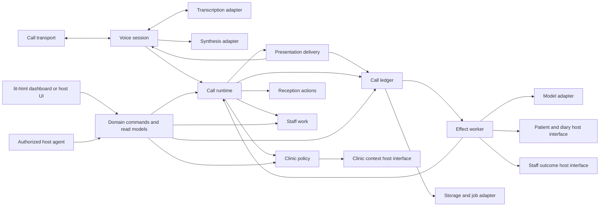
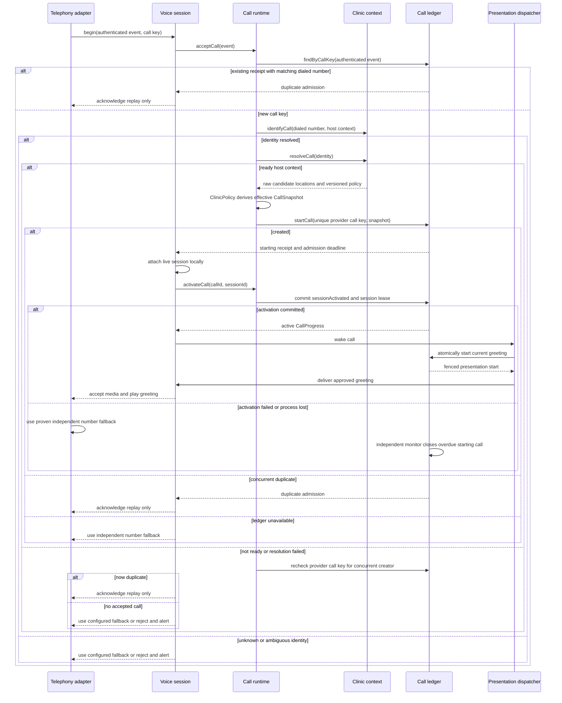

# Abby technical design

**Status:** Proposed design for implementation review. The [phone-index and patient-data boundary](phase-0/PHONE_INDEX_AND_PRIVACY_GATE.md) is a binding amendment; existing rich ledger payloads remain an implementation blocker.

**Product contract:** [PRD.md](PRD.md), version dated 2026-09-28

**Scope:** Inbound receptionist, Abby-owned real-time voice session, standalone Cliniko and Splose adapters, and an in-process reference host. This document specifies the interfaces and consequential call paths for version 1. TypeScript shapes are illustrative contracts; the PRD's caller-facing and safety requirements take precedence if a shape here proves inadequate.

## 1. Design rules

1. Abby's core is a headless set of deep modules. The standalone application and an acquiring monolith compose those modules in-process. Neither calls an Abby-hosted server to make a reception decision.
2. The host owns patient identity, intake, appointments, offers, opening hours, staff destinations, notification policy, and authorization. Abby owns conversation decisions, action evidence, call state, and the receptionist-specific audit trail.
3. An external model proposes typed actions. A deterministic acceptor checks policy, host evidence, caller confirmation, and capability before any consequential effect is dispatched. Prompts and vendor assistant configuration never become the source of appointment truth.
4. A call's policy, approved knowledge, and capability snapshot is versioned at call start. Later administrative edits affect later calls. An active-call override requires its own audited action.
5. A host write is confirmed to a caller only from a committed action receipt for that exact action. A timeout after dispatch is uncertain, even if the provider response is lost. An uncertain write is reconciled or sent to staff; it is never retried blindly.
6. Every durable transition, consequential effect intent, receipt, and staff outcome is tenant-scoped and replay-safe. The browser, an authorized host agent, and jobs use the same domain commands.
7. New behavior and settings ship with a mapped E2E scenario. The deterministic corpus runs against the standalone adapters and reference host, with provider differences represented as capabilities rather than provider branches in the core.
8. Abby owns turn timing, interruption, playback completion, and transfer control in one transient voice session per call. The session may use hosted telephony, transcription, and synthesis, but only the SAM runtime decides what an utterance means or what Abby may say or do. Raw media frames are not replayed into the durable call aggregate.

### Deliberate implementation choices

| Concern | Standalone choice | Embedded host choice |
| --- | --- | --- |
| Language | TypeScript for core and standalone shell | Reuse TypeScript modules or port the versioned contracts if the host uses another language |
| Persistence | PostgreSQL, Kysely migrations and queries, Kanel-generated row types | Host database and migration system behind Abby's storage interface |
| Staff UI | Direct `lit-html` templates rendered by a small TypeScript controller | Host-native screens consuming the same commands and read models |
| Jobs | Durable outbox workers in the standalone process family | Host worker system running the same effect and reconciliation jobs |
| Voice timing and playback | Abby-owned per-call voice session | Mount the same session in process with host-chosen media adapters |
| Telephony, transcription, synthesis, model | Replaceable provider adapters | Retain or replace adapters without changing voice-session or core decisions |

The Kysely and `lit-html` choices live in the standalone shell. Generated database types, HTTP request objects, UI templates, and provider payloads do not cross into core modules.

## 2. Module map and dependency direction

| Module | Interface for callers | Implementation it hides |
| --- | --- | --- |
| **Voice session** | Accept media/transcription events and approved presentations; return final turns and delivery outcomes | Per-call transient audio state, endpointing, interruption, playback marks, transfer control, disconnect cleanup |
| **Presentation delivery** | Start the call's current committed pending presentation through its attached live voice session; accept one fenced terminal result | Atomic start mark, lost-wake-up scan, no replay after possible output, terminal-result handoff to runtime |
| **Call runtime** | Accept a call event, caller turn, or authorized staff command; return durable progress and read models | Sole owner of the call aggregate, action and staff-item statuses, per-call SAM loop, sequencing, effect planning, duplicate detection, prompt/model version binding |
| **Reception actions** | Return plans, confirmation checks, and receipt/reconciliation interpretations to the call runtime | Pure evidence validation, offer expiry, caller confirmation, and safe-write decisions; no second action-state store |
| **Clinic policy** | Resolve a versioned call snapshot; change validated settings and approved knowledge | Setting registry, defaults, scope inheritance, readiness, policy versioning |
| **Staff work** | Return pure task-transition decisions to the call runtime | Staff task policy and valid lifecycle transitions; no direct host call or second staff-item state store |
| **Call ledger** | Atomically persist privacy-safe transitions, effect references, delivery states, and terminal operational status; read a call and pending work | Event order, projections, outbox, replay, tenant keys, and export; no patient-specific content or independent action decisions |
| **Command gateway** | Describe permitted capabilities and submit typed staff/agent commands | Actor authorization, schema checks, approval binding, command audit, dispatch to owning modules |
| **Evaluation** | Run versioned scenarios against a composition | Fixture catalogue, conformance assertions, requirement/setting coverage manifest |

The core modules depend on small host and infrastructure interfaces. They do not import each other's tables or reach through one another to a provider SDK.



**Seam ownership:** the host interfaces express Abby's needed behavior, not a copy of a PMS SDK. Cliniko, Splose, and the reference host each implement them. A new method is justified by a real caller need or provider difference, rather than a speculative integration. The voice session owns ephemeral media timing, presentation delivery owns durable-to-live dispatch, and the call runtime is the sole business orchestrator and state owner for one call. Reception actions return pure decisions, the ledger persists accepted transitions, and staff work owns only its linked task lifecycle.

## 3. Canonical contracts

These types describe wire-safe, versionable values. All IDs are opaque, nonempty, and validated at ingress. A `PatientRef` is never inferred from a caller phone number. Timestamps are instants; location timezones are IANA identifiers. Versioned exports document their encoding separately from TypeScript.

```ts
type Result<Value, Failure> =
  | { readonly ok: true; readonly value: Value }
  | { readonly ok: false; readonly error: Failure };

type ClinicScope = Readonly<{
  tenantId: string;
  clinicId: string;
}>;
type LocationScope = ClinicScope & Readonly<{
  locationId: string;
}>;

type CallKey = Readonly<{ provider: string; providerAccountId: string; providerCallId: string }>;
type CallIdentity = Readonly<{ scope: ClinicScope; dialedNumber: string }>;
type ActionKey = string; // Stable for one intended write and payload digest.
type PolicyRef = Readonly<{ version: string; capturedAt: string }>;
type CapabilityDecision =
  | Readonly<{ mode: "execute" }>
  | Readonly<{ mode: "requestOnly"; reason: "hostUnsafe" | "hostUnavailable" | "policyRestricted" }>
  | Readonly<{ mode: "unavailable"; reason: "settingDisabled" | "hostUnsupported" | "readinessFailed" }>;

type CallSnapshot = Readonly<{
  clinic: ClinicScope;
  candidateLocations: readonly Readonly<{
    locationId: string;
    timezone: string;
    openingHoursVersion: string;
    approvedKnowledgeVersion: string;
    capabilityVersion: string;
    effectivePolicy: Readonly<{
      staffedIntervals: readonly Readonly<{ startsAt: string; endsAt: string }>[];
      capabilities: Readonly<Record<string, CapabilityDecision>>;
      afterHoursMode: "staffRequest" | "approvedInfoAndRequest";
      staffedDestinationRef?: string;
      staffTaskDestination?: StaffDestination;
    }>;
  }>[];
  policy: PolicyRef;
  effectiveClinicSettingsVersion: string;
  effectiveClinicSettings: Readonly<{
    automationEnabled: boolean;
    voiceLocale: string;
    voiceId: string;
    notificationOwnerByKind: Readonly<Record<string, "host" | "abby">>;
    operatorReviewQueueRef: string;
  }>;
  promptVersion: string;
  modelVersion: string;
}>;

type HostWriteReceipt =
  | { readonly kind: "committed"; readonly actionKey: ActionKey; readonly hostRef: string; readonly committedAt: string }
  | { readonly kind: "rejected"; readonly actionKey: ActionKey; readonly reason: "conflict" | "invalid" | "forbidden" | "expiredOffer" }
  | { readonly kind: "unsupported"; readonly actionKey: ActionKey; readonly capability: string }
  | { readonly kind: "uncertain"; readonly actionKey: ActionKey; readonly reconcileAfter: string; readonly deadline: string };

type HostWritePreDispatchFailure = Readonly<{ kind: "notSent"; stage: "beforeTransport"; reason: "unavailable" | "rateLimited" | "deadlineExceeded" }>;
type HostWriteOutcome = Result<HostWriteReceipt, HostWritePreDispatchFailure>;

type HostReadFailure =
  | { readonly kind: "notFound" }
  | { readonly kind: "ambiguousIdentity" }
  | { readonly kind: "forbidden" }
  | { readonly kind: "unavailable" }
  | { readonly kind: "rateLimited"; readonly retryAfter?: string }
  | { readonly kind: "deadlineExceeded" };

type DispatchFailure =
  | { readonly kind: "callUnknown" }
  | { readonly kind: "effectUnknown" }
  | { readonly kind: "tenantMismatch" }
  | { readonly kind: "callClosed" }
  | { readonly kind: "invalidEvent" }
  | { readonly kind: "leaseLost" }
  | { readonly kind: "actionSuperseded" }
  | { readonly kind: "emergencyStopped" }
  | { readonly kind: "ledgerUnavailable" };
type RetentionFailure =
  | { readonly kind: "notPermitted" }
  | { readonly kind: "staleVersion" }
  | { readonly kind: "ledgerUnavailable" };

type ClinicFailure =
  | { readonly kind: "unknownNumber" }
  | { readonly kind: "ambiguousClinic" }
  | { readonly kind: "automationDisabled" }
  | { readonly kind: "unavailable" };
type IntakeFailure =
  | { readonly kind: "invalidEvent" }
  | { readonly kind: "clinicResolution"; readonly cause: ClinicFailure }
  | { readonly kind: "ledgerUnavailable" };
type PlanFailure =
  | { readonly kind: "verificationRequired" }
  | { readonly kind: "evidenceMissing" }
  | { readonly kind: "unsupportedOperation" }
  | { readonly kind: "readUnavailable"; readonly cause: HostReadFailure };
type ConfirmationFailure =
  | { readonly kind: "confirmationMissing" }
  | { readonly kind: "confirmationExpired" }
  | { readonly kind: "digestChanged" }
  | { readonly kind: "forbidden" };
type PolicyFailure =
  | { readonly kind: "invalidValue" }
  | { readonly kind: "forbidden" }
  | { readonly kind: "versionConflict" }
  | { readonly kind: "unavailable" };
type StaffFailure =
  | { readonly kind: "forbiddenTransition" }
  | { readonly kind: "versionConflict" }
  | { readonly kind: "unavailable" };
type ReadFailure =
  | { readonly kind: "notFound" }
  | { readonly kind: "forbidden" }
  | { readonly kind: "unavailable" };
type ReconcileFailure =
  | { readonly kind: "hostUnavailable" }
  | { readonly kind: "evidenceInsufficient" };
type CapabilityFailure =
  | { readonly kind: "forbidden" }
  | { readonly kind: "invalidPayload" }
  | { readonly kind: "versionConflict" }
  | { readonly kind: "unavailable" }
  | { readonly kind: "pendingApproval" };

type CallReceipt = Readonly<{ callId: string; acceptedAt: string; admissionDeadline: string; stateVersion: number }>;
type CallLookup =
  | { readonly kind: "found"; readonly receipt: CallReceipt }
  | { readonly kind: "absent" };
type CallAdmission =
  | { readonly kind: "created"; readonly receipt: CallReceipt }
  | { readonly kind: "duplicate"; readonly receipt: CallReceipt };
type VoiceBeginResult =
  | { readonly kind: "attached"; readonly progress: VoiceProgress }
  | { readonly kind: "duplicate"; readonly callId: string };
type SessionLease = Readonly<{ sessionId: string; version: number; expiresAt: string; validForMs: number }>;
type CallProgress =
  | Readonly<{ callId: string; stateVersion: number; lifecycle: "active"; pendingEffects: number; sessionLease: SessionLease }>
  | Readonly<{ callId: string; stateVersion: number; lifecycle: "ended"; pendingEffects: number }>;
type ExpiredSessionRef =
  | Readonly<{ kind: "admission"; callId: string; stateVersion: number; admissionDeadline: string }>
  | Readonly<{ kind: "active"; callId: string; stateVersion: number; sessionId: string; leaseVersion: number; leaseExpiresAt: string }>;
type SendPermit = Readonly<{ effectId: string; leaseVersion: number; possiblySentAt: string }>;
type VoiceFailure =
  | { readonly kind: "sessionUnknown" }
  | { readonly kind: "intakeRejected"; readonly cause: IntakeFailure }
  | { readonly kind: "runtimeRejected"; readonly cause: DispatchFailure }
  | { readonly kind: "transportUnavailable" }
  | { readonly kind: "transcriptionUnavailable" }
  | { readonly kind: "synthesisUnavailable" }
  | { readonly kind: "deadlineExceeded" }
  | { readonly kind: "disconnected" }
  | { readonly kind: "deliveryBlocked" };
type VoiceDeliveryGate = Readonly<{ sessionId: string; generation: number }>;
type VoiceProgress = Readonly<{ sessionId: string; lifecycle: "listening" | "speaking" | "interrupting" | "transferring" | "ended" }>;
type MediaFrame = Readonly<{
  sessionId: string;
  sequence: number;
  capturedAt: string;
  bytes: Uint8Array;
}>;
type FinalCallerTurn = Readonly<{
  callId: string;
  sessionId: string;
  turnId: string;
  text: string;
  at: string;
  quality: "clear" | "needsClarification";
}>;
type TranscriptEvent =
  | { readonly kind: "partial"; readonly sessionId: string; readonly generation: number; readonly utteranceId: string; readonly text: string }
  | { readonly kind: "segmentFinal"; readonly sessionId: string; readonly generation: number; readonly utteranceId: string; readonly text: string; readonly quality: FinalCallerTurn["quality"] };
type StaffReason = "callerRequested" | "verificationFailed" | "unsupported" | "uncertainAction" | "partialIntake" | "clinicalUrgency" | "systemFailure" | "afterHours";
type StaffDestination =
  | Readonly<{ kind: "owner"; ownerRef: string }>
  | Readonly<{ kind: "queue"; queueRef: string }>;
type ModelProposal =
  | { readonly kind: "answer"; readonly sourceRefs: readonly string[]; readonly proposedText: string }
  | { readonly kind: "lookup"; readonly target: "patient" | "appointment" | "offer"; readonly statedName?: string; readonly statedDate?: string; readonly requestedService?: string; readonly requestedLocationId?: string }
  | { readonly kind: "action"; readonly operation: "intake" | "book" | "cancel" | "reschedule"; readonly targetRef?: string; readonly requestedService?: string; readonly requestedTime?: string }
  | { readonly kind: "handoff"; readonly reason: StaffReason };
type ModelFailure =
  | { readonly kind: "malformed" }
  | { readonly kind: "unavailable" }
  | { readonly kind: "deadlineExceeded" };

type PatientCandidate = Readonly<{ scope: ClinicScope; candidateRef: string; verificationChallengeRef: string }>;
type VerifiedPatient = Readonly<{ scope: ClinicScope; patientRef: string; verificationRef: string; expiresAt: string }>;
type PatientClues = Readonly<{ statedName?: string; statedPhone?: string; statedEmail?: string; statedDateOfBirth?: string }>;
type VerificationProof = Readonly<{ challengeRef: string; responseRef: string }>;
type AppointmentSummary = Readonly<{ appointmentRef: string; scope: LocationScope; serviceRef: string; startsAt: string }>;
type OfferPreferences = Readonly<{ serviceRef?: string; practitionerRef?: string; earliestAt?: string; latestAt?: string }>;
type BookableOffer = Readonly<{
  offerRef: string;
  scope: LocationScope;
  serviceRef: string;
  practitionerRef?: string;
  startsAt: string;
  expiresAt: string;
  price?: Readonly<{ minorUnits: number; currency: string }>;
}>;

type MutationBase = Readonly<{
  scope: LocationScope;
  actionKey: ActionKey;
  payloadDigest: string;
  policyVersion: string;
}>;
type HostMutation = MutationBase & (
  | { readonly kind: "book"; readonly patientRef: string; readonly offerRef: string; readonly confirmationRef: string }
  | { readonly kind: "cancel"; readonly patientRef: string; readonly appointmentRef: string; readonly confirmationRef: string }
  | { readonly kind: "reschedule"; readonly patientRef: string; readonly appointmentRef: string; readonly offerRef: string; readonly confirmationRef: string }
  | { readonly kind: "intake"; readonly approvedDraftRef: string; readonly consentRef: string; readonly duplicateCheckRef: string }
);

type ReconcileObservation =
  | { readonly kind: "exactCommit"; readonly receipt: Extract<HostWriteReceipt, { kind: "committed" }> }
  | { readonly kind: "definitiveNonCommit"; readonly actionKey: ActionKey }
  | { readonly kind: "stillUnknown"; readonly actionKey: ActionKey; readonly checkedAt: string };

type StaffTaskCommand = Readonly<{
  taskKey: string;
  scope: LocationScope;
  destination: StaffDestination;
  reason: StaffReason;
  dueAt: string;
  verifiedContextRefs: readonly string[];
}>;
type StaffTaskReceipt =
  | { readonly kind: "opened"; readonly taskKey: string; readonly hostTaskRef: string; readonly destination: StaffDestination }
  | { readonly kind: "rejected"; readonly taskKey: string; readonly reason: "forbidden" | "destinationUnavailable" | "invalid" }
  | { readonly kind: "uncertain"; readonly taskKey: string; readonly reconcileAfter: string };
type StaffTaskObservation =
  | { readonly kind: "found"; readonly taskKey: string; readonly hostTaskRef: string }
  | { readonly kind: "definitiveAbsent"; readonly taskKey: string }
  | { readonly kind: "unknown"; readonly taskKey: string };
type StaffTransitionCommand = Readonly<{
  scope: LocationScope;
  taskKey: string;
  commandKey: string;
  actorRef: string;
  expectedStaffVersion: number;
  transition: "acknowledge" | "reassign" | "resolve";
  assigneeRef?: string;
}>;
type StaffTransitionReceipt =
  | { readonly kind: "applied"; readonly taskKey: string; readonly commandKey: string; readonly hostVersion: string }
  | { readonly kind: "rejected"; readonly taskKey: string; readonly commandKey: string; readonly reason: "forbidden" | "conflict" | "invalid" }
  | { readonly kind: "uncertain"; readonly taskKey: string; readonly commandKey: string; readonly reconcileAfter: string };
type StaffTransitionObservation =
  | { readonly kind: "exactApplied"; readonly taskKey: string; readonly commandKey: string; readonly hostVersion: string }
  | { readonly kind: "definitiveNotApplied"; readonly taskKey: string; readonly commandKey: string }
  | { readonly kind: "unknown"; readonly taskKey: string; readonly commandKey: string };
type NotificationObservation =
  | { readonly kind: "sent"; readonly notificationKey: string }
  | { readonly kind: "definitiveUnsent"; readonly notificationKey: string }
  | { readonly kind: "unknown"; readonly notificationKey: string };
```

`HostReadQuery` chooses a typed host operation before an effect is persisted. The offer branch requires a bound `LocationScope`; the worker cannot cast a clinic-only query into an offer read. Patient-specific query evidence remains transient or host-owned. An Abby `queryRef` is a random, scope-checked reference only and cannot encode, hash, or encrypt prohibited patient data. The adapter validates the query kind and scope before its host call.

`MediaFrame.bytes` is mono PCM16LE at 16 kHz. The transport adapter decodes and resamples each provider's input before constructing this transient value; it never passes a provider codec choice into the voice session. Transcription adapters consume the same normalized format and may encode it again for their provider. Media frames use the live binary channel and are excluded from durable event and export schemas.

`HostWriteOutcome` separates a proven `notSent` pre-dispatch failure from `HostWriteReceipt`, which includes uncertainty. Provider exceptions are caught by adapters: an error proven to precede send becomes `HostWritePreDispatchFailure`; an exception after the send barrier might have reached the host and therefore becomes `HostWriteReceipt.uncertain`. No provider error string enters the SAM model. Each module owns its more specific failure union, and its caller exhaustively maps every variant to retry, clarification, staff follow-up, or a caller statement. Sensitive diagnostics remain in restricted logs keyed by trace ID. A call starts with a clinic scope and candidate location snapshots; an appointment action requires a bound `LocationScope`. The snapshot carries one effective `CapabilityDecision` per registered actionable capability and candidate location, including booking, cancellation, rescheduling, first-time intake, and live transfer. `ClinicPolicy.resolveCall` derives these decisions from host declarations, versioned raw settings, and readiness; `execute` authorizes the action, `requestOnly` permits a staff request, and `unavailable` permits neither through that capability. A missing or unknown ID is never executable. Call decisions consult this map, not raw setting flags or a second enabled-capability list. Staffed intervals and notification ownership remain separate policy values; version references identify the immutable approved knowledge and full policy documents. The standalone telephony fallback is configured by dialed number outside this snapshot so it remains available when snapshot resolution fails.

### Evidence bound to a write

An appointment write needs `LocationScope`, an authorized `PatientRef`, the exact appointment or host-issued offer, the current policy/capability versions, a caller-confirmation token, an action key, and a deadline. The confirmation token is minted only after the exact action-detail presentation reports complete playback and a later final, affirmative caller turn is observed. It binds the presentation ID and a digest of the action, patient, location, time, and policy version. A model proposal, provisional transcript, or queued/partially played prompt cannot mint it. A correction to any bound field invalidates the token and requires a fresh confirmation. A host-issued offer is revalidated at commit and is not treated as a reservation unless the host says it is.

An intake write additionally needs the host's approved duplicate-check and consent evidence. Intake and booking are distinct receipts. If intake commits and booking fails or becomes uncertain, the patient reference is retained as host-owned data, the booking is not confirmed, and staff work opens. Abby does not delete the patient record as a speculative rollback.

### Capability and setting descriptors

Each host capability declares a stable ID, version, scope, input/result schemas, required authority, side effects, idempotency/reconciliation guarantee, and whether caller confirmation or staff approval is required. Each setting declares a stable ID, type, default, scope, validation rule, and E2E scenario IDs. A clinic setting cannot expand a capability the host does not support. At call start, `ClinicPolicy` derives a complete per-location `CapabilityDecision` map from host declarations, raw setting values, and readiness, then captures it with the effective setting and capability versions in `CallSnapshot`. The raw setting registry remains the edit and UI source; no action path independently recomputes capability eligibility from booleans. `ClinicContext` supplies versioned notification ownership; `ClinicPolicy` captures it in `CallSnapshot`, and the SAM decision copies that owner to each durable notification intent. The effect worker and `NotificationDispatch` use only the persisted owner, not a live setting lookup. An ordinary settings edit affects later calls; an active-call owner change requires an audited intervention that fences any unsent notification intent before replacing its owner.

The initial setting registry is proposed below. A default of `unset` blocks readiness for the dependent feature. Phase 0 confirms these defaults with product owners before implementation. Each `SET` ID is a distinct browser-plus-call E2E scenario, not just a unit test of the setting parser.

| Setting ID | Type and scope | Proposed default | Constraint | E2E ID |
| --- | --- | --- | --- | --- |
| `automation.enabled` | Boolean, clinic | `false` | Off stops new automated calls; active calls retain captured policy | `SET-001` |
| `appointments.booking.enabled` | Boolean, location | `false` | Effective only with a safe host booking capability | `SET-002` |
| `appointments.cancellation.enabled` | Boolean, location | `false` | Effective only with a safe host cancellation capability | `SET-003` |
| `appointments.rescheduling.enabled` | Boolean, location | `false` | Effective only with a host-native or atomic reschedule capability | `SET-004` |
| `patients.firstTimeIntake.enabled` | Boolean, clinic | `false` | Effective only with approved intake, consent, duplicate check, and safe writes | `SET-005` |
| `routing.afterHoursMode` | `staffRequest` or `approvedInfoAndRequest`, location | `staffRequest` | Approved after-hours response; no false live transfer | `SET-006` |
| `routing.staffedDestination` | Opaque host reference, location | `unset` | Must pass readiness before live transfer is enabled | `SET-007` |
| `routing.fallbackDestination` | Opaque telephony reference, dialed number | `unset` | Configured in telephony routing so it works before Abby resolves a location or persists a call | `SET-008` |
| `notifications.owner` | Enum per notification kind, clinic | `unset` | Exactly one owner per kind before that notification is enabled | `SET-009` |
| `voice.locale` | Locale ID, clinic | `unset` | Must be supported by voice and speech adapters | `SET-011` |
| `voice.voiceId` | Opaque provider ID, clinic | `unset` | Must be supported by the configured voice adapter | `SET-012` |

Approved knowledge is a separate versioned asset with owner, tenant/location scope, effective period, and approval status. It is referenced by settings and `CallSnapshot`; raw retrieved text cannot grant capabilities or override policy.

| Host capability ID | Automated only when | Safe fallback | Conformance journey |
| --- | --- | --- | --- |
| `patients.phoneCandidates` | A complete clinic-scoped phone-to-ID index yields candidates and each candidate's current phone is rechecked by Cliniko ID | Bounded clarification or staff verification | `E2E-003` |
| `patients.verify` | Host-approved verification can bind one candidate patient ref; caller ID alone is insufficient | Staff verification | `E2E-003` |
| `offers.search` | Host supplies eligible, time-bound offers | Staff request | `E2E-005` |
| `appointments.book` | Commit and lost-response safety are proven | Booking request | `E2E-006` |
| `appointments.cancel` | Exact appointment and commit safety are proven | Cancellation request | `E2E-007` |
| `appointments.reschedule` | Host-native or atomic operation and lost-response safety are proven | Reschedule request | `E2E-007` |
| `patients.intake` | Consent, duplicate check, and write safety are proven | First-time staff request | `E2E-016` |
| `staff.transfer` | Staffed destination and transfer window are valid | Durable staff request | `E2E-009` |
| `staff.openTask` | Host can create and track a task with a stable key | Visible unresolved call and operator alert | `E2E-009` |
| `actions.reconcile` | Exact outcome can be found by key or documented evidence | Needs-review item | `E2E-006` |

The capability IDs name behavior, not a provider. Cliniko, Splose, and the reference host declare support and constraints for each ID. An unsupported capability takes its stated fallback in the same scenario; the scenario is not skipped.

## 4. Public operations and consequential calls

The table records the functions another module, shell, or host must know. It is not a list of private helpers. Inputs and outputs are named contracts; exact field schemas are frozen in Phase 0 and versioned thereafter.

| Operation | Caller and input | Output | Consequential calls or effects |
| --- | --- | --- | --- |
| `VoiceSession.begin(event)` | Authenticated call transport; validated call key, dialed number, event ID, timestamp | `Result<VoiceBeginResult, VoiceFailure>` | `CallRuntime.acceptCall` returns a typed admission; only `created` attaches locally, calls `CallRuntime.activateCall`, and wakes presentation delivery after the active transition commits. `duplicate` acknowledges the repeated webhook without a second session or fallback command. A new-call failure uses the proven number fallback and leaves the admission monitor to close a stranded receipt |
| `VoiceSession.acceptMedia(frame)` | Call transport; ordered, normalized `MediaFrame` | `Result<VoiceProgress, VoiceFailure>` | Transcription adapter; bounded buffer and endpointing; no ledger event per frame |
| `VoiceSession.acceptTranscript(event)` | Transcription adapter; partial hypothesis or segment-final `TranscriptEvent` | `Result<VoiceProgress, VoiceFailure>` | Assembles provider segments, uses Abby endpointing to mint one `FinalCallerTurn` ID and submits it to `CallRuntime.acceptTurn`; a lost T2 acknowledgment retries the same ID and receives the stored result before the output gate reopens. The runtime decides clarification or handoff from turn quality |
| `PresentationDispatcher.drain(callId)` | Commit wake-up or live-session recovery scan; call ID | `Result<void, DispatchFailure>` | Gets a delivery gate before atomic start; `deliveryBlocked` leaves the pending intent untouched until the turn decision settles. It handles `started`, `expired`, or `none` from `CallLedger.startNextPresentation`, and calls `VoiceSession.deliver` only for `started`; a stale gate settles without media. It submits one fenced resolution to the runtime; an observed live-session loss calls `endCall`, while process loss is closed by the independent expiry monitor |
| `VoiceSession.prepareDelivery(sessionId)` | Presentation dispatcher; attached live session ID | `Result<VoiceDeliveryGate, VoiceFailure>` | Returns the current speech generation only while the session is ready for output; caller speech blocks new output from onset until its final `callerTurn` transition commits; that transition clears or replaces any older pending presentation before the gate reopens, and speech onset bumps the generation immediately |
| `VoiceSession.deliver(start, gate)` | Presentation dispatcher only; durably started `PresentationStart` and the gate obtained before atomic start | `Promise<VoiceDeliveryResult>` | Synchronously registers a cancelable delivery and rechecks session/generation and conservative local lease validity at the final media or transfer-send boundary and before later chunk enqueue. A stale gate before send settles speech as interrupted or transfer as canceled without output; possible output without terminal evidence settles unproven. It never invokes the runtime or dispatcher through a second completion callback; ledger fencing stays in the dispatcher |
| `VoiceSession.interrupt(sessionId, signal)` | Call transport or speech detector; session ID and interruption signal | `Result<VoiceProgress, VoiceFailure>` | Bumps generation, stops synthesis, and clears queued transport audio; settles speech as interrupted or a transfer as canceled only before its request crosses the transport boundary. A possibly sent transfer awaits connected/failed evidence or becomes unproven; waits for a final new turn |
| `VoiceSession.end(sessionId, reason)` | Call transport; session ID and disconnect/end reason | `Result<VoiceProgress, VoiceFailure>` | Detaches the live session, settles the transient delivery promise as `unproven.failed` when output may have started without terminal evidence, then calls `CallRuntime.endCall`. Its T2 end variant atomically resolves pending/started delivery and ignores a later transient result; host writes and staff review continue |
| `CallRuntime.acceptCall(event)` | Voice session; authenticated `CallKey`, dialed number, event ID, timestamp | `Result<CallAdmission, IntakeFailure>` | `CallLedger.findByCallKey` first, before current number-to-clinic routing; only an absent key calls `ClinicPolicy.identifyCall` and `ClinicPolicy.resolveCall`. Derives a bounded admission deadline from the injected clock before the pure `callStarted` transition and `CallLedger.startCall`. Global T1 uniqueness settles concurrent admissions; if mutable readiness fails after a preflight miss, a final lookup distinguishes a racing creator from a genuinely rejected new call. Only `created` authorizes attachment |
| `CallRuntime.activateCall(callId, sessionId, eventId)` | Attached live voice session; call and session IDs, stable activation event ID | `Result<CallProgress, DispatchFailure>` | Accepts `sessionActivated` only for a `starting` call before its admission deadline, commits `active` and a ledger-computed session lease in T2, returns its initial version, then permits media and greeting dispatch |
| `CallRuntime.acceptTurn(turn)` | Voice session; final `FinalCallerTurn` bound to call and active session | `Result<CallProgress, DispatchFailure>` | Validates the turn's call and active session IDs, then runs the SAM acceptor, `ReceptionActions`, and `CallLedger.commitTransition`; schedules model/host/presentation intents |
| `CallRuntime.acceptStaffCommand(command)` | Command gateway; authorized actor, existing task key and location scope, transition, expected staff-item version, stable command key | `Result<CallProgress, DispatchFailure>` | Loads the call aggregate even after media ends; uses pure `StaffWork.planTransition`, accepts `staffCommandRequested`, and commits the pending staff-item state, audit event, and host effect together in T2. Replays of the same command key return the stored result |
| `CallRuntime.acceptEffectResult(envelope)` | Effect worker; `EffectResultEnvelope` with tenant, call, effect, lease version, and typed model/host/reconciliation/staff/notification outcome | `Result<CallProgress, DispatchFailure>` | Loads the persisted effect, validates the result kind and correlation keys against its intent, then accepts one SAM `effectResolved` action and calls `CallLedger.commitEffectResult`; model success and typed failure use this same path |
| `CallRuntime.acceptPresentationResult(submission)` | Presentation dispatcher; typed `PresentationSubmission` pairing a fenced pending or started ref with its permitted outcome | `Result<CallProgress, DispatchFailure>` | SAM acceptor and atomic ledger delivery-result/transition commit; full playback enables a later confirmation, failed transfer schedules staff work, duplicate or stale results are ignored; internal supersession cannot enter this operation |
| `CallRuntime.endCall(event)` | Voice session; call ID, terminal event ID, timestamp, typed reason | `Result<CallProgress, DispatchFailure>` | SAM acceptor and T2 terminal variant; closes `starting` or `active` calls once, atomically resolves pending as superseded and any started delivery without a proven T4 result as unproven, and leaves unresolved host/staff effects active for reconciliation |
| `CallRuntime.expireSession(ref)` | Independent ledger-backed monitor; fenced `ExpiredSessionRef` | `Result<CallProgress, DispatchFailure>` | Creates one deterministic `callEnded` decision and calls `CallLedger.commitExpiredSession`; stale scan refs cannot close a renewed or activated call |
| `ClinicPolicy.identifyCall(dialedNumber, hostContext)` | Call runtime; authenticated dialed number and host context | `Result<CallIdentity, ClinicFailure>` | Resolves stable tenant/clinic identity without applying mutable automation or readiness policy; no patient read |
| `ClinicPolicy.resolveCall(identity)` | Call runtime; identified clinic for a new call | `Result<CallSnapshot, ClinicFailure>` | `ClinicContext.resolveCall`; validates candidate locations, captured staff-task destinations and operator review queue, and readiness, derives one effective capability decision per registered action and location from host declarations and versioned settings, and captures the result; no patient read |
| `ReceptionActions.plan(request)` | Call runtime; location scope, caller request, verified host evidence, policy snapshot | `Result<PlanDecision, PlanFailure>` | Returns required host-read intents and a proposed plan when evidence is sufficient; no host mutation |
| `ReceptionActions.confirm(plan, evidence)` | Call runtime; plan ID and bound caller confirmation | `Result<ReadyAction, ConfirmationFailure>` | Checks identity, offer, policy, capability, digest, and deadline; emits host-write intent |
| `ReceptionActions.interpretReceipt(action, receipt)` | Call runtime; current action and matching host outcome | `ActionDecision` | Purely returns next action status and reconciliation/staff intents; call runtime accepts and persists them |
| `ReceptionActions.interpretReconciliation(action, observation)` | Call runtime; current action and host observation for its original key | `ActionDecision` | Purely returns committed, definitive non-commit, or needs-review decision; never dispatches a second write |
| `ClinicPolicy.applyChange(command)` | UI or authorized agent; actor, scope, setting/knowledge change, expected version | `Result<PolicyRef, PolicyFailure>` | Authorization, registry validation, versioned storage, audit; next calls use new version |
| `StaffWork.planTransition(item, command)` | Call runtime; current staff item and authorized, scoped command with expected version | `Result<StaffTransitionDecision, StaffFailure>` | Purely validates scope and lifecycle, then returns the next pending staff-item state and keyed effect intent; no ledger or host call. Opening call-linked work is a separate SAM-produced `staffTask` intent |
| `CallLedger.findByCallKey(event)` | Call runtime; transport-authenticated provider account, call ID, and dialed number | `Result<CallLookup, IntakeFailure>` | Globally looks up `(provider, providerAccountId, providerCallId)` before mutable clinic routing; returns only the minimal stored receipt if the immutable dialed number matches, and rejects conflicting key reuse. It never reads patient or tenant data from the newly mapped clinic |
| `CallLedger.startCall(event, snapshot, decision)` | Call runtime; authenticated call event, resolved snapshot, and pure `callStarted` decision | `Result<CallAdmission, IntakeFailure>` | Transaction T1 stores `starting`, its admission deadline, and a generic approved greeting intent without patient content; returns `created` only for the inserting caller, `duplicate` with the stored receipt for the same call key, and rejects conflicting identity |
| `CallLedger.commitTransition(callId, expectedVersion, decision)` | Call runtime; call ID, expected version, pure SAM decision | `Result<CallProgress, DispatchFailure>` | Transaction T2; appends events, advances version, stores effects and canonical staff-item updates, and atomically keeps, replaces, or clears the one pending presentation |
| `CallLedger.startNextPresentation(callId, sessionId)` | Presentation dispatcher; call ID and attached live session | `Result<PresentationStartDecision, DispatchFailure>` | Checks the matching active session and its unexpired ledger lease; returns `none` when there is no eligible pending intent, `expired` with its fenced ref when its deadline passed, or atomically marks it started and returns `started`; never starts two presentations for one call |
| `CallLedger.commitPresentationResult(submission, decision)` | Call runtime; fenced `PresentationSubmission` and pure SAM decision | `Result<CallProgress, DispatchFailure>` | Atomically resolves delivery, appends `presentationResolved`, advances call state, and stores any follow-up intents; late or duplicate results cannot change the outcome |
| `CallLedger.renewSessionLease(callId, sessionId, expectedLeaseVersion)` | Attached voice process; call and session IDs, current lease version from activation or prior renewal | `Result<SessionLease, DispatchFailure>` | Checks active session and unexpired lease; an exact-version compare-and-swap reads ledger time after locking, increments the version, and sets expiry from the configured bounded TTL. One duplicate request for the immediately preceding version returns the current lease without extending it, recovering a lost acknowledgment; older or mismatched requests fail. No caller supplies a deadline or per-frame write |
| `CallLedger.findExpiredSessions()` | Independent ledger-backed monitor; bounded scan | `readonly ExpiredSessionRef[]` for starting calls past admission deadline and active calls past session lease | Reads ledger time and persisted liveness evidence so cleanup does not depend on an in-memory voice session or monitor clock |
| `CallLedger.commitExpiredSession(ref, decision)` | Call runtime; fenced expiry ref and pure `callEnded` decision | `Result<CallProgress, DispatchFailure>` | One atomic T2 variant reads ledger time, checks current deadline/lease version and expiry, ends the call, resolves pending as superseded and any started presentation as unproven, and appends both audit events; a stale ref returns `leaseLost` |
| `CallLedger.markPossiblySent(effectId, expectedLeaseVersion)` | Effect worker; leased consequential effect and lease version | `Result<SendPermit, DispatchFailure>` | Durably marks possible send before adapter call. For host writes, locks the call/action state shared with correction T2, verifies the exact action key, digest, current confirmation, dispatchable state, and deadline, and checks emergency stop in the same transaction; a superseded action returns `actionSuperseded` without a send permit |
| `CallLedger.commitEffectResult(envelope, expectedCallVersion, decision)` | Call runtime; validated result envelope, expected call version, pure SAM decision | `Result<CallProgress, DispatchFailure>` | Transaction T3; rechecks effect kind, tenant, call, lease version, and intent-specific correlation keys before storing the outcome and transition, advancing action or staff-item state, and creating follow-up intents atomically |
| `CallLedger.readCall(query)` | UI or authorized agent; actor, tenant, call ID | `Result<CallReadModel, ReadFailure>` | Authorizes scope, projects events and receipts; redacts by role |
| `CommandGateway.listPermitted(actor, scope)` | UI or authorized agent; actor and scope | Versioned, permission-filtered capability descriptors | Reads host policy and registered domain commands; no mutation |
| `CommandGateway.submit(command)` | UI or authorized agent; actor, scope, capability ID, typed payload and expected version | `Result<CapabilityResult, CapabilityFailure>` | Validates schema and authority, audits, and dispatches the same owning-module command used by UI; cannot bypass confirmation or host checks |

The call runtime dispatches actions for one call in sequence. Different calls and independent jobs run concurrently. The runtime never waits inside the pure acceptor for a model, database query, or network call; it persists a typed effect intent and later accepts a typed effect result. Every accepted decision explicitly `keep`s, `replace`s, or `clear`s the call's one pending presentation. T1 requires `replace`; T2, T3, and T4 apply the change with the call transition. `replace` and `clear` mark the former pending intent `superseded` in that same transaction, retaining its audit record without playing it. Every final `callerTurn` transition increments `conversationRevision` and must replace or clear the older pending prompt before T2 commits; it may issue an immediate new response or leave the slot empty while model/host effects run. An unrelated later result may keep the current slot. A started presentation is separate from the pending slot, so a correction to speech already in progress uses interruption and invalidates its confirmation. An active-call transition wakes the one logical `PresentationDispatcher` for that call; T1 does not wake it, and delivery remains gated on T2 activation. Different calls dispatch concurrently. The caller, effect worker, and composition root never deliver speech directly. The dispatcher first obtains a live-session delivery gate, then atomically marks the current pending intent started. `VoiceSession.deliver` registers a cancelable handle and checks that gate immediately before output; caller speech between those steps invalidates it. The dispatcher retains the started ref, awaits one `VoiceDeliveryResult`, and submits the fenced, state-paired result to `CallRuntime.acceptPresentationResult`. A lost wake-up leaves the current intent pending for a live-session recovery scan. If no session is attached at the deadline or the call ends, the pending intent resolves without speech; a started delivery with no proven terminal result resolves as `unproven` and is never replayed. `acceptEffectResult` runs the SAM transition and calls `commitEffectResult` so model/host/staff/notification outcomes, new state, and follow-up intents become durable together. Duplicate effect results return the stored result and do not run another transition. If a worker loses a host-write response before that transaction, recovery treats the write as possibly sent and reconciles its original action key. The reconciler performs the external host read and submits a typed observation; reception actions do not call the host or mutate a second state store.

The call aggregate owns `staffItems` alongside action state. A SAM-produced `staffTask` effect creates a pending staff item in the same T2/T3 decision that stores the effect. `StaffWork.planTransition` is pure: it validates an existing item and scoped command, then returns a proposed next item and keyed host effect. `CallRuntime.acceptStaffCommand` commits that decision in T2 even after the voice session ends. Staff-task and transition receipts enter the same T3 path and atomically settle the canonical item; the staff-item table and call review are projections of that state. A lost host response stays pending or needs review under its original key. Neither `StaffWork` nor `ReceptionActions` invokes a host interface inline.

| Named value | Minimum fields or variants |
| --- | --- |
| `HostCallContext` | Host-owned clinic and candidate-location identity, versioned raw settings, hours, knowledge, consent/notification policy, approved per-location task destinations, operator review queue, and capability declarations; no Abby effective-capability decisions |
| `PlanDecision` | Optional proposed action plan plus host-read intents needed to obtain missing evidence; no write intent |
| `ActionPlan` | Plan ID, call and location scope, typed operation(s), target refs, evidence refs, policy version, current status |
| `ConfirmationEvidence` | Call/final-turn IDs, completed action-detail presentation ID, observed affirmation, action digest, time, bounded expiry; never model-minted |
| `ReadyAction` | Exact host command, action key, payload digest, confirmation ref, dispatch deadline |
| `ActionState` | Canonical action key, status, last host receipt, reconciliation deadline, linked staff item if any; held only in the call aggregate |
| `ActionDecision` | Proposed next `ActionState`, durable events, and typed follow-up intents; no storage or network side effect |
| `CallReadModel` | Route, selected location, policy/prompt versions, action states and receipts, presentation delivery outcomes, staff/notification outcomes, role-redacted evidence refs |
| `StaffItem` | Tenant, call/action link, required `StaffDestination`, reason, due time, status, host task ref and version |
| `StaffTransitionDecision` | Proposed next staff-item state, audit event, and optional keyed host effect intent; no storage or network side effect |
| `CapabilityResult` | Versioned read data, accepted command receipt, pending approval, or typed failure |

The failure unions above are the initial public discriminants. Phase 0 may add evidence fields and versioned variants, but may not replace them with free-form provider errors. A late host-write timeout is a `HostWriteReceipt.uncertain`, not a generic `PlanFailure` or `ReadFailure`. A reconciliation query is its own `hostReconcile` effect and returns a typed observation or `ReconcileFailure` through T3; it never enters through an untyped side channel. Each union is exhausted where recovery or presentation is chosen.

## 5. SAM loop, ordering, and state

The acceptor is a pure function of a versioned call state and a typed action. It returns a proposed next state, durable events, effect intents, and a presentation instruction. The presenter turns the accepted state into caller speech and staff read models. The effect runner executes intents after the transition commits and feeds typed results back as actions.

```ts
type ActionStatus =
  | "proposed" | "awaitingEvidence" | "awaitingConfirmation" | "ready"
  | "dispatched" | "committed" | "rejected" | "unsupported"
  | "uncertain" | "needsReview" | "canceled";

type ActionState = Readonly<{
  actionKey: ActionKey;
  status: ActionStatus;
  lastHostReceipt?: HostWriteReceipt;
  reconciliationDeadline?: string;
  staffTaskKey?: string;
}>;
type StaffItemState = Readonly<{
  taskKey: string;
  scope: LocationScope;
  linkedActionKey?: ActionKey;
  destination: StaffDestination;
  status: "requested" | "open" | "acknowledged" | "transitionPending" | "resolved" | "failed" | "needsReview";
  version: number;
  pendingCommandKey?: string;
  hostTaskRef?: string;
  dueAt: string;
  reason: StaffReason;
}>;
type ConfirmationPrompt = Readonly<{
  presentationId: string;
  actionDigest: string;
  playback: "pending" | "played" | "interrupted" | "failed" | "expired" | "superseded";
}>;

type CallState = Readonly<{
  callId: string;
  snapshot: CallSnapshot;
  selectedLocationId?: string;
  stateVersion: number;
  lifecycle: "starting" | "active" | "ended";
  conversationRevision: number;
  actionStates: Readonly<Record<ActionKey, ActionState>>;
  staffItems: Readonly<Record<string, StaffItemState>>;
  confirmationPrompts: Readonly<Record<ActionKey, ConfirmationPrompt>>;
}>;

type EventBase = Readonly<{
  eventId: string;
  callId: string;
  schemaVersion: number;
  at: string;
}>;
type CallEvent = EventBase & (
  | { readonly kind: "callStarted"; readonly policyVersion: string; readonly admissionDeadline: string }
  | { readonly kind: "sessionActivated"; readonly sessionId: string }
  | { readonly kind: "callerTurnAccepted"; readonly turnId: string }
  | { readonly kind: "actionStatusChanged"; readonly actionKey: ActionKey; readonly status: ActionStatus }
  | { readonly kind: "effectResultAccepted"; readonly effectId: string; readonly outcomeKind: TypedEffectOutcome["kind"] }
  | { readonly kind: "staffTaskLinked"; readonly actionKey?: ActionKey; readonly taskKey: string }
  | { readonly kind: "staffCommandRequested"; readonly taskKey: string; readonly commandKey: string; readonly actorRef: string }
  | { readonly kind: "confirmationPromptIssued"; readonly presentationId: string; readonly actionKey: ActionKey; readonly actionDigest: string }
  | { readonly kind: "presentationResolved"; readonly resolution: PresentationResolution }
  | { readonly kind: "callEnded"; readonly reason: "transportEnded" | "admissionTimeout" | "sessionLost" }
);

type EffectBase = Readonly<{
  effectId: string;
  deadline: string;
}>;
type HostReadQuery =
  | Readonly<{ kind: "patientCandidates"; scope: ClinicScope; queryRef: string }>
  | Readonly<{ kind: "appointments"; patient: VerifiedPatient }>
  | Readonly<{ kind: "offers"; scope: LocationScope; queryRef: string }>;
type EffectIntent = EffectBase & (
  | { readonly kind: "hostRead"; readonly query: HostReadQuery; readonly conversationRevision: number }
  | { readonly kind: "hostWrite"; readonly mutation: HostMutation }
  | { readonly kind: "hostReconcile"; readonly scope: LocationScope; readonly originalEffectId: string; readonly actionKey: ActionKey }
  | { readonly kind: "model"; readonly taskRef: string; readonly conversationRevision: number }
  | { readonly kind: "staffTask"; readonly command: StaffTaskCommand }
  | { readonly kind: "staffTaskReconcile"; readonly scope: LocationScope; readonly originalEffectId: string; readonly taskKey: string }
  | { readonly kind: "staffTransition"; readonly command: StaffTransitionCommand }
  | { readonly kind: "staffTransitionReconcile"; readonly scope: LocationScope; readonly originalEffectId: string; readonly taskKey: string; readonly commandKey: string }
  | { readonly kind: "notificationReconcile"; readonly originalEffectId: string; readonly notificationKey: string; readonly owner: "host" | "abby" }
  | { readonly kind: "notification"; readonly actionKey: ActionKey; readonly notificationKey: string; readonly owner: "host" | "abby"; readonly payloadRef: string }
);

type TypedEffectOutcome =
  | { readonly kind: "model"; readonly result: Result<ModelProposal, ModelFailure> }
  | { readonly kind: "hostWrite"; readonly result: HostWriteOutcome }
  | { readonly kind: "hostReconcile"; readonly actionKey: ActionKey; readonly result: Result<ReconcileObservation, ReconcileFailure> }
  | { readonly kind: "hostRead"; readonly result: Result<{ readonly resultRef: string }, HostReadFailure> }
  | { readonly kind: "staffTask"; readonly receipt: StaffTaskReceipt }
  | { readonly kind: "staffTaskReconcile"; readonly taskKey: string; readonly result: Result<StaffTaskObservation, ReconcileFailure> }
  | { readonly kind: "staffTransition"; readonly receipt: StaffTransitionReceipt }
  | { readonly kind: "staffTransitionReconcile"; readonly taskKey: string; readonly commandKey: string; readonly result: Result<StaffTransitionObservation, ReconcileFailure> }
  | { readonly kind: "notificationReconcile"; readonly notificationKey: string; readonly result: Result<NotificationObservation, ReconcileFailure> }
  | { readonly kind: "notification"; readonly notificationKey: string; readonly status: "sent" | "uncertain" | "failed" };

type EffectResultEnvelope = Readonly<{
  tenantId: string;
  callId: string;
  effectId: string;
  leaseVersion: number;
  outcome: TypedEffectOutcome;
}>;

type PresentationIntent =
  | { readonly kind: "speak"; readonly presentationId: string; readonly approvedText: string }
  | { readonly kind: "confirmAction"; readonly presentationId: string; readonly approvedText: string; readonly actionKey: ActionKey; readonly actionDigest: string }
  | { readonly kind: "transfer"; readonly presentationId: string; readonly destinationRef: string };
type PresentationChange =
  | { readonly kind: "keep" }
  | { readonly kind: "replace"; readonly intent: PresentationIntent }
  | { readonly kind: "clear" };
type ProvenVoiceDeliveryResult =
  | { readonly kind: "speech"; readonly presentationId: string; readonly status: "played" | "interrupted" | "failed" }
  | { readonly kind: "transfer"; readonly presentationId: string; readonly status: "connected" | "failed" | "canceled" };
type NotStartedOutcome = Readonly<{ kind: "notStarted"; presentationId: string; status: "expired" | "failed" }>;
type UnprovenOutcome = Readonly<{ kind: "unproven"; presentationId: string; status: "failed" | "expired" }>;
type VoiceDeliveryResult = ProvenVoiceDeliveryResult | UnprovenOutcome;
type PresentationOutcome = VoiceDeliveryResult | NotStartedOutcome;
type PresentationResolution =
  | PresentationOutcome
  | { readonly kind: "superseded"; readonly presentationId: string; readonly status: "superseded" };
type PresentationRefBase = Readonly<{ callId: string; presentationId: string; deliveryVersion: number }>;
type PendingPresentationRef = PresentationRefBase & Readonly<{ state: "pending" }>;
type StartedPresentationRef = PresentationRefBase & Readonly<{ state: "started"; sessionId: string }>;
type PresentationSubmission =
  | Readonly<{ ref: PendingPresentationRef; result: NotStartedOutcome }>
  | Readonly<{ ref: StartedPresentationRef; result: VoiceDeliveryResult }>;
type PresentationStart = StartedPresentationRef & Readonly<{ intent: PresentationIntent; deadline: string }>;
type PresentationStartDecision =
  | { readonly kind: "started"; readonly value: PresentationStart }
  | { readonly kind: "expired"; readonly ref: PendingPresentationRef }
  | { readonly kind: "none" };

type ActionDecision = Readonly<{
  next: ActionState;
  events: readonly CallEvent[];
  effects: readonly EffectIntent[];
}>;

type StaffTransitionDecision = Readonly<{
  next: StaffItemState;
  event: CallEvent;
  effect?: EffectBase & Readonly<{ kind: "staffTransition"; command: StaffTransitionCommand }>;
}>;

type Decision = Readonly<{
  next: CallState;
  events: readonly CallEvent[];
  effects: readonly EffectIntent[];
  presentation: PresentationChange;
}>;

type CallAction =
  | { kind: "callStarted"; eventId: string; at: string; admissionDeadline: string; snapshot: CallSnapshot }
  | { kind: "sessionActivated"; eventId: string; sessionId: string; at: string }
  | { kind: "callerTurn"; turn: FinalCallerTurn }
  | { kind: "effectResolved"; effectId: string; outcome: TypedEffectOutcome }
  | { kind: "presentationResolved"; result: PresentationOutcome }
  | { kind: "deadlineElapsed"; deadlineId: string }
  | { kind: "staffCommandRequested"; command: StaffTransitionCommand }
  | { kind: "callEnded"; eventId: string; at: string; reason: "transportEnded" | "admissionTimeout" | "sessionLost" };

type Transition = (state: CallState, action: CallAction) => Decision;
```

The unknown model payload exists only at the ingress parser. It must be decoded to the versioned `ModelProposal` union before the effect worker returns a `TypedEffectOutcome.model`; invalid or incomplete output becomes `ModelFailure.malformed`. Model success and failure enter the acceptor through the same `effectResolved` action and T3 transaction as other effect results; there is no second model callback path. The acceptor cannot emit a host-write intent until all required evidence is present. A `hostWrite` intent carries only an action key and an opaque host-owned command reference; a `staffTask` intent carries only a host-owned task reference and non-patient operational metadata. The ingress decoder and storage adapter validate the discriminant and schema version, so an invalid serialized event or intent cannot bypass these TypeScript shapes. Proposed answer text is checked against approved source refs and policy before presentation. Patient-specific answer and action-detail text stays in the live session and is never stored in a presentation or event. Playback is complete only after the transport acknowledges that all audio for its presentation ID played; audio merely queued or cleared on interruption resolves as `interrupted` or `failed`. For `confirmAction`, only a later clear final caller turn can mint confirmation evidence against that presentation ID and digest. A failed transfer opens host-owned staff work, and duplicate delivery does not open a second task. Speech and transfer delivery are not replayed after a disconnected call. Final caller-turn text is transient and never persisted, including in hashes, logs, or archives.

| State axis | Values | Key invariant |
| --- | --- | --- |
| Call lifecycle | `starting`, `active`, `ended` | Ended calls can still have reconciliation or staff work; late turns cannot start new actions |
| Each action | `proposed`, `awaitingEvidence`, `awaitingConfirmation`, `ready`, `dispatched`, `committed`, `rejected`, `unsupported`, `uncertain`, `needsReview`, `canceled` | Only `committed` authorizes confirmation for that exact action; `needsReview` retains the last uncertain receipt |
| Each effect | `pending`, `leased`, `possiblySent`, `completed`, `uncertain`, `deadLetter` | Only an unsent `leased` intent may return to `pending`; `possiblySent` host writes reconcile before any retry |
| Each presentation | `pending`, `started`, `resolved` | At most one pending and one started record per call; a pending record can resolve `superseded` without speech, a started record is never replayed, and only proven `played` enables confirmation |
| Each staff item | `requested`, `open`, `acknowledged`, `transitionPending`, `resolved`, `failed`, `needsReview` | Destination, due time, and call/action link exist from creation; overdue is a derived alert from `dueAt` and unresolved status, not a second persisted state |

`CallLedger.commitTransition(callId, expectedVersion, decision)` atomically appends events, updates the call version and canonical staff-item state, records effect intents, and applies `PresentationChange` to the one pending slot. A final caller turn cannot use `keep`: it increments `conversationRevision` and replaces or clears the prior prompt, including when it starts asynchronous model interpretation. A concurrent turn with a stale version reloads and re-evaluates; the reducer itself stays pure. Duplicate provider event IDs, turn IDs, effect IDs, presentation IDs, and action keys return the previously recorded logical result. The worker leases ready intents and passes typed results to the call runtime; `commitEffectResult` durably records each result with its SAM transition. The runtime's `ActionState` is the single action outcome; the ledger stores and projects that state but does not decide it independently. Audio frames and partial speech remain ephemeral, while approved presentation intents and their resolutions are durable. Recovery can start a committed pending presentation, but never replays speech once delivery may have started.

An emergency stop creates an audited dispatch barrier for its scope. Workers check that barrier immediately before sending a queued host write; barred intents become canceled or request-only only when a proven host-owned staff route can accept the request, and otherwise unavailable with the approved caller fallback. A write already sent to the host cannot be revoked and keeps its normal receipt or reconciliation path. The stop receipt tells the operator which actions were already in flight, so the UI does not imply that those writes were undone. Recovery is a separate version-checked, audited command after fresh host-owned readiness evidence. The stop and recovery decisions serialize with the send-mark transaction at one clinic barrier row. Each stop version retains its own in-flight snapshot.

### Voice session and media timing

One voice session handles one connected call. Its states are `listening`, `speaking`, `interrupting`, `transferring`, and `ended`; its buffers, partial transcripts, synthesis stream, and endpointing timers are transient. T1 durably accepts the call as `starting` and stores its greeting, but the session cannot accept media or dispatch that greeting until the voice process attaches and `CallRuntime.activateCall` commits `active` in T2. Failure before T1 uses the independent dialed-number fallback without a call receipt. Failure after T1 but before activation also uses that provider route; the voice process attempts `endCall`, while an independent ledger-backed admission monitor closes the receipt if the process has died. The monitor scans `starting` admission deadlines and coarse `active` session leases, then uses a fenced, atomic expiry transition; a heartbeat or activation that wins first invalidates its scan. It does not depend on an in-memory voice session or write one event per media frame. A full session-process loss is not reconstructed from recorded audio: the provider failure route is used only if proven for that transport; otherwise the call ends, the failure is alerted, and unresolved host work remains for reconciliation. The monitor records a typed `callEnded` reason and terminal presentation resolutions in one transaction when the ledger is available, and retries after a ledger outage. A ledger failure during an accepted call stops new automated decisions, writes, and Abby-generated presentations. It invokes an independently configured provider transfer or prerecorded failure route only when that transport proves the route remains available; otherwise it ends media and alerts operators. No uncommitted speech or transfer is synthesized to work around the failed ledger.

The transport adapter authenticates the call and converts every provider encoding to ordered mono PCM16LE frames at 16 kHz. The voice session and transcription adapter share only this normalized `MediaFrame` contract; neither branches on a telephony codec. The transcription adapter reports partial hypotheses and segment-final text with stable session, generation, and utterance IDs; its final segment is not a final caller turn. The voice session assembles the segments and uses Abby-owned silence and end-of-utterance rules to close a turn, mint a stable `FinalCallerTurn.turnId` bound to its call and session, and submit that logical turn to `CallRuntime.acceptTurn` once by ID. A lost acknowledgment retries the same ID; the session reopens output only after the committed transition is confirmed. Stale generations after an interruption or disconnect are ignored. Provider quality evidence travels with the final turn; the SAM runtime, not the voice session, chooses bounded clarification or staff handoff and forbids low-confidence confirmation. The first version uses simple, configurable silence and end-of-utterance signals; it does not require emotion detection, generated filler, or backchannels. The model may propose an interpretation, but it cannot declare a turn final or mint confirmation.

Only a durably started `PresentationIntent` reaches synthesis. `VoiceSession.deliver` owns the session's active delivery promise. It gives each speech presentation a playback ID, paces audio through a bounded buffer, and settles with `played` only after the transport acknowledges completion. That acknowledgment proves provider playback completion, not human comprehension; the later caller affirmation remains required. The final media or transfer-send boundary and every later chunk enqueue synchronously check session generation, cancellation, and conservative local lease validity; an expired local lease stops new output without waiting for the ledger monitor. Caller speech advances the session generation at onset, before a final turn or correction is accepted. The output gate remains closed until the final `callerTurn` T2 transition clears or replaces the old pending prompt. If model or host work is still needed, the slot stays empty until a later accepted effect result creates the next approved presentation. A failed or unacknowledged T2 commit does not reopen the gate. The voice session retries the same final turn ID to learn the durable result; if it cannot prove the transition before its deadline, it follows the configured failure route. Interruption cancels synthesis, clears queued transport audio, and settles the same speech promise as `interrupted`; a later provider acknowledgment cannot settle it again. Expected synthesis and transport failures settle it as `failed`, including an immediate failure before any audio. The dispatcher awaits that single result, fences it against the started presentation version, and sends it once to T4; it does not also receive a callback. On disconnect after speech or transfer may have crossed its send boundary, missing terminal transport evidence resolves `unproven.failed`; `VoiceSession.end` settles that same delivery promise and never invents a played, connected, failed, or canceled result. An unexpected promise rejection is caught at the dispatcher boundary and becomes `unproven.failed`, because audio may have started. If the gate becomes stale after atomic start but before delivery, no audio or transfer begins: speech resolves `interrupted` and transfer resolves `canceled`. A pending intent past its deadline resolves `notStarted.expired`; a started delivery without a provable result resolves `unproven.expired`, never `played`. The session never treats a write as uncommitted merely because its spoken status was interrupted; the next accepted turn uses the durable receipt. For `confirmAction`, the SAM state and `confirmationPromptIssued` event store the exact digest and presentation ID, and only durably recorded `played` followed by a clear final affirmative turn may issue a confirmation token. A correction, interruption, expiry, supersession, or changed digest requires fresh details and confirmation.

Transfers execute only from an accepted `transfer` presentation. A `connected` result ends Abby's media role; `failed` returns to the SAM loop to open staff work and choose truthful caller language. A `canceled` transfer is permitted only when the gate went stale before the request crossed the transport boundary; it does not claim a failed connection or open a failure handoff by itself. Once a transfer may have been requested, interruption cannot relabel it canceled: the dispatcher accepts a connected/failed result or an unproven outcome and keeps staff work visible. Disconnect cancels media/model work that has not been dispatched, records `callEnded` once, and leaves possibly sent host writes, notifications, and staff tasks on their existing reconciliation paths. Per-call deadlines and bounded buffers prevent one stalled recognition or synthesis stream from blocking other calls. Operational traces record final-turn, speech-first-byte, playback-complete, interruption-to-silence, transfer, and disconnect timings without retaining raw audio unless consent allows it.

## 6. Critical call paths

### Call intake and degraded routing



The telephony adapter verifies the provider event before the voice session passes it to the call runtime. A replay of the same transport-authenticated provider call key is looked up before current tenant routing or mutable readiness policy and acknowledged as `duplicate` only when its immutable dialed number matches; T1 also deduplicates racing inserts. It never owns a second session or fallback action. The independent provider route handles a failed original admission or session. Unknown dialed numbers or ambiguous tenant resolution use a configured provider fallback if one exists; otherwise automation rejects the call and alerts an operator. They cannot inherit another tenant's configuration. A configured fallback is provisioned and test-called before automation is enabled and remains usable without the ledger, host lookup, or voice-session process. A multi-location number may yield candidate locations. Abby binds a specific location before giving location-specific hours, availability, or appointment details and before issuing a write. If durable intake fails, no patient lookup, model-driven action, or host mutation begins. A separate operational channel alerts on intake or fallback failure.

### Existing-patient booking

1. The caller states a request. The voice session sends one final turn to the runtime, which records it and schedules a model proposal or deterministic route. Provisional transcripts affect timing only. The proposal can request patient lookup; it cannot assert identity.
2. Abby normalizes the presented calling number and reads its clinic-scoped phone-to-Cliniko-ID index. The index is built by a bounded, resumable patient-list sync because Cliniko does not document a phone filter; the call path never scans all patients. It re-reads each candidate by ID from Cliniko and checks the current phone before treating it as a candidate. No candidate, an incomplete index, a stale entry, or several patients on the same number leads to bounded clarification or staff verification. A caller completes host-approved verification before any appointment detail or mutation. Caller ID alone never proves identity.
3. The host returns eligible, time-bound offers. Abby reads them as opaque offer references. Clinic timezone and daylight-saving rules come from the bound location.
4. The action module prepares the exact patient, service, location, practitioner where relevant, time, and cost if the host provides one. The runtime emits a `confirmAction` presentation. Only after the voice session reports full playback may a later final affirmative caller turn bind those details and the policy version to one action digest. Interrupted or failed playback requires fresh details and confirmation.
5. The pure action module checks the offer expiry, confirmation digest, captured policy, and deadline before the ledger records a keyed host-write intent. The ledger dispatch barrier checks current action state and emergency stop before issuing a send permit. `PatientDiary.commit` then rechecks live host authorization, capability, location scope, and offer validity at the adapter/host mutation boundary. A revoked permission or capability produces a definitive typed rejection without a write; if a request might have reached the host, the result is uncertain and reconciled. Routine settings edits remain next-call-only. An adapter may automate a mutation only when the host can enforce current authorization at commit; otherwise a standalone Cliniko capability uses the request-only path only if its Cliniko-owned durable staff route is proven, and is unavailable if it is not.
6. A `committed` receipt allows Abby to say the appointment is confirmed and to create the single owner-approved notification request. A `rejected` receipt leads to a new offer or handoff. An `uncertain` receipt leads to pending language and reconciliation. The staff read model exposes every receipt and next step.

Cancellation uses the same evidence/confirmation/receipt path with an exact host appointment reference. Rescheduling requires a host-native or atomic operation; if a provider can only implement it as cancel-then-book, its automated reschedule capability is disabled and Abby requests staff work only through a proven host-owned route, otherwise using the approved caller fallback. A caller correction before dispatch cancels the old proposed action and invalidates its confirmation. A correction after a committed write is a new action, never a silent rollback.

### First-time intake followed by booking

The host must provide a safe, approved intake capability with duplicate checking and consent evidence. The intake action and booking action have distinct keys, receipts, and caller claims. If intake commits and booking is rejected, Abby states that no appointment is confirmed and requests staff work only through a proven host-owned route; the patient reference remains in the host. If intake is uncertain, Abby does not issue a dependent booking or create a second patient; it reconciles or uses the approved fallback. Where safe intake is unsupported, staff follow-up is offered only through a proven host-owned route.

### Lost response and reconciliation

An adapter records whether a request may have crossed the host boundary. A proven `HostWritePreDispatchFailure.notSent` before the transport boundary can be retried within the budget without a host receipt; a failure after a possible send becomes `HostWriteReceipt.uncertain` and must reconcile first. The reconciliation worker runs the durable `hostReconcile` intent linked to the original possibly-sent effect through the host by the original action key or documented equivalent evidence and submits its typed result through T3. The runtime records `committed` only when the host can identify the exact mutation, `rejected` only when non-commit is definitive, and `needsReview` at the deadline otherwise. A provider capability without a proven safe lost-response path is request-only only if its durable host staff route is proven; otherwise it is unavailable. The worker never creates a new action key to replay an uncertain write.

### Handoff, closed hours, and urgent language

The clinic snapshot determines whether live transfer is permitted now. During closed hours Abby offers approved information or opens a staff request with owner/queue and due time only when the host's durable work destination is proven. A failed transfer falls back to that destination if available. For a standalone Cliniko clinic, the patient-specific request, owner/queue, due time, status, and review details must reside in Cliniko; an unproven or failed Cliniko task route leaves the call unresolved and triggers a non-patient operational alert and approved caller fallback. It cannot silently create an Abby staff item or assert that staff received the request. Potentially urgent clinical language uses only clinic-approved wording and an allowed transfer/request route. Abby does not diagnose or triage.

## 7. Host and infrastructure interfaces

The three host seams are narrow enough to embed in an existing monolith. They describe behavior and failure modes rather than exposing tables or provider HTTP shapes.

| Interface | Operations and inputs | Outcomes and obligations |
| --- | --- | --- |
| `ClinicContext` | `identifyCall(dialedNumber, hostContext)`, `resolveCall(CallIdentity)` | Stable tenant/clinic identity independent of current automation settings, then `Result<HostCallContext, ClinicFailure>` with candidate locations, versioned raw settings, hours, approved knowledge, consent/notification policies, and capability declarations; unknown/ambiguous identity is explicit. `ClinicPolicy` alone derives `CallSnapshot` |
| `PatientDiary` | `findCandidates(ClinicScope, PatientClues)`, `verifyCandidate(PatientCandidate, VerificationProof)`, `findAppointments(VerifiedPatient)`, `findOffers(LocationScope, OfferPreferences)`, `commit(HostMutation, SendPermit)`, `reconcile(LocationScope, ActionKey)` | Method-specific `Result` values with `HostReadFailure` for reads; `HostWriteOutcome` for writes; `Result<ReconcileObservation, ReconcileFailure>` for a lost write. Candidate and verified-patient refs carry tenant scope; reconciliation validates its location scope against the original mutation. `commit` rechecks current host authorization, location scope, capability, and offer validity at the adapter/host boundary before mutation. A definitive permission or capability denial returns a keyed `rejected.forbidden` or `unsupported` receipt; possible transport send without a definitive response returns `uncertain`, never a fabricated rejection. First-time intake is `HostMutation.intake`. Empty results differ from unavailable reads. |
| `StaffOutcome` | `openTask(StaffTaskCommand)`, `reconcileTask(LocationScope, taskKey)`, `advanceTask(StaffTransitionCommand)`, `reconcileTransition(LocationScope, commandKey)` | `StaffTaskReceipt` and `StaffTransitionReceipt`, exact key-based observations for lost task or transition responses, and durable task state and owner; each operation verifies location/tenant against the stored task. Uncertainty remains visible until reconciled or alerted. Only the effect worker invokes mutating operations |

The host declares raw capability support for each operation and location. `ClinicPolicy` turns those declarations and the versioned settings into the per-call effective decisions. A capability is executable only after its adapter demonstrates authorization, write safety, and lost-response reconciliation. A standalone Cliniko `requestOnly` action also requires a proven Cliniko-owned durable request, staff work path, and lost-response handling; lacking those, its effective mode is `unavailable`. Cliniko and Splose adapters use public APIs and provider-local indexes only where needed; those indexes stay outside core contracts. The reference host uses in-process native modules and its own transaction manager. No core conditional names either provider.

Infrastructure interfaces are `CallTransport`, `TranscriptionStream`, `SpeechSynthesis`, `ModelExecution`, `LedgerStore`, `JobRunner`, `NotificationDispatch`, and `OperationalAlert`. The composition root supplies them, clocks, ID generation, and configuration. `CallTransport` authenticates the call, decodes and resamples provider media to ordered mono PCM16LE frames at 16 kHz, reports playback completion rather than mere queue acceptance, clears queued audio on interruption, executes transfers with connected/failed outcomes, and retains a dialed-number fallback outside Abby. `TranscriptionStream` produces session-scoped partial hypotheses and segment-final text; `SpeechSynthesis` streams only accepted presentation text and can cancel a stream. Their codec and provider payloads do not enter the call aggregate or durable logs. `NotificationDispatch` sends one logical request through the designated host or Abby sender and returns sent, uncertain, or failed delivery status under a stable key. Its `reconcile(notificationKey)` returns `Result<NotificationObservation, ReconcileFailure>` where the sender supports key lookup; uncertain delivery is reconciled by that key when lookup is supported. Without exact lookup it becomes visible host-owned operator work, never a blind second send. Provider webhook validation occurs before `VoiceSession.begin`; model and provider responses are decoded at their adapter ingress. `OperationalAlert` is independent of the ledger so a ledger outage can still be reported. No host or infrastructure adapter may convert a possible write into a definitive rejection merely because its HTTP request timed out.

## 8. Persistence, transactions, and recovery

The standalone PostgreSQL schema stores receptionist-owned state only. The following are logical records and required constraints, not frozen SQL table definitions. Kysely migrations create the schema; Kanel generates row types from a clean migrated database. Database types remain inside storage adapters.

| Logical record | Essential fields and constraints |
| --- | --- |
| Call | Tenant, clinic, optional selected location, call key, lifecycle, state version, admission deadline, active session ID, lease version and expiry, non-patient policy and model refs; unique `(provider, providerAccountId, providerCallId)` across tenant reassignment; no patient ID or phone link to its outcome |
| Call event | Call ID, monotonically increasing sequence, action/event ID, schema version, redacted payload; unique `(callId, sequence)` and `(callId, eventId)` |
| Action attempt | Tenant, random host-owned command key, non-patient dispatch and reconciliation status; no patient, offer, appointment, time, patient-linked outcome, or request-derived digest in Abby; the host owns the full action and exact-key receipt |
| Effect intent | Effect ID, discriminated kind and versioned non-patient payload, lease and deadline, random host-owned command ref for consequential work; no patient-specific mutation or receipt payload; unique effect ID and logical idempotency key |
| Presentation delivery | Call ID, random presentation ID, kind, deadline, pending/started/resolved state, fencing version, attached session ref, terminal resolution; no patient-specific text or action details; unique `(callId, presentationId)` and storage constraints allowing at most one pending and one started delivery per call |
| Staff item | Non-patient delivery status and random host task ref only; patient-specific reason, details, due time, and outcome live in host-owned task storage; unique `(tenant, taskKey)` and `(tenant, commandKey)` for lifecycle commands |
| Notification request | Tenant, action key, notification kind, designated owner, delivery state; unique logical notification key |
| Settings and knowledge versions | Tenant/clinic/location scope, version, approver, effective period, schema version, immutable content ref |

**Transaction T1 — intake:** insert the globally unique provider call receipt, versioned non-patient policy snapshot, initial SAM state in `starting` with conversation revision zero, admission deadline, and one generic approved greeting intent before acknowledging a call as accepted. The `callStarted` decision must use `PresentationChange.replace`. A clinic without an approved greeting or safe initial route fails readiness. The preflight lookup uses the transport-authenticated provider account and call ID before mutable clinic routing; it returns the minimal stored receipt as `duplicate` only when the immutable dialed number matches, even if the number now maps to another tenant. Conflicting reuse is rejected without exposing stored tenant or patient data. T1 global uniqueness resolves a concurrent insert as `duplicate` with the stored receipt under the same identity check; a readiness failure after a preflight miss triggers one last lookup for that race before fallback. Either replay is acknowledged without attaching another session, starting another greeting, or invoking fallback. Greeting delivery stays gated until the creator commits session activation. If this transaction fails, use the provider fallback; no partial call acceptance is claimed.

**Transaction T2 — transition:** compare the call version, append accepted events, update action and staff-item states, insert consequential effects, and apply the decision's `PresentationChange` in one transaction. A new `staffTask` effect seeds one pending item with a required approved owner or queue (using the configured operator review queue if the captured location has no approved task destination); an authorized `staffCommandRequested` transition advances that same item to pending under its stable command key, including after call media has ended. `keep` leaves the pending record; `replace` resolves it `superseded` and inserts the new approved intent; `clear` resolves it `superseded` without a replacement. Supersession appends a `presentationResolved` audit event in the same transaction; the runtime chose the change, and the ledger applies it without a second SAM action. A `sessionActivated` transition changes `starting` to `active` and stores the initial session lease before delivery may start; the ledger reads storage time after locking and applies its configured bounded TTL. A duplicate activation is idempotent only for the same session and event ID. The dispatcher cannot see speech without the transition that authorized it. A version conflict reloads and re-evaluates the same typed action; stable IDs prevent duplicate logical work. The ordinary `callEnded` T2 variant atomically clears pending speech as superseded and resolves any started presentation without a prior T4 terminal result as `unproven.failed`, appending its audit event in the same commit. A racing T4 either wins first with a proven result or becomes stale; a crash after the end commit cannot strand delivery. The expiry variant of T2 also compares the persisted admission deadline or active session lease version and expiry against ledger time, so a heartbeat or activation cannot be mistaken for process loss.

**Patient-data boundary:** T1 through T4 reject any serialized state, event, effect, presentation, staff item, or audit payload containing patient-specific information other than an explicitly typed Cliniko patient ID or phone number. Patient-specific action details and speech remain in the attached live session or a host-owned durable command/task. In standalone Cliniko mode, Cliniko is the only permitted durable owner of patient-specific commands, reconciliation evidence, staff work, and review details. An embedded buyer may substitute its own authorized patient/work system without changing the core. The ledger stores only a non-reversible random command reference; it cannot derive an appointment, time, patient-linked outcome, or patient-specific text from that reference. A restart without a live session does not replay patient-specific speech. If Cliniko cannot durably own and safely reconcile an action or staff request, standalone mode disables that patient-specific capability, including `requestOnly`. Every new feature and setting toggle adds an end-to-end storage-boundary check, including outbox, logs, archive, and failed/retried paths.

**Dispatch barrier — before a consequential effect:** after leasing a host write, staff task, staff transition, or notification intent, the worker calls `markPossiblySent` and receives a `SendPermit` only after that state is durable. Its adapter requires this permit before sending. A crash before the mark leaves a provably unsent lease; a crash after it is conservatively treated as a possible send even if no network call occurred. For host writes, the mark locks the call/action state and checks the current confirmation, action key, payload digest, deadline, and emergency-stop barrier in the same transaction as the possible-send mark. Correction T2 takes the same lock: if correction commits first, it cancels the unsent intent and the mark returns `actionSuperseded` without a permit; if the mark commits first, correction cannot retract the possible write and leaves it in flight for receipt/reconciliation and truthful caller language. A stop before the mark blocks dispatch; a mark before the stop appears in the operator's in-flight list and still requires receipt/reconciliation. No local transaction can include an external effect. The permit does not attest live host permission: `PatientDiary.commit` revalidates authorization, location scope, capability, and offer at the host boundary, and the host must enforce them atomically with its mutation. A definitive local or host denial maps to keyed `rejected.forbidden` or `unsupported`; a request with uncertain send status remains `uncertain` for reconciliation. If the host cannot enforce permission at commit, automation for that capability is disabled.

**Transaction T3 — effect result:** bind the result to the stored intent before the SAM transition. The effect ID, tenant, call, lease version, and result kind must match. An `ok` host-write outcome's receipt or a host-reconciliation observation must carry the original action key. Staff-task receipts and observations must carry the original task key; staff-transition receipts and observations must carry both the task key and original command key; notification results and observations must carry the original notification key. A reconciliation intent names its original possibly-sent effect ID, and T3 verifies that intent and key. The runtime checks this before the acceptor; the ledger repeats the check inside the commit transaction so a racing or forged result cannot advance another action.

Model and host-read intents carry the conversation revision that requested them. A result for an older revision is recorded but cannot create speech, a new plan, or a host write. Host-write, reconciliation, task, and notification outcomes still update their durable states after a caller correction.

T3 records the validated result and SAM transition, updates action and staff-item state, creates follow-up effects, and applies `PresentationChange` atomically. A staff-task or transition receipt changes the canonical `CallState.staffItems` entry and its staff-item projection in this transaction; host-reported destinations are checked against the approved assignment, and a failed or mismatched destination moves the item to the configured operator review queue. a command receipt alone never claims that the host applied the transition. A definitive reconciliation outcome closes its own effect and the original possibly-sent effect; an unknown observation leaves the original uncertain. A proven `notSent` host-write result closes its lease as unsent and may schedule a bounded retry without reconciliation. An `uncertain` host-write receipt remains possibly sent and must reconcile under the original action key. A lost response before T3 follows that same reconciliation path; no distributed transaction with Cliniko or Splose is assumed.

**Transaction T4 — presentation result:** compare the delivery fencing version, matching ref/result presentation IDs, stored pending/started state, approved intent kind, and call version; accept `notStarted` only for pending and speech/transfer or `unproven` only for started, with speech and transfer outcomes matching their intent; store exactly one external `PresentationOutcome`, append `presentationResolved`, apply its SAM transition and `PresentationChange`, and create any follow-up effect atomically. `superseded` is an internal storage resolution produced only by a transition's presentation change; it cannot enter T4 as a second SAM action. A call-version conflict reloads and re-evaluates the same fenced terminal outcome through the per-call action stream; it does not send media again. A completion acknowledgment arriving after interruption, failure, expiry, or a newer start is ignored. A confirmation prompt remains unusable until this transaction records `played` for its exact ID and action digest while that prompt remains current; a correction that has already invalidated the prompt cannot be undone by a late playback acknowledgment.

**Effect recovery:** workers lease effect intents for a bounded period. After a crash, only an expired `leased` effect that never reached `possiblySent` returns to dispatch. An expired `possiblySent` host write enters reconciliation by its original action key; it cannot be queued as a fresh send. An exact commit closes the original and reconciliation effects. Definitive non-commit permits a retry only under the same action key and a proven idempotent host contract. An unknown outcome remains needs-review. Reads may be retried within the call budget. Staff-task opens, staff transitions, and notifications use stable logical keys. A host-owned staff transition has its own stable command key and is never marked complete from a pending command receipt. A possibly sent task, staff transition, or notification schedules a distinct durable `staffTaskReconcile`, `staffTransitionReconcile`, or `notificationReconcile` effect linked to the original effect ID, scope, and key when its adapter supports exact lookup; the typed observation returns through T3 and closes both effects on a definitive outcome. Without exact lookup, it becomes operator review. A definitive absent/unsent observation permits a fresh dispatch only under a proven key-safe adapter contract; unknown remains visible. No possibly sent effect is blindly resent.

**Presentation recovery:** delivery runs with the live voice session, not in a detached host job. While a session remains attached, its dispatcher scans the one pending slot independently of wake-up messages. `startNextPresentation` atomically changes a current, unexpired pending record to started before returning it; an expired record returns a fenced ref for `notStarted.expired` without starting media. A crash before the start transaction leaves the record pending; a crash after it never replays the same presentation. The ledger retains enough evidence to distinguish pending, possibly played, and resolved delivery.

**Session expiry:** an independent ledger-backed monitor scans overdue `starting` calls and expired `active` session leases using ledger time. The ledger adapter owns that clock: production reads storage time after acquiring the call lock (PostgreSQL `clock_timestamp()` or the buyer's equivalent), and deterministic tests inject a controlled ledger clock. The ledger returns the bounded `validForMs` with each lease. The voice process records a monotonic timestamp before requesting activation or renewal, then closes its local output gate no later than that timestamp plus `validForMs` minus a safety margin; it does not calculate or submit a ledger expiry. This conservative gate survives wall-clock skew and process stalls. The voice process holds the returned lease version and renews at a coarse interval before expiry, with one renewal outstanding at a time; a lost acknowledgment retries the same expected version and receives the current lease if that renewal already committed. A renewal after expiry cannot revive the lease. `CallRuntime.expireSession` produces a pure terminal decision. `commitExpiredSession` re-reads ledger time and checks the admission deadline or current lease version and expiry under one lock before atomically ending the call, resolving pending speech as superseded, and resolving any started presentation as `unproven.expired`. It appends a typed `callEnded` event and presentation audit events without treating those internal resolutions as a second external T4 action. A heartbeat, activation, or ordinary end that wins the race makes the scan ref stale; the monitor reloads instead of closing a live call. Stable terminal event IDs, expiry fencing, and lifecycle checks make repeated scans idempotent. The terminal decision invalidates confirmation evidence from an unfinished presentation and cannot produce new speech. If the ledger is unavailable, the monitor retries and alerts through the independent operational channel; it cannot claim closure until the transaction commits. A full session-process loss uses the proven provider failure route or ends the call, never reconstructs a voice session from audio. Export and import preserve event/schema versions and tenant/location mappings without credentials or a patient mirror.

Effect and presentation payloads are tenant-scoped and access-controlled. Abby does not persist patient-specific approved text, action details, appointment references or times, patient-linked outcomes, or free-text staff notes, even encrypted. Generic approved clinic knowledge may be durable only after a no-patient-content check. Call review shows non-patient operational health; patient-linked history and staff work are queried from the host under its own authorization. A read-result ref exists only in the live session and is never copied to an Abby event or digest.

### Standalone schema verification

CI starts a disposable PostgreSQL database, runs all Kysely migrations, generates Kanel/Kysely types, and fails on a generated-type diff. Upgrade tests migrate a previous schema with representative ledger and settings data. Every migration documents rollback or forward recovery. Parallel test workers receive isolated databases or schemas with unique names; no test reset may destroy another worker's data. The embedded host may replace all of this storage while passing the same interface conformance suite.

## 9. Staff UI and agent-native commands

The standalone browser uses direct `lit-html` `html`/`render` calls. Template functions depend only on typed UI state and read models. A small controller dispatches commands, maps typed results into UI state, and renders again. Booking policy, patient matching, and provider payloads never live in templates. The reference embedded host uses its own screens against the same commands and read models.

| Command or query | Authorized actors | Result and audit |
| --- | --- | --- |
| `getEffectiveSettings(scope)` | Clinic admin, permitted staff/agent | Values, sources, versions, and capability restrictions; read audit as host policy requires |
| `changeSetting(scope, id, value, expectedVersion)` | Clinic admin or explicitly approved host agent | New version or typed validation/forbidden/conflict failure; actor and diff audited |
| `approveKnowledge(scope, draftId, expectedVersion)` | Clinic approver | New immutable knowledge version or rejection; source, owner, and effective period audited |
| `getCall(callId)` | Staff with call-review scope | Non-patient operational status only; patient-linked history and receipts come from the host under its authorization |
| `listStaffItems(filter)` | Assigned staff or operator | Tenant-scoped queue with age, due time, status, and next action |
| `advanceStaffItem(itemId, transition, expectedVersion)` | Assigned staff or approved agent | Acknowledged, reassigned, or resolved state with actor and host receipt |
| `emergencyStop(scope, reason)` | Authorized clinic operator | Audited dispatch barrier and in-flight action list; standalone reason is the closed `cutover` or `operatorStop` code; blocks queued writes in active calls and routes them to staff |
| `resumeAutomatedWrites(scope, expectedStopVersion, reason)` | Authorized clinic operator | Fresh readiness proof, a new audit version, or typed readiness/conflict failure; standalone reason is the closed `operatorResume` code; reopening does not retroactively authorize a host write |
| `requestAppointmentAction(proposal)` | Receptionist or permitted host agent | Proposal or pending approval; never a committed appointment without the caller/host evidence path |

The capability catalogue exposes the permitted subset of these commands to host agents with versioned input/output schemas, scope, preconditions, side effects, and approval requirements. Discovery itself is permission-filtered. An agent-generated proposal is untrusted input and passes through the same validators and ledger as a browser command. A staff approval is a separate, durable command with actor, scope, expiry, and the exact proposal digest; the proposing agent cannot approve its own action. A host may mount the catalogue inside its agent platform without running an Abby network service.

The browser and agent clients use an explicit command result type. They render `forbidden`, `invalid`, `versionConflict`, `unavailable`, and `pendingApproval` differently. A successful HTTP status alone never proves that a setting affected a call or that an appointment committed.

## 10. Security, privacy, and operational evidence

- Authenticate provider call events before ingress. Authorize every staff and agent command against tenant, clinic, location, role, and capability; do not rely on a tenant ID supplied by the caller or browser alone.
- Scope host references, action keys, ledger queries, and job leases by tenant. A cross-tenant reference is a typed forbidden result, not an empty lookup.
- Send only the minimum caller and clinic facts needed for a model task. Parse structured model output; treat retrieved answer text as data, never as tool authority. Keep provider secrets in the composition root and redact them from logs, traces, exports, and fixtures.
- Keep audio, transcripts, patient-specific speech, appointment details, and free-text notes transient within Abby. Persist only Cliniko patient IDs and phone numbers in explicit fields; the host owns all other patient-linked records. Reject unexpected patient data at storage and export boundaries, including in logs and traces.
- Correlate a call, turns, effects, action keys, host receipts, staff items, and notifications by trace ID. Dashboards separate intake, lookup, model, commit, reconciliation, handoff, notification, and fallback failures. An operational alert path independent of the ledger reports ledger outages.
- Rollout switches operate by tenant or clinic. Setting `automation.enabled` to false stops new automated calls and preserves active calls under their captured policy. The separate, audited emergency-stop command blocks new automated writes on active calls, routes them to staff, and preserves unresolved work for reconciliation. Other settings edits do not silently alter an active call.

## 11. Verification design

### Scenario manifest and CI

The scenario manifest maps each PRD requirement, setting ID, capability ID, and typed failure kind to one or more E2E scenario IDs. CI rejects missing mappings, duplicate IDs, and scenario files absent from the manifest. An independently triggerable fault window has its own stable ID, fixture, and outcome assertion; an integrated journey may link to those IDs but cannot stand in for them. CI shards these IDs independently. A separate versioned, product-approved support matrix states the expected automated or request-only outcome for each provider, configured test-account profile, and capability. CI compares each adapter's declaration with that matrix before executing scenarios; an adapter cannot pass by silently downgrading itself. A support downgrade requires recorded provider evidence, a product decision, and updated matrix and scenarios in the same change. Each new behavior or setting changes the manifest and adds a scenario in the same pull request. Toggle scenarios prove default, enabled, disabled, persistence, tenant isolation, and actual next-call behavior; actionable toggles also assert the captured `CapabilityDecision`. UI-facing changes use the browser; call behavior enters through production call interfaces and observes speech intent, host action, ledger, notification, and staff read model.

The initial corpus has these minimum journeys. One scenario may cover several requirements, but a requirement is not considered covered merely because its name appears in the manifest: the assertion must observe its outcome.

| Scenario ID | Required journey | PRD coverage |
| --- | --- | --- |
| `E2E-001` | Unknown dialed number uses the approved no-clinic route without patient lookup | FR-01, FR-20 |
| `E2E-002` | Anonymous caller receives an allowed route without fabricated patient identity | FR-02 |
| `E2E-003` | Shared phone, failed and successful patient verification | FR-03 |
| `E2E-004` | Approved, current knowledge produces a sourced administrative answer | FR-04, FR-21 |
| `E2E-005` | Host offer search uses the clinic timezone and host eligibility rules | FR-05 |
| `E2E-006` | Confirmed booking produces one committed receipt and truthful caller statement | FR-06, FR-07, FR-12 |
| `E2E-007` | Confirmed cancellation produces one committed receipt | FR-06, FR-07 |
| `E2E-008` | Two actions in one call, partial success, caller correction | FR-08, FR-13 |
| `E2E-009` | Staff-task creation failure after a failed transfer leaves visible unresolved work and no false handoff claim | FR-09, FR-19 |
| `E2E-010` | Browser setting change, default/on/off, next-call effect, view-only denial | FR-10, FR-17 |
| `E2E-011` | Duplicate webhook before activation returns the stored receipt without a second session, greeting, or fallback | FR-11 |
| `E2E-012` | Barge-in during a task switch stops old speech and continues from the corrected request | FR-13 |
| `E2E-013` | Readiness refusal blocks automation before a new call is admitted | FR-14, FR-22 |
| `E2E-014` | Abby operational reporting reconciles without a patient-linked call record; patient-specific status is read from the authorized host | FR-15 |
| `E2E-015` | Authorized agent discovers and invokes a capability with the same audit as the UI | FR-16 |
| `E2E-016` | Successful first-time intake followed by definitive booking failure retains the patient reference and opens follow-up | FR-18 |
| `E2E-017` | After-hours and holiday routing follows approved information and staff-request policy | FR-20 |
| `E2E-018` | Disabling automation stops new calls while an existing call retains its captured policy | FR-17, FR-20 |
| `E2E-019` | Partial hypotheses, segment-final text, duplicate and stale generations produce one Abby-final turn ID; provider segment finality alone cannot trigger a write | FR-13, FR-22 |
| `E2E-020` | Queued audio does not count as played; complete action-details playback plus a later clear final affirmation permits one write | FR-06, FR-22 |
| `E2E-021` | Interruption during action details clears playback; a late completion acknowledgment cannot revive that prompt or permit a write | FR-06, FR-13, FR-22 |
| `E2E-022` | Immediate speech synthesis failure settles the delivery once as failed, even if a late provider callback arrives; a permitted transfer or visible staff work follows without claiming the prompt was heard | FR-07, FR-22 |
| `E2E-023` | Failed transfer produces staff work and no claim that staff answered | FR-09, FR-22 |
| `E2E-024` | Connected transfer ends Abby media control with one connected result | FR-09, FR-22 |
| `E2E-025` | Disconnect during an uncertain host write preserves reconciliation and staff visibility without replaying media | FR-11, FR-22 |
| `E2E-026` | Intake ledger failure uses the independent dialed-number fallback before patient lookup or greeting | FR-20, FR-22 |
| `E2E-027` | Mid-call ledger failure stops new decisions and uses only a proven live failure route | FR-20, FR-22 |
| `E2E-028` | A lost dispatcher wake-up leaves a pending intent for the live-session scan to start once | FR-11, FR-22 |
| `E2E-029` | A process crash after atomic start resolves the presentation as unproven without replay or false confirmation | FR-11, FR-22 |
| `E2E-030` | A typed model success enters T3 and produces the approved next caller outcome | FR-04, FR-11, FR-22 |
| `E2E-031` | Caller correction before atomic start supersedes the old pending details in the same call transition; only the corrected presentation can play | FR-06, FR-13, FR-22 |
| `E2E-032` | Correction racing atomic presentation start suppresses pending speech or interrupts started speech | FR-06, FR-13, FR-22 |
| `E2E-033` | Kill the voice process after T1 and before T2: the monitor closes the starting call and pending greeting once, while provider fallback handles the caller | FR-11, FR-20, FR-22 |
| `E2E-034` | Distinct supported provider input codecs normalize to the same canonical media frames and produce the same final turn and call decision | FR-13, FR-22 |
| `E2E-035` | T4 rejects internal supersession as a second external result before a SAM transition | FR-06, FR-11, FR-22 |
| `E2E-036` | Interruption before a transfer request crosses transport resolves canceled without a failure handoff | FR-09, FR-11, FR-22 |
| `E2E-037` | An effect result with the wrong kind cannot advance an action or emit follow-up work | FR-07, FR-11, FR-12 |
| `E2E-038` | Lose a staff-task response after possible send: key-based reconciliation or visible operator review resolves it without blind resend or duplicate staff work | FR-09, FR-11, FR-12 |
| `E2E-039` | A final caller correction clears the old pending prompt in T2 before delayed model interpretation | FR-13, FR-22 |
| `E2E-040` | A model result from an older conversation revision is recorded but cannot create obsolete speech, plans, or writes | FR-07, FR-11, FR-13 |
| `E2E-041` | A proven before-send host-write failure retries safely within budget | FR-07, FR-11 |
| `E2E-042` | Duplicate webhook after activation returns the stored receipt without another session or greeting | FR-11 |
| `E2E-043` | Duplicate webhook after automation is disabled for new calls still returns the original receipt without launching fallback | FR-11, FR-17 |
| `E2E-044` | The same provider call ID in distinct authenticated provider accounts admits two distinct calls | FR-11 |
| `E2E-045` | Crash before the dispatch mark leaves a proven-unsent host write eligible for bounded dispatch | FR-11 |
| `E2E-046` | Crash after the dispatch mark but before network send enters reconciliation under the original key without blind resend | FR-11 |
| `E2E-047` | Crash after host send enters reconciliation under the original key without a duplicate mutation | FR-11 |
| `E2E-048` | Crash after host response but before T3 recovers the original outcome without a duplicate mutation | FR-11 |
| `E2E-049` | Lose a notification response after possible send: key-based reconciliation or visible operator review resolves it without blind resend or duplicate notification | FR-11, FR-12 |
| `E2E-050` | A stale session-lease version cannot renew or extend the lease | FR-11, FR-22 |
| `E2E-051` | An expired session lease cannot renew or start media, and the monitor closes the call once | FR-11, FR-22 |
| `E2E-052` | Skewed voice-process and monitor clocks cannot alter ledger-owned lease expiry or its fenced close decision | FR-11, FR-22 |
| `E2E-053` | A host write that may have been sent becomes uncertain and reconciles under the original action key without blind resend | FR-07, FR-11 |
| `E2E-054` | Unknown-number tenant isolation prevents cross-tenant call or patient data access | FR-01, FR-20 |
| `E2E-055` | A shared dialed number binds the chosen location before any appointment action | FR-01, FR-20 |
| `E2E-056` | Patient lookup returns a definitive no-match without treating it as a provider failure | FR-02 |
| `E2E-057` | Patient lookup failure prompts bounded retry or staff work without claiming no match | FR-02 |
| `E2E-058` | Missing approved answer source triggers clarification or staff follow-up without invented content | FR-04, FR-21 |
| `E2E-059` | Expired approved answer source is not stated as current clinic policy | FR-04, FR-21 |
| `E2E-060` | Conflicting answer sources prevent an unsupported factual answer | FR-04, FR-21 |
| `E2E-061` | Injected instructions inside retrieved tool text cannot invoke a capability | FR-04, FR-21 |
| `E2E-062` | A daylight-saving transition yields the host-approved local offer time and UTC instant | FR-05 |
| `E2E-063` | An expired offer cannot produce a committed booking or false confirmation | FR-05, FR-07 |
| `E2E-064` | A definitive booking rejection produces no confirmation and one accurate caller outcome | FR-06, FR-07 |
| `E2E-065` | A lost booking response reconciles the original action key before any caller confirmation | FR-07, FR-12 |
| `E2E-066` | A supported atomic reschedule commits once with a truthful receipt | FR-06, FR-07 |
| `E2E-067` | An unsafe reschedule capability takes the request-only staff path | FR-06, FR-07 |
| `E2E-068` | Overdue staff work alerts its configured owner without marking the task resolved | FR-09, FR-19 |
| `E2E-069` | A view-only staff member cannot change settings through the browser command path | FR-10, FR-17 |
| `E2E-070` | Silence reaches a bounded retry and then an approved outcome rather than looping | FR-13 |
| `E2E-071` | An agent with denied tenant or role scope cannot invoke the capability or read protected results | FR-16 |
| `E2E-072` | An agent command requiring approval remains pending until the approved command is applied and audited | FR-16 |
| `E2E-073` | Successful first-time intake followed by uncertain booking retains the patient reference and reconciles booking | FR-18 |
| `E2E-074` | Emergency-stop on an active call blocks a new host write and routes unresolved work to staff | FR-17, FR-20 |
| `E2E-075` | Dispatcher-task restart with an attached voice session recovers the pending intent once | FR-11, FR-22 |
| `E2E-076` | Malformed model output enters T3 as a typed failure and produces a bounded caller outcome | FR-04, FR-11, FR-22 |
| `E2E-077` | Unavailable model enters T3 as a typed failure and produces a bounded caller outcome | FR-04, FR-11, FR-22 |
| `E2E-078` | Timed-out model enters T3 as a typed failure and produces a bounded caller outcome | FR-04, FR-11, FR-22 |
| `E2E-079` | A correction in the gap after durable presentation start but before deliver closes the delivery gate before media | FR-06, FR-13, FR-22 |
| `E2E-080` | Activation racing an admission-expiry scan invalidates the stale scan ref | FR-11, FR-20, FR-22 |
| `E2E-081` | A heartbeat racing an active-session expiry scan invalidates the stale scan ref | FR-11, FR-22 |
| `E2E-082` | T4 rejects played for a still-pending speech intent before confirmation | FR-06, FR-11, FR-22 |
| `E2E-083` | T4 rejects played for a transfer intent before confirmation | FR-06, FR-11, FR-22 |
| `E2E-084` | T4 rejects a mismatched presentation ID before any second SAM transition | FR-06, FR-11, FR-22 |
| `E2E-085` | After a transfer request may have crossed transport, only connected, failed, or unproven evidence settles it | FR-09, FR-11, FR-22 |
| `E2E-086` | An effect result with the wrong tenant cannot advance another action or emit follow-up work | FR-07, FR-11, FR-12 |
| `E2E-087` | An effect result with the wrong lease version cannot advance another action or emit follow-up work | FR-07, FR-11, FR-12 |
| `E2E-088` | An effect result with the wrong action key cannot advance another action or emit follow-up work | FR-07, FR-11, FR-12 |
| `E2E-089` | A reconciliation result with the wrong original action key cannot close the original effect | FR-07, FR-11, FR-12 |
| `E2E-090` | A staff-task result with the wrong task key cannot advance staff work or emit follow-up work | FR-09, FR-11, FR-12 |
| `E2E-091` | A notification result with the wrong notification key cannot advance another request | FR-11, FR-12 |
| `E2E-092` | A lost T2 acknowledgment retries the same caller-turn ID without reopening output or duplicating the turn | FR-13, FR-22 |
| `E2E-093` | A host-read result from an older conversation revision cannot create an obsolete plan or speech | FR-07, FR-11, FR-13 |
| `E2E-094` | A prior host-write result still updates its action after a caller correction | FR-07, FR-11, FR-13 |
| `E2E-095` | A retry after a lost lease-renewal acknowledgment returns the current unexpired lease without extending it | FR-11, FR-22 |
| `E2E-096` | Provider call replay after number reassignment acknowledges the original receipt without routing under the new tenant | FR-11 |
| `E2E-097` | A reused provider call key with a conflicting dialed number is rejected without disclosing the original tenant | FR-11 |
| `E2E-098` | An authorized staff-item transition stores its command and host effect before dispatch; lost host response reconciles by command key | FR-19 |
| `E2E-099` | Disconnect after possible speech or transfer send without terminal transport evidence resolves one `unproven.failed` result and never fabricates playback or connection | FR-09, FR-11, FR-22 |
| `E2E-100` | Notification ownership changes after call admission but before dispatch; the original intent sends only through its captured owner | FR-12, FR-17 |
| `E2E-101` | Session lease expires during a process stall between durable presentation start and first output; resumed voice processing emits no media or transfer request | FR-11, FR-22 |
| `E2E-102` | Reconciliation with another tenant's location scope or colliding action key cannot read or settle the original mutation | FR-07, FR-11 |
| `E2E-103` | Caller correction commits before a host-write dispatch mark, canceling the unsent intent without a send permit | FR-06, FR-07, FR-11, FR-13 |
| `E2E-104` | A cross-tenant staff-task reconciliation request is rejected before disclosure | FR-09, FR-11, FR-19 |
| `E2E-105` | A host-write dispatch mark commits before caller correction; the possible write remains in flight for truthful receipt or reconciliation | FR-06, FR-07, FR-11, FR-13 |
| `E2E-106` | A cross-tenant staff-item advance request is rejected before host mutation | FR-09, FR-11, FR-19 |
| `E2E-107` | A cross-tenant staff-transition reconciliation request is rejected before disclosure or state change | FR-09, FR-11, FR-19 |
| `E2E-108` | A host-read intent with clinic scope cannot dispatch an offer search before location binding | FR-01, FR-05, FR-11 |
| `E2E-109` | An authorized staff reassignment after call media ends updates the call aggregate's single staff-item state through T2/T3 and projects one versioned result | FR-09, FR-19 |
| `E2E-110` | Caller audio and final transcript are processed live and absent from every Abby durable surface after a completed call | FR-17, FR-22 |
| `E2E-111` | A phone-index refresh publishes only Cliniko patient IDs and normalized phone numbers after all pages complete | FR-03, FR-17 |
| `E2E-112` | A voice-process restart leaves no recoverable audio, transcript, or patient-specific presentation text | FR-11, FR-22 |
| `E2E-113` | A changed or archived Cliniko patient phone invalidates a stale local candidate before disclosure | FR-03, FR-17 |
| `E2E-114` | A location without an approved host task destination cannot accept patient-specific staff work; standalone Cliniko mode remains unavailable and emits only a non-patient alert | FR-09, FR-19 |
| `E2E-115` | A host task receipt reporting an unapproved destination cannot mark the handoff complete; standalone Cliniko mode retains no patient-specific Abby review item and uses the approved caller fallback | FR-09, FR-19 |
| `E2E-116` | Crash after ordinary call-end T2 but before a transient delivery promise reaches T4 leaves one durable unproven resolution and no replay | FR-11, FR-22 |
| `E2E-117` | A shared phone maps to multiple patient IDs and does not authorize appointment disclosure before host-approved verification | FR-03, FR-22 |
| `E2E-118` | A failed or partial phone-index refresh leaves the published generation unchanged and stale, blocking automatic lookup | FR-03, FR-17 |
| `E2E-119` | A location change switches the phone-index scope and cannot select a candidate from the previous clinic | FR-01, FR-03, FR-17 |
| `E2E-120` | Host permission is revoked after call snapshot but before commit; the adapter/host rejects the original keyed write, records `rejected.forbidden`, and does not claim a booking | FR-06, FR-07, FR-11 |
| `E2E-121` | Host capability is withdrawn after call snapshot but before commit; the adapter/host returns keyed `unsupported`, performs no mutation, and uses a request-only path only when a proven host staff route exists | FR-06, FR-07, FR-11 |
| `E2E-122` | A frozen configuration-only source and staged target publish one shared-number route under the exact fence version; concurrent publication has one winner and rollback retains target staff work | FR-01, FR-11, FR-17 |
| `E2E-123` | A stale source fence, changed native target knowledge, or stale number version blocks route publication while the source assignment remains authoritative | FR-01, FR-11, FR-17 |
| `E2E-124` | A standalone Cliniko profile without a proven Cliniko-owned task route keeps patient-specific request-only unavailable after restart; a failed transfer leaves no patient details in Abby storage, outbox, logs, or alerts and makes no delivered-handoff claim | FR-09, FR-17, FR-19 |
| `E2E-125` | The same Cliniko availability text ingress runs in standalone and embedded compositions, presenting provisional times or a truthful empty/failure result without a reservation claim. The text call closes only after presentation delivery. Standalone retains no caller text or offered times in Abby's database or disposable backup and creates no patient-specific staff task; the embedded reference host owns its configured failure work without a false delivery claim | FR-05, FR-07, FR-09, FR-17, FR-19 |
| `E2E-126` | A standalone text startup with legacy rich call, setting, or work rows refuses caller input before a Cliniko request and reports only redacted affected areas | FR-11, FR-17 |
| `E2E-127` | Completed strict standalone text calls permit a fenced configuration archive and durable target import with only an aggregate omitted-call count; an active call blocks both export and freeze, and the new omission count changes the source comparison without exporting caller content | FR-11, FR-17 |
| `E2E-128` | Streamed provider speech is converted to bounded Abby PCM chunks, and only exact transport playback completion settles the notice; provider failure, malformed audio, or cancellation cannot claim speech played | FR-11, FR-17, FR-22 |
| `E2E-129` | Streaming provider transcription receives Abby PCM frames, commits only at Abby's silence boundary, and yields only the final transcript matched to the committed item; rejected configuration, malformed events, and cancellation fail closed | FR-11, FR-17, FR-22 |
| `E2E-130` | A synthetic bidirectional Twilio stream validates start identity and ordered media, converts μ-law input and PCM output, and accepts only the exact playback mark; a clear echo cannot claim playback and a missing clear fence closes output | FR-11, FR-13, FR-17, FR-22 |
| `E2E-131` | A signed Twilio inbound webhook yields a short-lived call binding in `<Connect><Stream>`; a signed WebSocket upgrade and matching start consume that binding before Abby creates a call owner, while forged, changed, or expired inputs fail closed in both local socket and protocol tests | FR-01, FR-11, FR-13, FR-17 |
| `E2E-132` | A signed local Twilio webhook and WebSocket start one actual Abby call owner, queue a greeting, accept only its exact playback mark, consume caller media through a final turn, and disconnect with terminal evidence | FR-01, FR-11, FR-13, FR-17, FR-22 |
| `E2E-133` | A live voice session supplies approved greeting and dynamic presentation text from process memory when ledger reads contain only status; mismatched greeting evidence or missing transient text fails closed without speaking persisted content | FR-11, FR-17, FR-22 |
| `E2E-134` | A signed synthetic Twilio call runs through the standalone transient composition with strict PostgreSQL settings, reads provisional Cliniko availability and speaks its safe answer, then discards its isolated live ledger; voice tables and a disposable backup contain no caller, provider-call, or appointment canaries, and legacy rich settings refuse call construction | FR-01, FR-11, FR-17, FR-22 |
| `E2E-135` | Concurrent signed WebSockets and a second signed webhook within the original three-minute claim window for the same provider call create one call owner; the process-local claim survives socket closure or factory failure until that window ends, while a different provider call proceeds | FR-01, FR-11, FR-13 |
| `E2E-136` | A signed inbound webhook for each configured clinic number returns `<Connect><Stream>` followed by its independent static `<Dial>` fallback; absent routes and routing loops fail before call admission and never select another clinic's fallback | FR-01, FR-11, FR-13 |
| `E2E-137` | A clear transcribed availability request passes through a transient, structured model decision to the Cliniko-only read path; unsupported or malformed decisions cannot start patient-specific actions, and the model request omits call and patient metadata outside the caller's spoken text | FR-05, FR-07, FR-11, FR-17 |
| `E2E-138` | One standalone server composes signed Twilio ingress, per-call OpenAI transcription, speech synthesis, the Cliniko availability route, and transient storage; an uncertain final transcript cannot query the model or Cliniko, while the local caller and backup remain free of patient-specific data | FR-01, FR-05, FR-11, FR-17, FR-22 |
| `E2E-139` | A first uncertain spoken request receives one generic repeat prompt with proven playback and no patient task; a second uncertain turn closes to the configured fallback without invoking the model, Cliniko, or a patient-specific write | FR-09, FR-13, FR-17, FR-22 |
| `E2E-140` | A clinic-approved keypad greeting on a signed standalone socket offers today or tomorrow; a key during greeting is ignored, an unsupported key is ignored, and a later exact key reads only the selected Cliniko date and speaks provisional times without a model or patient-specific persistence | FR-05, FR-11, FR-17, FR-22 |
| `E2E-141` | A signed local call renews its active session lease while quiet, accepts a caller turn after the original lease expiry, and closes its WebSocket when a later renewal proves lease loss; the timer stops with the call and the previously returned fallback TwiML remains available but is not live-proven | FR-11, FR-13, FR-17, FR-22 |
| `E2E-142` | On a signed local socket, caller speech during the greeting sends a clear fence; the original completion mark cannot claim playback, the returned fence unblocks the waiting media turn, the greeting becomes interrupted, and the socket stays open | FR-11, FR-13, FR-17, FR-22 |
| `E2E-143` | Standalone Cliniko voice server preparation refuses a database with legacy patient-bearing settings before it returns a listenable server; the error names only affected storage areas and exposes no patient content | FR-11, FR-17 |
| `E2E-144` | An embedded reference host supplies call storage, policy, number routing, clinical/staff host, model intent, transcription, synthesis, and output to the transport-neutral connected voice composition; a synthetic caller turn plays the approved greeting and creates host-owned staff work without standalone storage | FR-09, FR-11, FR-17, FR-20, FR-22 |
| `E2E-145` | The embedded voice composition proposes a host-issued booking from a final caller turn, refuses an inexact details-playback acknowledgment, writes nothing before the exact completion and later clear affirmation, then commits one keyed booking in the reference host | FR-06, FR-07, FR-11, FR-17, FR-22 |
| `E2E-146` | A synthetic Realtime final that arrives before its commit acknowledgment remains transient and cannot finalize a caller turn until the committed item ID matches; foreign finals cannot replace it, excessive unmatched finals close transcription, and matched text remains untrusted without a quality gate | FR-11, FR-17, FR-22 |
| `E2E-147` | A Cliniko available-time response containing a slot outside the requested date in the clinic's own time zone fails the text call through the real reception path; Abby does not offer that time, claim an empty diary, create patient-specific staff work, or retain the returned time in standalone storage | FR-05, FR-07, FR-17 |
| `E2E-148` | An embedded voice call reads a clinic-scoped availability snapshot from either of two interchangeable host diary ports, queues only a provisional spoken notice, and creates no booking or staff action; the test uses synthetic media and does not claim a signed provider socket | FR-05, FR-07, FR-11, FR-17, FR-22 |
| `E2E-149` | A reference buyer process rejects an unsigned call before creating host work, then mounts signed Twilio HTTP and WebSocket ingress around the shared embedded voice services; one synthetic caller turn reads the host diary, speaks a provisional notice with exact playback acknowledgment, and creates no booking or staff action | FR-05, FR-07, FR-11, FR-17, FR-20, FR-22 |
| `E2E-150` | A versioned patient-free speech loop fixture bounds synthesized PCM, rejects silence, replays 16 kHz frames through the transcription evaluation path, keeps final text untrusted, and flags missing safety words; the separate opt-in live runner uses the real OpenAI adapters without claiming phone-call evidence | FR-11, FR-13, FR-17, FR-22 |
| `E2E-151` | With an opt-in alternate speech model, a signed standalone call whose primary synthesis stalls before audio switches once to the alternate and queues one greeting; a caller interruption prevents the switch, and a primary failure after its first chunk cannot switch or claim playback; a local socket test checks the signed route and patient-free storage | FR-11, FR-13, FR-17, FR-22 |
| `E2E-152` | A versioned patient-free telephone-band corpus passes synthetic speech through 8 kHz G.711 mu-law and the production media normalizer, pins distinct bounded 16 kHz fixtures, and replays them through the transcription evaluation path; opt-in live runs keep final text untrusted and do not claim real caller audio | FR-11, FR-17, FR-22 |
| `E2E-153` | A signed local standalone keypad call reads a Cliniko business with online booking disabled, stops before available-time or model requests, speaks a direct-contact fallback without offering or claiming a booking, and retains no synthetic caller or provider call identifier in its database | FR-05, FR-07, FR-11, FR-17, FR-22 |
| `E2E-154` | Standalone voice server preparation rejects a Cliniko availability reader bound to a different tenant, clinic, or location than its route before opening a listener, reading storage, or contacting Cliniko | FR-01, FR-05, FR-11, FR-17 |
| `E2E-155` | Standalone voice server preparation rejects a missing, unapproved, wrong-scope, or instruction-free keypad availability greeting before opening a listener, reading storage, or contacting Cliniko; synthetic approval in the test is not clinic approval for deployment | FR-01, FR-05, FR-11, FR-17, FR-22 |
| `E2E-156` | Two standalone Cliniko readers on separate PostgreSQL connections reserve against one user-wide budget before HTTP; concurrent demand spends at most one configured slot and only a credential digest and request timing remain in Abby storage | FR-03, FR-05, FR-17 |
| `E2E-157` | A provider 429 observed by one PostgreSQL-connected Cliniko budget fences another connection until the reported reset without another provider request | FR-03, FR-05, FR-17 |
| `E2E-158` | Loss of standalone budget storage returns typed `unavailable` before a Cliniko patient read can send HTTP | FR-03, FR-17 |
| `E2E-159` | Distinct API keys configured for the same Cliniko user share one PostgreSQL request budget and cannot spend the last slot twice | FR-03, FR-05, FR-17 |
| `E2E-160` | Conflicting per-minute limits for one Cliniko user fail closed instead of silently expanding that user's allowance | FR-03, FR-05, FR-17 |
| `E2E-161` | A versioned patient-free two-speaker corpus mixes deterministic white noise into clean speech before G.711 encoding and production media normalization, pins six distinct PCM fixtures, replays them through the transcription evaluation path, and keeps every final untrusted; live evaluation reports missing safety terms separately from wording mismatches | FR-11, FR-17, FR-22 |
| `E2E-162` | A committed-turn `gpt-transcribe` Realtime candidate sends and verifies its selected session model, accepts only the transcript for the committed item even with detected-language metadata, keeps it `needsClarification`, and fails closed when the provider resolves a different model | FR-11, FR-17, FR-22 |
| `E2E-163` | A standalone voice route refuses a process-local, mismatched, or foreign-database Cliniko request budget before opening a listener; a signed local keypad journey charges all Cliniko reads to its shared PostgreSQL budget while keeping appointment detail out of Abby storage | FR-03, FR-05, FR-11, FR-17 |
| `E2E-164` | A two-location standalone archive emits version 2 omission counts by source location, preserves their mapped target locations in preflight and durable target history, reads a legacy version 1 aggregate without inventing location counts, and rejects a digest-valid per-location count that disagrees with the manifest total | FR-09, FR-17, FR-20 |
| `E2E-165` | A staged configuration-only cutover refuses publication after an unmapped target location adds settings or an unmapped target clinic adds write-stop state; the source remains the sole active route until the extra rows are removed and native target state reconciles with the import | FR-09, FR-17, FR-20 |
| `E2E-166` | A configuration-only number route stages an audited target phone-index country and freshness plan, refuses publication without a matching fresh target clinic generation or after it is marked stale, rejects a conflicting replayed plan, and publishes only after a fresh synthetic target generation is rebuilt | FR-03, FR-09, FR-17, FR-20 |
| `E2E-167` | A staged target with a changed or additional write-stop audit event cannot publish its number route; the source remains authoritative until the native target head and complete event history reconcile with the import | FR-09, FR-17, FR-20 |

The corpus runs with deterministic synthetic media frames, partial hypotheses and segment-final transcription events, synthesis chunks, playback acknowledgments, typed model effect results, clock, and host effects against the reference host and standalone adapters. It enters through `VoiceSession.begin` and its media/transcript methods, not by calling `CallRuntime.acceptTurn` directly as a substitute for voice E2E. The harness can delay a playback acknowledgment or deliver it after a clear to prove that queued/cleared audio does not count as played. It can race a caller correction with `startNextPresentation`, drop a commit wake-up, restart the dispatcher task while retaining the live session, or lose the entire session process before activation or after atomic start. Assertions distinguish superseded pending speech from unproven started speech, reject `played` for a pending or transfer intent, and verify exactly one terminal resolution without duplicate media. `E2E-035` and `E2E-082` through `E2E-084` separately submit invalid presentation outcomes through T4 and prove each is rejected before a second SAM transition. `E2E-019` through `E2E-026` individually cover final turn, playback, interruption, transfer, and fallback behavior. Each independently triggerable voice or effect fault has its own scenario ID so cases can run in parallel and a failure identifies one behavior. Every provider runs the same scenario IDs; assertions use its approved support-matrix row and fail if its declared capability snapshot disagrees. Provider-specific contract tests separately cover permission limits, pagination, rate limits, availability rules, unsupported mutations, and lost responses. Scheduled smoke tests use sanctioned provider test accounts and a limited real telephony path, including an actual interruption and transfer. Tests contain no live patient data.

Independent unit, contract, browser, and call E2E scenarios run concurrently in CI shards. Each scenario owns isolated tenant IDs, call/action IDs, database or schema, queue namespace, clock, and provider fixtures. Tests must pass alone, in a shard, and in changed order. A serial group exists only for a documented scarce external resource and does not serialize unrelated tests. Failing or flaky tests block release; retries or lower concurrency do not mask a defect.

### Model and voice evaluation

Deterministic E2E proves orchestration. A versioned corpus using the exact candidate prompt, model, transcription, synthesis, and telephony configuration evaluates understanding, approved evidence use, correct capability choice, truthful outcome wording, turn timing, interruption, and required escalation. It includes noisy speech, interruptions, overlapping speech, ambiguous names/dates, shared phones, closed hours, urgent language, and prompt-injection attempts. A false confirmation, wrong-patient disclosure/write, unauthorized write, invented clinic policy or clinical advice, or missed required escalation is a critical failure and blocks rollout. Task/locale/provider scores, repeated-run counts, human review sample, and thresholds are declared before pilot traffic and reported with the release configuration. Turn-end to first speech, interruption-to-silence, and transfer outcomes are reported separately; pilot thresholds are declared before traffic. These evaluations run in parallel within provider rate limits.

## 12. Implementation sequence and unresolved gates

| Stage | Build and proof |
| --- | --- |
| 0 — Contracts | Freeze canonical terms, schema versions, failure unions, capability/setting registry, approved provider support matrix, voice-session canonical media/turn/playback interfaces, admission deadline and lease contract, single-pending-presentation and atomic-start contracts, conversation-revision fencing, effect-result correlation and reconciliation contracts, host interfaces, scenario manifest, evaluation rubric, and caller-facing result language. Spike each PMS for write safety, first-time intake, atomic rescheduling, fallback routing, and reconciliation; spike a bidirectional media adapter for codec normalization, segment-final signals, playback acknowledgment, clear-on-interruption, transfer, and failure routing. |
| 1 — Reference vertical slice and embedding proof | Implement the minimum production standalone PostgreSQL/Kysely/Kanel ledger, outbox, phone index, and settings storage plus a direct `lit-html` dashboard shell; migrate a fresh database and verify generated types. Accept a synthetic media call through the Abby voice session, bind a location, durably admit then activate the call, assemble one Abby-final turn, look up candidate patient IDs by phone, recheck them in Cliniko, keep exact action details in the live session or host-owned command, accept a later affirmation, and show a privacy-safe staff read model in both standalone and reference-monolith compositions. The monolith uses native storage, jobs, authorization, UI, and patient/diary modules without edits to core code. E2E proves hypotheses cannot write, shared-number matches cannot disclose, pre-start corrections supersede stale details, interrupted details require fresh confirmation, a lost presentation wake-up recovers without replaying patient content, a pre-activation crash is cleaned up independently without closing a renewed session, model and reconciliation results use the typed T3 path, stale read/model results cannot restore old plans, failed transfer creates host-owned staff work, disconnect preserves unresolved work, and crash-after-send host reconciliation remains safe. |
| 2 — Standalone shell and adapters | Extend the Phase 1 standalone storage and direct `lit-html` screens to the released scope; add Cliniko/Splose adapters and per-provider capability manifests. Run the shared corpus, provider contract tests, browser scenarios, and lost-response tests; unsupported capabilities use request-only only with a proven provider-owned staff route, otherwise remain unavailable. |
| 3 — Pilot hardening | Complete remaining E2E corpus, actual model/voice evaluation, patient-data boundary tests, alerting, latency/cost reports, and controlled-clinic rollout gates. |
| 4 — Acquisition rehearsal | Expand the Phase 1 reference monolith to the full released capability set. Run the unchanged conformance corpus, provider-replacement exercise, and import/export round trip. |
| 5 — Existing-clinic cutover | Dry-run permitted-data import, reconcile clinic/location/settings and non-patient operational counts, rebuild the phone index, switch one number route at a time, and prove rollback without two active receptionists or lost host-owned staff work. |

The following evidence must be obtained before implementation treats an operation as automated: the actual public API permissions and semantics for each PMS; whether a write can be safely deduplicated or reconciled after a lost response; whether rescheduling is host-native/atomic; whether approved first-time intake is possible; and whether telephony can route to a configured fallback when Abby cannot persist intake or its voice session cannot start. The chosen media adapter must report playback completion separately from queue acceptance, clear queued audio on interruption, and distinguish transfer connection from transfer request. A real media test call exercises those claims before clinic activation; failure blocks voice readiness or limits the clinic to a safe staff route. Mid-call process-loss behavior is recorded as supported or unsupported for that transport and tested accordingly. This document does not assume that Cliniko and Splose expose identical operations.

Product owners must also finalize caller verification methods, the initial setting defaults, locale/market scope, staff due-time policy, and pilot quality thresholds. The patient-data storage boundary above is fixed, not a setting. Changes to the public module interfaces or action-result language update this design, the versioned contract fixtures, and the relevant E2E scenarios together.
