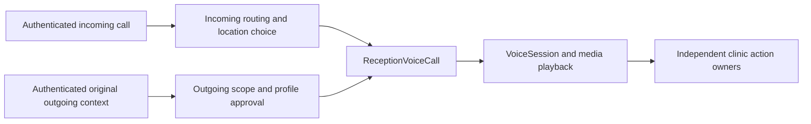

# Conditional Abby outbound conversation

The optional `twilioAbbyOutboundConversation` factory connects the signed outbound ingress to Abby's actual media, playback and session machinery. It does not create an incoming event or use the called number to select a patient. It is explicitly provisioned; the default standalone service and CLI remain unchanged.

The provider owner keeps the called number and immutable original send context in a volatile closure. The direction-neutral entry receives only public account/call identifiers, original clinic scope, public clinic number and a pinned profile reference. The separately approved outgoing greeting is time bounded. Its fingerprint covers clinic/policy versions, voice settings/profile, approved greeting, physical host model configuration and effective media/playback options. Changed configuration, an incoming-purpose greeting, missing readiness, wrong scope and lost/expired approval refuse before speech. Current time is rechecked independently of a host source's true claim.

`ReceptionVoiceCall` owns existing full/prelocation session handoff, renewal, playback and shutdown. The incoming adapter preserves its existing constructor and shared-number intake; embedded incoming composition remains explicitly incoming. The outgoing entry has no location-choice path or incoming caller-number lookup. `TwilioConnectedCall` uses the same actual controller and lease/silence behavior for either entry. A lost outgoing approval fences new media and lease renewal. Provider speech adapters, model/session callbacks and runtime settings are captured by the explicitly configured host; physical speech input/output gates remain current throughout the call. Approval and the operation abort are checked after each asynchronous transcription accept/flush as well as before it; late final events after withdrawal cannot reach the session or intent.

The actual standalone factory owns one transient `MemoryLedger`. Its session factory receives the exact original native send context privately as routing evidence, never as a verified patient. Any original-patient verification, recall/appointment target binding and clinical action require their independent owners and permissions. Disconnect disposes the rich in-memory state; no patient-bearing SQL, private digest index, ciphertext journal, transcript log or private call map is introduced.

The existing permanent SQL conversation exclusion precedes this factory and is independent of its transient ledger. A failed policy/profile binding still leaves that exclusion spent. Conversation closure or a played greeting does not spend the separate report action, release the original contact/call holds, prove no stop request, certify all possible provider calls ended, or grant a clinical action. The carrier adapter continues to return terminal `unknown` until the separate complete reporting work is implemented.

## Shared ownership



## Qualification

[Execution progress](EXECUTION_PROGRESS.md) records actual qualification IDs/results and any remaining cloud checks. Focused controls use the actual signed answer/WSS/start path and actual Abby conversation classes, cover greeting playback evidence, current-profile/model/media changes, private original-context linkage, grant withdrawal during a real ledger read, and independent time-bound expiry. Existing incoming admission, location choice and voice controls run beside them. The emitted PostgreSQL tests include the actual caller audio/transcription/intent/reply loop and compose the native180 owner and real shared exclusion across independent/cold servers, revoked policy during a held read, and a real emitted-process SIGKILL after greeting audio. Privacy scans include all application tables, an unfiltered PostgreSQL17 backup, and empty child directories/output. The corrected combined candidate passed93 source controls,27 emitted SQL cases and both actual incoming financial offer-prefix journeys, with full strict TypeScript and652 artifacts. Earlier seven signed incoming controls and staged E2E-419 retain their recorded source/evidence. The initial48 source passed all eight cloud jobs; the corrected candidate must pass its own new-head cloud qualification before merge. Focused evidence is insufficient to declare the combined graph green.

```sh
npm run typecheck
npm run build:voice-tests
node --test --test-concurrency=2 test/voice/shared-number-voice-call.test.ts test/voice/twilio-connected-call.test.ts test/voice/outbound-voice-entry.test.ts test/voice/twilio-outbound-conversation.test.ts test/voice/twilio-outbound-ingress.test.ts test/admission/admission.test.ts test/admission/shared-number-intake.test.ts test/admission/pending-location.test.ts
bash scripts/with-postgres.sh bash -c 'npm run db:migrate && ABBY_LEDGER=postgres node --test --test-concurrency=4 test/storage/postgres-outbound-conversation.test.ts test/storage/postgres-outbound-twilio-ingress.test.ts test/storage/postgres-outbound-twilio.test.ts test/storage/postgres-outbound-contact-lifecycle.test.ts test/storage/postgres-outbound-runtime.test.ts'
```

Complete immutable provider/contact/speech reporting, automatic authenticated at-number stop recovery from that producer, independently verified original-patient/exact clinical handoff, live default wiring, approved gap13 and real clinic/provider/public-route/acoustic/source/restore acceptance remain separate work. The existing native settlement/stop owners are reused by that work. Twilio's [WebSocket messages](https://www.twilio.com/docs/voice/media-streams/websocket-messages) distinguish stream closure from call closure and report marks after clear as well as playback; [Call status](https://www.twilio.com/docs/voice/api/call-resource) does not identify a verified patient. Neither source provides a shortcut around Abby's complete report/independent authority requirements.

Consult the preserved Karen reference at `/home/gust/code/karen-website-dev` when useful; do not copy its private local call journals, raw customer logging or fail-open consent/DNC behavior. No real provider/clinic traffic, deployment, credential activation or Karen deletion is part of this qualification.


The [optional positive speech-stop producer](TWILIO_OUTBOUND_STOP_SPEECH.md) now
connects the actual assembled outbound turn to native report production and the
same DNC recovery engine. Its selected profile is approved before speech, and
the owned disconnect tail awaits independent bounded native retention after
voice closure.62 focused source controls and strict fixture types pass;
whole strict/667 serving build,129 existing voice controls and9 emitted SQL/privacy cases also pass. Publication/cloud qualification follow. This supplies no no-stop
coverage, complete all-call/provider finality, hold release or clinical authority.
Report/recovery/receiver foundations through PR565 are normally merged with all
exact-head cloud jobs green; actual merged-main qualification is separately
recorded in EXECUTION_PROGRESS.md.


The subsequent approved-profile version2 conservatively closes an exact whole
stop phrase at uncertain ASR quality without report/DNC retention. The real
OpenAI adapter's uncertain quality is unchanged. Revised63 source, focused
strict types, full strict/667 serving build and10 emitted SQL/privacy cases
pass. Two original PostgreSQL/TLS browser login journeys pass after explicit
image preparation outside the unchanged10-second launch deadline. Revised
exact-head cloud qualification follows; this does not promote NoStop/finality,
clinical authority, real acoustic acceptance or activation.
